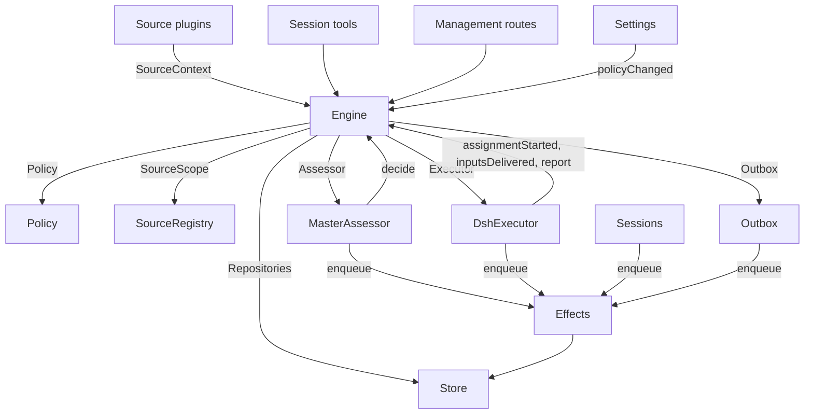

# 007 Architecture

This is the developer guide to the implementation. It maps the concepts in [001 Domain model](001-domain.md) through [006 Deployment](006-deployment.md) to classes, interfaces and files. Start with the runtime and Engine, then use the module and test tables as a code index.

## Core classes and glue

Core classes own domain concepts and external boundaries behind small interfaces. Glue translates tool arguments, HTTP requests, Source payloads and DeepSeek Harness events into calls to those classes, then turns results into cards, views and messages.

`Runtime` (`src/app/runtime.ts`) constructs the application, supplies dependencies, and owns startup and shutdown. `Engine` constructs its own internal parts. The Executor and Assessor call back into the Engine, so Runtime gives them getters rather than requiring construction in a circular order.

### Runtime

`Runtime` is the composition root; it contains no domain rules. Its constructor locks the state directory, opens the Store and builds each component. If construction fails, it closes the Store and releases the lock.

Startup registers management routes and runs Setup. After setup resolves, it installs Session and Executor hooks, ensures the main Session exists, starts Policy syncs, resumes interrupted Assignments, and starts passes and effects. `ready` marks completion of startup.

Shutdown cancels turns, waits for passes, effects and agents, restores the process environment, closes the Store and releases the lock. Source plugins inject Runtime as the `orchestrator` service through the narrow `SourceHost` interface.

| Part | Module | Does |
| --- | --- | --- |
| Setup | `src/app/setup.ts` | Resolves the repository and the accounts by probing their CLIs the way worker shells run them, writes and applies the workers' environment and command shims, and keeps the setup problems; Settings checks a changed account through it, and restarts through it, which runs setup again |
| Passes | `src/app/passes.ts` | One pass at a time, every two seconds and whenever a command asks: the due effects, then `Engine.evaluateDue`; a Source's Trigger reaches the Engine through it |
| Outbox | `src/app/outbox.ts` | The Engine's `Outbox` port, and the only writer of the receipts: `send` keeps a message's receipt and queues its `reply` effect in one transaction, and the effect's handler sends it through `SourceRegistry.send`; a message waits while its Source is off, and is dropped when the conversation is gone or not listened to |
| Notices | `src/app/notices.ts` | Converts domain events and worker activity into main-Session messages. `eventNotice` handles domain notices; `reportRelay` forwards questions immediately, keeps ordinary progress on its Ticket, and relays other reports; `followupRelay` names the Tickets that own a human follow-up. Relays arriving during a turn are delivered together at its next step through the DeepSeek Harness inbox |

### Engine

`Engine` (`src/core/engine.ts`) is the only writer of Triggers, Threads, Decisions, Tickets and Assignments. It receives these ports from `src/core/ports.ts`: `Repositories`, a current-Policy getter, `SourceScope`, `Assessor`, `Executor` and `Outbox`. Optional dependencies are `prepareTicket`, `now` and `emit`.

All Engine methods are synchronous. Each command changes its aggregates in one transaction. `evaluateDue` uses a separate transaction for each Eval or Ticket it changes. Ports enqueue external work inside the transaction; adapters perform it after commit. Invalid requests throw `UserError`.

The Engine exposes one entry point and delegates to five internal parts. It owns each command's transaction. Commands spanning parts, such as `attach`, `evaluateDue` and `policyChanged`, call the parts in sequence.

Each part extends `EnginePart` (`src/core/part.ts`), which provides options and shared reads. Dependencies between the parts flow in one direction:

| Part | Responsibility | Depends on |
| --- | --- | --- |
| `Intake` | A Source's Trigger: stored once with its disposition, recorded on its Threads and their correlations, fanned out to the subscribed Tickets and, unless it is a person's message that reached one, queued for Eval on its primary Thread | Tickets |
| `Evals` | The Evals of Threads: batching, the gate's strength, actor and basis with the Trigger that gave them (`primary`), the deadline from the candidate's delivery and its shift by a pause, the requeue of an expired Eval, candidates, replays and hand-backs, the requeue on a Policy change, and the Decision each ends with: accept, stop, ignore or unavailable | Tickets |
| `Tickets` | The Ticket lifecycle: creation from an accept with its Mandate, Subscriptions and first Assignment, the Threads it follows and their closes (`followsDone`), attached Threads and Threads followed for context, Inputs and notes, resume and the messages a resume refuses, retry, restart, stop and end, the Subscriptions it drops, and the notice of a Policy change to the Tickets it bears on | Replies |
| `Assignments` | What the Executor and its workers report: an Assignment started, Inputs reached it or failed to, a restart interrupted it, and a worker's Report with its question for a person | Tickets, Replies |
| `Replies` | Channel writes through the `Outbox`: the acknowledgement, the answer, the result and the attention message, each by the rule that allows it | Nothing |

Commands use imperative names such as `stopTicket`; facts reported by adapters use past-tense names such as `assignmentStarted`. The query `candidate` uses a noun.

Callers receive only their role's `Pick` of the Engine: `EngineForSources`, `EngineForMainSession`, `EngineForPeople`, `EngineForSettings` or `EngineForExecutor`.

| Role | Method | Effect |
| --- | --- | --- |
| Sources | `receive(trigger)` | Stores a Trigger once and answers `stored`, `duplicate`, or `filtered` when no Source receives it; fans it out to the Tickets subscribed to its Threads, where a person's message resumes an ended Ticket at once unless processing is paused, and queues it for Eval on its primary Thread, unless it is a person's message that reached a Ticket, which stays that Ticket's |
| Sources | `bindThread(ticketId, thread, own)` | Makes an open Ticket follow one of the Source's Threads, such as a pull request's, `own` when the Ticket opened it; a closed Thread bound again is open again. The Threads' closes, not a `ready` Report, end the Ticket |
| Sources | `threadClosed(thread, outcome, at)` | A Thread closed: each open Ticket that follows it records the close, and ends once it is done with the Threads it follows (`followsDone`): no Thread it opened is open, or, when it opened none, every Thread it follows closed. It ends `merged` or `closed` as the latest of those closes did, unless work resumed after the close has not reported `ready`, or its Executor took up, by acknowledging or answering it, a person's follow-up it decides after its latest Report other than `progress`, or the end of its last turn; a `dropped` Report then ends it as the close did |
| Main Session | `candidate(triggerId)` | The Eval that holds a Trigger, as its assessor sees it |
| Main Session | `candidateDelivered(evalId)` | The Eval's candidate reached the main Session: its deadline counts from now |
| Main Session | `decide(triggerId, outcome)` | Records an Eval Decision, or a direct Decision for an explicit request. Accept creates the Ticket, Mandate, Assignment, Subscriptions and acknowledgement atomically. An inferred candidate ignored from its card records `ignoredFromCard` before the supplied reason. While `followupOwners` still owns a human follow-up, only stop is allowed |
| Main Session | `attach(ticketId, triggerId, note?)` | Routes a Trigger to a Ticket it points at, whose Executor then decides it as a follow-up, and ends the Eval that holds it, whose other Triggers wait for a fresh Eval; an ended Ticket resumes under its Mandate at once unless processing is paused. A follow-up an Executor still decides is refused, as is one routed back to the Ticket that handed it back |
| Main Session | `requestStatus(ticketId)` | Asks a waiting Executor Session for its status, and answers whether it asked |
| Main Session | `note(ticketId, text)` | Gives a Ticket's Executor a fact from other work as a text Input, which grants nothing |
| Main Session, Executor | `reply(request)` | Queues a message for the Channel its purpose names: `acknowledgement`, `answer`, `result` or `attention` |
| People | `stopTicket(ticketId, reason?)` | A person's stop, which withdraws the Mandate |
| People | `retryTicket(ticketId)` | Ends the stalled Assignment of a Ticket that waits for a person after a `failed` or `blocked` Report, or whose Input delivery failed (`canRetry`), and starts a new one |
| People | `reevaluate(triggerId)` | Queues a stored Trigger for a fresh Eval |
| People | `unsubscribe(thread)` | Drops every Subscription on a Thread, and the Tickets that followed it follow it no more; each keeps deciding the follow-ups it received there |
| People | `dismiss(decisionId)` | Dismisses the problem an `unavailable` Decision shows, which the Decision records |
| Executor | `assignmentStarted(ticketId, assignmentId)` | An Assignment runs; its waiting Inputs go out |
| Executor | `inputsDelivered(ticketId, assignmentId, inputIds)` | Inputs reached the Assignment's Executor Session, where each waits for a step to take it |
| Executor | `inputsRead(ticketId, inputIds)` | The Executor Session took the messages that carry these Inputs into its history (a `user/message` Session event), from which its model has them; a step that claimed them and was cancelled or failed before does not count. Each counts as read once a Report or the end of a turn follows, also after a restart, and its Ticket's end does not let go of it; an Input delivered before reads were recorded counts as read once a Report or the end of a turn followed its delivery |
| Executor | `turnEnded(ticketId, assignmentId)` | A turn of the Executor Session ended, also after a Report, once nothing runs for it in the background or as it hands off to a person. What a step took before, it read (`inputsRead`) |
| Executor | `deliveryFailed(ticketId, assignmentId, error)` | Delivering Inputs failed; the Ticket shows it until a delivery succeeds, a new Assignment starts or the Ticket ends |
| Executor | `report(ticketId, report)` | Records a Report and its question for a person; `dropped` ends the Ticket, and `ready` completes one that follows no Thread, and ends one done with the Threads it follows as they ended |
| Executor | `markUnrelated(ticketId, thread, reason)` | Drops only that Ticket's Subscription to an attached Thread it found unrelated, and hands back, with the reason, the follow-ups there that the Ticket decides |
| Executor | `followForContext(ticketId, thread)` | Subscribes an open Ticket to a related Thread for context: its messages reach the Ticket but lend it no follow-up strength and do not resume it |
| Executor | `handback(ticketId, triggerId, reason)` | Records that the Ticket hands back a Trigger that reached it, with the reason its candidate carries, and queues it for a fresh Eval once no other Ticket decides it, if this Ticket did; it answers whether it queued it. A Ticket hands back each Trigger once and keeps its Subscription |
| Executor | `assignmentInterrupted(ticketId, assignmentId)` | An Assignment was running when the host stopped: one interrupted mid-work, or one that received an Input after its latest Report, starts again with a recovery note and the Inputs delivered to it that its Executor Session did not take, as a retry does; one that had reported since keeps its Session. The DshExecutor reports each at start (`resume`), oldest Ticket first, and queues again a launch that waits |
| Passes | `evaluateDue()` | Unless processing is paused: starts the Evals of the Threads whose queued Triggers wait, one per Thread with the Triggers queued meanwhile as one batch; queues the Triggers of an Eval past its deadline again, twice in a row, and records it `unavailable` the third time; and resumes the ended Tickets a person's message reached during a pause, if their Mandates still hold. An Eval whose candidate has not reached the main Session does not expire. While processing is paused, no Eval expires, and once it resumes each deadline moves later by the pause's length |
| Settings | `policyChanged(from, to, effects)` | Tells each live Ticket the change bears on how (`policyEffects` in `src/policy.ts`: a rule it was accepted under changed or no longer applies, its requester may no longer start work, or proactive work is no longer accepted), and restarts the Evals in progress under the new version |

The Engine keeps batching, authorization, fan-out, resume and attention lifecycle rules private. Several shared predicates make these rules consistent:

- `waitsForPerson` (`src/core/model.ts`): the latest Assignment reported `blocked` or `failed`, and no human message has arrived since. Automatic Inputs and failed launches remain held while this is true.
- `followupOwners`: the Tickets still responsible for a human follow-up received on their own Threads. A Ticket can be live or ended without a human stop and waiting to resume. Handing back the message ends that ownership.
- `settled`: a Decision resolved the request; stop, unavailable, routed and refused-stop Decisions do not count.
- `ticketStage` (`src/core/stage.ts`): implements the stage table in [003 Execution](003-execution.md).

When a Ticket ends, unread follow-ups return to Eval unless another Ticket still owns them or another disposition settled them. Acknowledged, answered and handed-back messages are excluded. For older records without acknowledgement dispositions, the outbox receipt supplies that fact. A final Report also covers messages waiting when the Assignment began, including the message that resumed it. The message that stopped a Ticket is not automatically re-evaluated.

After a change, the Engine emits an event from `DomainEvents` in `src/core/ports.ts`:

`trigger.received`, `eval.started`, `decision.recorded`, `ticket.created`, `ticket.resumed`, `ticket.ended`, `assignment.started`, `assignment.ended`, `thread.subscribed`, `thread.unsubscribed`, `trigger.requeued`, or `policy.changed`.

Runtime turns `ticket.ended`, `trigger.requeued` and `thread.unsubscribed` into notices. A human `trigger.received` delivered to Tickets becomes a follow-up relay. `pullEndNotices` sends one chat notice, using a stable id, when a Ticket ends merged or closed. Other events currently have no consumer.

### Model

`src/core/model.ts` holds the domain types, and `src/core/stage.ts` the Ticket stages. A Decision records why as `reason`, a list of `Reason`s (`src/core/reasons.ts`): each a `code` with its `values` and, for one Trigger of a batch, its `triggerId`.

The core's codes, such as `timeout`, `policyChanged`, `routed` and `startedTicket`, are `REASONS`, with the English that agents read through `reasonText`; a gate or a Source scope gives its own, such as `not_a_member`; and `said` carries words an assessor or a person wrote. The panel words each code by `reason.<code>`, and a Trigger a Source filtered records the Source's code the same way.

A Ticket keeps each fact once. It is open while it has no `ended`, which records when, by whom, why and with what outcome it ended; what it last said is its latest Assignment Report (`latestReport`); and its Executor Session is named after it (`workerSessionId` in `src/executor/dsh.ts`).

Its fields are typed: `origin`, the admissible Trigger that gave its Eval's batch its strength and the batch itself (`triggerId`, `triggerIds`); `execution`, what the Executor chose (`name`, `directory` and `assignment`); `delivery`, the last failed Input delivery (`error`, `at`), until a delivery succeeds, a new Assignment starts or the Ticket ends; and `follows`, the Threads a Source made it follow, each `{thread, own, closed?}`: `own` when the Ticket opened it, and `closed` with `at` and `outcome` once it closed. Tickets alone writes `follows`; the GitHub Source reads its pull requests with `pullsOf` and `pullOf` (`src/sources/github-pull.ts`).

An Input that carries a Trigger records whether a person wrote it, which `waitsForPerson` reads. A Thread also lists in `context` the subscribed Tickets that follow it only for context, and counts in `expired` the Evals of its queued Triggers that expired in a row; an Evaluation records its `primary` Trigger and when its candidate was `delivered`.

A Trigger's disposition records the Tickets it reached, by fan-out or attachment, a person's requeue, each Ticket that handed it back, with the reason, and each Ticket whose Executor acknowledged or answered it.

A Mandate's `basis` (`MandateBasis`) records how the gate admitted its Trigger. Revalidation reads the receiving `source`, `scope` and `row`, the listed `sender`, matched `rules`, and `via`:

| `via` | Admission basis |
| --- | --- |
| `addressed` | An allowed sender addressed the agent |
| `followup` | A message arrived on a Thread with Tickets |
| `admission` | An admission-table cell; `observation` marks an inferred candidate |
| `bot` | A listed bot produced an inferred candidate |

Trigger and Thread `meta` belong to the Source. The core does not interpret them.

### Policy

`src/policy.ts` defines settings schemas, authorization and assessment rules. `settingsPolicy(settings, scope)` returns a fresh, stateless `Policy` on each use:

- `version`, `paused` and `evalTimeoutMs` describe its current state.
- `gate(trigger, thread, tickets)` returns admission strength and basis.
- `revalidate(mandate)` checks whether an existing Mandate still holds.
- `admitsInferred(rules)` permits proactive acceptance only in auto mode with enabled matching rules.

`assessmentOutcome(assessment, settings, strength)` converts the model's assessment to an Engine outcome. It requires a judgement for every enabled rule, settled direction, a matching rule and evidence of intent. Outside auto mode, an inferred accept becomes a “would accept” record.

`policyEffects(tickets, old, now, scope)` identifies which open Tickets a change affects and how. `Engine.policyChanged` notifies only those Tickets. `policyVersion` hashes rules, accept mode and the Sources' Policy parts, including bot lists.

### Store

`Store` (`src/app/store.ts`) owns one SQLite database. Runtime acquires the directory lock before opening it, preventing a second process from migrating or writing the same state.

Its interfaces are grouped by purpose:

- **Domain repositories:** `atomic`, plus `triggers`, `threads`, `tickets` and `decisions`, each with `get`, `save` and list queries. Indexed working sets are `threads.active()`, `tickets.open()`, `tickets.active()` and `read.subscribedThreads`.
- **Read queries:** `read` serves views, tools and Source polls through methods such as `threadTriggers`, `triggerStats`, `search` and `droppedReplies`. These methods never write.
- **Source metadata:** `threads.describe` and `threads.patchMeta` update Source-owned Thread metadata.
- **Settings:** `settings`, `saveSettings`, `blockRevision` and `settingsHistory`. Settings and prompts use numbered `Versions` (`src/app/versions.ts`).
- **Outbox receipts:** `replyStatus` and `receipts`, written only by Outbox. Receipt operations are `get`, `waiting`, `behind`, `add`, `settle` and `withdraw`. `behind` checks whether an earlier message for the same Ticket and conversation is waiting with fewer than three failures. A withdrawn message settles with `channelGone` or `channelIgnored`. Read queries expose failed and dropped replies through `failingReplies`, `droppedReplies` and `droppedSince`.
- **Typed key-value records:** `get`, `set`, `delete` and `keys`, using entries from `KV`.

`afterCommit` runs an action only after the transaction commits, never after rollback. Runtime reads records in their stored shape; the schema 11 migration converts older supported records at startup.

### Effects

`Effects` (`src/app/effects.ts`) is the durable side-effect queue. A command calls `enqueue(kind, key, payload)` inside its transaction; execution begins only after commit.

Each kind/key pair has one row. Enqueuing the same waiting key replaces its payload and makes it due immediately without changing queue order. `handle(kind, run, options)` registers one handler per kind. It processes due rows oldest first, up to the concurrency limit.

Failures retry with exponential backoff. Throwing `Later` defers work without counting a failure, for example when no worker slot is available. `start` begins processing after setup, `drain` stops it during shutdown while preserving pending rows, and `pending`/`idle` expose queue state.

| Kind | Handler | Does | At once | Retry |
| --- | --- | --- | --- | --- |
| `assessment` | MasterAssessor | Steers an Eval's candidate card into the main Session's turn, then tells the Engine it was delivered, which starts the Eval's deadline | 4, none while paused | 2 s doubling to 60 s |
| `launch` | DshExecutor | Launches a pending Assignment: prepare command, Executor Session, assignment message | The free worker slots, none while paused | A passing failure of the model provider or the network runs again after 5 s doubling to 300 s, three times; any other failure, and a failed prepare command, fails its Ticket. One held by a pause or by full worker slots tries again after 5 s |
| `delivery` | DshExecutor | Hands a Ticket's waiting Inputs to its running Assignment, in order | 4, none while paused | 2 s doubling to 60 s; one that waits for a worker slot tries again after 2 s |
| `relay` | Sessions | Steers a worker's report or question, or a person's follow-up, into the main Session's turn | 1, in queue order | 2 s doubling to 60 s |
| `notice` | Sessions | Injects a notice into the main Session without waking it | 1, in queue order | 2 s doubling to 60 s |
| `reply` | Outbox | Sends a message for a Channel through its Source, after the earlier messages of its Ticket to its conversation that have not failed three times; withdrawing the message cancels it | 1, none while paused | 5 s doubling to 300 s; one whose Source is off, or behind an earlier message, tries again after 5 s |

Each kind has a health entry under its name. It reports an error once one of its effects failed three times in a row, except `delivery`, whose failures show on their Ticket instead. Relays keep their order, and so do notices; a failed one holds back the later ones of its kind.

### Sources

Sources extend the host through `SourceKind`, defined in `src/sources/kind.ts`. A kind declares its identity, title, description, configuration `schema` and `fields`, derived `facts`, and `health` entries. Optional behavior includes `scope`, a `channel` (`allowed`, `send`, `link`), `threadContext`, `find`, `policy`, `environment` and `refreshLabels`.

`SourceRegistry` (`registry.ts`) owns registered kinds and stored instances, and implements the Engine's `SourceScope`. Registration claims health entries on `HealthBoard`; duplicate claims and reserved `sync:` names are refused. A SourceContext writes only through its registration's claimed entries, so reports after unregistration do nothing.

Registry configuration methods include `kind`, `instances`, `instance`, `validate`, `validatePolicy`, `policyPart`, `channelAllowed`, `declarations`, `environments`, `find` and `scope`. `find` asks each kind that supports search.

Generic code accesses Source behavior through the registry. `send(message, commands)` calls the kind's Channel and returns `sent`, `gone` or `waiting` if the kind is not installed. `link` resolves its Channel link. `threadContext` pairs a kind's reader with its configuration, or returns nothing when the kind has no reader. Invalid stored configuration disables the instance.

Plugins receive `SourceHost`: the registry and `context(kind)`. The kind itself uses a narrower `SourceContext`, built by `sourceContextOf` in `src/app/source-context.ts`.

That context supplies deployment and commands, setup readiness (`ready`, `configured`, `problem`), configuration, `receive`, `atomic`, and typed `state`. It also exposes Thread reads and metadata writes, Ticket reads and binding/closure commands, Trigger reads, `notify` through Outbox, and `report` for declared health entries.

### DshExecutor

`DshExecutor` (`src/executor/dsh.ts`) provides one Session and directory per Ticket. `start` and `deliver` enqueue `launch` and `delivery` effects. `stop` cancels the turn through `Store.afterCommit`, so a rolled-back end does not stop the worker.

`prepare(ticket, outcome)` supplies the Engine's `prepareTicket` hook: short name, directory and `ticketExecution` assignment text. `workerSessionId(ticket.id)` derives the Session id.

`WorkerSlots` reserves capacity before a launch or a delivery that wakes an idle worker. A human message can use one slot beyond `maxWorkers`, and wakes have priority over launches. `activeCount` supplies panel load.

Transient provider and network failures get three retries. Launches use effect backoff; failed turns receive continuation messages after 15, 30 and 60 seconds. `inputMessage` renders each Input from current Ticket state, and `mandateInstructions` adds the matched-rule limits for inferred work.

`install` subscribes to Session events; `dispose` unsubscribes. A turn end normally reports waiting, except after readiness or while human action is required. Errors report failed. At startup, `resume` reports interrupted Assignments through `assignmentInterrupted` and requeues pending launches that do not wait for a person, oldest Ticket first.

### MasterAssessor

`MasterAssessor` (`src/app/assessment.ts`) lets the main Session assess proactive candidates. `request` queues an assessment effect; `release` drops cached state when its Eval ends.

Its `context`, `read` and `decide` methods serve `orchestrator_eval`, `orchestrator_eval_read` and `orchestrator_eval_decide`. They provide bounded Thread context through `SourceRegistry.threadContext`, repository context, and decision submission. A kind without a context reader supplies only the Trigger and batch.

`assessmentOutcome` converts the model's answer for `Engine.decide`. Evals checks inferred acceptance against the current Policy again.

### Settings

`Settings` (`src/app/settings.ts`) reads and writes revisioned settings blocks. `current` and `view` read them; `save(block, value, revision, origin)` validates a save; `pause(paused, origin)` changes the separate `paused` setting.

Every save declares its origin: `panel`, `tool` or `sync`. Only `panel` can change the execution environment or fields listed in `SETUP_FIELDS` (`src/deployment.ts`).

A Policy-version change calculates `policyEffects`, records which Tickets were notified, and calls `Engine.policyChanged`. `syncable` and `sync(id)` refresh a Source's Policy part. `refreshLabels(id)` refreshes display names.

### Prompts

`Prompts` (`src/app/prompts.ts`) stores configurations as `Versions`. `current`, `version` and `history` read them; `validate`, `preview` and `save(value, baseRevision, source)` check and save them. `compose` and `skills` build Session text.

`builtInParts` lists override keys, roles, default text and required template placeholders. Each override stores team `text` and a `base`: the `builtInBase` key of its original default. Saves preserve that default under `KV.prompts.builtIn`. `defaultChanged` then reports changed defaults, their old text when available, and removed parts.

Validation inherits an omitted base from the saved override, drops removed parts already present in saved data, and rejects blank text or other unknown keys. This allows the save tool to round-trip a configuration it read. `environmentSection` and `policySection` substitute template values once, using own keys only. Configurations without overrides use defaults.

### Sessions

`Sessions` (`src/app/sessions.ts`) manages DeepSeek Harness Sessions for both roles. `ensure` creates a Session with its role's model. `install` follows agent events and registers prompts, skills and tools for managed Sessions.

`prompt` delivers once per request id. `relay` and `notify` enqueue main-Session messages handled by the `relay` and `notice` effects. `src/app/notices.ts` defines their content; `delivery` checks whether a message arrived.

Each model request binds the Session to the current prompt revision. The revisions it used are stored durably: `promptVersion` identifies the active one and `mayRead` restricts which versions a worker can inspect. Registrations are tracked in one map per agent.

`status` and `promptVersion` serve prompt pages. Saves go through `Prompts.save` and notify the main Session. `modelRetry` exposes model-budget retry state.

### Glue

| Glue | Translates |
| --- | --- |
| `src/app/runtime.ts` | The composition root: builds the parts with the interfaces they use, registers the routes and the Source host, and starts and stops dsh-superagent |
| `src/app/notices.ts` | Domain events and worker reports into notices and relays for the main Session |
| `src/app/tools/main.ts`, `src/app/tools/executor.ts` | Tool arguments of the main Session and the Executor Sessions into calls of the core classes, and their results into cards |
| `src/app/http.ts`, `src/app/views/`, `src/app/api.ts` | HTTP requests into calls, and Store reads into the panel's views; `api.ts` types every route for the panel |
| `src/app/resources.ts`, `src/app/links.ts`, `src/app/cards.ts` | Resource names into reads, source messages into links, records into compact cards for models |
| `src/sources/github*.ts`, `src/sources/feishu*.ts`, `src/sources/poll.ts` | GitHub and Feishu payloads into Triggers and Thread facts, and messages into CLI calls |
| `src/deployment.ts`, `src/setup.ts`, `src/infra/` | Setup probes and problems, CLI transport, the agent's process environment |

## Dependency rules

- **Explicit, narrow dependencies.** Each class receives an interface that names what it uses, mostly as `Pick` types of other classes: `ExecutorHost`, `AssessorHost`, `SessionsHost`, `SettingsHost`, `SetupHost`, `PassesHost` and `OutboxHost` for the core classes, and `HttpHost`, `MainToolsHost`, `ExecutorToolsHost`, `ResourceHost`, `LinkHost` and `SourceContextDeps` for the glue, with the Engine as the `Pick` of the role that calls it. The Runtime passes itself only behind such an interface. A Source plugin injects the `orchestrator` service, which its type names as a `SourceHost`: the registry and `context(kind)`; its kind's code sees only its `SourceContext`.
- **What may import what.** `src/core` imports nothing outside itself apart from Node's hashing, and does no I/O. `src/sources` imports nothing from `src/app`. The panel imports only types from the host side, and the plain values of `src/admission.ts`, `src/limits.ts`, `src/setup.ts`, `src/navigation.ts`, `src/sources/host.ts`, `src/core/errors.ts`, `src/core/reasons.ts` and the filter lists of `src/app/api.ts`.
- **One writer per state.** Each kind of state has one writer, and the others read it or ask that writer.

  | State | Writer |
  | --- | --- |
  | Triggers, Threads, Decisions, Tickets, Assignments | Engine |
  | A Source's read positions, and the meta it keeps on its Threads (`label`, `url`, `facts` and its own keys) | That Source, through `SourceContext` |
  | Settings and their history | Settings |
  | Prompt versions | Prompts |
  | Effect rows | Effects |
  | Outbox receipts | The Outbox: the Engine's messages and Sources' `notify` go through its `send`, and its `reply` effects mark them |
  | A health entry | The part that claimed it on the `HealthBoard` (`src/infra/health.ts`), which refuses a second claim: `runtime` the Runtime, which Passes report through, `evals` the Runtime after each pass, `models` Sessions, each effect kind Effects, `worker` the DshExecutor, a Source kind's entries the SourceRegistry for that kind's Source, `sync:<id>` Settings |

  A Source changes a Ticket only through `SourceContext.tickets.bindThread` and `threadClosed`, which call the Engine.
- **Requests and facts.** A method that asks for something is named by an imperative verb and its object, such as `stopTicket` or `bindThread`, and may be refused; a method that records what an adapter did is named in the past tense, such as `assignmentStarted` or `deliveryFailed`. Each host receives the Engine as the role type it needs.
- **Typed fields, and Source data under the Source.** The code reads typed fields of Tickets and Mandates. A Source keeps nothing on a Ticket: which of its Threads a Ticket follows is the Ticket's `follows`, and what it keeps about a Trigger or a Thread is in their `meta`.
- **Fixed refusals.** A refusal a person or an agent can cause is a `UserError(code, values)` from `USER_ERRORS` in `src/core/errors.ts`. The management API answers a `missing` code with 404 and the others with 400, and the panel words each code in its language. Setup problems are `SetupError` codes (`src/setup.ts`) and fixed health texts `HealthCode`s (`src/sources/host.ts`), worded the same way.
### Source-specific dependencies

Some generic modules still refer directly to GitHub or Feishu:

- Outbox applies the Feishu chat word limit.
- `src/app/links.ts` resolves Feishu message links and `repliedTo`. It and Runtime read settings with `feishuSettings`.
- `src/app/resources.ts` reads the `feishu/` and `github/` originals; `src/app/cards.ts` uses `pullOf` for Ticket cards.
- Runtime sends `pullEndNotices` for merged or closed Tickets.
- Executor tools bind reported pull requests with `readPull` and `claimPull`, using the GitHub context exposed by Runtime.
- MasterAssessor reads repository files with `readRepositoryPath`.
- Sessions and Prompts register built-in skills only for GitHub and Feishu. Migration converts their schema-10 records.
- Setup probes only GitHub and Feishu account fields (`SETUP_FIELDS`). Only those Sources receive account setup problems through `SourceContext.problem`.

## Modules

| Path | Responsibility |
| --- | --- |
| `src/index.ts` | The main plugin entry: reads the machine settings, starts the Runtime, and gives it the restart that a save of a Source's account uses |
| `src/deployment.ts` | The plugin `Config` and `Machine`; `resolveDeployment` and `resolveFeishuBot` read the repository and the accounts from the Source settings, each CLI run as Executor shells run it; `SETUP_FIELDS` lists the Source fields setup reads. The code names no person, account or organization |
| `src/setup.ts` | Setup problems: `SetupError`, with a code, the place that fixes it and the English text the log, the main Session and the panel share |
| `src/policy.ts` | The Policy: the settings schemas by block, the Policy version, the gate and Mandate revalidation |
| `src/admission.ts` | The admission table's values, each cell's options and defaults, shared with the panel |
| `src/limits.ts` | The limits of the values a person sets, which the settings schemas check and the panel's fields offer |
| `src/kv.ts` | `KV`: every family of `kv` records with its key, its value's type and its owner, and the `Key` and `Family` types the Store and `SourceContext.state` take |
| `src/navigation.ts` | Opens a DeepSeek Harness Session from the panel once the host's catalog lists it |
| `src/core/model.ts` | The domain types, among them the typed Ticket and `MandateBasis`, with `threadKey`, `ticketOutcome`, `reached`, `followupOwners`, `settled`, `waitsForPerson`, `liveTicket`, `runningAssignment`, `latestAssignment` and `latestReport` |
| `src/core/ports.ts` | The ports: `Repositories`, `Policy`, `SourceScope`, `Assessor`, `Executor`, `Outbox`, and the domain events |
| `src/core/engine.ts` | The Engine, the core's entry point, and the role interfaces `EngineForSources`, `EngineForMainSession`, `EngineForPeople`, `EngineForSettings` and `EngineForExecutor` |
| `src/core/part.ts` | `EnginePart`, the base of the Engine's parts, and `EngineOptions` |
| `src/core/intake.ts` | `Intake`: Triggers from Sources, to their Tickets and, unless a person's message reached one, to Eval |
| `src/core/evals.ts` | `Evals`: the Evals of Threads and their Decisions |
| `src/core/tickets.ts` | `Tickets`: the Ticket lifecycle, the Threads a Ticket follows, Subscriptions and Inputs |
| `src/core/assignments.ts` | `Assignments`: the Executor's facts and its workers' Reports |
| `src/core/replies.ts` | `Replies`: the Engine's Channel writes |
| `src/core/stage.ts` | `ticketStage` and `canRetry`: the Ticket stages of [003 Execution](003-execution.md) |
| `src/core/errors.ts` | `UserError` and `USER_ERRORS` |
| `src/core/reasons.ts` | `Reason`, `REASONS` and `reasonText`: why the core recorded a Decision or set a Trigger aside, by code |
| `src/core/ids.ts` | `key`: ids derived from their inputs, equal for equal inputs |
| `src/core/memory.ts` | `MemoryRepositories`: the Store's repositories in memory, in the Store's order and with its nested rollback, for domain tests |
| `src/core/index.ts` | The core's exports |
| `src/app/runtime.ts` | The Runtime, the composition root, with its start and stop |
| `src/app/setup.ts` | Setup, and `setupChanged`, whether a save changes a field setup reads |
| `src/app/passes.ts` | Passes, the pass scheduler |
| `src/app/outbox.ts` | The Outbox: the Engine's `Outbox` port, the receipts and the `reply` effects that send them |
| `src/app/notices.ts` | The main Session's notices and relays: `eventNotice`, `reportRelay`, `resultRelay` and `followupRelay` |
| `src/app/store.ts` | The Store, and `Receipt`, a message of the outbox |
| `src/app/store-read.ts` | `storeReads`: the Store's read queries for the views, the tools and the Sources' polls, which never write |
| `src/app/migration.ts` | The schema 11 migration: one step from schema 10 that writes every stored record in its current shape |
| `src/app/effects.ts` | Effects |
| `src/app/versions.ts` | `Versions`: a record kept as numbered snapshots with a pointer to the current one, for the settings and the prompts |
| `src/app/cache.ts` | `TextCache`: texts kept in memory within a size, the least recently used dropped first |
| `src/app/settings.ts` | Settings |
| `src/app/settings-history.ts` | `policyHistory`: each saved settings revision with what it changed from the one before |
| `src/app/prompts.ts` | Prompts, `builtInParts`, the built-in parts a team may override, and `promptParts`, the order of a role's prompt sections |
| `src/app/context.ts` | The built-in prompt text, read from `prompts/`, and the transcript entries Sessions read |
| `src/app/skill-files.ts` | Packaged text: `promptFile`, which joins a file's one-sentence lines into paragraphs, and the bundled skills |
| `src/app/sessions.ts` | Sessions |
| `src/app/delivery.ts` | `AgentDelivery`: delivers a message to a DeepSeek Harness agent once per request id, also across a restored Session |
| `src/app/retry-health.ts` | `RetryHealth`: which Sessions wait on a model budget retry, for the `models` health entry |
| `src/app/role-models.ts` | Resolves the Eval and Executor models, and seeds a new Session with its role's model |
| `src/app/assessment.ts` | The MasterAssessor, the assessment schema and the window `orchestrator_eval` answers |
| `src/app/execution-environment.ts` | The execution environment: its variables, a Ticket's values, the directory root and the lines of the prompt section, which `src/app/prompts.ts` fills into its template |
| `src/app/source-context.ts` | `sourceContextOf`: each Source kind's `SourceContext` |
| `src/app/links.ts` | `sourceLink`, the page of a Trigger's message, and `candidateCard` |
| `src/app/cards.ts` | Compact cards of Triggers, Tickets, Threads and Decisions for models, the closed set of ticket card states `TICKET_STATES`, and `textPage` |
| `src/app/resources.ts` | `RESOURCES` and `readResource`: what `orchestrator_read` reads, for each role |
| `src/app/tools/tool.ts` | The `Tool` type, `readTool`, the `orchestrator_read` of both roles, and `AcknowledgementSchema` |
| `src/app/tools/main.ts` | The main Session's tools |
| `src/app/tools/executor.ts` | An Executor Session's tools |
| `src/app/http.ts` | The `/orchestrator/api` routes: the same-origin check, request limits and one status per kind of failure |
| `src/app/api.ts` | `Api`, every route with its parameters, query, body and response, and the filters of the lists; it imports only types, so the panel bundles it |
| `src/app/views/text.ts` | The two forms of a view's text: `preview`, plain text on one line, and `markdown` without HTML; `plain` and `readable` |
| `src/app/views/records.ts` | The rows the views share: Triggers, Tickets, Threads, Decisions and Channel links, and `ownersOf`, the owners of follow-ups as one request reads them |
| `src/app/views/tickets.ts` | The Ticket lists by stage, a Ticket's page, the Mandate basis facts and the Executor's load |
| `src/app/views/threads.ts` | The Thread lists, a Thread's timeline, the search and the Decision list |
| `src/app/views/sources.ts` | The Source status: each Source instance's state, its last day's counts, and what it filtered and dropped in that day |
| `src/app/views/settings.ts` | The settings page's view: each block with its revision, each Source's settings with its kind's form, and the execution environment |
| `src/app/views/overview.ts` | The overview: Tickets that need a person, problems, the last day's flow and the Executor's load |
| `src/executor/dsh.ts` | The DshExecutor, `WorkerSlots`, `ticketExecution`, `inputMessage` and `mandateInstructions` |
| `src/executor/background.ts` | A worker's background work in DeepSeek Harness, the shell jobs its Session owns (`ctx.jobs`) and its subagents (`ctx.subagents`): `runningJobs`, `untilQuiet`, `killJobs`, `collectJobs`, `stopSubagents`, `stopBackground`, `until`, and `cancelled`, the workers whose turn a stop of their subagents cancelled |
| `src/infra/commands.ts` | `Commands`, the CLI transport: `run`; `api` and `pages`, limited to the configured repository and validated; `lark` as the bot; `git`. `CliError` carries the code a command's output reports, such as a GitHub HTTP status, and a command that prints nothing fails with how it ended, never with its arguments; `validItems` skips and counts the malformed items of a list |
| `src/infra/environment.ts` | The agent's process environment: command shims, the git configuration and credential helper, `runAsWorker`, and the checks of the environment and of a Ticket's directory |
| `src/infra/paths.ts` | The package's root, where packaged files are |
| `src/infra/text.ts` | Word counts and the chat message limit, `fill` and `sameName` |
| `src/infra/health.ts` | The `HealthBoard`, every part's health entry, each claimed by its one writer |
| `src/sources/kind.ts` | The `SourceKind` protocol |
| `src/sources/registry.ts` | `SourceRegistry` |
| `src/sources/host.ts` | `SourceHost`, `SourceContext`, `Health`, `health` and the fixed health texts |
| `src/sources/poll.ts` | What GitHub and Feishu polling share: `POLL_HORIZON_MS`, `polled`, `cursorAt`, and `pollThreads`, which keeps a failure on its Thread as `pollError` |
| `src/sources/github.ts` | The GitHub kind and plugin entry, exported as `./github-watch`: a poll round of notifications, the pull requests of open Tickets with their CI, and subscribed Threads |
| `src/sources/github-trigger.ts` | GitHub comments, reviews, Issue bodies and CI changes as Triggers, and GitHub addresses |
| `src/sources/github-pull.ts` | The pull request rules: which pull requests a Ticket follows (`claimPull`, `observePull`), the closes it reports to the Engine, and `pullEndNotices`, the chat notice of a Ticket that ended merged or closed |
| `src/sources/github-channel.ts` | The GitHub Channel: comments and review thread replies, `sent` or `gone` |
| `src/sources/github-read.ts` | CI snapshots, repository reads, the `github/` resources, and `githubThreadContext`: an Issue's or pull request's conversation by page |
| `src/sources/feishu.ts` | The Feishu kind and plugin entry, exported as `./feishu-watch` |
| `src/sources/feishu-trigger.ts` | Feishu messages as Triggers, by one rule for live events, history pages and topic pages |
| `src/sources/feishu-loops.ts` | The Feishu loops: the event consumer, history recovery, chat names and polling of subscribed topics |
| `src/sources/feishu-channel.ts` | The Feishu Channel: topic replies, `sent` or `gone` |
| `src/sources/feishu-read.ts` | The `feishu/` reads of a Trigger's message, its root, parent and topic, and `feishuThreadContext`, which gives them to assessments with their images |
| `src/sources/admission-context.ts` | The bounded window an assessment starts from: the first pages of a Trigger's Thread, read through its kind, and the messages around the Trigger |
| `src/sources/feishu-image.ts` | Reads a Feishu message's image as an attachment for the assessing Session |
| `src/client/index.tsx` | The client plugin entry: the sidebar entry, the main panel and the page in DeepSeek Harness's Plugin Manager |
| `src/client/app.tsx` | The panel: header, search, glossary, tabs and the page of the current route |
| `src/client/provider.tsx` | What every page reads from its host: copy, calls, navigation, notices, the state poll, and `restart`, which reads the state quickly while dsh-superagent restarts |
| `src/client/api.ts` | Calls and polls of the management API, typed by `src/app/api.ts`, and the Decision filters of the Eval status |
| `src/client/route.ts` | The tabs, the settings groups, the typed routes that `parseRoute` reads, and the route memory with the settings group opened last |
| `src/client/overview.tsx` | The overview |
| `src/client/source.tsx`, `trigger.tsx`, `eval.tsx`, `execution.tsx` | One file per stage: its status, and its settings where it has some |
| `src/client/thread.tsx`, `ticket.tsx` | The record pages: a Thread with its timeline, and a Ticket with its authorization, Inputs and Assignments |
| `src/client/settings.tsx` | The Settings tab: the group navigation and the group on screen |
| `src/client/settings-kit.tsx` | The building blocks of settings blocks: the settings the stage groups share, `useBlockDraft`, the fields, among them a Source kind's, and the history of saves |
| `src/client/prompts.tsx` | The Prompts settings: the page owns the view it read and its editor the draft, and the Edit, Full prompt and History tabs render from them; a built-in part's editor shows a changed default and keeps or drops the override |
| `src/client/prompt-config.ts` | The prompt configuration by section, by the team sections, skill names, built-in parts (`part/<key>`, with `withOverride`) and part headings the prompt views give, and the line diff of the full prompt, as pure functions |
| `src/client/deployment.tsx` | The Deployment settings, also shown in DeepSeek Harness's Plugin Manager |
| `src/client/draft.tsx` | Settings drafts: `draftReducer`, their states and their merge with a newer saved revision, `saveBarText`, the save bar's line, and the save bar |
| `src/client/controls.tsx` | Local copies of DeepSeek Harness's controls, which follow its markup, keyboard behaviour and design tokens, since the bundle does not import `@deepseek-ai/dsh-client-ui-primitives`; they read no context |
| `src/client/widgets.tsx` | The small components the pages share, which read the panel's context: sections, page heads, load states, times, links, confirmed actions, the setup check and Markdown |
| `src/client/rows.tsx` | The rows the pages share: a Ticket, a Thread and a Decision, a Thread's chip, and the folding of runs of automated messages |
| `src/client/markdown.ts` | The Markdown subset of reports and questions, and the bare addresses in messages, as blocks and inline parts |
| `src/client/text.ts` | Copy by key and the wording of domain values, reasons, senders and times |
| `src/client/marks.ts` | The marks of the states the views classify: a Ticket's or a Thread's stage, a Source's state and a Decision's outcome, each as a dot, an icon, a tone and a label |
| `src/client/locales.ts` | All copy in both languages, and the glossary of [001 Domain model](001-domain.md) |
| `src/client/client.css`, `css.d.ts` | The panel's stylesheet, loaded as text |

`src/sources/github.ts` and `src/sources/feishu.ts` are also the entries of the two Source plugins, built by `tsdown.config.ts` and exported in `package.json` as `./github-watch` and `./feishu-watch`. The bundle's `cordis.patch.yml` inserts the three plugins, with Feishu disabled.

## Tests

| Test | Covers |
| --- | --- |
| `tests/core-engine.spec.ts` | Domain rules on in-memory repositories: receiving, Eval, fan-out, resume and stop, interrupted Assignments, the pause, Policy changes, reports and outcomes, attaching, replies, failed deliveries and dismissed problems |
| `tests/stage.spec.ts` | The Ticket stages, row by row |
| `tests/policy.spec.ts` | Source scope, the gate, the admission table, Mandate revalidation, the Policy version, settings migrations and assessment outcomes |
| `tests/registry.spec.ts` | `SourceRegistry`: instances, validation, Policy parts, Channels and Thread context |
| `tests/sources.spec.ts` | The Feishu and GitHub Sources on a `SourceContext`: translation, polls and read positions, the pull request rules, health |
| `tests/commands.spec.ts` | CLI calls as the deployment's accounts, the Channels' answers, and repository-scoped GitHub calls |
| `tests/feishu-read.spec.ts`, `tests/github-read.spec.ts` | Feishu and GitHub reads |
| `tests/admission-context.spec.ts`, `tests/feishu-image.spec.ts` | The Thread window of assessments, and Feishu image reads |
| `tests/assessment.spec.ts` | What the MasterAssessor keeps per Eval, and when it lets go |
| `tests/background.spec.ts` | Waiting for a worker's shell jobs and subagents: an end that woke it, and a host that stops |
| `tests/bundle-patch.spec.ts` | The bundle's patch, read as DeepSeek Harness reads it, and the agent preset of Executor Sessions it defines |
| `tests/effects.spec.ts` | The effect queue: coalescing, limits, retries with backoff, health and shutdown |
| `tests/passes.spec.ts` | Passes: one at a time, the ones asked for during a pass run as one after it, and the runtime health a failed pass reports |
| `tests/outbox.spec.ts` | The Outbox on a running Runtime: messages wait while processing is paused or their Source is not installed |
| `tests/cache.spec.ts` | `TextCache` |
| `tests/queue.spec.ts` | The Runtime's work through the effect queue, and what earlier versions stored |
| `tests/followups.spec.ts` | A person's follow-up on a Ticket's Thread: its notice to the main Session, the tools that act on it, what a burst costs; a worker's hand-back and context follow, and the main Session's note |
| `tests/health.spec.ts` | One health entry per part, each cleared by its own next success |
| `tests/delivery.spec.ts` | `AgentDelivery` |
| `tests/retry-health.spec.ts`, `tests/role-models.spec.ts` | Model budget retries, and the models of the two roles |
| `tests/runtime.spec.ts` | The whole application on a simulated DeepSeek Harness host, through tools and HTTP |
| `tests/tools.spec.ts` | The Sessions' tools: what `orchestrator_read` reads for each role, and the shapes and checks of the other main Session tools |
| `tests/runtime-concurrency.spec.ts` | Work that overlaps: Triggers during a pass, Tickets that change during deliveries and launches |
| `tests/http.spec.ts` | The same-origin and loopback checks, the status of each kind of failure, the body limit, path parameters and queries |
| `tests/settings.spec.ts` | Settings saves that race a model or account check, a Policy sync that a save outran, and the refusals of the pause, a sync and a block |
| `tests/views.spec.ts` | What the management views derive from the Store, such as the Thread a dropped message belongs to |
| `tests/timeline.spec.ts` | A Thread's pages and a Trigger's neighbours by time and then id, with every received Trigger's time in one form |
| `tests/migration.spec.ts` | The schema 11 migration: every stored record in its current shape, and the refusal of older schemas |
| `tests/store.spec.ts` | Repositories and their working sets, in SQLite as in memory, the kv area, with every key of `KV` spelled only in `src/kv.ts` and the migration, settings history and queries |
| `tests/prompts.spec.ts` | Prompt validation, assembly and versions |
| `tests/cards.spec.ts` | The rules the built-in text must state, file by file |
| `tests/model-surface.spec.ts` | Everything models read: tools, prompts, skills and inputs, checked against the tool schemas, the execution environment and the glossary, within a size budget per role |
| `tests/deployment.spec.ts`, `tests/environment.spec.ts`, `tests/index.spec.ts` | The plugin configuration and setup, the agent's process environment, the plugin entry |
| `tests/service-script.spec.ts` | `scripts/dsh-superagent` against fake `ps`, `tmux` and `dsh` |
| `tests/client.spec.tsx`, `tests/navigation.spec.ts`, `tests/controls.spec.tsx` | The client plugin's registration and polling, Session navigation and route memory, the local controls, and the panel's imports, which have no cycle |
| `tests/panel-overview.spec.tsx`, `panel-source.spec.tsx`, `panel-trigger.spec.tsx`, `panel-eval.spec.tsx`, `panel-execution.spec.tsx` | Each page of the panel, against a fake management API answered by route |
| `tests/panel-settings.spec.tsx`, `panel-prompts.spec.tsx`, `panel-deployment.spec.tsx`, `panel-panel.spec.tsx` | The settings groups, drafts and history, the prompts, the Deployment page, and the panel's search, glossary and route memory |
| `tests/draft.spec.ts`, `tests/prompt-config.spec.ts`, `tests/markdown.spec.ts`, `tests/marks.spec.ts` | Draft states, merges and the save bar's line; the prompt configuration by section and the line diff; the Markdown subset and its links; the mark of every state the views classify |
| `tests/locales.spec.ts`, `tests/styles.spec.ts` | The copy in both languages, the stylesheet |
| `tests/class-docs.spec.ts` | Every class in `src` has a JSDoc block before it |
| `tests/docs.spec.ts` | Numbered documents link only to earlier ones, every local link resolves, no document has merge conflict markers, and this document's tables list every module and every test |

`tests/fixtures/` holds what several tests share: `host.ts`, a simulated DeepSeek Harness host; `panel-server.ts` and `panel.tsx`, the fake management API and the panel around a page; `deployment.ts`, a resolved deployment; `git.ts`, the environment of every git the tests start, which names no repository; and `async.ts`.

## Persistence

One SQLite file, `<stateDir>/orchestrator.sqlite`, which only the Store opens.

| Table | Holds | Written by |
| --- | --- | --- |
| `trigger` | Each Trigger, its time `at` in the one form `Date#toISOString` gives, set when the Engine receives it, so times compare as text | Engine |
| `disposition` | Where each Trigger went: `filtered` with the Source's reason code, its Eval and Decision, the Tickets it reached, by fan-out or attachment, whether it was requeued, the Tickets that handed it back with their reasons, and those whose Executor acknowledged or answered it | Engine |
| `trigger_thread` | Which Threads each Trigger is on, with its time and whether a person wrote it, so a Thread's Triggers are read without scanning every Trigger, in order of time and then id: a page of a Thread's timeline continues from a `<at>|<id>` cursor, and Triggers that share a time are not skipped | Store, with each Trigger |
| `thread` | Threads: Subscriptions, the Tickets that follow it for context, queued Triggers, the Eval in progress, the count of its expiries and `meta`; the generated columns `active`, set while Triggers are queued or an Eval runs, and `subscribed`, its Source while a Ticket subscribes to it | Engine; Sources write `meta` |
| `ticket` | Tickets with their Mandate, origin, execution, Assignments, Channels, Inputs and the Threads they follow; the generated columns `open`, set while it has not ended, and `active`, set while Inputs are undelivered or the latest Assignment is pending or running | Engine |
| `decision` | Decisions, by Thread | Engine |
| `effect` | The effect queue: per kind and key, the payload, its order, failed attempts with the last error, and when it is due | Effects; the schema 11 migration queues what earlier versions kept for the main Session |
| `outbox` | The receipt of each message for a Channel, by id, with the Ticket it is for and its `status`, `pending`, `sent` or `dropped`, kept so an id is never queued twice; for a dropped message, when and why, as the generated column `dropped`, its time, and a reason code. A message that waits has a `reply` effect, which holds its attempts | The Outbox |
| `kv` | Every other record, by key | The part that names it |

A generated column is computed from its row's JSON and is empty outside its set, and each has an index over its set, so a pass reads only active work. A database that predates a column gets it when the Store opens it.

`KV` (`src/kv.ts`) defines each key-value record's owner, key and type. All readers and writers use these entries; only migration code names older keys.

| Records | Keys or contents |
| --- | --- |
| Schema | Current schema version |
| Settings versions | `settings-revision`, `settings-version:<n>`, `settings-block-revision:<block>`; snapshots include origin, Policy version and affected Tickets |
| Prompt versions | `prompt-revision`, `prompt-version:<n>` |
| Main Session | `master-id` |
| Session prompt history | `session-prompts:<session id>` |
| Source state | Read positions such as `github-cursor:<number>`, PR CI fingerprints and seen Feishu-topic messages; keys begin with the kind or `thread-` plus a Thread key |
| Display names | `source-labels:<source id>` |

Dismissal is stored on its Decision. Input text is rendered from the Ticket when read, so neither needs a separate key-value record.

Read caches use bounded in-memory `TextCache` instances and are lost on restart. A Session paging through an original Source record or prompt preview must reread offset 0 after a restart. Feishu links resolved after intake are cached the same way; link-based search finds them only after that link has been read during the current process lifetime.

Nothing deletes old records yet, so these grow without bound: the `trigger`, `disposition` and `decision` rows; ended Tickets and their Threads; the outbox's receipts; and in `kv`, every saved settings revision and prompt version, the prompt revisions each Session worked under, and the Sources' records per Thread and per Issue or pull request.

`SCHEMA_VERSION` only increases. A database of a newer version refuses to start; `src/app/migration.ts` upgrades a database of the pre-release schema 10 once, at start, and refuses an older one.

## Model-facing interfaces

### Main Session tools

The main Session has 14 application tools:

| Purpose | Tools |
| --- | --- |
| Read and route | `orchestrator_read`, `orchestrator_route` |
| Manage Tickets | `orchestrator_ticket_retry`, `orchestrator_ticket_request_status`, `orchestrator_ticket_note` |
| Re-evaluate | `orchestrator_trigger_requeue` |
| Assess proactive work | `orchestrator_eval`, `orchestrator_eval_read`, `orchestrator_eval_decide` |
| Communicate and unsubscribe | `orchestrator_reply`, `orchestrator_thread_unsubscribe` |
| Configure | `orchestrator_settings_save`, `orchestrator_policy_sync`, `orchestrator_prompts_save` |

`orchestrator_route` accepts 1–20 decisions in order. Each accept, attach, stop or ignore runs as a separate Engine command. It also permits ignoring an inferred candidate directly from its card. `orchestrator_ticket_note` sends a fact as context, not authority.

Settings saves select `policy`, `eval`, `executor`, `pause`, or `source`; the last also names its Source id. A prompt save with `preview: true` composes text without saving.

The main Session also has DeepSeek Harness's `skill`, `bash`, `read`, `read_image`, `job_output`, `job_list` and `job_kill`. Avoiding code reads is a prompt rule, not a tool restriction.

### Presets and wait limits

New main Sessions use `dsh-superagent-router` (`ROUTER_PRESET`). Shell commands and job waits return after 5 seconds. If the Web UI selects another preset before the first turn, `Sessions` restores this preset, or `WORKER_PRESET` for a worker.

The `noWait` guard in `src/app/sessions.ts` refuses main-Session shell commands that invoke `sleep` at a command position, shell `timeoutMs` above 30 seconds, and `job_output` waits above 5 seconds. Reports and job results arrive automatically, so waiting only delays incoming candidates.

Existing main Sessions on `standard` also need explicit timeouts for foreground commands and job waits; otherwise that preset's defaults hold the step for 60 and 30 seconds respectively. The host determines the current preset through `presetForSession`, falls back to the Session projection or header, and assumes `standard` if it cannot read the value.

### Executor tools

Each Executor has six application tools:

| Tool | Purpose |
| --- | --- |
| `orchestrator_read` | Read resources available to its own Ticket |
| `orchestrator_ack` | Acknowledge a request |
| `orchestrator_report` | Report progress or an outcome, binding a pull request under the pull-request rules |
| `orchestrator_thread_unrelated` | Drop an unrelated attached Thread, hand back its owned follow-ups and tell the main Session why |
| `orchestrator_thread_follow` | Subscribe to a related Thread for context and tell the main Session |
| `orchestrator_trigger_handback` | Hand back a message once, with a reason carried by its candidate |

A hand-back returns `queued: false` if another Ticket still owns the message, or this Ticket never owned it. For example, a bot message went to Eval independently.

The worker preset is defined in `cordis.patch.yml` and selected through `WORKER_PRESET`. `WORK_TOOLS` in `src/app/sessions.ts` retains available file, search, shell, job, web, skill, todo and subagent tools. Workers do not receive tools for asking or presenting to a person, changing the profile, scheduling work outside worker slots, starting or messaging other Sessions, or editing external documents. Tool calls are refused after the Ticket ends.

### Result shapes and assessment context

Routing results use `{decision?, reason, ticket?}`. `orchestrator_route` returns `{results}`, preserving item order and adding each item's `trigger_id` and `kind`. Invalid or refused items return `refused` and a reason without stopping the batch.

Settings and prompt saves return the saved configuration. Policy sync returns the Source, allowed-list size, and `added` and `removed` names.

`orchestrator_eval` returns context rather than instructions. Assessment instructions live in `runtime/admission` (`prompts/admission.md`), and rules in `runtime/policy`. Its context includes:

- The Trigger text, up to 4,000 characters, with image ids and other Triggers in the batch.
- Up to eight `related_tickets`, open ones first, and `tickets_total`.
- The Eval's `policy_version`.
- A Thread window: the first five messages and five on either side of the Trigger. Messages use `{id, from, at, text}`, normally limited to 400 characters, or 1,200 for the two on either side. Truncated messages include `chars`; image references use `images`.
- Other loaded messages as `{id, from, preview}` stubs of 50 characters. `orchestrator_eval_read` expands them by id.

Ticket cards use the closed `TICKET_STATES` set from `src/app/cards.ts`: an open stage such as `person/review` or `working/queued`, or an ended outcome. Acknowledgements are limited to 100 words whether submitted through accept, assessment or `orchestrator_ack`.

### Read resources

`RESOURCES` in `src/app/resources.ts` defines the resources and generates the tool's `resource` description.

| Resources | Content |
| --- | --- |
| `tickets`, `triggers`, `threads`, `decisions` | Paged lists as `{items, next_offset}`; activity lists put newest first |
| `decision/<id>` | One Decision |
| `thread/<key>` | Label, Tickets, recent Decisions and a page of Triggers |
| `trigger/<id>` | Message text, replied-to Trigger and neighboring messages, excluding CI runs |
| `ticket/<id>` | Related ids, source-batch Triggers, Threads, and first pages of Assignments and Inputs |
| Ticket subresources | `/assignments`, `/inputs`, `/assignment`, `/result`, `/report/<assignment id>`, `/transcript`, `/message/<n>`, `/input/<id>` |
| `settings`, `settings/<block>` | Revisions and summaries, or a complete block ready to save |
| `prompts`, `prompts/<revision>`, `prompts/current`, `prompts/defaults`, `prompt-preview/<id>` | Prompt configurations and composed text |
| `models`, `models/<provider>` | Available models |
| `feishu/<trigger id>/…`, `github/…` | Original Source records, described in the Source skills |

Ticket Threads are marked `context` for context-only follows and `bound` for Source bindings. Assignment pages are newest first and include report previews. Continue lists with `next_offset`. `/input/<id>` accepts an Input's name or id. `settings` includes small blocks in full and summarizes Policy and Source blocks.

Source resources include message neighborhoods, `github/pulls/<n>/thread/<comment id>` and `github/commits/<sha>/checks`.

An original's messages read in one compact shape, `{id, from, at, text, reply_to?, path?, line?, url?}`, not as GitHub or Feishu records them.

An Executor Session reads only its own Ticket, its Threads, the Triggers that reached it or that its request held, the prompt versions it worked under and the originals, and its pages leave out the ids of what it cannot read, Decisions and other Tickets.

Every id a page shows reads through one of these, so a Session walks from one object to the next; hashes nothing reads by, such as an Eval's id or a Policy version, stay off the pages.

A text page has 4,000 UTF-16 code units by default and 8,000 at most, a list 20 items by default and 50 at most.

The names `event/`, `task/` and `observation/` of earlier versions still resolve.

### Messages delivered to Sessions

These messages are steered into the main Session's turn:

| Message | Content |
| --- | --- |
| Candidate | Batch Trigger cards, Thread, `related_tickets`, `tickets_total`, `delivered_to`, referenced Tickets from Issue/PR links, `handed_back` reasons and the next action |
| `follow_up` | One message as its Executor sees it, `replies_to`, receiving Tickets, and the reminder that Executors decide it while the main Session may only stop work |
| `worker_report` | Ticket card, originating Trigger, state and summary up to 600 characters; `chars` and a read pointer when truncated |
| `worker_attention` | Ticket card carrying the question |

Other notices are injected without waking the main Session: `ticket_ended`, `settings_saved`, prompt saves, Trigger requeues, dropped Subscriptions and context follows. A settings notice names the block, changed paths and `read: settings/<block>`. The main Session receives no redundant notice for a save, requeue, unsubscribe or attach it performed itself.

Workers receive assignments and Inputs inline. The first message includes the title, up to 1,500 characters of assignment text and the source Trigger card. Inputs carry a Trigger card with up to 600 characters and `replies_to`, or plain Input text. Read pointers appear only for truncated content.

### Panel-only actions

There is no tool for dismissing an unavailable Decision, rerunning setup, refreshing Source display names, or sending an Executor-owned human follow-up to Eval. The last action is deliberately refused by `orchestrator_trigger_requeue`. Other panel actions have equivalent tools.

Most built-in instructions live in `prompts/*.md`, with one sentence per line joined by `promptFile`. Source skills live in `skills/dsh-superagent-*/SKILL.md`. Tool descriptions and fixed notices such as restart recovery notes remain in code. Assessment instructions live only in `prompts/admission.md`.

`tests/model-surface.spec.ts` checks these surfaces for drift. [004 Prompts](004-prompts.md) explains the team's editable parts.

## Configuration reload

Every plugin configuration key except `stateDir` is volatile. The panel's Deployment settings and DeepSeek Harness's Plugin Manager edit them through DeepSeek Harness's configuration form; the host writes `cordis.patch.yml` and updates the values in place, and dsh-superagent reads each limit when it uses it, so a change applies without a restart.

A settings save that changes a Source field setup reads, such as an account's CLI, and any save while setup waits, restarts dsh-superagent. DeepSeek Harness's settings service does not serve the entry during that restart, so after its own restart dsh-superagent asks it to read the entry again, and an open form becomes editable again.

## Reviewing a change against real data

Point `DSH_HOME` at a temporary directory and create a new profile there. Copy the database from a backup, disable every Source, pause processing and remove the main Session id. Give the GitHub and Feishu CLIs read-only stand-ins.

## Open questions

- Trust: which Trigger fields are trusted, such as the Source's actor and Thread membership, and which are not, such as the body and quotes.
- Deployment isolation: the agent's profile on its own pinned DeepSeek Harness installation, so upgrading DeepSeek Harness elsewhere does not break it.
