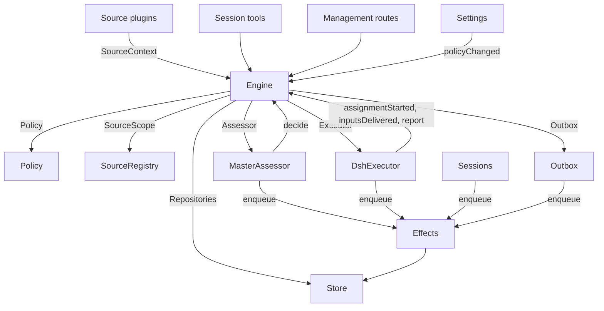

# 007 Architecture

This is the developer guide to the implementation. It maps the concepts in [001 Domain model](001-domain.md) through [006 Deployment](006-deployment.md) to classes, interfaces and files. Start with the runtime and Engine, then use the module and test tables as a code index.

## Core classes and glue

Core classes own domain concepts and external boundaries behind small interfaces. Glue translates tool arguments, HTTP requests, Source payloads and DeepSeek Harness events into calls to those classes, then turns results into cards, views and messages.

`Runtime` (`src/app/runtime.ts`) constructs the application, supplies dependencies, and owns startup and shutdown. `Engine` constructs its own internal parts. The Executor and Assessor call back into the Engine, so Runtime gives them getters rather than requiring construction in a circular order.

### Runtime

`Runtime` is the composition root; it contains no domain rules. Its constructor locks the state directory, opens the Store and builds each component. If construction fails, it closes the Store and releases the lock.

Startup registers management routes and runs Setup. After setup resolves, it installs Session and Executor hooks, ensures the main Session exists, starts Policy syncs, resumes interrupted Assignments, and starts passes and effects. `ready` marks completion of startup.

Shutdown cancels turns, waits for passes, effects and agents, restores the process environment, closes the Store and releases the lock. Source plugins inject Runtime as the `orchestrator` service through the narrow `SourceHost` interface.

| Part | Module | Does |
| --- | --- | --- |
| Setup | `src/app/setup.ts` | Resolves the repository and the accounts by probing their CLIs the way worker shells run them, writes and applies the workers' environment and command shims, and keeps the setup problems; Settings checks a changed account through it, and restarts through it, which runs setup again |
| Passes | `src/app/passes.ts` | One pass at a time, every two seconds and whenever a command asks: the due effects, then `Engine.evaluateDue`; a Source's Trigger reaches the Engine through it |
| Outbox | `src/app/outbox.ts` | The Engine's `Outbox` port, and the only writer of the receipts: `send` keeps a message's receipt and queues its `reply` effect in one transaction, and the effect's handler sends it through `SourceRegistry.send`; a message waits while its Source is off, and is dropped when the conversation is gone or not listened to |
| Notices | `src/app/notices.ts` | Converts domain events and worker activity into main-Session messages. `eventNotice` handles domain notices; `reportRelay` forwards questions immediately, keeps ordinary progress on its Ticket, and relays other reports; `followupRelay` names the Tickets that own a human follow-up. Relays arriving during a turn are delivered together at its next step through the DeepSeek Harness inbox |

### Engine

`Engine` (`src/core/engine.ts`) is the only writer of Triggers, Threads, Decisions, Tickets and Assignments. It receives these ports from `src/core/ports.ts`: `Repositories`, a current-Policy getter, `SourceScope`, `Assessor`, `Executor` and `Outbox`. Optional dependencies are `prepareTicket`, `now` and `emit`.

All Engine methods are synchronous. Each command changes its aggregates in one transaction. `evaluateDue` uses a separate transaction for each Eval or Ticket it changes. Ports enqueue external work inside the transaction; adapters perform it after commit. Invalid requests throw `UserError`.

The Engine exposes one entry point and delegates to five internal parts. It owns each command's transaction. Commands spanning parts, such as `attach`, `evaluateDue` and `policyChanged`, call the parts in sequence.

Each part extends `EnginePart` (`src/core/part.ts`), which provides options and shared reads. Dependencies between the parts flow in one direction:

| Part | Responsibility | Depends on |
| --- | --- | --- |
| `Intake` | A Source's Trigger: stored once with its disposition, recorded on its Threads and their correlations, fanned out to the subscribed Tickets and, unless it is a person's message that reached one, queued for Eval on its primary Thread | Tickets |
| `Evals` | The Evals of Threads: batching, the gate's strength, actor and basis with the Trigger that gave them (`primary`), the deadline from the candidate's delivery and its shift by a pause, the requeue of an expired Eval, candidates, replays and hand-backs, the requeue on a Policy change, and the Decision each ends with: accept, stop, ignore or unavailable | Tickets |
| `Tickets` | The Ticket lifecycle: creation from an accept with its Mandate, Subscriptions and first Assignment, the Threads it follows and their closes (`followsDone`), attached Threads and Threads followed for context, Inputs and notes, resume and the messages a resume refuses, retry, restart, stop and end, the Subscriptions it drops, and the notice of a Policy change to the Tickets it bears on | Replies |
| `Assignments` | What the Executor and its workers report: an Assignment started, Inputs reached it or failed to, a restart interrupted it, and a worker's Report with its question for a person | Tickets, Replies |
| `Replies` | Channel writes through the `Outbox`: the acknowledgement, the answer, the result and the attention message, each by the rule that allows it | Nothing |

Commands use imperative names such as `stopTicket`; facts reported by adapters use past-tense names such as `assignmentStarted`. The query `candidate` uses a noun.

Callers receive only their role's `Pick` of the Engine: `EngineForSources`, `EngineForMainSession`, `EngineForPeople`, `EngineForSettings` or `EngineForExecutor`.

| Role | Method | Effect |
| --- | --- | --- |
| Sources | `receive(trigger)` | Stores a Trigger once and answers `stored`, `duplicate`, or `filtered` when no Source receives it; fans it out to the Tickets subscribed to its Threads, where a person's message resumes an ended Ticket at once unless processing is paused, and queues it for Eval on its primary Thread, unless it is a person's message that reached a Ticket, which stays that Ticket's |
| Sources | `bindThread(ticketId, thread, own)` | Makes an open Ticket follow one of the Source's Threads, such as a pull request's, `own` when the Ticket opened it; a closed Thread bound again is open again. The Threads' closes, not a `ready` Report, end the Ticket |
| Sources | `threadClosed(thread, outcome, at)` | A Thread closed: each open Ticket that follows it records the close, and ends once it is done with the Threads it follows (`followsDone`): no Thread it opened is open, or, when it opened none, every Thread it follows closed. It ends `merged` or `closed` as the latest of those closes did, unless work resumed after the close has not reported `ready`, or its Executor took up, by acknowledging or answering it, a person's follow-up it decides after its latest Report other than `progress`, or the end of its last turn; a `dropped` Report then ends it as the close did |
| Main Session | `candidate(triggerId)` | The Eval that holds a Trigger, as its assessor sees it |
| Main Session | `candidateDelivered(evalId)` | The Eval's candidate reached the main Session: its deadline counts from now |
| Main Session | `decide(triggerId, outcome)` | Records an Eval Decision, or a direct Decision for an explicit request. Accept creates the Ticket, Mandate, Assignment, Subscriptions and acknowledgement atomically. An inferred candidate ignored from its card records `ignoredFromCard` before the supplied reason. While `followupOwners` still owns a human follow-up, only stop is allowed |
| Main Session | `attach(ticketId, triggerId, note?)` | Routes a Trigger to a Ticket it points at, whose Executor then decides it as a follow-up, and ends the Eval that holds it, whose other Triggers wait for a fresh Eval; an ended Ticket resumes under its Mandate at once unless processing is paused. A follow-up an Executor still decides is refused, as is one routed back to the Ticket that handed it back |
| Main Session | `requestStatus(ticketId)` | Asks a waiting Executor Session for its status, and answers whether it asked |
| Main Session | `note(ticketId, text)` | Gives a Ticket's Executor a fact from other work as a text Input, which grants nothing |
| Main Session, Executor | `reply(request)` | Queues a message for the Channel its purpose names: `acknowledgement`, `answer`, `result` or `attention` |
| People | `stopTicket(ticketId, reason?)` | A person's stop, which withdraws the Mandate |
| People | `retryTicket(ticketId)` | Ends the stalled Assignment of a Ticket that waits for a person after a `failed` or `blocked` Report, or whose Input delivery failed (`canRetry`), and starts a new one |
| People | `reevaluate(triggerId)` | Queues a stored Trigger for a fresh Eval |
| People | `unsubscribe(thread)` | Drops every Subscription on a Thread, and the Tickets that followed it follow it no more; each keeps deciding the follow-ups it received there |
| People | `dismiss(decisionId)` | Dismisses the problem an `unavailable` Decision shows, which the Decision records |
| Executor | `assignmentStarted(ticketId, assignmentId)` | An Assignment runs; its waiting Inputs go out |
| Executor | `inputsDelivered(ticketId, assignmentId, inputIds)` | Inputs reached the Assignment's Executor Session, where each waits for a step to take it |
| Executor | `inputsRead(ticketId, inputIds)` | The Executor Session took the messages that carry these Inputs into its history (a `user/message` Session event), from which its model has them; a step that claimed them and was cancelled or failed before does not count. Each counts as read once a Report or the end of a turn follows, also after a restart, and its Ticket's end does not let go of it; an Input delivered before reads were recorded counts as read once a Report or the end of a turn followed its delivery |
| Executor | `turnEnded(ticketId, assignmentId)` | A turn of the Executor Session ended, also after a Report, once nothing runs for it in the background or as it hands off to a person. What a step took before, it read (`inputsRead`) |
| Executor | `deliveryFailed(ticketId, assignmentId, error)` | Delivering Inputs failed; the Ticket shows it until a delivery succeeds, a new Assignment starts or the Ticket ends |
| Executor | `report(ticketId, report)` | Records a Report and its question for a person; `dropped` ends the Ticket, and `ready` completes one that follows no Thread, and ends one done with the Threads it follows as they ended |
| Executor | `markUnrelated(ticketId, thread, reason)` | Drops only that Ticket's Subscription to an attached Thread it found unrelated, and hands back, with the reason, the follow-ups there that the Ticket decides |
| Executor | `followForContext(ticketId, thread)` | Subscribes an open Ticket to a related Thread for context: its messages reach the Ticket but lend it no follow-up strength and do not resume it |
| Executor | `handback(ticketId, triggerId, reason)` | Records that the Ticket hands back a Trigger that reached it, with the reason its candidate carries, and queues it for a fresh Eval once no other Ticket decides it, if this Ticket did; it answers whether it queued it. A Ticket hands back each Trigger once and keeps its Subscription |
| Executor | `assignmentInterrupted(ticketId, assignmentId)` | An Assignment was running when the host stopped: one interrupted mid-work, or one that received an Input after its latest Report, starts again with a recovery note and the Inputs delivered to it that its Executor Session did not take, as a retry does; one that had reported since keeps its Session. The DshExecutor reports each at start (`resume`), oldest Ticket first, and queues again a launch that waits |
| Passes | `evaluateDue()` | Unless processing is paused: starts the Evals of the Threads whose queued Triggers wait, one per Thread with the Triggers queued meanwhile as one batch; queues the Triggers of an Eval past its deadline again, twice in a row, and records it `unavailable` the third time; and resumes the ended Tickets a person's message reached during a pause, if their Mandates still hold. An Eval whose candidate has not reached the main Session does not expire. While processing is paused, no Eval expires, and once it resumes each deadline moves later by the pause's length |
| Settings | `policyChanged(from, to, effects)` | Tells each live Ticket the change bears on how (`policyEffects` in `src/policy.ts`: a rule it was accepted under changed or no longer applies, its requester may no longer start work, or proactive work is no longer accepted), and restarts the Evals in progress under the new version |

The Engine keeps batching, authorization, fan-out, resume and attention lifecycle rules private. Several shared predicates make these rules consistent:

- `waitsForPerson` (`src/core/model.ts`): the latest Assignment reported `blocked` or `failed`, and no human message has arrived since. Automatic Inputs and failed launches remain held while this is true.
- `followupOwners`: the Tickets still responsible for a human follow-up received on their own Threads. A Ticket can be live or ended without a human stop and waiting to resume. Handing back the message ends that ownership.
- `settled`: a Decision resolved the request; stop, unavailable, routed and refused-stop Decisions do not count.
- `ticketStage` (`src/core/stage.ts`): implements the stage table in [003 Execution](003-execution.md).

When a Ticket ends, unread follow-ups return to Eval unless another Ticket still owns them or another disposition settled them. Acknowledged, answered and handed-back messages are excluded. For older records without acknowledgement dispositions, the outbox receipt supplies that fact. A final Report also covers messages waiting when the Assignment began, including the message that resumed it. The message that stopped a Ticket is not automatically re-evaluated.

After a change, the Engine emits an event from `DomainEvents` in `src/core/ports.ts`:

`trigger.received`, `eval.started`, `decision.recorded`, `ticket.created`, `ticket.resumed`, `ticket.ended`, `assignment.started`, `assignment.ended`, `thread.subscribed`, `thread.unsubscribed`, `trigger.requeued`, or `policy.changed`.

Runtime turns `ticket.ended`, `trigger.requeued` and `thread.unsubscribed` into notices. A human `trigger.received` delivered to Tickets becomes a follow-up relay. `pullEndNotices` sends one chat notice, using a stable id, when a Ticket ends merged or closed. Other events currently have no consumer.

### Model

`src/core/model.ts` holds the domain types, and `src/core/stage.ts` the Ticket stages. A Decision records why as `reason`, a list of `Reason`s (`src/core/reasons.ts`): each a `code` with its `values` and, for one Trigger of a batch, its `triggerId`.

The core's codes, such as `timeout`, `policyChanged`, `routed` and `startedTicket`, are `REASONS`, with the English that agents read through `reasonText`; a gate or a Source scope gives its own, such as `not_a_member`; and `said` carries words an assessor or a person wrote. The panel words each code by `reason.<code>`, and a Trigger a Source filtered records the Source's code the same way.

A Ticket keeps each fact once. It is open while it has no `ended`, which records when, by whom, why and with what outcome it ended; what it last said is its latest Assignment Report (`latestReport`); and its Executor Session is named after it (`workerSessionId` in `src/executor/dsh.ts`).

Its fields are typed: `origin`, the admissible Trigger that gave its Eval's batch its strength and the batch itself (`triggerId`, `triggerIds`); `execution`, what the Executor chose (`name`, `directory` and `assignment`); `delivery`, the last failed Input delivery (`error`, `at`), until a delivery succeeds, a new Assignment starts or the Ticket ends; and `follows`, the Threads a Source made it follow, each `{thread, own, closed?}`: `own` when the Ticket opened it, and `closed` with `at` and `outcome` once it closed. Tickets alone writes `follows`; the GitHub Source reads its pull requests with `pullsOf` and `pullOf` (`src/sources/github-pull.ts`).

An Input that carries a Trigger records whether a person wrote it, which `waitsForPerson` reads. A Thread also lists in `context` the subscribed Tickets that follow it only for context, and counts in `expired` the Evals of its queued Triggers that expired in a row; an Evaluation records its `primary` Trigger and when its candidate was `delivered`.

A Trigger's disposition records the Tickets it reached, by fan-out or attachment, a person's requeue, each Ticket that handed it back, with the reason, and each Ticket whose Executor acknowledged or answered it.

A Mandate's `basis` (`MandateBasis`) records how the gate admitted its Trigger. Revalidation reads the receiving `source`, `scope` and `row`, the listed `sender`, matched `rules`, and `via`:

| `via` | Admission basis |
| --- | --- |
| `addressed` | An allowed sender addressed the agent |
| `followup` | A message arrived on a Thread with Tickets |
| `admission` | An admission-table cell; `observation` marks an inferred candidate |
| `bot` | A listed bot produced an inferred candidate |

Trigger and Thread `meta` belong to the Source. The core does not interpret them.

### Policy

`src/policy.ts` defines settings schemas, authorization and assessment rules. `settingsPolicy(settings, scope)` returns a fresh, stateless `Policy` on each use:

- `version`, `paused` and `evalTimeoutMs` describe its current state.
- `gate(trigger, thread, tickets)` returns admission strength and basis.
- `revalidate(mandate)` checks whether an existing Mandate still holds.
- `admitsInferred(rules)` permits proactive acceptance only in auto mode with enabled matching rules.

`assessmentOutcome(assessment, settings, strength)` converts the model's assessment to an Engine outcome. It requires a judgement for every enabled rule, settled direction, a matching rule and evidence of intent. Outside auto mode, an inferred accept becomes a “would accept” record.

`policyEffects(tickets, old, now, scope)` identifies which open Tickets a change affects and how. `Engine.policyChanged` notifies only those Tickets. `policyVersion` hashes rules, accept mode and the Sources' Policy parts, including bot lists.

### Store

`Store` (`src/app/store.ts`) owns one SQLite database. Runtime acquires the directory lock before opening it, preventing a second process from migrating or writing the same state.

Its interfaces are grouped by purpose:

- **Domain repositories:** `atomic`, plus `triggers`, `threads`, `tickets` and `decisions`, each with `get`, `save` and list queries. Indexed working sets are `threads.active()`, `tickets.open()`, `tickets.active()` and `read.subscribedThreads`.
- **Read queries:** `read` serves views, tools and Source polls through methods such as `threadTriggers`, `triggerStats`, `search` and `droppedReplies`. These methods never write.
- **Source metadata:** `threads.describe` and `threads.patchMeta` update Source-owned Thread metadata.
- **Settings:** `settings`, `saveSettings`, `blockRevision` and `settingsHistory`. Settings and prompts use numbered `Versions` (`src/app/versions.ts`).
- **Outbox receipts:** `replyStatus` and `receipts`, written only by Outbox. Receipt operations are `get`, `waiting`, `behind`, `add`, `settle` and `withdraw`. `behind` checks whether an earlier message for the same Ticket and conversation is waiting with fewer than three failures. A withdrawn message settles with `channelGone` or `channelIgnored`. Read queries expose failed and dropped replies through `failingReplies`, `droppedReplies` and `droppedSince`.
- **Typed key-value records:** `get`, `set`, `delete` and `keys`, using entries from `KV`.

`afterCommit` runs an action only after the transaction commits, never after rollback. Runtime reads records in their stored shape; the schema 11 migration converts older supported records at startup.

### Effects

`Effects` (`src/app/effects.ts`) is the durable side-effect queue. A command calls `enqueue(kind, key, payload)` inside its transaction; execution begins only after commit.

Each kind/key pair has one row. Enqueuing the same waiting key replaces its payload and makes it due immediately without changing queue order. `handle(kind, run, options)` registers one handler per kind. It processes due rows oldest first, up to the concurrency limit.

Failures retry with exponential backoff. Throwing `Later` defers work without counting a failure, for example when no worker slot is available. `start` begins processing after setup, `drain` stops it during shutdown while preserving pending rows, and `pending`/`idle` expose queue state.

| Kind | Handler | Does | At once | Retry |
| --- | --- | --- | --- | --- |
| `hmmDispatch` | HmmDispatcher | 按键分离就绪扫描、单个节点启动及回收；节点占用与启动入队同事务，旧实例记录不重放会话 | 每个在途实例最多启动和回收各一项，另留一个扫描位置；执行仍受共享槽及计划额度约束 | 2 s doubling to 60 s；重复协调不覆盖执行级退避记录 |
| `assessment` | MasterAssessor | Steers an Eval's candidate card into the main Session's turn, then tells the Engine it was delivered, which starts the Eval's deadline | 4, none while paused | 2 s doubling to 60 s |
| `launch` | DshExecutor | Launches a pending Assignment: prepare command, Executor Session, assignment message | The free worker slots, none while paused | A passing failure of the model provider or the network runs again after 5 s doubling to 300 s, three times; any other failure, and a failed prepare command, fails its Ticket. One held by a pause or by full worker slots tries again after 5 s |
| `delivery` | DshExecutor | Hands a Ticket's waiting Inputs to its running Assignment, in order | 4, none while paused | 2 s doubling to 60 s; one that waits for a worker slot tries again after 2 s |
| `relay` | Sessions | Steers a worker's report or question, or a person's follow-up, into the main Session's turn | 1, in queue order | 2 s doubling to 60 s |
| `notice` | Sessions | Injects a notice into the main Session without waking it | 1, in queue order | 2 s doubling to 60 s |
| `reply` | Outbox | Sends a message for a Channel through its Source, after the earlier messages of its Ticket to its conversation that have not failed three times; withdrawing the message cancels it | 1, none while paused | 5 s doubling to 300 s; one whose Source is off, or behind an earlier message, tries again after 5 s |

Each kind has a health entry under its name. It reports an error once one of its effects failed three times in a row, except `delivery`, whose failures show on their Ticket instead. Relays keep their order, and so do notices; a failed one holds back the later ones of its kind.

### Sources

Sources extend the host through `SourceKind`, defined in `src/sources/kind.ts`. A kind declares its identity, title, description, configuration `schema` and `fields`, derived `facts`, and `health` entries. Optional behavior includes `scope`, a `channel` (`allowed`, `send`, `link`), `threadContext`, `find`, `policy`, `environment` and `refreshLabels`.

`SourceRegistry` (`registry.ts`) owns registered kinds and stored instances, and implements the Engine's `SourceScope`. Registration claims health entries on `HealthBoard`; duplicate claims and reserved `sync:` names are refused. A SourceContext writes only through its registration's claimed entries, so reports after unregistration do nothing.

Registry configuration methods include `kind`, `instances`, `instance`, `validate`, `validatePolicy`, `policyPart`, `channelAllowed`, `declarations`, `environments`, `find` and `scope`. `find` asks each kind that supports search.

Generic code accesses Source behavior through the registry. `send(message, commands)` calls the kind's Channel and returns `sent`, `gone` or `waiting` if the kind is not installed. `link` resolves its Channel link. `threadContext` pairs a kind's reader with its configuration, or returns nothing when the kind has no reader. Invalid stored configuration disables the instance.

Plugins receive `SourceHost`: the registry and `context(kind)`. The kind itself uses a narrower `SourceContext`, built by `sourceContextOf` in `src/app/source-context.ts`.

That context supplies deployment and commands, setup readiness (`ready`, `configured`, `problem`), configuration, `receive`, `atomic`, and typed `state`. It also exposes Thread reads and metadata writes, Ticket reads and binding/closure commands, Trigger reads, `notify` through Outbox, and `report` for declared health entries.

### DshExecutor

`DshExecutor` (`src/executor/dsh.ts`) provides one Session and directory per Ticket. `start` and `deliver` enqueue `launch` and `delivery` effects. `stop` cancels the turn through `Store.afterCommit`, so a rolled-back end does not stop the worker.

`prepare(ticket, outcome)` supplies the Engine's `prepareTicket` hook: short name, directory and `ticketExecution` assignment text. `workerSessionId(ticket.id)` derives the Session id.

`WorkerSlots` reserves capacity before a launch or a delivery that wakes an idle worker. A human message can use one slot beyond `maxWorkers`, and wakes have priority over launches. `activeCount` supplies panel load.

Transient provider and network failures get three retries. Launches use effect backoff; failed turns receive continuation messages after 15, 30 and 60 seconds. `inputMessage` renders each Input from current Ticket state, and `mandateInstructions` adds the matched-rule limits for inferred work.

`install` subscribes to Session events; `dispose` unsubscribes. A turn end normally reports waiting, except after readiness or while human action is required. Errors report failed. At startup, `resume` reports interrupted Assignments through `assignmentInterrupted` and requeues pending launches that do not wait for a person, oldest Ticket first.

### MasterAssessor

`MasterAssessor` (`src/app/assessment.ts`) lets the main Session assess proactive candidates. `request` queues an assessment effect; `release` drops cached state when its Eval ends.

Its `context`, `read` and `decide` methods serve `orchestrator_eval`, `orchestrator_eval_read` and `orchestrator_eval_decide`. They provide bounded Thread context through `SourceRegistry.threadContext`, repository context, and decision submission. A kind without a context reader supplies only the Trigger and batch.

`assessmentOutcome` converts the model's answer for `Engine.decide`. Evals checks inferred acceptance against the current Policy again.

### Settings

`Settings` (`src/app/settings.ts`) reads and writes revisioned settings blocks. `current` and `view` read them; `save(block, value, revision, origin)` validates a save; `pause(paused, origin)` changes the separate `paused` setting.

Every save declares its origin: `panel`, `tool` or `sync`. Only `panel` can change the execution environment or fields listed in `SETUP_FIELDS` (`src/deployment.ts`).

A Policy-version change calculates `policyEffects`, records which Tickets were notified, and calls `Engine.policyChanged`. `syncable` and `sync(id)` refresh a Source's Policy part. `refreshLabels(id)` refreshes display names.

### Prompts

`Prompts` (`src/app/prompts.ts`) stores configurations as `Versions`. `current`, `version` and `history` read them; `validate`, `preview` and `save(value, baseRevision, source)` check and save them. `compose` and `skills` build Session text.

`builtInParts` lists override keys, roles, default text and required template placeholders. Each override stores team `text` and a `base`: the `builtInBase` key of its original default. Saves preserve that default under `KV.prompts.builtIn`. `defaultChanged` then reports changed defaults, their old text when available, and removed parts.

Validation inherits an omitted base from the saved override, drops removed parts already present in saved data, and rejects blank text or other unknown keys. This allows the save tool to round-trip a configuration it read. `environmentSection` and `policySection` substitute template values once, using own keys only. Configurations without overrides use defaults.

### Sessions

`Sessions` (`src/app/sessions.ts`) manages DeepSeek Harness Sessions for both roles. `ensure` creates a Session with its role's model. `install` follows agent events and registers prompts, skills and tools for managed Sessions.

`prompt` delivers once per request id. `relay` and `notify` enqueue main-Session messages handled by the `relay` and `notice` effects. `src/app/notices.ts` defines their content; `delivery` checks whether a message arrived.

Each model request binds the Session to the current prompt revision. The revisions it used are stored durably: `promptVersion` identifies the active one and `mayRead` restricts which versions a worker can inspect. Registrations are tracked in one map per agent.

独立 `hmm` 模式例外：总管只绑定固定 `prompts/hmm-orchestrator.md` 和受限工具，不使用仓库提示词修订或技能。
该模式不装配仓库执行器，通知、重试和验收仍复用同一持久队列；部署模式与状态目录绑定，禁止跨模式重用会话。

`status` and `promptVersion` serve prompt pages. Saves go through `Prompts.save` and notify the main Session. `modelRetry` exposes model-budget retry state.

### Glue

| Glue | Translates |
| --- | --- |
| `src/app/runtime.ts` | The composition root: builds the parts with the interfaces they use, registers the routes and the Source host, and starts and stops dsh-superagent |
| `src/app/notices.ts` | Domain events and worker reports into notices and relays for the main Session |
| `src/app/tools/main.ts`, `src/app/tools/executor.ts` | Tool arguments of the main Session and the Executor Sessions into calls of the core classes, and their results into cards |
| `src/app/http.ts`, `src/app/views/`, `src/app/api.ts` | HTTP requests into calls, and Store reads into the panel's views; `api.ts` types every route for the panel |
| `src/app/resources.ts`, `src/app/links.ts`, `src/app/cards.ts` | Resource names into reads, source messages into links, records into compact cards for models |
| `src/sources/github*.ts`, `src/sources/feishu*.ts`, `src/sources/poll.ts` | GitHub and Feishu payloads into Triggers and Thread facts, and messages into CLI calls |
| `src/deployment.ts`, `src/setup.ts`, `src/infra/` | Setup probes and problems, CLI transport, the agent's process environment |

## Dependency rules

- **Explicit, narrow dependencies.** Each class receives an interface that names what it uses, mostly as `Pick` types of other classes: `ExecutorHost`, `AssessorHost`, `SessionsHost`, `SettingsHost`, `SetupHost`, `PassesHost` and `OutboxHost` for the core classes, and `HttpHost`, `MainToolsHost`, `ExecutorToolsHost`, `ResourceHost`, `LinkHost` and `SourceContextDeps` for the glue, with the Engine as the `Pick` of the role that calls it. The Runtime passes itself only behind such an interface. A Source plugin injects the `orchestrator` service, which its type names as a `SourceHost`: the registry and `context(kind)`; its kind's code sees only its `SourceContext`.
- **What may import what.** `src/core` imports nothing outside itself apart from Node's hashing, and does no I/O. `src/sources` imports nothing from `src/app`. The panel imports only types from the host side, and the plain values of `src/admission.ts`, `src/limits.ts`, `src/setup.ts`, `src/navigation.ts`, `src/sources/host.ts`, `src/core/errors.ts`, `src/core/reasons.ts` and the filter lists of `src/app/api.ts`.
- **One writer per state.** Each kind of state has one writer, and the others read it or ask that writer.

  | State | Writer |
  | --- | --- |
  | Triggers, Threads, Decisions, Tickets, Assignments | Engine |
  | A Source's read positions, and the meta it keeps on its Threads (`label`, `url`, `facts` and its own keys) | That Source, through `SourceContext` |
  | Settings and their history | Settings |
  | Prompt versions | Prompts |
  | Effect rows | Effects |
  | Outbox receipts | The Outbox: the Engine's messages and Sources' `notify` go through its `send`, and its `reply` effects mark them |
  | A health entry | The part that claimed it on the `HealthBoard` (`src/infra/health.ts`), which refuses a second claim: `runtime` the Runtime, which Passes report through, `evals` the Runtime after each pass, `models` Sessions, each effect kind Effects, `worker` the DshExecutor, a Source kind's entries the SourceRegistry for that kind's Source, `sync:<id>` Settings |

  A Source changes a Ticket only through `SourceContext.tickets.bindThread` and `threadClosed`, which call the Engine.
- **Requests and facts.** A method that asks for something is named by an imperative verb and its object, such as `stopTicket` or `bindThread`, and may be refused; a method that records what an adapter did is named in the past tense, such as `assignmentStarted` or `deliveryFailed`. Each host receives the Engine as the role type it needs.
- **Typed fields, and Source data under the Source.** The code reads typed fields of Tickets and Mandates. A Source keeps nothing on a Ticket: which of its Threads a Ticket follows is the Ticket's `follows`, and what it keeps about a Trigger or a Thread is in their `meta`.
- **Fixed refusals.** A refusal a person or an agent can cause is a `UserError(code, values)` from `USER_ERRORS` in `src/core/errors.ts`. The management API answers a `missing` code with 404 and the others with 400, and the panel words each code in its language. Setup problems are `SetupError` codes (`src/setup.ts`) and fixed health texts `HealthCode`s (`src/sources/host.ts`), worded the same way.
### Source-specific dependencies

Some generic modules still refer directly to GitHub or Feishu:

- Outbox applies the Feishu chat word limit.
- `src/app/links.ts` resolves Feishu message links and `repliedTo`. It and Runtime read settings with `feishuSettings`.
- `src/app/resources.ts` reads the `feishu/` and `github/` originals; `src/app/cards.ts` uses `pullOf` for Ticket cards.
- Runtime sends `pullEndNotices` for merged or closed Tickets.
- Executor tools bind reported pull requests with `readPull` and `claimPull`, using the GitHub context exposed by Runtime.
- MasterAssessor reads repository files with `readRepositoryPath`.
- Sessions and Prompts register built-in skills only for GitHub and Feishu. Migration converts their schema-10 records.
- Setup probes only GitHub and Feishu account fields (`SETUP_FIELDS`). Only those Sources receive account setup problems through `SourceContext.problem`.

## Modules

| Path | Responsibility |
| --- | --- |
| `src/index.ts` | The main plugin entry: reads the machine settings, starts the Runtime, and gives it the restart that a save of a Source's account uses |
| `src/development/inspect.ts` | 固定提交身份及未冻结工作区的只读检查；进度观测实验分离 HEAD、语义索引、差异与未跟踪名称摘要，不读取新文件正文；不冻结写者、不捕获可恢复进度、不生成候选 |
| `src/development/quality-files.ts` | 有界只读质量文件读取、固定相对路径、链接及读取期间变化拒绝；不跟随报告中的路径，不构成 OS 沙箱 |
| `src/development/quality.ts` | 固定 JVM/原生配方的外来证据解释；执行声明与缺证/过期/待审查分离，不持久收录、不授予候选或发布资格 |
| `src/development/quality-contracts.ts` | 质量报告格式与目标、配方、工具、环境声明的有界协议；不包含执行命令或宿主路径配置 |
| `src/development/quality-profiles.ts` | 复用模块版本和 Store 的质量配置历史、幂等更新及固定提交绑定预览；声明不等于工具验证或执行许可 |
| `src/client/task-quality.tsx` | 工程区域按需展开，复用质量配置分页、登记起点/固定组合核验、代码输入计量、跨仓配方位置补充和候选操作；不授予发布许可 |
| `src/client/task-acceptance.tsx` | 来源回执下按需核对既有验收要求、配方与操作者依据；确认、撤回和历史，不授予执行或发布权限 |
| `src/client/task-candidates.tsx` | 候选目录按需读取、固定依赖计划准备、分页快照与迟到回执隔离；明确区分组合生成、冲突和仍待验收 |
| `src/development/optimization-suggestions.ts` | 任务内不可变优化建议、必要输入绑定与去重、变化重评、追加式关注事件、容量预算和分页；不授予工作区写入或发布权限 |
| `src/client/optimization-suggestions.tsx` | 质量配置内按需查看优化建议、原始依据与重评原因、版本化暂缓/恢复关注和迟到回执隔离 |
| `src/development/optimization-reports.ts` | 复用只读解释器保存建议关联的不可变报告观察、文件摘要及缺证项；显式选择时原子保留已读原件，任务归属校验和分页；不授权执行 |
| `src/development/optimization-report-files.ts` | 显式保留适配器同次读取的原件字节、按内容去重、全局容量限制与逐文件完整性核对；经任务与报告归属取回 |
| `src/client/optimization-reports.tsx` | 建议详情内按需读取核对记录、继承格式与提交、显式选择留存原件、核验下载字节，展示声明身份和缺证边界 |
| `src/development/git-read.ts` | 内部 Git 只读进程调用、批量输入、固定 cat-file 对象流、字节预算、取消后等待 close 及脱敏错误；不向模型或管理端暴露任意命令 |
| `src/development/git-object-stream.ts` | 固定对象流的长度分帧与双摘要核验；只保留头和哈希状态，拒绝截断、错序、损坏及额外输出 |
| `src/development/quality-sources.ts` | 提交内配置、完整配方及按需完整代码树的批量对象核验；内容去重、逻辑大小与引用缺证分开，不检出、不跟随链接；外部依赖与工具能力仍未核验 |
| `src/development/source-materialization.ts` | 可信宿主从固定 Git 对象准备独立源码目录及空输出根，背压写入及落盘读回核验；不覆盖、不开过滤器、不授予执行，失败残留不发布 |
| `src/development/tool-files.ts` | 工具文件流式摘要、元数据预算、目录扩展扫描和前后身份复核，不运行工具、不跟随链接 |
| `src/development/quality-tools.ts` | 显式工具集内容对比及 Python 安装声明解释；标识可编辑源码、依赖和启动扩展缺证，不扩大成工具链可信结论 |
| `src/development/workspaces.ts` | 现有 Store 上的工程占用、执行代次、不可逆启动许可及取消协议；支持当前控制面在事务中核验精确执行证据后释放，不开放宿主确认给 HTTP 或模型 |
| `src/development/executions.ts` | 可信宿主执行登记、提交后启动、固定输入/输出回执绑定、未发许可恢复、取消及范围观测；目标许可关闭或新版消费方明确报告拒绝创建，且范围证据已提交时原子回收；已运行及未知保留占用 |
| `src/development/execution-contract.ts` | 可信适配器保证与调用方要求的校验；缺少保证则拒绝启动，能力声明不代替执行证据或目录释放依据 |
| `src/development/command.ts` | 控制面与可信启动器共享的有界命令输入；不包含命令授权或持久环境正文 |
| `src/development/launch-permits.ts` | 既有 SQLite 上的单次目标启动许可、不可逆关闭与独立连接消费；绑定身份/命令、消费前重核取消和宿主，只有消费获胜者可持久记录不可改写的目标创建结果 |
| `src/executor/development-runner.ts` | DSH 管理的短命可信入口；从有界 stdin 取命令，消费后启动目标并分别记录创建与直属目标退出；写回失败保持未知，不按启动器退出码推断 |
| `src/client/development-executions.tsx` | 原执行页按需查看工程目录和直属目标退出，区分启动器结果、旧记录未知和回收权限；不轮询或启动命令 |
| `src/executor/development-dsh.ts` | 开发执行到 DSH 公开子进程接口的窄适配；有限输出尾部，不导入上游私有实现 |
| `src/development/change-contracts.ts` | 模块/变更意图及只读关联查询的有界参数契约，不依赖 Git 或 DSH |
| `src/development/changes.ts` | 本地模块与 HMM 任务的多对多版本登记、固定提交核验、声明过期及路径/契约关联发现；不裁决兼容、不分配目录或派发 |
| `src/development/candidate-git.ts` | 隔离配置的对象级候选读取、范围差异、专用保留引用和确定组合提交；不检出、不执行自定义驱动、不更新发布分支 |
| `src/development/candidates.ts` | 显式完成候选与组合意图、只读依赖计划与目录快照、声明失效、单槽去重和回执恢复；不授予验收或发布资格 |
| `src/development/combination-checks.ts` | 组合固定输入核验与可信宿主源码准备接线，持久保存输入/输出容器回执，回执/版本前后核对、取消及重启未确认；管理入口不接受上传结论或授予发布权 |
| `src/development/acceptance-basis.ts` | 来源回执解析验收依据、版本摘要、操作者声明确认/撤回、原子回执及历史适用性；不认证独立身份或授权执行 |
| `src/development/acceptance-checks.ts` | 固定检查声明、显式依赖、工作目录/参数根与结果约定；逐条匹配任务/模块要求并列出缺口，不运行命令或认定覆盖充分 |
| `src/development/acceptance-execution.ts` | 将固定检查声明绑定物化输入并解析源码/输出路径；拒绝未准备配方，保留前置关系；只生成未授权执行计划，不启动工具 |
| `src/development/test-report.ts` | 原始 JUnit/CTest XML 的有界解析、逐项计数及汇总一致性；不认证执行来源或判定产品根因 |
| `src/development/acceptance-reports.ts` | 从固定验收依据解析检查结果路径，只读文件并前后核对依据，不落库、不授予发布许可 |
| `src/client/task-check-report.tsx` | 检查明细内显式目录核对、内容结果与缺证展示；迟到响应隔离，不保存路径或自动重试 |
| `src/deployment.ts` | The plugin `Config` and `Machine`; `resolveDeployment` and `resolveFeishuBot` read the repository and the accounts from the Source settings, each CLI run as Executor shells run it; `SETUP_FIELDS` lists the Source fields setup reads. The code names no person, account or organization |
| `src/setup.ts` | Setup problems: `SetupError`, with a code, the place that fixes it and the English text the log, the main Session and the panel share |
| `src/policy.ts` | The Policy: the settings schemas by block, the Policy version, the gate and Mandate revalidation |
| `src/admission.ts` | The admission table's values, each cell's options and defaults, shared with the panel |
| `src/limits.ts` | The limits of the values a person sets, which the settings schemas check and the panel's fields offer |
| `src/kv.ts` | 汇总各组件的 KV 键；HMM 键引用领域定义，兼容重导出 `Key`、`Family`、`record` 和 `family` |
| `src/kv-key.ts` | 无宿主依赖的类型化键与键族原语，保持既有键编码 |
| `src/navigation.ts` | Opens a DeepSeek Harness Session from the panel once the host's catalog lists it |
| `src/core/model.ts` | The domain types, among them the typed Ticket and `MandateBasis`, with `threadKey`, `ticketOutcome`, `reached`, `followupOwners`, `settled`, `waitsForPerson`, `liveTicket`, `runningAssignment`, `latestAssignment` and `latestReport` |
| `src/core/ports.ts` | The ports: `Repositories`, `Policy`, `SourceScope`, `Assessor`, `Executor`, `Outbox`, and the domain events |
| `src/core/engine.ts` | The Engine, the core's entry point, and the role interfaces `EngineForSources`, `EngineForMainSession`, `EngineForPeople`, `EngineForSettings` and `EngineForExecutor` |
| `src/core/part.ts` | `EnginePart`, the base of the Engine's parts, and `EngineOptions` |
| `src/core/intake.ts` | `Intake`: Triggers from Sources, to their Tickets and, unless a person's message reached one, to Eval |
| `src/core/evals.ts` | `Evals`: the Evals of Threads and their Decisions |
| `src/core/tickets.ts` | `Tickets`: the Ticket lifecycle, the Threads a Ticket follows, Subscriptions and Inputs |
| `src/core/assignments.ts` | `Assignments`: the Executor's facts and its workers' Reports |
| `src/core/replies.ts` | `Replies`: the Engine's Channel writes |
| `src/core/stage.ts` | `ticketStage` and `canRetry`: the Ticket stages of [003 Execution](003-execution.md) |
| `src/core/errors.ts` | `UserError` and `USER_ERRORS` |
| `src/core/reasons.ts` | `Reason`, `REASONS` and `reasonText`: why the core recorded a Decision or set a Trigger aside, by code |
| `src/core/ids.ts` | `key`: ids derived from their inputs, equal for equal inputs |
| `src/core/memory.ts` | `MemoryRepositories`: the Store's repositories in memory, in the Store's order and with its nested rollback, for domain tests |
| `src/core/index.ts` | The core's exports |
| `src/app/runtime.ts` | The Runtime, the composition root, with its start and stop |
| `src/app/local-tasks.ts` | 本地 HMM 目标入口、可选先建计划后派发与首次请求幂等、有界列表与目录/详情共用的只读活动判定、按计划版本读取完整当前目标及最近修订的有界原因、计数和受影响步骤名称、同快照运行步骤摘要、绑定挂起列表快照的按需分页及恢复后的完整投影延续证明、总管判断及计划重评摘要、验收结果及直接采用步骤成果的有界只读分页、有界回答及补充回执、补充信息、任务讨论定位及逻辑派工生命周期；人工选中步骤的恢复与派发原子提交，以及本地任务级停止与幂等终态 |
| `src/app/task-list.ts` | 客户端任务目录参数契约，支持问题节选与待答存在性投影；总管工具剔除这两项面板参数，不依赖存储实现或执行宿主 |
| `src/app/task-question.ts` | 总管提问和撤回的有界契约，不依赖 DSH 或持久存储 |
| `src/app/setup.ts` | Setup, and `setupChanged`, whether a save changes a field setup reads |
| `src/app/passes.ts` | Passes, the pass scheduler |
| `src/app/outbox.ts` | The Outbox: the Engine's `Outbox` port, the receipts and the `reply` effects that send them |
| `src/app/notices.ts` | The main Session's notices and relays: `eventNotice`, `reportRelay`, `resultRelay` and `followupRelay` |
| `src/app/store.ts` | The Store, and `Receipt`, a message of the outbox |
| `src/app/store-read.ts` | `storeReads`：视图、工具、来源轮询及本地任务摘要游标分页的只读查询；待答工作集索引支持筛选与名称范围内存在性查询，问题节选显式请求 |
| `src/app/migration.ts` | The schema 11 migration: one step from schema 10 that writes every stored record in its current shape |
| `src/app/effects.ts` | Effects |
| `src/app/versions.ts` | `Versions`: a record kept as numbered snapshots with a pointer to the current one, for the settings and the prompts |
| `src/app/cache.ts` | `TextCache`: texts kept in memory within a size, the least recently used dropped first |
| `src/app/settings.ts` | Settings |
| `src/app/settings-history.ts` | `policyHistory`: each saved settings revision with what it changed from the one before |
| `src/app/prompts.ts` | Prompts, `builtInParts`, the built-in parts a team may override, and `promptParts`, the order of a role's prompt sections |
| `src/app/context.ts` | The built-in prompt text, read from `prompts/`, and the transcript entries Sessions read |
| `src/app/skill-files.ts` | Packaged text: `promptFile`, which joins a file's one-sentence lines into paragraphs, and the bundled skills |
| `src/app/sessions.ts` | Sessions；HMM 任务讨论背景的幂等持久注入，不唤醒总管或创建新会话 |
| `src/app/delivery.ts` | `AgentDelivery`: delivers a message to a DeepSeek Harness agent once per request id, also across a restored Session |
| `src/app/retry-health.ts` | `RetryHealth`: which Sessions wait on a model budget retry, for the `models` health entry |
| `src/app/controller-health.ts` | 从 HMM 总管原生回合结束日志重建有界故障投影；过滤迟到事件，正常完成才清除，不另存历史 |
| `src/app/role-models.ts` | Resolves the Eval and Executor models, and seeds a new Session with its role's model |
| `src/app/controller-model-status.ts` | 按需读取 DSH 总管模型投影，区分配置、最近请求与后续选择；有界等待、未知分类和字段过滤，不激活会话 |
| `src/app/assessment.ts` | The MasterAssessor, the assessment schema and the window `orchestrator_eval` answers |
| `src/app/execution-environment.ts` | The execution environment: its variables, a Ticket's values, the directory root and the lines of the prompt section, which `src/app/prompts.ts` fills into its template |
| `src/app/source-context.ts` | `sourceContextOf`: each Source kind's `SourceContext` |
| `src/app/links.ts` | `sourceLink`, the page of a Trigger's message, and `candidateCard` |
| `src/app/cards.ts` | Compact cards of Triggers, Tickets, Threads and Decisions for models, the closed set of ticket card states `TICKET_STATES`, and `textPage` |
| `src/app/resources.ts` | `RESOURCES` and `readResource`: what `orchestrator_read` reads, for each role |
| `src/app/tools/tool.ts` | 与宿主无关的 `Tool` 类型、工具定义辅助函数和 `AcknowledgementSchema` |
| `src/app/tools/read-resource.ts` | 仓库模式两类角色的 `readTool`，绑定资源目录和分页参数，不让通用工具基元依赖资源宿主 |
| `src/app/tools/register.ts` | 共用工具注册边界，只省略对象中未赋值的可选字段，保留 DSH 原生输出校验 |
| `src/app/tools/knowledge.ts` | `knowledge_query` reuses HMM node grants and device handles; the host binds the Executor's ticket, and the main Session must select a ticket and node |
| `src/app/tools/main.ts` | The main Session's tools |
| `src/app/tools/executor.ts` | An Executor Session's tools |
| `src/knowledge/contracts.ts` | Knowledge artifacts, assertion provenance, relations, access scope, query results, and the `KnowledgeStore` port |
| `src/knowledge/query.ts` | Scope validation, evidence filtering, bounded ranking, and omission accounting for materialized knowledge |
| `src/knowledge/router.ts` | Per-device query routing that merges results within a single result limit |
| `src/hmm/model.ts` | HMM 单步/多步目标启动、计划与严格命令契约、状态预算和错误码 |
| `src/hmm/model-failure.ts` | DSH 模型错误码白名单和固定中文诊断，不解析或外传提供方正文 |
| `src/hmm/workflow.ts` | 单步/多步默认计划的原子启动、工单内嵌套计划、依赖校验、闭环路径诊断及显式/串行约束区分、上下文投影、目录状态的只读事实投影、发布前依据检查、启动输入复核、状态恢复、原子计划修订、只授予总管的轻量计划身份核对及输入版本一致性验收 |
| `src/hmm/dispatcher.ts` | 独立业务节点调度、共享并发预算、工单轮转、授权检查与领域状态转换；异步启动后重验必需成果，执行级启动及回收隔离慢等待，占用与入队原子提交，释放成功前保留额度；只依赖节点执行端口 |
| `src/hmm/node-runtime.ts` | Session 无关的节点启动、回调、工具描述与可中断收尾/取消/释放端口；HmmNodeStartError 移交启动失败后仍待回收的句柄 |
| `src/hmm/handoff.ts` | 改编 DS-Bot 的近期消息保留策略，按 UTF-8 字节预算为 HMM 总管构造带原文引用的交接视图；继承原始长度、截断状态和既有省略记录 |
| `src/hmm/context-checkpoint.ts` | DS-Bot 检查点提示词、可信编号、消息身份校验、连续压缩的宿主原话索引继承与去重、损坏索引拒绝及有界摘要封装 |
| `src/executor/controller-context.ts` | 当前 HMM 总管的 DSH 原生摘要钩子适配、取消与输出预算、受限原始日志回读；不接管其他会话或压缩事务 |
| `src/hmm/keys.ts` | HMM 自有持久化键族；与宿主 `KV.hmm` 共用同一对象，领域无需反向导入全局键表 |
| `src/executor/hmm-dsh.ts` | DSH 适配：模型解析、节点 Session、工具/预设挂载、提示词、上下文投递、成功回合收尾与原生事件隔离；创建后的启动失败保留句柄并交回宿主释放 |
| `src/hmm/evidence.ts` | 有界证据片段、按节点读取回执、版本及派生引用校验、按可见结果引用读取 |
| `src/hmm/claims.ts` | 断言与支持/反证关系、分页投影、逐条复核及验收门槛 |
| `src/hmm/device-contracts.ts` | 可信设备端口、节点授权、元数据与有界读取契约 |
| `src/hmm/devices.ts` | 设备连接、短期查询句柄、限流、取消及取证回写 |
| `src/hmm/device-http.ts` | 可替换 HTTPS 设备端口适配器：凭据、固定路由、有界流式接收、取消清理和协议校验 |
| `src/connectors/device-http.ts` | 可选 Cordis 设备插件：固定桥接配置、环境凭据、端口注册和卸载，不授予读取权限 |
| `src/app/tools/hmm.ts` | 总管与执行器按角色绑定的 HMM 工具，支持目标启动或自定义计划 |
| `src/app/tools/hmm-controller.ts` | 独立 HMM 总管的受限计划修订、固定提示词、授权知识查询及本地工单分页读取；仅接收领域能力与组合根注入的资源读取 |
| `src/app/http.ts` | `/orchestrator/api` 路由、同源与请求大小检查、失败状态映射；任务目录与输入保存以可忽略请求头表达展示偏好，输入保存可附同事务状态，投影失败明确返回空值；选择参数保持严格；闭环错误只附带经领域确认的等待边，完整计划附加可选内容摘要及节点上限，轻量计划身份读取沿用总管权限及同源边界 |
| `src/app/build-info.ts` | 构建时注入、源码运行时留空的只读源码指纹，供管理端核对实际加载版本 |
| `src/app/api.ts` | `Api`, every route with its parameters, query, body and response, and the filters of the lists; it imports only types, so the panel bundles it |
| `src/app/views/text.ts` | The two forms of a view's text: `preview`, plain text on one line, and `markdown` without HTML; `plain` and `readable` |
| `src/app/views/records.ts` | The rows the views share: Triggers, Tickets, Threads, Decisions and Channel links, and `ownersOf`, the owners of follow-ups as one request reads them |
| `src/app/views/tickets.ts` | The Ticket lists by stage, a Ticket's page, the Mandate basis facts and the Executor's load |
| `src/app/views/threads.ts` | The Thread lists, a Thread's timeline, the search and the Decision list |
| `src/app/views/sources.ts` | The Source status: each Source instance's state, its last day's counts, and what it filtered and dropped in that day |
| `src/app/views/settings.ts` | The settings page's view: each block with its revision, each Source's settings with its kind's form, and the execution environment |
| `src/app/views/overview.ts` | The overview: Tickets that need a person, problems, the last day's flow and the Executor's load |
| `src/executor/dsh.ts` | The DshExecutor, `WorkerSlots`, `ticketExecution`, `inputMessage` and `mandateInstructions` |
| `src/executor/background.ts` | A worker's background work in DeepSeek Harness, the shell jobs its Session owns (`ctx.jobs`) and its subagents (`ctx.subagents`): `runningJobs`, `untilQuiet`, `killJobs`, `collectJobs`, `stopSubagents`, `stopBackground`, `until`, and `cancelled`, the workers whose turn a stop of their subagents cancelled |
| `src/infra/commands.ts` | `Commands`, the CLI transport: `run`; `api` and `pages`, limited to the configured repository and validated; `lark` as the bot; `git`. `CliError` carries the code a command's output reports, such as a GitHub HTTP status, and a command that prints nothing fails with how it ended, never with its arguments; `validItems` skips and counts the malformed items of a list |
| `src/infra/environment.ts` | The agent's process environment: command shims, the git configuration and credential helper, `runAsWorker`, and the checks of the environment and of a Ticket's directory |
| `src/infra/paths.ts` | The package's root, where packaged files are |
| `src/infra/text.ts` | Word counts and the chat message limit, `fill` and `sameName` |
| `src/infra/health.ts` | The `HealthBoard`, every part's health entry, each claimed by its one writer |
| `src/sources/kind.ts` | The `SourceKind` protocol |
| `src/sources/registry.ts` | `SourceRegistry` |
| `src/sources/host.ts` | `SourceHost`, `SourceContext`, `Health`, `health` and the fixed health texts |
| `src/sources/poll.ts` | What GitHub and Feishu polling share: `POLL_HORIZON_MS`, `polled`, `cursorAt`, and `pollThreads`, which keeps a failure on its Thread as `pollError` |
| `src/sources/github.ts` | The GitHub kind and plugin entry, exported as `./github-watch`: a poll round of notifications, the pull requests of open Tickets with their CI, and subscribed Threads |
| `src/sources/github-trigger.ts` | GitHub comments, reviews, Issue bodies and CI changes as Triggers, and GitHub addresses |
| `src/sources/github-pull.ts` | The pull request rules: which pull requests a Ticket follows (`claimPull`, `observePull`), the closes it reports to the Engine, and `pullEndNotices`, the chat notice of a Ticket that ended merged or closed |
| `src/sources/github-channel.ts` | The GitHub Channel: comments and review thread replies, `sent` or `gone` |
| `src/sources/github-read.ts` | CI snapshots, repository reads, the `github/` resources, and `githubThreadContext`: an Issue's or pull request's conversation by page |
| `src/sources/feishu.ts` | The Feishu kind and plugin entry, exported as `./feishu-watch` |
| `src/sources/feishu-trigger.ts` | Feishu messages as Triggers, by one rule for live events, history pages and topic pages |
| `src/sources/feishu-loops.ts` | The Feishu loops: the event consumer, history recovery, chat names and polling of subscribed topics |
| `src/sources/feishu-channel.ts` | The Feishu Channel: topic replies, `sent` or `gone` |
| `src/sources/feishu-read.ts` | The `feishu/` reads of a Trigger's message, its root, parent and topic, and `feishuThreadContext`, which gives them to assessments with their images |
| `src/sources/admission-context.ts` | The bounded window an assessment starts from: the first pages of a Trigger's Thread, read through its kind, and the messages around the Trigger |
| `src/sources/feishu-image.ts` | Reads a Feishu message's image as an attachment for the assessing Session |
| `src/client/index.tsx` | The client plugin entry: the sidebar entry, the main panel and the page in DeepSeek Harness's Plugin Manager |
| `src/client/app.tsx` | 面板标题、搜索、术语表、标签和路由页面；任务面板按宿主及状态目录隔离，目录阅读位置可跨详情保留 |
| `src/client/provider.tsx` | What every page reads from its host: copy, calls, navigation, notices, the state poll, and `restart`, which reads the state quickly while dsh-superagent restarts |
| `src/client/api.ts` | 管理端类型化调用、串行轮询及错误处理；完整回执按当前数据身份接纳并隔离此前在途读取，订阅切换或卸载后拒绝旧回执；评价状态的决策筛选 |
| `src/client/route.ts` | The tabs, the settings groups, the typed routes that `parseRoute` reads, and route memory for the last settings group and task-list filter |
| `src/client/overview.tsx` | The overview |
| `src/client/source.tsx`, `trigger.tsx`, `eval.tsx`, `execution.tsx` | One file per stage: its status, and its settings where it has some |
| `src/client/thread.tsx`, `ticket.tsx` | The record pages: a Thread with its timeline, and a Ticket with its authorization, Inputs and Assignments |
| `src/client/tasks.tsx` | 本地 HMM 任务创建与列表、只轮询当前页的游标往返及独立草稿、详情返回原页重读及按任务隔离表单、列表活动状态及旧宿主回退、待回答优先呈现并与暂停和终态分离、进行中回答回执就近显示及终态交付优先、与标题不同的当前目标及最近计划调整按需回看和计划版本隔离、调整时受影响步骤名称及遗漏计数、当前执行步骤和进度、状态失败后的显式重读、详情旧快照标记和继续执行限制、绑定列表快照的挂起步骤按需展开及有证明的恢复延续、迟到分页与离页错误隔离、执行版本与阅读快照分离、恢复及停止复用完整事务回执且并发变化时重读、恢复后的就近焦点衔接与重复回车隔离、验收步骤成果按需展开及换版失效隔离、展开结果后复用任务讨论及迟到失败隔离、失效依赖的有界步骤名称、完整计数及未列出步骤数、计划重评提示、按需显示任务讨论入口、全局暂停时进入执行设置、有界上下文补充和最近保存回执、问题与补充的有效输入回执校验、回答及补充迟到反馈隔离、回答冲突重读按任务页访问隔离错误且保留同页失败提示、执行命令离页后不重读旧任务、派发控制、确认停止任务及总管会话入口 |
| `src/client/task-creation.ts` | 同一标签页按控制器和状态目录隔离的原提交恢复、白名单校验及条件清理；不自动发送或保存执行权限 |
| `src/client/task-plan.tsx` | 完整计划按需读取与本页草稿、二十次有界撤销重做和连续文本合并、历史操作使预览失效且已提交修订不回退、步骤名称和说明编辑、同级依赖及顺序、串并行分组、步骤和分组新增、确认移除子树、跨组移动及显式依赖核对、复制定义并重映射分支内部依赖及生命周期预算检查、闭环边的名称化诊断和步骤/分组定位、空说明和空分组修复、按名称区分新增/移除/受影响项、原定义与规范化候选的按需字段比较和同名节点区分、绑定完整候选的影响预览与原子修订、进度变化后的轻量核对并保留草稿/原因/历史、定义摘要和计划版本双重校验且必须重新预览、未知回执重读核对、请求互斥和离页隔离；应用不派发，依赖及授权规则由后端维护 |
| `src/client/settings.tsx` | 设置分组导航；HMM 执行设置显示全局处理控制，并在从任务详情进入时显示复用路由栈的返回任务入口 |
| `src/client/settings-kit.tsx` | The building blocks of settings blocks: the settings the stage groups share, `useBlockDraft`, the fields, among them a Source kind's, and the history of saves |
| `src/client/controller-model-status.tsx` | 折叠的总管模型核对入口；按需读取、手动刷新、身份与迟到响应隔离，复用原生会话入口 |
| `src/client/prompts.tsx` | The Prompts settings: the page owns the view it read and its editor the draft, and the Edit, Full prompt and History tabs render from them; a built-in part's editor shows a changed default and keeps or drops the override |
| `src/client/prompt-config.ts` | The prompt configuration by section, by the team sections, skill names, built-in parts (`part/<key>`, with `withOverride`) and part headings the prompt views give, and the line diff of the full prompt, as pure functions |
| `src/client/deployment.tsx` | The Deployment settings, also shown in DeepSeek Harness's Plugin Manager |
| `src/client/draft.tsx` | Settings drafts: `draftReducer`, their states and their merge with a newer saved revision, `saveBarText`, the save bar's line, and the save bar |
| `src/client/controls.tsx` | Local copies of DeepSeek Harness's controls, which follow its markup, keyboard behaviour and design tokens, since the bundle does not import `@deepseek-ai/dsh-client-ui-primitives`; they read no context |
| `src/client/widgets.tsx` | The small components the pages share, which read the panel's context: sections, page heads, load states, times, links, confirmed actions, the setup check and Markdown |
| `src/client/rows.tsx` | The rows the pages share: a Ticket, a Thread and a Decision, a Thread's chip, and the folding of runs of automated messages |
| `src/client/markdown.ts` | The Markdown subset of reports and questions, and the bare addresses in messages, as blocks and inline parts |
| `src/client/text.ts` | Copy by key and the wording of domain values, reasons, senders and times |
| `src/client/marks.ts` | The marks of the states the views classify: a Ticket's or a Thread's stage, a Source's state and a Decision's outcome, each as a dot, an icon, a tone and a label |
| `src/client/locales.ts` | All copy in both languages, and the glossary of [001 Domain model](001-domain.md) |
| `src/client/client.css`, `css.d.ts` | The panel's stylesheet, loaded as text |

`src/sources/github.ts` and `src/sources/feishu.ts` are also the entries of the two Source plugins, built by `tsdown.config.ts` and exported in `package.json` as `./github-watch` and `./feishu-watch`. The bundle's `cordis.patch.yml` inserts the three plugins, with Feishu disabled.

`src/connectors/device-http.ts` 单独构建并导出为 `./device-http`，由部署配置显式加载；
默认 bundle 不插入设备。每个实例通过原生 `orchestrator` 注入注册一个端口，卸载时断开，
允许不同设备并存，拒绝重复设备覆盖。配置只保存凭据环境变量名，不保存凭据本身，
不引入设备管理 API、授权副本、轮询器或独立请求队列。

## Tests

| Test | Covers |
| --- | --- |
| `tests/core-engine.spec.ts` | Domain rules on in-memory repositories: receiving, Eval, fan-out, resume and stop, interrupted Assignments, the pause, Policy changes, reports and outcomes, attaching, replies, failed deliveries and dismissed problems |
| `tests/development-inspect.spec.ts` | 真实 Git 夹具中的固定提交与工作区身份、暂存/未暂存/忽略项、过滤器禁用、裸仓库、子模块及失败取消；检查不修改数据且不泄露正文 |
| `tests/development-quality.spec.ts` | 合成 JVM/原生证据的待审查、严格解析缺项、映射/计数/范围变化、报告损坏、路径边界、读取替换、取消及只读反例 |
| `tests/development-quality-profiles.spec.ts` | 真实 Store 上的质量配置版本、请求幂等、并发覆盖、事务失败、模块变更失效、固定输入预览及本机 HTTP/重启接线 |
| `tests/development-quality-sources.spec.ts` | 真实 Git 对象与 Runtime/HTTP 的配置、配方及完整代码输入核验；覆盖双对象格式、配置外缺失/损坏、脏进度/空提交不变、内容去重、链接、预算和版本竞态 |
| `tests/git-object-stream.spec.ts` | 任意分块、空对象及二进制流的摘要不变；错误头、正文损坏、分隔、截断、额外数据及超长头反例 |
| `tests/source-materialization.spec.ts` | 双 Git 格式、脏进度不变、过滤器隔离、独立副本、路径碰撞/引用拒绝、取消/预算/落盘篡改和不发布部分输出 |
| `tests/development-quality-tools.spec.ts` | 工具流式摘要、完整配置范围、Python 可编辑安装与启动扩展缺证、读时变化/取消及配置版本和 HTTP 边界 |
| `tests/development-task-quality.spec.ts` | 真实 Git/SQLite/HTTP 的任务质量配置关联、跨仓配方、只读核验、版本竞态及分页失效 |
| `tests/client-task-quality.spec.tsx` | 质量入口按需读取、请求继承与互斥、过期配置和不完整证据呈现、翻页及换任务后的迟到响应隔离 |
| `tests/client-task-candidates.spec.tsx` | 工程入口候选读取、固定计划提交、重复点击、迟到/错配回执、旧宿主缺项、分页失效及冲突状态 |
| `tests/optimization-suggestions.spec.ts` | 真实 Git/SQLite/HTTP 的建议去重、版本变化、处理重放、并发核对、任务隔离、容量和失败回滚；不运行优化工具 |
| `tests/client-optimization-suggestions.spec.tsx` | 建议按需读取、版本化关注动作、过期依据、冲突重读、迟到与缺失回执、分页及读取失败 |
| `tests/optimization-reports.spec.ts` | 报告观察的真实文件读取与 HTTP/SQLite 持久化，重复/变化/历史依据/取消/回滚/重启/归属及容量验证 |
| `tests/optimization-report-files.spec.ts` | 原件全局序列化容量上限、跨任务内容去重、达到预算不写入部分原件 |
| `tests/client-optimization-reports.spec.tsx` | 报告按需读取、单次位置输入、互斥、迟到及错误回执隔离、缺证呈现和分页 |
| `tests/development-progress-observation.spec.ts` | 进度观测的差异/语义索引/名称摘要、只读及脱敏边界、真实变化与盲区、钩子禁用、损坏索引和取消等待；两次相同不证明一致捕获 |
| `tests/development-workspaces.spec.ts` | 真实 SQLite 与 Runtime 的占用、父子目录/别名互斥、事务回滚、重启及旧代次拒绝；真实子进程未退出时租约过期/取消不释放目录 |
| `tests/development-executions.spec.ts` | 执行先登记后启动、事务取消、结束范围边界、缺失句柄、重启与晚到回执；真实 Runtime 的只读 API 和取消接线 |
| `tests/development-execution-contract.spec.ts` | 强保证缺项和能力变化时拒绝启动、异步要求隔离、直接适配器校验及管理 API 只读边界；能力不能授权回收 |
| `tests/development-executions-live.spec.ts` | 显式使用已安装 DSH 提供方，验证真实后代写入、主命令先退出、范围结束及取消；不安装依赖或启动线上配置 |
| `tests/development-launch-recovery.spec.ts` | 未发许可恢复、已发许可保留、旧宿主迟到、旧版记录、启动/恢复事务回滚和 Runtime 自动恢复 |
| `tests/development-launch-crash.spec.ts` | 真实进程在准备、许可提交、范围证据及回收提交边界强制退出；旧进程迟到和持续写者反例，不凭进程缺失自动释放 |
| `tests/development-range-probe.spec.ts` | 原生范围实验 CLI、真实 Windows 后代/跨拥有者退出观测、观察句柄延长寿命和同名对象重建；不将探测成功冒充生产恢复 |
| `tests/development-creation-probe.spec.ts` | 真实 Windows 创建与绑定间隙崩溃对照、创建时范围绑定、主进程退出后的后代和无效范围拒绝；不将实验接入生产回收 |
| `tests/development-launch-permits.spec.ts` | 真实启动器单次消费、迟到关闭、竞争、消费后崩溃、身份与载荷绑定；独占创建结果、创建失败与运行失败分离、结果写入失败及旧版兼容 |
| `tests/client-development-executions.spec.tsx` | 按需两层读取、目标/启动器分离、旧宿主缺字段、身份错配和离页响应隔离，无隐式写入 |
| `tests/development-closed-reclaim.spec.ts` | 目标许可关闭或新版明确拒绝创建，且正向范围证据成立后的原子回收；顺序、回滚、重启、旧版及旧宿主误回收反例 |
| `tests/development-changes.spec.ts` | 同模块并行/跨模块关联、契约和读写线索、声明版本与重启、并发修改、回滚、预算及范围隔离；真实 Git 管理 API 与总管只读工具接线 |
| `tests/development-candidates.spec.ts` | SHA-1/SHA-256 真实 Git 候选与组合、脏进度保持、配套依赖、冲突、强制进程退出后的回执恢复、引用异值/符号引用拒绝、固定顺序与基线、声明范围、执行去重及管理 API |
| `tests/combination-checks.spec.ts` | 真实组合代码输入核验、旧起点/旧范围证据误用反例、脏进度保持、配置过期、持久回执与未完成意图恢复、任务范围及管理接口输入约束 |
| `tests/client-task-acceptance.spec.tsx` | 依据按需读取、确认/撤回、版本冲突、迟到响应、旧宿主和来源错配，不自动重发决定 |
| `tests/acceptance-checks.spec.ts` | 要求作用域/序号/原文映射、缺口、依赖顺序与循环、参数路径和结果契约；声明不提升为执行证明 |
| `tests/test-report.spec.ts` | JUnit/CTest 逐项/汇总、重复、零测试、跳过、损坏、DTD、隐藏结构、编码和预算反例 |
| `tests/acceptance-execution.spec.ts` | 固定检查计划的输入/输出路径绑定、前置关系保留、配方未准备和越界路径拒绝；不启动工具 |
| `tests/acceptance-reports.spec.ts` | 固定结果路径、目录边界、大小写空格、缺报告、变更竞态、取消和关闭，内容核对不冒充执行来源 |
| `tests/client-task-check-report.spec.tsx` | 显式只读核对、固定输入、组合/路径/摘要错配、重复点击及离页隔离，旧宿主不自动重试 |
| `tests/knowledge.spec.ts` | Knowledge scope, visible assertions, inferred evidence, deletion, ranking, and result limits |
| `tests/knowledge-store.spec.ts` | The device adapter boundary exposed by the `KnowledgeStore` port |
| `tests/knowledge-tools.spec.ts` | The task Agent's knowledge access scope |
| `tests/knowledge-router.spec.ts` | Authorized per-device routing and global result bounds |
| `tests/hmm.spec.ts` | SQLite 状态、启动回滚与权限、嵌套依赖、工作帧隔离、全部与部分剪枝的依赖边界、恢复、版本冲突和预算 |
| `tests/hmm-runtime.spec.ts` | 目标启动、三阶段推进与重跑、DSH 工具、管理 HTTP、工单验收与跨工单拒绝；宿主中断通知的事务、重启去重及显式恢复 |
| `tests/hmm-standalone.spec.ts` | 独立 HMM 部署、受限总管验收及重核、暂停恢复、通知重试、重启恢复与状态目录隔离 |
| `tests/hmm-replan.spec.ts` | 总管按反馈调整不同嵌套结构、成果复用、预览及版本冲突、权限边界、核验保留和模型输入预算 |
| `tests/hmm-inputs.spec.ts` | 本地任务补充、有界补充回执与原文回读、问答及批注隔离、显式修订与验收、并发及重启去重、暂停与结束、通知事务和存储预算 |
| `tests/hmm-validation-inputs.spec.ts` | 新增输入与验收的一致性、单步多步及已有成果保留、并发补充、重启与跨任务隔离、旧验收结果失效 |
| `tests/hmm-task-list.spec.ts` | 本地任务发现、游标分页与重启、新增及停止、完成与停止筛选、仓库隔离和有界摘要；本页活动状态读取、未知及终态处理、后续页成员变化重读与无执行副作用；总管会话重建后的按需发现、模型页限及节点权限隔离 |
| `tests/hmm-task-question.spec.ts` | 提问暂停、任务页回答、原始问答回读、事务回滚、问题替换、并发与重启去重、已结束和权限边界；回答不自动派发 |
| `tests/hmm-task-delivery.spec.ts` | 目录与详情区分历史完成和当前交付可用性，按当前页核验且不重启执行 |
| `tests/hmm-task-read-recovery.spec.ts` | 计划缺失时的讨论恢复仍核对本地身份、来源和权限 |
| `tests/hmm-task-status.spec.ts` | 本地任务只读活动状态、完整当前目标及最近计划调整按需读取、修订影响名称及原字节预算、计划版本及隐私预算、输入与生命周期隔离、执行额度等待、嵌套并行运行摘要与同快照计数、全局暂停下停止派发及权限边界、节点聚合、验收交付与撤回后失效、验收步骤分页去重与当前引用校验、步骤的有界名称及 Unicode 截断与隐私预算、挂起分页及版本冲突、重启与重新核验、任务级停止及回滚、终态幂等和迟到写入、响应大小 |
| `tests/hmm-failures.spec.ts` | 模型错误安全投影、无隐式重试、重启及显式恢复、旧诊断清理、迟到错误与工单隔离 |
| `tests/hmm-run-modes.spec.ts` | 单步与多步默认计划的分流、兼容默认值、显式模式边界及统一验收 |
| `tests/hmm-dispatch.spec.ts` | 模拟节点执行端口及 DSH 适配的上下文隔离、成功工具回执、自动调度、预算、取消竞态和故障恢复；准备及投递失败叠加清理失败时保留资源归属、原始诊断和退避；异步启动期间必需依据失效拒绝旧快照、无关变化保留及新会话恢复 |
| `tests/hmm-survey-routing.spec.ts` | 调查用途的独立模型路由、旧配置继承、失效路由不回退、设置核验与版本冲突、在途模型保持及共享并发预算 |
| `tests/hmm-node-runtime.spec.ts` | 不创建 DSH 的业务调度与总管工具调用、资源读取范围与取消信号、独立执行端口、实例丢失重建、可中断收尾、暂停边界和错误清理；慢启动及回收隔离、真实占槽、退避及入队回滚；迟到启动失败保留剪枝、已提交成果和关停回收边界 |
| `tests/hmm-handoff.spec.ts` | 交接字节预算、超长/多字节及转义文本、最新原话和历史回读、连续任务讨论背景的去重与竞态、已验收结果讨论保持终态及执行状态、总管重建、节点检查点与工单/角色隔离 |
| `tests/controller-context.spec.ts` | 总管摘要钩子的实际装配、检查点编号和尾部身份、重复压缩的原话保留及截断预算、历史索引兼容与伪造拒绝、调用事实、失败与取消、原话翻页和单条读取、角色隔离及迟到句柄释放 |
| `tests/hmm-boundary.spec.ts` | 独立编译 HMM/知识/工程领域及总管工具，检查包含类型和重导出的传递依赖，不让业务边界重新依赖 DSH 或 Cordis |
| `tests/hmm-crash-recovery.spec.ts` | 独立进程提交前后直接退出、持久协调请求及恢复通知、完成成果保留与旧执行拒绝；残留启动及回收记录不重放旧会话 |
| `tests/hmm-device-http.spec.ts` | 设备端口路径与凭据、流式响应上限、取消清理、回环 HTTP 调用及重定向拒绝 |
| `tests/hmm-device-connector.spec.ts` | 原生插件注册与卸载、真实回环 HTTP 取证、撤权取消、重启、实例隔离、配置失败和香港路由边界 |
| `tests/hmm-results.spec.ts` | 有界结果投影、短依赖去重、按引用读取、跨工单隔离、撤回与恢复；失效组依赖、祖先约束和串行/可选共享边界；失效成果拒绝发布、独立成果保留及重新取证后发布 |
| `tests/hmm-scheduling.spec.ts` | 跨工单轮转、单槽串行推进、饱和计划与迟到任务、暂停停单边界和空闲容量利用；失效产物不建新会话、重核验后保留独立成果 |
| `tests/hmm-blocked-notice.spec.ts` | 剪枝或引用失效依赖阻断的工单级通知；重复写入去重、独立执行、挂起与串行等待边界、修订替代路径、同事务回滚及重启后送达 |
| `tests/hmm-evidence.spec.ts` | 证据范围、版本、读取回执、派生引用、撤回、持久化与限额 |
| `tests/hmm-claims.spec.ts` | 断言来源、反证、复核门槛、权限、失效传播、分页与持久化 |
| `tests/hmm-revision.spec.ts` | 计划修订预览、依赖重组、闭环诊断、成果失效、编号墓碑、版本与事务预算；轻量计划核对仍只授予总管且不改变状态 |
| `tests/hmm-plan-editor.spec.ts` | 真实管理 HTTP、Runtime 与 SQLite 中的计划读取、只读预览及原子应用；显式/串行/双重约束及长闭环诊断、声明顺序不影响显式闭环识别，复制定义不继承执行成果、工作帧、断言和知识授权，串行插入重新计算后继失效，进度和授权变化后的摘要一致性、核对后再次变化拒绝旧应用、剪枝摘要变化及定义改回后计划版本仍变化、轻量响应大小和数据边界、文本规范化及内部换行保留、增删和跨组重组、未修复依赖拒绝、内部依赖及核验要求保留、受影响成果和知识授权撤回、独立结果保留、旧版本拒绝及不启动执行 |
| `tests/client-task-plan.spec.tsx` | 计划编辑器按需加载、完整候选保留、定义复制与内部依赖重映射、原外部消费者保留、批量新编号避碰、父节点声明顺序变化、复制撤销重做及生命周期预算、闭环诊断按名称与同名标签展示、显式/串行/双重约束定位、无效或过期诊断降级为通用错误、闭环修正后重新预览、进度变化保留草稿核对及任务详情轮询接线、核对时版本再次变化/权限收回/离页隔离、计划版本与摘要失配拒绝、无效回执和网络失败可重试、旧宿主不探测接口、按需字段前后值比较、同名依赖与重排区分、长说明文本转义和规范化、比较零额外请求及与预览一同失效、编辑与预览失效、有界撤销重做、连续字段输入合并、子树/顺序/依赖与原编号恢复、原因保留、历史操作不联网且不绕过版本/权限/未知回执、重读与应用清理历史、同级顺序和依赖、新增步骤和空分组、删除子树确认和引用保留、跨组及整组移动、空分组不隐式删除、根分组保护和后代排除、版本与权限变化、未知回执、读取失败、请求互斥、重读确认和离页迟到隔离 |
| `tests/hmm-baseline.spec.ts` | 固定双设备样本的断言、修订、撤权、离线执行与有界资源基线 |
| `tests/hmm-baseline-report.spec.ts` | 基线报告完整性、重复采样、资源摘要与同口径比较 |
| `tests/hmm-interaction-report.spec.ts` | 离线交互成本报告的计划绑定、失败/重试/放弃计量、缺证和只读命令行 |
| `tests/hmm-provider-wire.spec.ts` | 出站历史完整性、调用与结果对应、角色边界、错误数据及回环传输限制 |
| `tests/hmm-live-wire-audit.spec.ts` | 原生流观察的会话隔离、真实回环传输、全局捕获预算、脱敏和插件卸载 |
| `tests/hmm-tool-control-report.spec.ts` | 合成对照的终态判定、HTTP与出站证据关联、缺失对照及答案哈希校验 |
| `tests/hmm-devices.spec.ts` | 设备授权、离线、版本变化、超时、撤权竞态与成果发布限制、有界资源及 HTTP 清理未结束时的槽位保留与重连限制 |
| `tests/stage.spec.ts` | The Ticket stages, row by row |
| `tests/policy.spec.ts` | Source scope, the gate, the admission table, Mandate revalidation, the Policy version, settings migrations and assessment outcomes |
| `tests/registry.spec.ts` | `SourceRegistry`: instances, validation, Policy parts, Channels and Thread context |
| `tests/sources.spec.ts` | The Feishu and GitHub Sources on a `SourceContext`: translation, polls and read positions, the pull request rules, health |
| `tests/commands.spec.ts` | CLI calls as the deployment's accounts, the Channels' answers, and repository-scoped GitHub calls |
| `tests/feishu-read.spec.ts`, `tests/github-read.spec.ts` | Feishu and GitHub reads |
| `tests/admission-context.spec.ts`, `tests/feishu-image.spec.ts` | The Thread window of assessments, and Feishu image reads |
| `tests/assessment.spec.ts` | What the MasterAssessor keeps per Eval, and when it lets go |
| `tests/background.spec.ts` | Waiting for a worker's shell jobs and subagents, including already-cancelled waits and late rejection collection |
| `tests/bundle-patch.spec.ts` | The bundle's patch, read as DeepSeek Harness reads it, and the agent preset of Executor Sessions it defines |
| `tests/effects.spec.ts` | The effect queue: coalescing, limits, retries with backoff, health and shutdown |
| `tests/passes.spec.ts` | Passes: one at a time, the ones asked for during a pass run as one after it, and the runtime health a failed pass reports |
| `tests/outbox.spec.ts` | The Outbox on a running Runtime: messages wait while processing is paused or their Source is not installed |
| `tests/cache.spec.ts` | `TextCache` |
| `tests/queue.spec.ts` | The Runtime's work through the effect queue, and what earlier versions stored |
| `tests/followups.spec.ts` | A person's follow-up on a Ticket's Thread: its notice to the main Session, the tools that act on it, what a burst costs; a worker's hand-back and context follow, and the main Session's note |
| `tests/health.spec.ts` | One health entry per part, each cleared by its own next success |
| `tests/delivery.spec.ts` | `AgentDelivery` |
| `tests/retry-health.spec.ts`, `tests/role-models.spec.ts` | Model budget retries, and the models of the two roles |
| `tests/controller-health.spec.ts` | 总管故障重放、成功清除、取消不冒充恢复、事件身份隔离及待验收成果不被故障污染 |
| `tests/runtime.spec.ts` | The whole application on a simulated DeepSeek Harness host, through tools and HTTP |
| `tests/tools.spec.ts` | The Sessions' tools: what `orchestrator_read` reads for each role, and the shapes and checks of the other main Session tools |
| `tests/tool-output.spec.ts` | 原生 DSH 工具输出契约、嵌套可选字段、非法 JSON 反例和 HMM 注册闭环 |
| `tests/hmm-custom-plan.spec.ts` | 客户端完整计划原子提交、首次计划幂等、嵌套依赖执行与预算及权限反例 |
| `tests/hmm-task-preparation.spec.ts` | 默认及自定义计划先建后派发、初始选择幂等、重启修订、授权版本冲突与失败回滚 |
| `tests/hmm-task-resume.spec.ts` | 本地任务选中步骤恢复与派发的原子提交、恢复与停止完整回执的一致性、完整挂起投影延续证明及页外变化反例、版本及重启去重、检查点恢复、暂停/结束/分组/预算拒绝、失败回滚及依赖隔离 |
| `tests/runtime-concurrency.spec.ts` | Work that overlaps: Triggers during a pass, Tickets that change during deliveries and launches |
| `tests/http.spec.ts` | The same-origin and loopback checks, the status of each kind of failure, the body limit, path parameters and queries |
| `tests/build-info.spec.ts` | 构建输入指纹的确定性、变更识别、凭据与运行产物排除、源码模式管理端标识 |
| `tests/settings.spec.ts` | Settings saves that race a model or account check, a Policy sync that a save outran, and the refusals of the pause, a sync and a block |
| `tests/views.spec.ts` | What the management views derive from the Store, such as the Thread a dropped message belongs to |
| `tests/timeline.spec.ts` | A Thread's pages and a Trigger's neighbours by time and then id, with every received Trigger's time in one form |
| `tests/migration.spec.ts` | The schema 11 migration: every stored record in its current shape, and the refusal of older schemas |
| `tests/store.spec.ts` | SQLite 与内存仓库的工作集、类型化 KV 键、迁移、配置历史及查询 |
| `tests/prompts.spec.ts` | Prompt validation, assembly and versions |
| `tests/cards.spec.ts` | The rules the built-in text must state, file by file |
| `tests/model-surface.spec.ts` | Everything models read: tools, prompts, skills and inputs, checked against the tool schemas, the execution environment and the glossary, within a size budget per role |
| `tests/controller-model-status.spec.ts` | 固定总管身份的只读模型投影、保存值与请求值分离、缺能力及迁移未知、超时取消、敏感字段过滤与无激活副作用 |
| `tests/client-controller-model.spec.tsx` | 折叠零读取、显式刷新和会话打开、迟到与跨会话响应隔离、刷新失败后不保留旧观察 |
| `tests/deployment.spec.ts`, `tests/environment.spec.ts`, `tests/index.spec.ts` | The plugin configuration and setup, the agent's process environment, the plugin entry |
| `tests/service-script.spec.ts` | `scripts/dsh-superagent` against fake `ps`, `tmux` and `dsh` |
| `tests/client.spec.tsx`, `tests/navigation.spec.ts`, `tests/controls.spec.tsx` | The client plugin's registration and polling, HMM task creation and interaction, Session navigation and route memory, the local controls, and the panel's imports, which have no cycle |
| `tests/client-task-entry.spec.tsx` | 目录打开到详情的焦点归属、迟到读取与离页隔离 |
| `tests/client-task-read-recovery.spec.tsx` | 任务读取失败后的重读和讨论入口、回执核对及焦点保持 |
| `tests/client-task-delivery.spec.tsx` | 当前交付状态、失效提示与明确点击后的总管讨论 |
| `tests/client-result-sources.spec.tsx` | 成果依据按需分页、异任务响应隔离及旧宿主兼容 |
| `tests/task-creation.spec.ts` | 标签页创建记录的校验、控制器隔离、存储故障、原提交保存和迟到回执清理边界 |
| `tests/panel-overview.spec.tsx`, `panel-source.spec.tsx`, `panel-trigger.spec.tsx`, `panel-eval.spec.tsx`, `panel-execution.spec.tsx` | Each page of the panel, against a fake management API answered by route |
| `tests/panel-settings.spec.tsx`, `panel-prompts.spec.tsx`, `panel-deployment.spec.tsx`, `panel-panel.spec.tsx` | The settings groups, drafts and history, the prompts, the Deployment page, and the panel's search, glossary and route memory |
| `tests/draft.spec.ts`, `tests/prompt-config.spec.ts`, `tests/markdown.spec.ts`, `tests/marks.spec.ts` | Draft states, merges and the save bar's line; the prompt configuration by section and the line diff; the Markdown subset and its links; the mark of every state the views classify |
| `tests/locales.spec.ts`, `tests/styles.spec.ts` | The copy in both languages, the stylesheet |
| `tests/class-docs.spec.ts` | Every class in `src` has a JSDoc block before it |
| `tests/docs.spec.ts` | Numbered documents link only to earlier ones, every local link resolves, no document has merge conflict markers, and this document's tables list every module and every test |

`tests/fixtures/` holds what several tests share: `host.ts`, a simulated DeepSeek Harness host; `panel-server.ts` and `panel.tsx`, the fake management API and the panel around a page; `deployment.ts`, a resolved deployment; `git.ts`, the environment of every git the tests start, which names no repository; and `async.ts`.

`tests/fixtures/hmm-baseline.ts` 提供固定双设备资料、脚本化节点行为和边界计量。
`scripts/hmm-baseline.mjs` 驱动有界重复采样并写入忽略目录下的报告；
`scripts/hmm-baseline-report.ts` 校验采样完整性、重算摘要并执行同口径比较。
`scripts/hmm-interaction.mjs` 只读导入固定交互实验计划和逐次尝试；
`scripts/hmm-interaction-report.ts` 分开汇总开发/留出声明，保留失败成本和未知值，
只输出描述性配对差异，不将脚本耗时解释为人类收益，也不在正式页面采集行为。
`scripts/hmm-provider-probe.mjs` 使用指定安装目录的公开适配器，把合成历史发送到隔离回环服务；
`scripts/hmm-provider-wire.ts` 核对实际请求的调用、结果、指令角色及传输边界。
该诊断只使用占位凭据，报告不保存正文；不能代替线上网关或真实模型验收。
`scripts/hmm-live-wire-audit.ts` 是显式加载的临时 Cordis 诊断插件，不进入默认 bundle。
它在原生模型流的异步作用域内观察 Node 已发送的请求体，共用前述历史校验器；
必须指定合成任务标记、精确端点与报告路径，不修改请求、不读取凭据、不保存正文。
全部并发捕获共用至多 2 MiB 缓冲预算；无捕获、超限和失败都不能视为传输验证通过。
这只能验证进程的出站边界，不能证明远端模型实际采用了历史或业务任务已通过验收。
`scripts/hmm-tool-control-report.ts` 对合成 A/B 工具结果对照作独立判定；
实验记录的结束状态不代表通过，必须同时核对正常模型终态、HTTP 状态、出站完整性及答案哈希。
请求记录不能重复用于两组对照，缺失、失败或未关联的对照只返回不确定，不改变业务验收状态。
`scripts/build-source-hash.ts` 仅在构建时计算源码、构建配置和依赖锁的指纹；
`GET state` 返回已加载模块捕获的值，不在请求时读取工作目录来冒充在线版本。
这些入口仅供开发验证，不随服务端运行或向模型注册工具。

## Persistence

One SQLite file, `<stateDir>/orchestrator.sqlite`, which only the Store opens.

| Table | Holds | Written by |
| --- | --- | --- |
| `trigger` | Each Trigger, its time `at` in the one form `Date#toISOString` gives, set when the Engine receives it, so times compare as text | Engine |
| `disposition` | Where each Trigger went: `filtered` with the Source's reason code, its Eval and Decision, the Tickets it reached, by fan-out or attachment, whether it was requeued, the Tickets that handed it back with their reasons, and those whose Executor acknowledged or answered it | Engine |
| `trigger_thread` | Which Threads each Trigger is on, with its time and whether a person wrote it, so a Thread's Triggers are read without scanning every Trigger, in order of time and then id: a page of a Thread's timeline continues from a `<at>|<id>` cursor, and Triggers that share a time are not skipped | Store, with each Trigger |
| `thread` | Threads: Subscriptions, the Tickets that follow it for context, queued Triggers, the Eval in progress, the count of its expiries and `meta`; the generated columns `active`, set while Triggers are queued or an Eval runs, and `subscribed`, its Source while a Ticket subscribes to it | Engine; Sources write `meta` |
| `ticket` | Tickets with their Mandate, origin, execution, Assignments, Channels, Inputs and the Threads they follow; the generated columns `open`, set while it has not ended, and `active`, set while Inputs are undelivered or the latest Assignment is pending or running | Engine |
| `decision` | Decisions, by Thread | Engine |
| `effect` | The effect queue: per kind and key, the payload, its order, failed attempts with the last error, and when it is due | Effects; the schema 11 migration queues what earlier versions kept for the main Session |
| `outbox` | The receipt of each message for a Channel, by id, with the Ticket it is for and its `status`, `pending`, `sent` or `dropped`, kept so an id is never queued twice; for a dropped message, when and why, as the generated column `dropped`, its time, and a reason code. A message that waits has a `reply` effect, which holds its attempts | The Outbox |
| `kv` | Every other record, by key | The part that names it |

A generated column is computed from its row's JSON and is empty outside its set, and each has an index over its set, so a pass reads only active work. A database that predates a column gets it when the Store opens it.

`KV` (`src/kv.ts`) 汇总各键值记录的所有者、键和类型。HMM 的键族定义在
`src/hmm/keys.ts`，`KV.hmm` 引用同一对象；领域代码直接使用自有键族，宿主及插件沿用全局入口。
`src/kv-key.ts` 只提供无宿主依赖的类型化键原语，原全局入口保留兼容导出。
键编码和数据库格式不变；生产读写通过唯一的键定义访问，只有迁移代码直接命名历史键。

| Records | Keys or contents |
| --- | --- |
| Schema | Current schema version |
| Settings versions | `settings-revision`, `settings-version:<n>`, `settings-block-revision:<block>`; snapshots include origin, Policy version and affected Tickets |
| Prompt versions | `prompt-revision`, `prompt-version:<n>` |
| Main Session | `master-id` |
| Session prompt history | `session-prompts:<session id>` |
| Source state | Read positions such as `github-cursor:<number>`, PR CI fingerprints and seen Feishu-topic messages; keys begin with the kind or `thread-` plus a Thread key |
| Display names | `source-labels:<source id>` |

Dismissal is stored on its Decision. Input text is rendered from the Ticket when read, so neither needs a separate key-value record.

Read caches use bounded in-memory `TextCache` instances and are lost on restart. A Session paging through an original Source record or prompt preview must reread offset 0 after a restart. Feishu links resolved after intake are cached the same way; link-based search finds them only after that link has been read during the current process lifetime.

Nothing deletes old records yet, so these grow without bound: the `trigger`, `disposition` and `decision` rows; ended Tickets and their Threads; the outbox's receipts; and in `kv`, every saved settings revision and prompt version, the prompt revisions each Session worked under, and the Sources' records per Thread and per Issue or pull request.

`SCHEMA_VERSION` only increases. A database of a newer version refuses to start; `src/app/migration.ts` upgrades a database of the pre-release schema 10 once, at start, and refuses an older one.

## Model-facing interfaces

### Main Session tools

The main Session has 14 application tools:

| Purpose | Tools |
| --- | --- |
| Read and route | `orchestrator_read`, `orchestrator_route` |
| Manage Tickets | `orchestrator_ticket_retry`, `orchestrator_ticket_request_status`, `orchestrator_ticket_note` |
| Re-evaluate | `orchestrator_trigger_requeue` |
| Assess proactive work | `orchestrator_eval`, `orchestrator_eval_read`, `orchestrator_eval_decide` |
| Communicate and unsubscribe | `orchestrator_reply`, `orchestrator_thread_unsubscribe` |
| Configure | `orchestrator_settings_save`, `orchestrator_policy_sync`, `orchestrator_prompts_save` |

`orchestrator_route` accepts 1–20 decisions in order. Each accept, attach, stop or ignore runs as a separate Engine command. It also permits ignoring an inferred candidate directly from its card. `orchestrator_ticket_note` sends a fact as context, not authority.

Settings saves select `policy`, `eval`, `executor`, `pause`, or `source`; the last also names its Source id. A prompt save with `preview: true` composes text without saving.

The main Session also has DeepSeek Harness's `skill`, `bash`, `read`, `read_image`, `job_output`, `job_list` and `job_kill`. Avoiding code reads is a prompt rule, not a tool restriction.

### Presets and wait limits

New main Sessions use `dsh-superagent-router` (`ROUTER_PRESET`). Shell commands and job waits return after 5 seconds. If the Web UI selects another preset before the first turn, `Sessions` restores this preset, or `WORKER_PRESET` for a worker.

The `noWait` guard in `src/app/sessions.ts` refuses main-Session shell commands that invoke `sleep` at a command position, shell `timeoutMs` above 30 seconds, and `job_output` waits above 5 seconds. Reports and job results arrive automatically, so waiting only delays incoming candidates.

Existing main Sessions on `standard` also need explicit timeouts for foreground commands and job waits; otherwise that preset's defaults hold the step for 60 and 30 seconds respectively. The host determines the current preset through `presetForSession`, falls back to the Session projection or header, and assumes `standard` if it cannot read the value.

### Executor tools

Each Executor has six application tools:

| Tool | Purpose |
| --- | --- |
| `orchestrator_read` | Read resources available to its own Ticket |
| `orchestrator_ack` | Acknowledge a request |
| `orchestrator_report` | Report progress or an outcome, binding a pull request under the pull-request rules |
| `orchestrator_thread_unrelated` | Drop an unrelated attached Thread, hand back its owned follow-ups and tell the main Session why |
| `orchestrator_thread_follow` | Subscribe to a related Thread for context and tell the main Session |
| `orchestrator_trigger_handback` | Hand back a message once, with a reason carried by its candidate |

A hand-back returns `queued: false` if another Ticket still owns the message, or this Ticket never owned it. For example, a bot message went to Eval independently.

The worker preset is defined in `cordis.patch.yml` and selected through `WORKER_PRESET`. `WORK_TOOLS` in `src/app/sessions.ts` retains available file, search, shell, job, web, skill, todo and subagent tools. Workers do not receive tools for asking or presenting to a person, changing the profile, scheduling work outside worker slots, starting or messaging other Sessions, or editing external documents. Tool calls are refused after the Ticket ends.

### Result shapes and assessment context

Routing results use `{decision?, reason, ticket?}`. `orchestrator_route` returns `{results}`, preserving item order and adding each item's `trigger_id` and `kind`. Invalid or refused items return `refused` and a reason without stopping the batch.

Settings and prompt saves return the saved configuration. Policy sync returns the Source, allowed-list size, and `added` and `removed` names.

`orchestrator_eval` returns context rather than instructions. Assessment instructions live in `runtime/admission` (`prompts/admission.md`), and rules in `runtime/policy`. Its context includes:

- The Trigger text, up to 4,000 characters, with image ids and other Triggers in the batch.
- Up to eight `related_tickets`, open ones first, and `tickets_total`.
- The Eval's `policy_version`.
- A Thread window: the first five messages and five on either side of the Trigger. Messages use `{id, from, at, text}`, normally limited to 400 characters, or 1,200 for the two on either side. Truncated messages include `chars`; image references use `images`.
- Other loaded messages as `{id, from, preview}` stubs of 50 characters. `orchestrator_eval_read` expands them by id.

Ticket cards use the closed `TICKET_STATES` set from `src/app/cards.ts`: an open stage such as `person/review` or `working/queued`, or an ended outcome. Acknowledgements are limited to 100 words whether submitted through accept, assessment or `orchestrator_ack`.

### Read resources

`RESOURCES` in `src/app/resources.ts` defines the resources and generates the tool's `resource` description.

| Resources | Content |
| --- | --- |
| `tickets`, `triggers`, `threads`, `decisions` | Paged lists as `{items, next_offset}`; activity lists put newest first |
| `decision/<id>` | One Decision |
| `thread/<key>` | Label, Tickets, recent Decisions and a page of Triggers |
| `trigger/<id>` | Message text, replied-to Trigger and neighboring messages, excluding CI runs |
| `ticket/<id>` | Related ids, source-batch Triggers, Threads, and first pages of Assignments and Inputs |
| Ticket subresources | `/assignments`, `/inputs`, `/assignment`, `/result`, `/report/<assignment id>`, `/transcript`, `/message/<n>`, `/input/<id>` |
| `settings`, `settings/<block>` | Revisions and summaries, or a complete block ready to save |
| `prompts`, `prompts/<revision>`, `prompts/current`, `prompts/defaults`, `prompt-preview/<id>` | Prompt configurations and composed text |
| `models`, `models/<provider>` | Available models |
| `feishu/<trigger id>/…`, `github/…` | Original Source records, described in the Source skills |

Ticket Threads are marked `context` for context-only follows and `bound` for Source bindings. Assignment pages are newest first and include report previews. Continue lists with `next_offset`. `/input/<id>` accepts an Input's name or id. `settings` includes small blocks in full and summarizes Policy and Source blocks.

Source resources include message neighborhoods, `github/pulls/<n>/thread/<comment id>` and `github/commits/<sha>/checks`.

An original's messages read in one compact shape, `{id, from, at, text, reply_to?, path?, line?, url?}`, not as GitHub or Feishu records them.

An Executor Session reads only its own Ticket, its Threads, the Triggers that reached it or that its request held, the prompt versions it worked under and the originals, and its pages leave out the ids of what it cannot read, Decisions and other Tickets.

Every id a page shows reads through one of these, so a Session walks from one object to the next; hashes nothing reads by, such as an Eval's id or a Policy version, stay off the pages.

A text page has 4,000 UTF-16 code units by default and 8,000 at most, a list 20 items by default and 50 at most.

The names `event/`, `task/` and `observation/` of earlier versions still resolve.

### Messages delivered to Sessions

These messages are steered into the main Session's turn:

| Message | Content |
| --- | --- |
| Candidate | Batch Trigger cards, Thread, `related_tickets`, `tickets_total`, `delivered_to`, referenced Tickets from Issue/PR links, `handed_back` reasons and the next action |
| `follow_up` | One message as its Executor sees it, `replies_to`, receiving Tickets, and the reminder that Executors decide it while the main Session may only stop work |
| `worker_report` | Ticket card, originating Trigger, state and summary up to 600 characters; `chars` and a read pointer when truncated |
| `worker_attention` | Ticket card carrying the question |

Other notices are injected without waking the main Session: `ticket_ended`, `settings_saved`, prompt saves, Trigger requeues, dropped Subscriptions and context follows. A settings notice names the block, changed paths and `read: settings/<block>`. The main Session receives no redundant notice for a save, requeue, unsubscribe or attach it performed itself.

Workers receive assignments and Inputs inline. The first message includes the title, up to 1,500 characters of assignment text and the source Trigger card. Inputs carry a Trigger card with up to 600 characters and `replies_to`, or plain Input text. Read pointers appear only for truncated content.

### Panel-only actions

There is no tool for dismissing an unavailable Decision, rerunning setup, refreshing Source display names, or sending an Executor-owned human follow-up to Eval. The last action is deliberately refused by `orchestrator_trigger_requeue`. Other panel actions have equivalent tools.

Most built-in instructions live in `prompts/*.md`, with one sentence per line joined by `promptFile`. Source skills live in `skills/dsh-superagent-*/SKILL.md`. Tool descriptions and fixed notices such as restart recovery notes remain in code. Assessment instructions live only in `prompts/admission.md`.

`tests/model-surface.spec.ts` checks these surfaces for drift. [004 Prompts](004-prompts.md) explains the team's editable parts.

## Configuration reload

Every plugin configuration key except `stateDir` is volatile. The panel's Deployment settings and DeepSeek Harness's Plugin Manager edit them through DeepSeek Harness's configuration form; the host writes `cordis.patch.yml` and updates the values in place, and dsh-superagent reads each limit when it uses it, so a change applies without a restart.

A settings save that changes a Source field setup reads, such as an account's CLI, and any save while setup waits, restarts dsh-superagent. DeepSeek Harness's settings service does not serve the entry during that restart, so after its own restart dsh-superagent asks it to read the entry again, and an open form becomes editable again.

## Reviewing a change against real data

Point `DSH_HOME` at a temporary directory and create a new profile there. Copy the database from a backup, disable every Source, pause processing and remove the main Session id. Give the GitHub and Feishu CLIs read-only stand-ins.

## Open questions

- Trust: which Trigger fields are trusted, such as the Source's actor and Thread membership, and which are not, such as the body and quotes.
- Deployment isolation: the agent's profile on its own pinned DeepSeek Harness installation, so upgrading DeepSeek Harness elsewhere does not break it.
