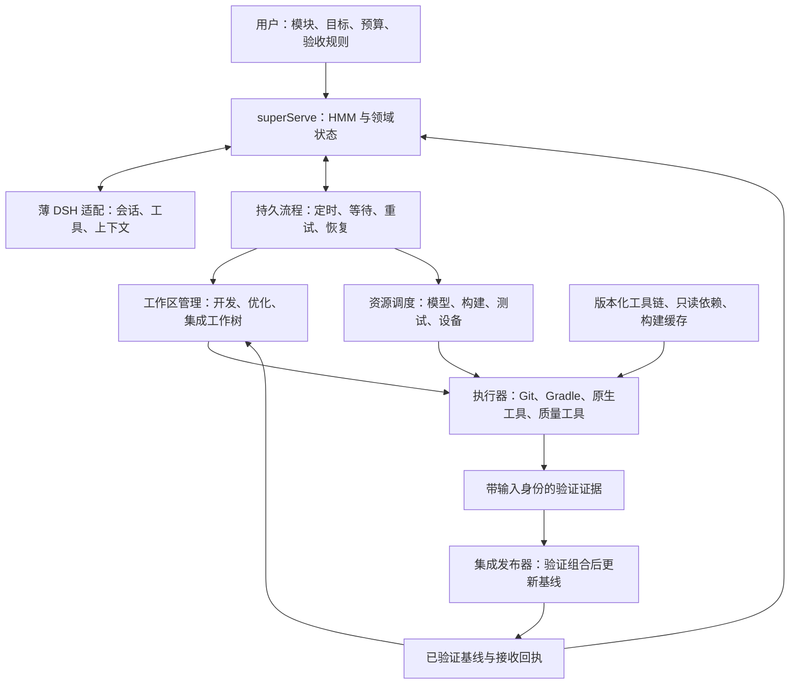
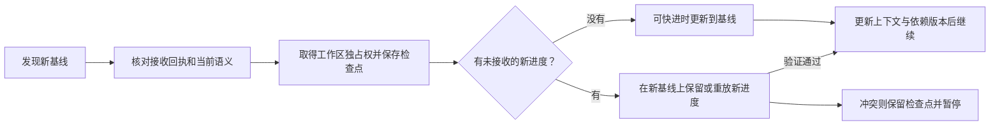

# 多 Agent 开发、持续优化与 DSH 升级总体设计

日期：2026-11-06。状态：设计提案，待分阶段实现与验收。

归属：superServe 扩展设计，不加入上游按顺序阅读的编号文档系列。

本文统一工作树开发、每小时集成、基线回流、构建复用、持续优化、上下文交接和 DSH 更新。本文不代表定时任务已经运行，也不改变现有分支、配置、数据库或工具版本。

后续执行裁决和实际进度见 [问题空间](问题空间.md)。本提案中的工具及路线选择保持可批判，
不将 Temporal、每分支工作树或分布式部署作为默认需求。

## 1. 目标与约束

<重表述提示词为问题>如何让多个 Agent 持续并行开发和优化，低成本共享可复用资源，隔离可变状态，将可信成果自动集成，并让系统能够低成本跟随 DSH 更新？</重表述提示词为问题>

### 1.1 已确认需求

1. 模块可以指定负责 Agent、主工作树、依赖关系和验收要求；可以随时从基线或当前进度分叉。
2. 合并协调器每小时收集候选、验证组合，成功后发布新基线；失败保留原有已验证基线。
3. 普通工作树确认成果已被接收后，从新基线继续，保留候选发布后产生的新提交、未提交修改与必要新文件。
4. 统一供给工具链、依赖和缓存，降低网络、存储、内存、编译和排队成本。
5. CRAP、覆盖率、变异测试、性能证据用于持续发现和验证改进；优化任务尽量不干扰正常开发。
6. 任务、决策、原始依据、失败经验与检查点可持久化并跨会话交接。
7. 暂停、取消、崩溃、重试、基线前进和 DSH 升级都不能导致丢失新改动、重复外部动作或虚假验收。
8. 尽量使用 DSH 的公开服务与插件扩展点，限制本地定制成本。

### 1.2 现实取舍

理想目标是：新增逻辑分支主要增加自己的改动、必要证据和实际执行成本，而不是再复制整个环境。

| 张力 | 选择 | 接受的代价 |
| --- | --- | --- |
| 并行更多，但 CPU、内存和 I/O 有限 | 逻辑分支与物理执行槽分离，按资源预算调度 | 部分任务排队 |
| 共享节省空间，但可变状态会污染 | 共享已发布的不可变输入，隔离正在写入的状态 | 活跃构建仍需独立输出空间 |
| 基线要及时前进，但个人工作不能丢失 | 固定候选、组合验证、检查点后跟进 | 冲突和未确认外部编辑会暂停自动跟进 |
| 追随 DSH 更新，但不能破坏长期工作 | 候选运行组合、真实宿主验证、受控切换 | 新版本不会直接进入生产 |
| 持续优化，但不能为了分数制造改动 | 证据驱动、有界尝试、无收益结束、条件变化后重开 | 不保证每个周期都有代码修改 |

本设计扩展 superServe 的工程开发能力，不替代原有手机知识库、Root 节点和用户任务能力。手机原始资料默认留在来源设备；微信相关路径继续服从用户指定的香港服务器约束。短视频与 IM 媒体传输不纳入本次工程调度实现。

## 2. 现状与证据

下列是本次设计依据，不是性能结论：

| 对象 | 已核对事实 | 对设计的影响 |
| --- | --- | --- |
| HMM OPML | 步骤需独立、依赖显式；分支由上下文范围和执行方式定义；允许剪枝与重组 | HMM 分支不等于永久工作树 |
| 现有执行边界 | `src/hmm/node-runtime.ts` 定义生命周期；`src/executor/hmm-dsh.ts` 接入 DSH | 在已有边界上扩展，不另造通用 Agent SDK |
| 持久状态 | `src/app/store.ts`、`src/app/effects.ts` 和 `src/hmm/workflow.ts` 已提供领域状态、待执行动作和恢复基础 | 复用业务记录，不把 Git/构建结果只写进聊天 |
| 开发依赖与宿主 | 仓库 `dsh-agent` 为 `0.2.1-alpha.2`；本机 DSH 与其 `dsh-agent` 为 `0.2.1-rc.2` | 当前是混合组合，不是已证明兼容的版本矩阵 |
| 上下文定制 | `src/executor/controller-context.ts` 会替换实例的 `summarize` 方法 | 优先验证能否改为正式子类扩展方式 |
| Android 仓库 | 本会话 2026-11-06 只读观测：80 个登记工作树，pack 约 1.03 GiB，Git 报告垃圾对象约 889.45 MiB | 登记数量不是并发数；尚未诊断垃圾对象或完整构建开销 |
| 既有优化器 | 一个已登记快照、零份报告、三条等待证据的计划；工具复制后存在路径、快照覆盖和并发写入缺口 | 先修复证据与执行能力，再自动修改代码 |

参考代码与本地资料：

- [现有总体边界](009-superServe-architecture.md)、[部署与升级说明](006-deployment.md)；HMM 后端记录位于 `docs/hmm-backend.md`。
- [节点接口](../src/hmm/node-runtime.ts)、[DSH 实现](../src/executor/hmm-dsh.ts)、[交接检查点](../src/hmm/context-checkpoint.ts)。
- OPML：`F:\HMM-NEW\HumachineMetamethodology\references\使用ai的agentic嵌套状态机.opml`。
- 规约与交接：`C:\Users\Paifa\WorkBuddy\2026-10-21-03-12-32\agents.md`、同目录 `agents-handoff.md`。
- 优化器：`C:\Users\Paifa\.codex\worktrees\im-group-projection-20261029\superAppAndroid\tools\persistent-code-optimizer`。

## 3. 总体架构与技术选择

图中是职责边界，不要求一格一个服务。模型负责分析和生成候选，确定性执行器负责资源占用、身份核验、命令执行及基线发布。

| 层 | 默认选择 | 边界 |
| --- | --- | --- |
| Agent 内核 | 保留 DSH + SuperAgent 来源基座 | 不修改宿主以实现 Git 队列、设备租约或构建缓存 |
| 版本控制 | Git 原生 worktree [S1] | 按需分配；共享对象并不隔离进程或阻止同账户修改公共 refs |
| 长流程 | Temporal 作为首选验证候选，生产前完成与现有 Effects 的故障对照 | 首个里程碑必须作出明确选型，不无限延长自研恢复逻辑 |
| 业务状态 | 保留现有 SQLite Store 单写者入口 | 外部流程执行器通过命令 API 修改业务，不直接打开同一数据库 |
| 执行环境 | 先适配现有 Windows；需要额外隔离或扩容时增加 Linux 执行节点 | 不以迁移操作系统作为全部能力的前置条件 |
| 构建与制品 | 固定工具链、Gradle Cache、sccache、按摘要保存的制品 | 采用工具原生缓存协议，避免重造通用构建缓存 |
| 集成策略 | 单仓库基线发布串行，构建与候选验证按预算并行 | 暂不同时引入 Zuul 和另一套合并队列 |
| 设备 | 单设备操作入口、独占执行与代次校验 | 等租约存储真正需要多节点一致性时，再决定 etcd |

Temporal 的 Activity 重试仍要求业务处理幂等；它不是 Git 与数据库之间的分布式事务。[S5]

若选 Temporal，其历史拥有计时器、活动尝试和流程进度；superServe 拥有需求、候选、接收决定和证据。业务命令携带稳定请求身份并去重。现有 Effects 继续承担内部通知与 DSH 投递，不与 Temporal 双重调度同一个合并或构建步骤。若保留现有引擎，则由其单独拥有这些流程。切换时先停止派发并核对在途操作。

DSH 进程可重启，长时间构建进程由执行宿主管理。恢复后依据作业身份查询真实状态，不能因模型会话消失就重复启动。此为目标能力，目前尚未实现整条工程流程。

## 4. 状态归属与关键不变量

| 状态 | 权威来源 | 不能代替它的东西 |
| --- | --- | --- |
| 需求、约束、模块映射、授权和预算 | superServe 领域记录及其版本 | 模型口头结论、过时交接摘要 |
| 任务计划、检查点、候选与优化决策 | superServe Store | DSH Session ID、工作树目录存在 |
| 源码历史与具体代码树 | Git 提交及树对象 | 分支名字、候选标题 |
| 工作区占用与进程生命周期 | 执行宿主登记和当前代次 | 只检查一次租约、提示词中的约定 |
| 构建与验证结果 | 不可变报告和完整输入清单 | 单个退出码、总分、历史缓存命中 |
| 公共基线 | 指定 Git ref 与接收回执的核对结果 | 数据库里的期望值、旧测试报告 |
| 聊天、压缩历史和运行句柄 | DSH 自己的持久化机制 | 业务数据库复制宿主私有结构 |
| 交接事实与原文定位 | 独立 ContextBundle 和证据索引 | 单份自然语言摘要 |

必要不变量：

- 同一个可写目录不得由两个执行者同时修改；旧代次不得提交有效执行回执。
- 一次验证绑定冻结候选，不与正在修改的目录共用输入。
- 每个公共基线的前进都有对应的候选组合、验收版本和回执。
- 未提交进度、尚未接收的提交和未确认设备状态不能被自动清理。
- 重试先检查真实外部状态，再决定继续、重做或等待核验。
- 取消只代表停止请求；执行器确认结束前不能释放相关独占资源。

工作树在同一 OS 账户下不是安全沙箱。受保护基线应由独立发布权限或远端分支保护约束；普通 Agent 不持有该发布凭据。若执行不可信代码，需要额外进程和文件访问隔离，不把提示词当访问控制。

## 5. 工作树、分叉与模块分配

模块映射记录仓库、路径、依赖、负责工作树、验收计划和优先级。映射用于分工，不意味着每个模块必须拆仓，也不代表可删掉构建所需的其他目录。

模块与任务/工作树为多对多关系：多个普通功能任务可同时修改同一模块，一个任务也可跨模块。
“开发、优化、集成”仅描述本次工作的用途，不构成模块所有权或互斥类型。
协调应以变更目标、契约版本、读写影响、验收与候选关系为依据：
兼容贡献可并行，配套接口明确依赖或共同发布，重叠修改局部拆分/串行，
竞争实现作为替代方案选择，不能按提交时间将所有方案机械合入。
目录锁仅约束同一物理输出；不同工作树的语义冲突还需组合验证。
新的子问题、例子与验收计划见 [问题空间 P03.4](问题空间.md)。
当前已实现模块/变更意图的版本化登记与潜在关系只读查询；
实际差异核对、候选关系约束、兼容性裁决和自动组合验证尚未实现。

工作区分为开发、优化、集成、兼容性验证四种用途。用途决定权限、预算及保留策略，不意味着每种用途、每个候选或每轮验证都新建一个目录；底层共用创建、占用、检查点、挂起、恢复、归档机制。默认复用用户规划的合并工作树作为一个固定验证执行槽，具体空间预算见 6.11。

分叉步骤：

1. 选择已验证基线或当前工作进度，取得一致的源版本。
2. 从当前进度分叉时，协调源目录写入，保存已提交、已暂存、未暂存和必要新文件的清单；保留源工作树的暂存边界。
3. 不默认复制 `.git`、构建缓存、输出、密钥或设备凭据；被忽略但对任务必要的文件显式分类保存。
4. 新建独立分支和工作目录，绑定新任务、父任务、上下文引用和依赖制品版本。
5. 完成前后核对；无法取得一致快照时等待，不复制一份正在变化的目录后宣称分叉成功。

只读任务使用固定版本的代码读取和检索能力；需要可写执行才占用物理工作区。部分克隆、稀疏检出、写时复制属于后续工作区提供器优化，应通过真实构建验证，不改变上述生命周期契约。

## 6. 每小时集成与基线回流

### 6.1 自动集成

默认按 `Asia/Hong_Kong` 每小时触发一次集成发布轮次；候选发布后即可做预检，不必等到整点才开始发现错误。无候选时不唤醒模型。进程重启后合并错过的触发，不补跑大量空周期。每个目标基线同一时刻只有一轮发布流程。

`发布候选 → 独立预检 → 排队 → 固定候选与旧基线 → 临时组合 → 组合验证 → 发布意图 → 条件更新 Git ref → 接收回执 → 通知跟进`

- 只收集显式发布的提交，不自动提交开发目录里的任意改动。
- 候选绑定基线、提交/树、依赖、验收规则和上下文；冲突修复产生新的候选身份。
- 验证的是具体组合，不是把各分支的通过结果相加。候选有依赖时不能任意跳过其中一项。
- 若目标 ref 已变化，则重新组合并确认哪些证据仍适用；不能用旧结果直接发布。
- ref 更新按期望旧值执行；远端目标需遵守其保护规则。默认不强推公共历史。
- Git 与业务库之间使用“记录意图、执行、核对、补回执”的恢复流程，不承诺跨系统原子提交。
- 若发布成功但回执未落库，依据运行身份、候选提交与实际 ref 补记；不能无条件再次合并或回退。
- 验证失败、基线未知或外部更新无法解释时，保留已有基线并等待处理。
- 临时集成提交先保存在对象库和候选 ref，只有需要实际执行时才检出到独占验证槽；不更新公共基线，不触发普通工作树跟进。只有发布成功的基线才发出接收回执。
- 默认发布已经验证的同一提交；若发布策略重新生成、压缩或重放提交，必须重建证据绑定，不能假定树相同就与提交身份、构建环境等输入无关。
- 基线发布 ref 不作为普通开发工作树的活动分支。由发布器控制独立 ref 或仓库，消费者使用各自分支，避免只更新 ref 却遗留不匹配的索引和工作文件。

### 6.2 普通工作树跟进

提交祖先关系只证明历史包含，不能证明成果没有被后续修改或撤销。回流还需检查接收决定是否被取代、相关契约是否仍成立。

若发布 `a17` 后又产生 `a18`，基线只接收 `a17`，则 `a18` 必须保留。重放过程在可恢复检查点上进行；不同步正在编译、安装或被人工编辑的目录。发现检查之后又发生写入，暂停切换并重新取得一致状态。

### 6.3 三阶段验收：先独立预检，再临时合并测试，最后发布

这里的“先合并再测试”仅指逻辑隔离的候选组合，不是先把未完成代码写进公共基线；“临时”指候选的生命周期，不要求每次创建临时目录。工作树是开发容器；最小发布单位是满足一个明确契约的候选或配套候选组，不是整棵工作树里的全部改动。

| 阶段 | 冻结输入 | 应做的检查 | 未通过的处理 |
| --- | --- | --- | --- |
| 独立预检 | 候选代码及其明确依赖闭包 | 与改动相关的编译、测试、静态检查、契约检查；核对范围与验收依据 | 返回作者修复、补证或等待依赖，不占用基线发布槽 |
| 集成验证 | 当前基线与有序候选集合生成的具体提交 | 跨模块契约、必要集成/设备测试和验收要求；可复用完整身份相同的有效结果 | 候选组合不发布，定位失败并重建受影响的后续组合 |
| 发布核验 | 已验收提交、报告、规则版本与期望旧基线 | 证据完整性、授权有效性、基线与候选未被取代 | 证据过期则重新验证；满足条件才条件更新 ref |

预检不要求每次重建完整发布 APK；验证范围由受版本管理的验收计划和影响分析产生，不能由作者自行删减。改了 JNI/ABI、公共 API、数据迁移、权限或设备生命周期时，沿真实调用和运行依赖扩大范围；无法可靠判断影响时采取更完整的验证。

纯文档或没有对应运行行为的候选使用明确的适用检查，不能伪造一份“运行测试已通过”的报告。编译通过和模型审查结论都不能单独替代行为验收。

GitHub merge queue 在临时分支上测试目标基线与候选组合；GitLab merge trains 会验证前序候选形成的组合。这些是三阶段设计的可参考机制，不表示必须迁移托管平台。[S7][S8]

### 6.4 依赖与配套候选组

验收依赖不止是修改了哪个文件，应至少识别：

- 源码候选依赖：精确的候选版本、先后关系和已接收的基线，不绑定会继续移动的分支名。
- 模块与运行依赖：API、JNI、ABI、序列化、数据库、资源、权限、启动与恢复路径。
- 工具链和制品依赖：锁定版本、构建参数、原生库/AAR 摘要，不能以共享目录里“最新文件”替代。
- 验收与执行依赖：规则版本、测试源码、测试发现清单、设备能力、独占资源及必要外部环境。

提供方 A 修改接口，调用方 B 同时迁移时，有两条合法路径：

1. A 先维持新旧接口兼容，A 验收合入后 B 跟进；需要额外清理旧接口时作为后续候选。
2. A 与 B 作为显式配套候选组一起预检、一起集成、一次发布基线。每项仍需范围和变更审查，但不要求不完整的一半独立通过依赖它另一半的编译。

不能为了凑成一个绿构建，把没有因果关系的未完成工作都塞进配套组。候选循环依赖需明确重组为有共同验收目标的组，或重新拆分契约；不能让调度器无限互等。组中一项失败或被撤回，依赖该组的候选等待；独立候选可以继续。

同文件改动提示文本冲突风险，不是依赖完整定义；不同文件也可能修改同一协议。自动冲突修复必须保留双方验收目标，产生新版本并重跑受影响检查，不能机械选一边或删测试。

### 6.5 放行规则与角色分离

自动发布要求以下条件同时成立：

`候选已发布且未撤回 AND 依赖齐全 AND 组合可确定 AND 验收计划完整且适用 AND 所需证据有效并满足规则 AND 发布授权有效 AND 旧基线仍匹配`

这是发布边界的一次领域决策，不是在每个工具调用里重复堆布尔开关。决策保存所检查版本、理由和证据引用，状态转换受持久事务与执行回执约束。

| 角色 | 负责 | 不应拥有的权限 |
| --- | --- | --- |
| 工作/优化 Agent | 开发、补测试、发布候选、解释依据、修复失败 | 直接推进受保护基线，修改自己的验收标准 |
| 验证执行器 | 从冻结输入运行可信检查入口，记录测试发现、结果、环境和摘要 | 把作者提交的 JSON 当作已执行证明 |
| 合并协调器 | 维护依赖与队列、选择组合、分类失败、发起修复 | 遇失败后自动降低必要检查 |
| 基线发布器 | 按有效放行决定发布并核对外部状态 | 根据自然语言“做完了”直接更新基线 |
| 规则维护者 | 版本化需求、验收范围、风险类别和授权 | 用一次候选的需求临时绕过原有标准而不留记录 |

角色可以共用进程，但发布凭据、策略写权限和可执行工具范围必须在运行时隔离。独立模型复核是补充证据，不是仅换一个 Agent 就得到可靠授权。测试代码本身可能执行任意构建逻辑，验证环境不带基线发布密钥，不能写公共工具链或作为未经验证的公共缓存写入者。

现有上游说明 `docs/003-execution.md` 将合并约束放在 Delivery requirements 提示词中，宿主没有专用合并判定；其中行数规则不能充当本设计的正确性证据。实施时普通执行器的直接合入路径必须收敛到统一发布器，远端分支保护/独立凭据与本地受控入口共同防止绕行，而不是仅增加提示词。

验收规则不能由同一个候选放宽后立刻用来批准自己。测试、规则、阈值或忽略范围发生变化时，单独检查改变的理由与新增盲区，仍保留当前有效规则要求的证明。确需改变行为契约时先形成新的授权需求，不能把需求变更藏在“重构”中。

### 6.6 报告、证据失效和故障分类

每次验证记录：仓库/候选/组合身份、基线及提交树、测试与构建输入、工具链和制品身份、规则版本、执行范围、检查结果、执行者来源和报告摘要。构建输入若包含提交 SHA、环境或生成参数，也必须纳入身份。证据复用以相同有效输入为依据，不以报告文件名或历史绿色标记为依据。

验证执行器检查“应执行的检查”与“实际执行的检查”是否一致；零测试、异常跳过、仅输出退出码 0、缺失报告或工具崩溃，不能冒充要求已满足。适用性判断由明确规则给出，并保留不适用理由。

| 结果 | 自动动作 | 是否可发布当前候选 |
| --- | --- | --- |
| 产品/契约失败 | 保存反例和日志，派回修复；新修复产生新候选 | 否 |
| 依赖或验收证据不足 | 等待依赖、补验证或补充可判定需求 | 否 |
| 下载失败、设备不可用、执行器中断 | 有预算地重试并保留尝试记录，必要时换执行环境 | 否，不把环境失败等同代码错误 |
| 疑似偶发测试 | 对照基线复现，记录多次结果并定位；不能只重跑到绿 | 未达到既定偶发测试处理规则前不可发布 |
| 基线、候选、规则或依赖输入变化 | 将对应组合证据标为过期并重建，未受影响证据可复用 | 旧放行决定不能继续使用 |
| 需要人工判断的语义/范围冲突 | 汇总最小问题和证据等待决策 | 否；不是每个普通候选都需要问人 |
| 所需证据满足预先授权的规则 | 写放行决定，等待本轮发布 | 是 |

若基线本身在当前有效环境中无法通过必要验收，先冻结普通发布并诊断；修复候选可以优先进入修复流程，但必须恢复所需契约。不能因为“这个失败早就有了”放行另一项未经证明的修改。历史失败记录用于定位，不自动成为豁免。

每个修复/重试有时间、资源和次数预算。作者可以继续开发，但发布候选版本不可变；新版本替代旧版本后不沿用旧组合的审批。等待问题候选不长期占住执行槽。

### 6.7 并行、失败隔离和发布后观察

候选预检可以在各自已冻结且独占的执行环境中并行；默认重型集成验证只有一个固定执行槽，依次验证，基线更新按依赖顺序串行。对象层可提前计算 `S+A`、`S+A+B`、`S+A+B+C`，不等于同时为它们建立构建目录；每个报告只对应实际执行过的冻结组合。额外并行验证槽仅在等待与空间/内存预算实测允许时增加，不能为了前瞻验证无界复制工作树。

若包含 B 的组合失败，不能断言 B 单独一定错误，也不能将包含 B 的旧结果用于 C。先保留已有通过的前缀 A；定位交互原因，撤下 B 后对不依赖 B 的 C 重建 `S+A+C` 验证。依赖 B 的候选等待。GitLab merge trains 的失败后重建机制可作为参照。[S8]

若只验证了整个批次且失败，不得把其中任何未经独立验证的子集直接发布。可以按依赖完整的组拆分、重测并定位；定位次数受预算限制，避免穷举所有组合。初期用小批次，稳定后再扩大前瞻验证，平衡吞吐与失败重算成本。

每小时触发不意味着每小时必须有合入，也不意味着必须等待所有工作树完成。只有已就绪且依赖齐全的候选进入发布轮次；开发反馈优先，优化候选同样遵守验收但可在资源和队列上让位。

发布后保留烟雾验证、观察与恢复依据。若发现遗漏问题，停止依赖该基线的自动跟进，保留已发生的工作并选择验证过的修复或回退提交；不能强制改写公共历史、覆盖普通工作树的新进度，或假定数据库/设备副作用会随 Git 回退而撤销。

这个机制降低错误进入基线的概率，但不把有限测试包装成“无缺陷证明”。对关键能力缺少可执行验收的情形，先补证或请求限定的语义判断，而不是无限增加形式检查。

### 6.8 HMM：从自动排队升级为有界的闭环改进

本节提出更高自动化的候选设计，预期收益需要对照验证，不声明当前已经实现或优于既有流程。

**状态与真正目标。** 当前三阶段设计能挡住已识别失败，但若失败后总要人分诊，验收标准和隐含依赖仍会成为人工瓶颈。理想目标是：人负责目的、边界和无法消除的语义选择；系统自行获取证据、协调依赖、执行验证、修复可解决的问题，并使满足要求的成果自然进入基线。现实目标是在不丢进度、不削弱验收的条件下，降低每项有效改进所需的人工时间与总资源成本。

测试判定问题的研究区分“生成输入”与“判断输出是否正确”；自动生成大量测试不能自动获得正确的预期结果。[S9] 因此第一项投资应是可执行契约和证据来源，而不是仅增加修复 Agent 数量。

| 参与者/资源 | 能决定的事 | 需要避免的有害结果 |
| --- | --- | --- |
| 用户与模块负责人 | 目标、允许行为变化、预算和发布策略 | 被重复询问已确认事项，或需求被自动收窄 |
| 开发与优化 Agent | 在授权范围内产生实现、测试、诊断及修复候选 | 同时改动同一目标、反复修复同一失败、以自评分数放行 |
| 验证器与证据库 | 记录冻结输入下的观测、有效性和适用范围 | 把旧报告、等价变异或偶然通过当作新证明 |
| 集成发布器 | 决定固定组合是否满足授权验收并发布 | 把尝试合并直接写成公共基线，或重复副作用 |
| 执行节点与设备 | 提供有限并发、存储和隔离能力 | 前台受抢占、隔离失效、设备状态未知仍继续操作 |

**约束分层。**

- 基底约束：资源有限；外部效果不能靠恢复聊天撤销；观察样本不能证明任意行为；未观测依赖不能靠模型确信消失。
- 用户禁区：不丢未接收进度、不绕过权限、不篡改验收来获通过、不擅自修改其他工作树；前台干扰不超约定预算，不把推测写成已确认事实。
- 当前瓶颈：验收依据不足、隐藏耦合、构建成本高、基线持续变化、诊断依赖人工、角色上下文缺失。
- 路径代价：更多前瞻组合带来重算；更强隔离与更多缓存带来空间/管理成本；自动修复带来错误放大风险。
- 暂时策略：每小时发布、初始批次、并发预算、特定流程引擎均可按实测调整，但改变用户既定发布节奏需获得相应授权。

**核心矛盾与分离。**

| 矛盾 | 对应互斥要求 | 分离方案 |
| --- | --- | --- |
| 探索速度与基线稳定性 | 代码允许不完整，又必须可用 | 空间分离：候选区域可失败，公共基线只接收已验证组合 |
| 独立开发与同步变更 | 模块独立前进，又必须满足共同接口 | 整体/部分分离：独立候选与显式配套组使用不同验收单位 |
| 验证可信度与成本 | 输入变化应重新验证，未变部分不应重算 | 条件分离：依完整输入和影响范围复用证据，不降低契约 |
| 持续优化与前台体验 | 优化持续需要资源，前台又不能被占满 | 时间分离：事件驱动诊断、空闲执行和有限保留容量；持续满载时明确等待或扩容 |
| 修复自主性与判据稳定 | Agent 必须能改实现，不能自行定义什么算成功 | 权限分离：实现可产生新候选，验收契约由独立版本与授权控制 |

主要失效链条有两个：`存在行为错误 AND 验收未能识别 AND 发布通道放行` 会使错误进入基线；`前序候选变化 OR 隐含依赖变化 OR 规则/环境变化` 都可能使原证据不再适用。第一条应同时改善契约、执行和发布约束；第二条不能只监听代码文件变化。

### 6.9 建议增加的五个自动化动作

1. **编码前形成任务契约。** 从用户需求、模块契约和既有证据生成候选计划，明确允许改变什么、必须保持什么、由哪些检查证明、依赖哪些版本。复用已有授权；有实质歧义才集中询问。自动生成的测试关系先作为待核验假设，不能与实现一起自我证明。
2. **自动收集并维护依赖。** 从 Gradle/CMake 依赖、编译输入、API/JNI、配置、测试覆盖及人工声明形成有来源的依赖记录。静态分析与实际执行覆盖相互补充；没有观察到调用不证明没有依赖。受影响集合不确定时扩大检查，而不是断言候选独立。
3. **开发中提前发现交互。** 编译接口或可执行检查点发布后，可以在临时区域提前组合，尽早反馈另一模块的影响。草稿检查点永不自动获得发布资格；重任务使用预算，不能每次保存文件都做完整组合。保留每小时正式发布节奏。
4. **失败后先自动补证与有界修复。** 固定失败输入，判断基线在相同环境下的表现；再选择恢复环境、补齐已确认依赖、增加来自契约的测试或修改实现。修复在独立候选上执行，不修改作者正在工作的目录。每次记录假设、变化、复现结果与资源消耗；相同输入、失败和修复重复出现且没有新证据时挂起。预算耗尽、需求冲突或无法确定外部状态时才形成具体待处理事项。
5. **让结果影响下一轮成本。** 将通过、失败、误判、回退、冲突与耗时写回证据和坑点记录，用于后续检索、排序、批次与资源分配。可调整执行策略，不能据历史成功自动放宽验收阈值、权限或行为契约。DSH 更新也作为固定候选验证，继续使用第 10 节边界。

新增控制对象优先收敛为任务契约、带来源的依赖与验证计划、诊断/修复记录，复用现有候选和报告；不另建五个常驻 Agent 服务。模型按需执行结构化子任务，调度、计时和发布由确定性流程完成。对已预授权且证据齐全的范围可以自动放行，其余先自动补证，人工不必逐一点击批准。

### 6.10 约束联动、反例与路线选择

| 可能遇到的问题 | 自动化方案自身的风险 | 处理原则 |
| --- | --- | --- |
| 多个 Agent 都依同一错误假设写测试 | 换一个模型审查仍可能重复同一错误 | 保留需求来源、独立参考和不变量；无可靠预期时明确未知 |
| 接口变更导致整队失败 | 把正常配套依赖误当产品缺陷 | 更新有证据的依赖关系，配套候选一起验证，不给失败贴永久标签 |
| 自动修复删掉调用、断言或必要兼容性 | 构建变绿但能力退化 | 验证原始契约和适用域；测试变化与预期行为变化分别审查 |
| 预先验证的组合不断过期 | 计算大部分花在被取消的组合 | 根据失效率缩小前瞻窗口和在制候选数量，保留有效前缀与证据 |
| 动态依赖没有进入缓存身份 | 错误缓存快速扩散 | 完整声明输入、隔离可疑结果并扩大复核；Gradle 明确提示漏报输入会错误命中。[S3] |
| 存活变异与增量历史被当作确定结论 | 反复改正确代码或遗漏依赖影响 | 分开等价候选、未覆盖、失败及推断结果，安排周期复核。[S4][S10] |
| 开发长期占满资源，优化永远排不到 | “低打扰”变成名义运行但零进展 | 由用户预算定义可接受干扰、保留窗口或额外资源，不作零成本承诺 |
| 自动重试发生重复 Git/设备动作 | 修复了会话却放大外部副作用 | 稳定操作身份、状态核对、幂等/去重；流程引擎不能替代这些机制。[S5] |
| 项目只是被拆成更多层以降低分数 | 复杂度转移到依赖和构建开销 | 看端到端成本、契约保持和实际收益，不以 CRAP/覆盖率单项判定 |

比较三条路线：

- 仅自动排队、失败交给人：构建成本较低，但人持续承担分诊、补证和恢复。
- 无界 Agent 自行改实现、测试与规则：看似人工最少，却无法辨别规则被放宽后的虚假成功，不采用。
- **契约约束下自动补证、修复与集成：建议路线。** 增加证据与协调成本，以减少重复人工处理；在已明确、可验证的范围内扩大自动化，而不假定可以自动决定所有需求。

效果验证采用固定代表性任务和失败情景，对照现有三阶段流程；先影子运行只记录拟采取动作和结果，再在预授权范围逐步启用。保留独立的未参与策略调整的场景，避免只对已有案例优化。

同时比较人工介入次数/耗时、有效成果合入时间、错误放行与错误阻塞、回退/返工、前台等待、无效重算与总资源开销。候选吞吐增加而回退率、前台延迟或错误拒绝恶化，不认定为整体改进。记录失败和放弃尝试，不能只统计成功合入样本。

本轮 HMM 自评：瓶颈已从“怎样自动执行 Git”上移到“正确性依据、依赖可见性与恢复成本”。没有证据证明自动修复能普遍提高质量，需以这套对照验证决定启用范围；尤其应先补齐现有质量工具的证据链，再扩大修改权限。

### 6.11 空间预算：候选按需落盘，复用一个固定验证槽

用户进一步明确：新增临时集成工作树本身也有开销。修正默认设计为“多个逻辑候选，共用一个固定验证目录”，优先复用用户规划的合并工作树，不在其旁边再创建每候选一棵的临时工作树。

**第一步：在对象库计算组合。** `git merge-tree --write-tree` 可以计算真实合并所用的内容、重命名及冲突处理结果，不读写工作目录或索引，也不会自动创建提交。[S11] 用冻结提交身份计算，检查退出状态和冲突记录；有冲突的树不能当作可发布结果。必要时再创建具有正确父提交的候选提交并保留引用。此过程会消耗 CPU 并可能写入新对象，并非零空间；候选数量、保留引用和回收都需有界。

**第二步：先判断是否已有足够证据。** 若待发布的精确提交及全部相关输入已经按当前规则完成验证，且基线与依赖关系仍匹配，则复用该证据，不因进入队列就机械再构建一次。典型情况是单个可快进候选已在当前基线上完成全部必要检查。只有内容树相同、各分支分别通过或历史报告是绿色，均不足以作出该判断。

**第三步：需要执行时复用固定目录。** 验证器取得独占权，在同一路径检出候选；共享版本化依赖并保留适用的增量状态及原生缓存。同一槽只执行一套可写构建，前一作业及残留写入者结束后才切换。不会每轮重新下载 SDK/NDK 或完整依赖，也不每轮例行 `clean`。

持久目录复用必须检查未跟踪输入、生成文件、环境和后台写入者，清理已确认属于前一作业且会影响新输入的残留，不能泛化删除用户数据。未声明输入可能造成假增量和错误缓存；无法证明复用安全时，对受影响输出定向重建，必要时做冷态复核，而不是为了省空间沿用可疑结果。[S3]

**第四步：发布引用，不复制第二套目录。** 验证通过后，由受控发布器将基线指向已验证提交并写回执。Git 支持按期望旧对象值更新引用。[S12] 公共基线仍是受保护的版本身份，不依赖验证目录当前显示哪份代码。验证失败时基线不动，目录后续可切换到另一候选；原基线及检查点仍有引用可恢复。远端发布必须经过其权限与分支保护，不能用本地 plumbing 绕过。

| 选项 | 新增占用 | 对开发等待的代价 |
| --- | --- | --- |
| 复用原计划的合并工作树，默认一个槽 | 相对于原计划，不再额外新增集成目录；仍有新对象、报告及构建增长 | 重型组合验证排队，路径稳定便于复用 |
| 借用闲置普通工作树 | 可以不新增目录，但需保存并恢复该工作树状态 | 必须无人工/Agent/构建写入，原任务可能等待；切换也可能破坏其热构建状态 |
| 增加独立验证槽 | 增加检出空间、独立输出和进程内存 | 可减少部分排队；只有收益超过成本才采用 |

默认选第一种；第二种是用户明确允许且可取得独占权时的选项，不自动占用正在开发的目录。不能同时保证“没有任何可用执行空间、不暂停正在写入的开发环境、又立即对新组合运行真实测试”。缓存也不能证明此前从未验证过的组合正确。

近似空间预算按“共享输入 + 各活跃执行槽的独立可变状态 + 有界候选对象/报告”计算，不按逻辑候选数量复制整个环境。低空间优先时保持单槽、批量复用输入；低等待优先时在总预算内增加槽数。先测实际物理占用、增量命中和排队时延，再决定是否需要写时复制、远程执行等额外设施。

## 7. 依赖、制品与构建资源

统一管理表示按项目锁定版本、集中供给，不强迫不同项目使用同一工具版本。

| 资源 | 复用方式 | 隔离或失效条件 |
| --- | --- | --- |
| Git 对象 | 同仓库共享；保留检查点引用 | 不在并发写入时盲目清理临时对象 |
| JDK、SDK、NDK、CMake、质量工具 | 按平台与版本安装，使用时只读 | 原地升级改为新版本目录 |
| JAR、AAR、原生库、模型 | 校验后按摘要发布，读者引用 | 可变标签不作为最终身份 |
| 下载依赖缓存 | 原生支持的共享机制；容器使用只读代次与独立写入区 | 不原地修改正在使用的只读代次 |
| Gradle 任务缓存、sccache | 通过其缓存协议复用 | 输入声明、编译选项、工具链和环境改变时依其规则失效 |
| 项目 `.gradle`、`.cxx`、CMake 目录、`build` | 每个并发工作区/执行槽独立 | 空闲后按预算回收，不能让多个构建同时写同一路径 |
| 测试库、临时目录、变异输出、模拟器数据 | 按任务隔离 | 不将可写测试状态发布为共享依赖 |
| 已验收产物与报告 | 集中不可变保存，工作树引用 | 保留消费者引用后再考虑回收 |

Gradle 同机依赖缓存使用文件锁；跨容器不能假定其进程通信条件成立，共享只读缓存目前属于孵化功能。[S2] 构建缓存只适用于输入与输出声明正确的任务，不能替代输入完整性检查。[S3]

复用优先级：当前增量状态、本机有效缓存、共享缓存、重新执行。避免为了省空间不停销毁热构建目录。大型不可变依赖先集中供给；多机分发收益明确后再选 OCI 注册表，不预先部署全部存储服务。

资源调度分别计算模型并发、编译、测试、磁盘 I/O 与设备占用。开发反馈和必要集成验证优先于优化重任务；为集成保留有限容量，避免其被持续开发无限饿死。CPU 优先级不足以控制内存、I/O 和逃离父进程的构建守护进程，执行宿主必须确认真实进程归属。

## 8. 持续优化

`新证据/基线变化 → 诊断 → 候选待办 → 按需分配已有执行槽/授权工作区 → 验证收益 → 集成队列 → 观察/回退记录`

### 8.1 任务选择

- CRAP、复杂度、覆盖率、变异结果、性能与构建耗时都只是证据。先确认目标契约与统计范围，再选择增加测试、简化结构、修复缺陷或改善性能。
- 比较风险、证据可信度、预期收益、验证成本、开发冲突与尝试历史，不使用“CRAP + 存活数固定加权”作为完成判据。
- 没有证据先修复采集。缺失覆盖、符号映射失败、未执行、超时、等价候选、基础设施错误均独立记录。
- 一次优化设定主要目标、必须保留的行为和资源预算；无收益或预算耗尽时结束，并记录在何种条件变化后可重开。
- 用户正在修改同一范围时，优化任务让位或等待。公共接口影响范围要沿依赖传播，不能只按文件名判定无冲突。

### 8.2 验证效率与独立性

分为快速增量诊断、候选相关范围验证、重要模块周期复核。PIT 的增量历史存在依赖变化导致推断不正确的风险，不能无限复用旧结论。[S4]

基线与候选使用可比的工具链、测试计划和指标范围。新增测试也是有效成果，但删除断言、扩大排除范围、修改阈值必须独立审查，不能由优化 Agent 自行降低验收标准。

测试预期来自需求、性质、反例或独立参考；不因与实现一致就认定正确。Host 原生测试、JVM 测试和 Android/JNI 真机测试明确覆盖边界，不相互冒充。未受影响的任务可复用有效结果；影响分析不足时扩大验证范围。

Agent 数量不等于变异测试并发数。测试按可恢复分片执行，先停止新派发，再在安全边界取消或结束已有分片。被抢占的超时不能计为优化收益。环境长期满载时必须等待或增加执行资源，不能承诺既完全不争用又始终推进。

### 8.3 既有工具接入

保留现有 `persistent-code-optimizer` 工具资产，先实现可配置项目根目录、目标模块、执行参数、版本检测、退出状态与报告适配。快照需去重并包含相关测试、构建配置、依赖和工具链身份；状态更新通过单写者服务或可靠事务完成。

把旧 JSON 状态作为可审计导入源，不直接把它当作新的多 Agent 数据库。先证明一项真实目标能采集报告，再开放自动修改。补测、重构、性能优化分别验收，不要求所有候选都修改生产代码。

### 8.4 从手动质量提示词到正式功能（2026-11-07 校准）

状态：核验后的实施设计，不代表报告导入、质量执行器或优化调度已实现。
复用现有 HMM 任务、SQLite、工作区归属及 DSH 执行接口，不新增独立质量平台、永久质量 Agent 或默认优化工作树。

<重表述提示词为问题>如何把用户逐次交代工具路径、检查命令和解释报告的工作，
变成一次配置目标后可重复执行、可说明缺证、会让位并能验证实际改进的模块质量任务？</重表述提示词为问题>

`S0`：工具和专用质量脚本已有，身份、路径、退出含义与接受依据主要靠提示词传递。
`IFR`：有效证据自动到达需要它的任务，只补缺少的工作，改进保持有效而无需人工搬运上下文。
`Sg`：固定目标与执行配置、按需占槽、采集分层证据、未知生成补证、候选进入原集成协议。
`O`：已有完整脚本包、固定工具、原始报告和持久记录。`C`：不在活跃开发目录注入修改，
不以分数替代契约，不改分母或规则自证通过，不擅自安装或升级工具。

用户/模块负责人定义范围、预算和验收；Agent 可提出候选但不能自行放宽验收；
执行宿主负责槽内写入和真实状态核验；消费者承担接口回归，须进入组合验收。
作用仅在输入身份、权限和证据来源明确时成立；等待、存储与恢复的代价仍由宿主及用户承担。

**归属不要求物理复制**

| 对象 | 正式归属与共享方式 | 代价或禁用条件 |
| --- | --- | --- |
| 工具链、脚本及 vendor | 固定版本工具包，记录摘要、来源、许可证及宿主能力；目标引用 | 文件存在不等于兼容；Python 可编辑安装还要绑定源码与依赖，执行时不得原地升级 |
| 源码、配置、测试及契约 | 目标任务绑定固定提交/合法检查点；配置变化产生新版本 | 活跃工作区不是不可变输入，不完整捕获只能诊断 |
| `.cxx`、活跃 Gradle/PIT 历史、临时输出 | 当前执行槽与代次独占；可放在目标目录外 | 取消/租约过期不能直接复用；Windows/WSL 写者分别核验 |
| 不可变依赖及封存报告 | 按内容引用共享；每份证据明确目标、输入、范围和运行 | 复制报告不能转移适用范围；复用需完整输入与环境等价证据 |
| Windows/WSL 暂存区 | 映射到有界执行槽，按需物化必要输入 | 计入复制、虚拟磁盘增长、保留和回收成本；逻辑删除不代表宿主空间立即减少 |

TC：更多检查提高发现率却增加等待与复制。PC：同一可写构建状态既想共享又必须独占。
时间分离复用槽，空间分离输入/输出，条件分离证据复用，整体/部分分离局部诊断与组合验收。
AND：输入归属错误 + 工具产生报告 + 控制面只看退出码 => 错误放行。
OR：源码不一致 / 范围缩小 / 映射缺失 / 环境不同 / 证据过期，任何一项都需独立补证。

**本机核验及脚本差异**

参考工作树 HEAD：`ccb751d13403068dbf9de111f2277ca4bb25df07`；
`univerge-ai-browser/tools/quality` tree：`6feec4a995ee1573e9e99c7881bb56a4a942ab54`；
该目录 `git status --short` 无输出，不推断整个工作树无修改。

- CRAP 提交 `0dbd85b3cb6d4bce2c7a3982f4c3b2e88691144a`，该仓库状态无输出；
  Python 元数据确认 crap4cpp 1.0.0、tree-sitter 0.25.2、language-pack 0.13.0。
  指定 detekt/Kover/PIT JAR 存在，未逐一运行或验证目标兼容性。
- JDK release 为 17.0.16；CMake/CTest 文件版本 3.31.6；NDK 元数据 28.2.13676358；
  CodeCoverage.Console 文件版本 17.1400.325.32702。agentctl、zipalign 入口存在，
  不能据此认定构建隔离或包体检查已成功。
- Ubuntu/WSL2 中包元数据给出 Clang/LLVM 20.1.2、Mull 0.37.0；
  Mull 实际版本输出包含 LLVM 20.1.2 插件，reporter-20 别名存在。
  GCC/G++ 实际 `--version` 为 13.3.0；gcc 元包版本为 13.2.0，两者不可混同。
- 旧 optimizer 状态含 1 个快照、0 份报告、3 个 optimizationPlan 项，不代表其他目录没有报告。
  已读 `symbol-tests-f7e87aa8/results.json` 中部分结果为 `passed=true,supported=false`，
  表示正确拒绝不支持映射的测试通过，不能据此认定这些 Kotlin 语义已被质量评分支持。
  本轮未编译、采集覆盖率、运行变异或操作设备。

1. `Invoke-QualityTrial.ps1:18` 从脚本位置推导根且写死 `univerge-ai-browser`；
   `Aggregate-Crap.ps1` 同样固定模块。原位置成立，搬进 optimizer/vendor 后不再等价。
   正式入口显式传仓库、模块、配置和运行目录，复用含 Java/Gradle/vendor 的完整包。
2. JVM 脚本已有输入/字节码摘要、非零测试检查和独立轮次目录；结束为 `review_required`、
   退出 3、`fullWorkflowPassed=false`。应保留这种边界，不当产品失败、不重试到绿。
   `Snapshot-Inputs` 的部分源码/配置清单仍不证明根构建脚本、锁文件、依赖及环境闭包完整。
3. 原生脚本用 `New-Item -Force` 创建证据目录，gate 允许解析错误，strict 结果另存，
   最终退出码仅取普通 gate。正式验收分别检查 strict/gate/覆盖范围，gate 成功不能遮盖缺项。
   原生阈值 6、JVM 配置阈值 10 不能直接变为跨模块统一质量线。
4. `run-handoff.sh` 的 commit 参数只写标签，实际复制当前目录列举的文件；
   前后源摘要相同不证明副本来自该 commit，也不能排除混合时刻或依赖遗漏。
   必须先取得合法固定输入，再核对物化副本；P02 观测摘要不能代替此步骤。
5. Mull 将整个临时目录回存；coverage、sanitizers 各建副本并继续写同一证据目录。
   三份插桩证据应独立，源码可共享固定输入，可写子目录分别归属阶段，完成后封存。
   这些路径没有自行清理 /tmp，不据此断言系统其他机制永不清理。
6. `RepairRound` 是调用参数，不能阻止每次从 0 开始；正式预算需按问题/输入版本累计尝试，
   失败、取消、放弃均计入。旧 JSON 状态和工具路径存在性仅作导入线索，不承担多写者事务或能力权威。

**正式功能的最小结构**

只增加三类领域记录，沿用现有存储与任务引用：

- 模块质量配置：目标、授权范围、测试/契约、执行配方、工具包引用及预算。
  路径在宿主绑定中解析，前端使用逻辑名称；导入参考配置必须核对目标，不能继承错误模块。
- 质量运行：输入清单摘要、执行槽/代次、阶段/尝试、产物引用、成本及取消/恢复状态。
  输入涉及生产/测试、构建脚本、依赖、工具/脚本、算子、过滤范围、参数和必要环境能力；
  未知项阻止证据复用，不以空值把不同未知输入视为相同。
- 质量发现：具体症状/反例、影响目标、证据、改进假设、完成条件、无收益与重开条件。
  按固定输入和问题证据去重，不能按“同模块/同名函数”粗暴合并不同问题。

DSH Session 执行诊断和修复，不裁决证据有效性；脚本作为窄适配器，编译/覆盖率/变异引擎继续复用。
当前无需独立 DSH 插件；有独立安装、权限或版本发布需求时才拆包。

保留两个结果维度：执行事实（未执行/运行/完成/取消待核验/环境失败/未知），
证据判断（范围内通过/发现反例/不足/过期/待审查）。
退出码和 JSON 字段由固定配方解释，不能跨工具生搬含义。
外来报告哈希只证明内容身份，不证明执行可信；导入先标待核验，不直接获得受管执行或发布资格。
零变异、未覆盖、超时、工具错误、等价待审查、真实存活分别统计；
缺失覆盖不是 0%，未知 CRAP 不是 0 分；主机、WSL、JVM、Android/JNI 结果不能互相替代。

**用户操作与调度**

`选择模块/目标 → 确认配置和预算一次 → 复用证据或执行缺少阶段 → 形成发现 →
授权工作区提出补测/修改 → 同一有效契约比较 → 固定候选 → 原集成流程`

常用操作是“优化模块”和“暂停”；初次配置展示识别出的范围、预算及未满足条件。
运行页突出目标、当前动作、当前需用户处理的阻塞和已验证收益，工具路径/命令/原始计数放证据详情。
共享工具故障按配置版本聚合显示，同时保留各运行的失败记录。确定性步骤不唤醒模型；
无可行动发现则结束该轮，不增多个常驻 Agent 轮流解释日志。

其他功能工作树修改同模块时，先诊断固定输入，以变更关系协调补测和修改先后；
不加整个模块大锁，也不并发写同一目录。旧发现遇到新基线先重验，不向未提交进度直接套旧补丁。
正确性修复、增补测试、简化结构和性能改善分别验收，不强求 CRAP 必降或必须改生产代码。
Gradle build cache、下载缓存、PIT 历史和活跃输出分别处理；PIT 历史只是加速线索，不能代替有效性判断。[S4]
基线测试、映射和覆盖证据满足后再投入对应变异；不支持的范围应补证，不能排除后声称完成原需求。
开发让位发生在分片/阶段边界，被抢占的超时不能计作杀死；Windows 取消或 agentctl 锁
未经核验不能代表 WSL 所有写者已停止。报告封存前归当前运行独占，封存后按引用共享；
审计和复现仍需要的原始证据不得随意回收，不能取回时需降低相应可复核声明。

**实施与反例**

先做只读导入归一化：读取指定报告包，核对格式/范围/原始收据，给出待审查或具体补证动作；
不运行脚本，不改原报告，不赋予发布权。这一步无需等 P02 冻结当前工作区。
随后接模块配置和完整输入，在有授权的固定提交/完整检查点上补证，再接预算让位及优化候选。
不同时开放周期扫描和自动合并，物理槽及热缓存数量由排队/复制/重编译/峰值空间成本决定。

必须验证：合法退出 3 不误判产品失败；gate=0/strict 缺项不绿灯；
拒绝不支持符号的自检不等于支持该语义；同名同大小但内容改变导致失效；
搬到 vendor 后不读错模块；不同测试/算子范围不伪造收益；
截断报告/取消回执丢失不完成；旧修复不覆盖新进度。
至少使用两个模块及未参与适配开发的故障样例，不把 handoff 文件名或固定两项目标写进通用协议。
这些是待执行验收，本轮只核对源码及元数据。

自评：消除“每类优化一棵永久工作树”和“每树复制报告”的假设，保留可写归属和独立验收。
新增代价是输入清单、报告解释器、原始证据保留与跨宿主恢复，不能承诺零成本。

## 9. 上下文、知识与证据

每个任务交接包至少包含：目标与约束版本、代码基线、已接收候选、剩余进度、关键决定及理由、证据引用、失败条件、未知、下一步和访问范围。

接手者读取“摘要 + 按需原文/报告”，不复制全部聊天，也不把前任推测作为既定事实。代码快照、测试及工具变化使相应证据过期；无关基线变化不机械清空全部知识。

`坑点.md` 是可读入口，底层记录应保留来源、触发条件、适用版本、修复证据、状态及重开条件。它指导检索和复现，不成为产品能力黑名单。剪枝减少活跃上下文，不静默删除审计依据。

交接质量通过接手任务验收：能定位真实代码和证据、解释限制、识别未完成事项、避免重复已完成动作；不能只按摘要字数评分。资料跨任务、设备或项目共享时重新应用访问权限。

## 10. 跟随 DSH 更新

### 10.1 分开三类变化

1. **DSH 宿主与官方包更新**：会话、工具、事件、持久化、客户端与公开扩展点变化。
2. **SuperAgent 上游原型更新**：本项目已有源码定制，属于上游代码吸收，不是替换一个宿主版本。
3. **superServe 业务与状态迁移**：候选、基线、证据和配置的协议演进，不能随宿主升级隐式变更。

每次候选只尽量改变一类因素。保存上游来源提交、必要定制及理由；不对有未提交改动的主工作目录执行自动上游合并。保留来源许可与 NOTICE。

### 10.2 复用已有薄适配

| 现有位置 | 应保留的职责 | 升级重点 |
| --- | --- | --- |
| `src/hmm/node-runtime.ts` | 启动、取消、结束、释放的业务语义 | 不暴露 DSH 的 Agent/Session 私有结构 |
| `src/executor/hmm-dsh.ts` | DSH 节点执行 | 公开事件语义、容量、权限、取消与迟到回调 |
| `src/app/sessions.ts`、`src/app/delivery.ts` | 宿主会话与投递适配 | 收件箱、持久化 flush、请求去重与恢复 |
| `src/app/tools/register.ts` | 原生工具注册和结果边界 | 输入/输出 schema、异常、取消，不吞掉契约错误 |
| `src/executor/controller-context.ts` | 当前检查点与原文回读适配 | 优先验证正式压缩子类扩展，减少实例方法替换 |
| `src/client/*`、`cordis.patch.yml` | 宿主 UI 与组合配置 | Slot、配置模式、静态资源与后端组合一致 |

本机 `dsh-agent` 文档将公开 Agent 句柄与驱动器分开；本机 `dsh-compaction-basic` 文档列出 `summarize()` 子类钩子。[L1][L2] 这为收敛现有接入提供依据，但不证明未来版本稳定。

检查点改为正式扩展时，必须保持现有总管作用域、取消、原文索引与失败保留语义，并验证其他 Agent 的默认压缩不受影响。不能为了移除实例包装而重新实现整个压缩事务。

优先在现有文件中形成边界，不为满足目录形式移动全部源码。领域代码使用自己的任务、回执和上下文类型，外部包导入留在实际集成层；允许公开接口的直接使用，不机械套包装函数。

无公开扩展点时，先考虑很小的上游扩展建议；确需临时兼容实现时，记录精确版本、原因、验收和退出条件。不要通过反射、私有文件路径或到处判断版本号维持“看起来兼容”。必需能力缺失时停止激活候选，不能静默扩大权限或降低验收。

### 10.3 运行组合与兼容性验证

每个候选发布记录：Node、DSH 宿主、实际加载的官方包版本、插件提交/构建摘要、lockfile、profile/patch 摘要、领域协议与存储版本。凭据单独注入，不进入发布清单、报告或版本库。

配置与组合使用 DSH 原生 profile、patch 和包解析机制，不另造宿主配置加载器。候选环境同时隔离宿主安装、可写状态和配置覆盖来源；仅换 profile 名称不足以证明没有继承全局 patch。检查最终解析的 schema、包来源和脱敏配置指纹，不打印配置中的密钥。[L3]

现有 `alpha.2` 开发依赖与 `rc.2` 宿主的混合状态应先做基线验证。`engines` 范围、类型检查和单元测试通过不能代替真实宿主验证。对需要一致发布的官方包按实际依赖组合锁定，不假定所有包必须同号，也不放任重复不兼容运行时。

最小兼容矩阵为“当前已验证组合”与“一个明确的候选组合”。在独立安装目录、profile、端口、状态副本和测试仓库验证：

- 插件加载、配置、角色权限、工具注册及输出校验。
- 会话创建、投递去重、取消/结束、资源回收、迟到结果拒绝。
- 重启恢复、检查点压缩、原文回读、上下文权限与摘要失败处理。
- Git/构建回执接收、阶段恢复、不能重复发布基线。
- 必需客户端流程；UI 与后端不匹配时不得报告整体兼容。

先用可控模型响应测试契约，再以有预算的真实模型请求验证通路，记录网络/模型失败与宿主兼容失败的区别。纯 mock 不足以证明候选组合可用。对上述差异做测试，不镜像全部 DSH 内部实现。

### 10.4 切换、回退和升级 Agent

`发现上游变化 → 固定候选 → 隔离构建与验证 → 升级报告 → 停止新派发 → 核验检查点/在途动作 → 备份 → 切换 → 小范围验收`

- 两个版本不能同时取得同一生产 stateDir、工作区或基线的写入权。
- 备份必须一致，涵盖领域状态、必要 DSH 会话状态、配置和检查点；不能只复制正在写入的 SQLite 主文件并忽略 WAL。
- 升级前停止或明确交接运行中的模型、构建及设备动作；无法证明其状态时等待核验，不强制当作已停止。
- 切换失败时回到已验证运行组合。数据库若已经迁移，旧程序不能直接读取新格式。
- 恢复备份前保留故障版本期间新增的用户输入、事件、检查点和回执；恢复后对账导入，不能用旧备份悄悄抹掉切换后的工作。
- 若新版本已发布真实 Git 基线或产生设备副作用，恢复旧数据库不能撤销这些动作；先与外部状态对账，必要时向前修复。
- 恢复 HMM 任务可新建 DSH 会话并加载业务交接包；不承诺任意版本之间直接迁移运行中的模型调用或私有 Session 对象。
- 上游发现与候选验证使用独立低优先级队列，可自动生成升级候选；生产切换遵守预先配置的发布策略。开发代码自动合并不自动授权宿主升级。

若采用 Temporal，工作流代码也独立版本化；不能把 DSH 升级当成修改在途工作流历史语义的理由。[S6]

## 11. 故障验收与指标

| 场景 | 必须满足的结果 |
| --- | --- |
| 分叉时源目录继续写入 | 重取一致快照或等待，不产生混合版本 |
| 合并前进程崩溃 | 原基线不变，恢复原固定候选 |
| Git 发布成功、回执前崩溃 | 识别已发布结果并补回执，不重复合并 |
| 验证后目标分支前进 | 不覆盖新成果，重新核对组合 |
| 发布候选后又有新进度 | 跟进基线后仍可恢复这些进度 |
| 两个候选各自通过但组合失败 | 公共基线不变，定位交互并重建待发布组合 |
| API 提供方与调用方必须共同修改 | 明确配套候选组后整体验收，不拆开发布半成品 |
| 中间候选失败或被撤回 | 失效后续受影响组合，独立候选重组后继续 |
| 测试零执行、报告缺失或作者伪造成功 | 验证证据不足，不能仅凭退出码或文本放行 |
| 候选删测试或放宽验收规则 | 不能用自改规则批准自己，需单独审查契约变化 |
| 既有失败或偶发失败 | 复现和分类，不按故障名字豁免，不重跑到绿即合入 |
| 共享依赖或工具版本变化 | 旧证据不冒充新输入验证 |
| 优化被前台任务抢占 | 分片状态明确，取消不算测试通过 |
| 租约失效但旧设备操作仍在执行 | 设备进入核验/隔离状态，不把它立即交给新任务 |
| DSH 更新破坏工具或压缩契约 | 候选不进入生产，任务数据仍可读取和恢复 |
| 升级后出现数据库或外部状态变化 | 不盲目回滚数据库后重放副作用 |

持续观察每个“已验收并合入任务”的时间、模型费用、CPU 时间、峰值内存、网络、实际物理磁盘与返工成本。单独记录前台排队/构建时延、缓存命中与失效、候选过期率、冲突率、回退率、上下文接手成功情况和 DSH 升级适配量。

不把工作树创建速度、CRAP 总分、变异总分或每日提交数作为唯一成功指标。并发、缓存保留和优化预算由基准决定；尚未有证据支持固定提速比例或某个规模阈值。

## 12. 落地顺序

| 阶段 | 交付 | 退出条件 |
| --- | --- | --- |
| A：事实与边界 | 测量代表性 Android 任务，固定 DSH 已验证组合，修正工具执行和证据身份 | 能解释时间与空间主要花在哪里，真实质量报告可产生 |
| B：最小贯通 | 候选预检、临时组合验证、受控发布与回流；并对照现有 Effects 与 Temporal 的故障恢复 | 独立通过但组合失败、配套候选组、证据过期、发布后崩溃均正确处理；作出长流程引擎决定 |
| C：持续优化 | 增量诊断、独立优化工作树、资源让位、候选验证进入同一集成队列 | 有可解释收益，前台影响在测定预算内，错误候选被拒绝 |
| D：DSH 追随 | 候选运行组合、真实宿主矩阵、切换与回退演练 | 宿主升级不会丢任务、重复动作或隐式改变业务协议 |
| E：按瓶颈扩展 | 远程执行、制品服务或文件系统优化 | 同一负载下总收益超过构建、运维和迁移成本 |

这五个阶段属于一份设计：先建立一致的任务、候选和证据规则，再提高并行规模。DSH 升级边界从 A 阶段就遵守，不能到 D 阶段才开始隔离。

下一步实现应优先修改已有接入点，并为确实缺失的工作区、集成和质量任务能力增加模块。不要同时重写 DSH、Git、构建缓存与持久工作流。

## 13. 来源、假设与设计自评

在线资料核对日期为 2026-11-06；以下仅支持相应机制，不代表当前项目已实现或使用其最新版本。

- [S1] Git worktree 官方说明：共享仓库对象与独立工作树状态。`https://git-scm.com/docs/git-worktree`
- [S2] Gradle Dependency Caching：锁、只读共享缓存和适用边界。`https://docs.gradle.org/current/userguide/dependency_caching.html`
- [S3] Gradle Build Cache：输入声明、缓存键及可复用任务输出。`https://docs.gradle.org/current/userguide/build_cache.html`
- [S4] PIT Incremental Analysis：历史复用及依赖变化的不确定性。`https://pitest.org/quickstart/incremental_analysis/`
- [S5] Temporal Activities：持久活动、重试、幂等与心跳恢复边界。`https://docs.temporal.io/activities`
- [S6] Temporal Worker Deployments：工作流执行版本管理。`https://docs.temporal.io/production-deployment/worker-deployments`
- [S7] GitHub Merge Queue：临时组合、合并组检查和受保护基线。`https://docs.github.com/en/repositories/configuring-branches-and-merges-in-your-repository/configuring-pull-request-merges/managing-a-merge-queue`
- [S8] GitLab Merge Trains：组合验证、前序依赖、失败后的重新排队。`https://docs.gitlab.com/ci/pipelines/merge_trains/`
- [S9] Barr 等，《The Oracle Problem in Software Testing: A Survey》，IEEE TSE 2015；测试预期、契约与自动化判定边界。`https://doi.org/10.1109/TSE.2014.2372785`
- [S10] Stryker Equivalent Mutants：等价变异与不能只追求满分的原因。`https://stryker-mutator.io/docs/mutation-testing-elements/equivalent-mutants/`
- [S11] Git merge-tree：在不改动工作目录和索引的情况下计算合并结果，输出树对象与冲突信息。`https://git-scm.com/docs/git-merge-tree`
- [S12] Git update-ref：校验期望旧值后更新引用。`https://git-scm.com/docs/git-update-ref`
- [S13] Mull 安装：工具与匹配 LLVM 的插件分别分发，旧版本化命令名作为别名保留。`https://mull.readthedocs.io/en/latest/Installation.html`
- [S14] Gradle 8.13 缓存概念：缓存键、确定性输入、路径可重定位和输出重叠限制。`https://docs.gradle.org/8.13/userguide/build_cache_concepts.html`
- [L1] 本机官方包 `C:\Users\Paifa\dsh\node_modules\@deepseek-ai\dsh-agent\README.zh.md`，版本 `0.2.1-rc.2`。
- [L2] 本机官方包 `C:\Users\Paifa\dsh\node_modules\@deepseek-ai\dsh-compaction-basic\README.zh.md`；当前安装文档明确列出 `summarize()` 子类扩展点。
- [L3] 本机官方包 `C:\Users\Paifa\dsh\node_modules\@deepseek-ai\dsh\README.zh.md`；描述 profile、全局 patch、schema 导出和运行时包解析。
- 上游来源：`https://github.com/deepseek-ai/dsh-superagent-prototype`；本地源码定制与实际安装组合需单独追踪。

8.4 核验日期为 2026-11-07；本次重新取得 [S4]、[S13]、[S14] 官方页面并核对机制，
没有检查所有工具最新发行，也未证明本机完整兼容性。
本机脚本根为 `C:/Users/Paifa/.codex/worktrees/ai-browser-rewrite-model/superAppAndroid/univerge-ai-browser/tools/quality`，
工具根为 `F:/code/worktree/.tools/kotlin-quality`。安装记录仅作历史线索，收据与实际源码分别判断。

仍需实测或确认：真实同时活跃的工作树数、宿主资源、主要构建瓶颈、可接受前台影响、设备占用协议、生产高可用目标，以及当前可验证的 DSH 候选版本。不把这些未知擅自填成确定阈值。

自评：需求、状态归属、关键流程、资源共享、持续优化和 DSH 更新已形成统一边界；方案尚未经过端到端实施及故障演练。Temporal 是优先验证候选，不是已部署结论；所有性能收益与生产自动化能力均待对应阶段验收。
