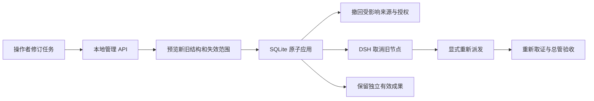

# HMM 服务端

## 当前能力与恢复范围（2026-11-07）

本节依据当前共享工作区源码和本会话的实际验证重述，不是丢失记录的逐字恢复。
后面的“当前验收边界（2026-11-05）”及各阶段记录保留其当时含义；
其中“暂不支持计划编辑”等描述不代表当前产品状态。

### 先保住已有事实，再增加功能

<重表述提示词为问题>如何在 DSH + DeepSeek SuperAgent 基座上减少重复输入、反复核对和错误恢复成本，
同时保留依赖、版本、成果和授权边界，不以界面便利替代执行真相？</重表述提示词为问题>

`S0`：已经实现任务创建、问答、执行恢复、计划编辑与闭环诊断，但上轮磁盘耗尽使本文件被截断。
`Sg`：先完成既有功能的相关回归和文档恢复，再决定下一项产品改进。
`IFR`：用户能直接知道下一步、修改什么、修改后影响谁；发生失败时已有正确工作不丢失。
本轮依次处理验证环境、文档恢复、恢复结果核对三项待办，不再增加新按钮或执行协议。

当前实际约束是共享磁盘和并行写入；方法上的选择是先降低有害作用，再扩展功能。
继续复用现有插件、管理 HTTP、SQLite 原子修订及 DSH 会话宿主。
不新增工作树，不自动修改用户依赖，不把界面草稿当作已保存成果或授权。

### 计划编辑的完整操作路径

| 用户需要 | 当前行为 | 仍需保留的判断 |
| --- | --- | --- |
| 查看或修改计划 | 展开时按需读取完整定义，修改名称、说明、同级顺序、依赖和串并行分组 | 自然语言说明不能替代显式依赖 |
| 增删与重组 | 新增步骤或分组、确认删除子树、跨组移动；无效引用保留供核对 | 空说明、空分组和无效引用修复后才能预览 |
| 复用相近方案 | 单步或子树复制为同计划新分支，批量新编号，内部依赖映射到副本 | 原消费者不自动接到副本；不等同跨任务组合 |
| 撤回误操作 | 最多二十次本页撤销与重做，连续同字段输入合为一次 | 不是后端历史回退；刷新、离页及成功重读不保留本页历史 |
| 核对修改 | 新增、移除、受影响项分列；变更字段可展开比较前后值 | 后端继续决定失效范围和应用合法性 |
| 进度变化后继续编辑 | 服务端计划身份核对；摘要和计划版本相同时仅更新执行基线 | 草稿、原因及历史保留，但必须重新预览；定义变化仍锁定 |
| 找到等待闭环 | 后端给出一条真实闭环，区分显式前置、串行顺序及双重约束；按名称定位 | 不自动删依赖、改并行或重排；多条独立循环可能需要逐次处理 |
| 应用修订 | 预览和应用使用同一份规范化完整候选，后端原子提交 | 本次操作暂停自动派发，不自动启动新节点 |

副本仅复制定义和核验要求，不继承成果、工作帧、执行次数、会话、原文读取回执或设备授权。
根分组不能复制；节点预算来自管理端返回值，累计编号预算包含墓碑及本次移除节点。
旧宿主缺少相应能力字段时保留原有保守路径，不后台探测或偷偷补请求。

预览前会对名称和说明做与服务端一致的首尾空白规范化，保留内部换行。
修改、撤销、版本变化都会使原预览失效。未知应用回执不会自动重放；
请求在途、权限收回、版本冲突和离页迟到响应均受原有互斥及隔离约束。

### 闭环诊断的验证边界

闭环路径由后端已有依赖遍历取得，仅包含节点身份、前置身份和约束类别，
不包含计划正文、工作帧、成果或会话内容。
客户端核对路径确实属于当前候选、前后闭合且约束类别完整；
无效、缺失或过期诊断退回通用错误，不产生错误定位动作。
界面使用名称和同名区分标签，用户输入按文本显示。

定位只打开步骤或分组并聚焦原编辑控件，不修改计划、不增加请求。
若用户仍在等待提交结果，提示接续焦点进入视口；
等待期间已经转到其他控件时不抢焦点。
修正后仍须重新预览，不能直接应用原有候选。

真实 HTTP、Runtime 与 SQLite 检查覆盖显式、串行、双重约束、
无关前缀及较长闭环；预览和应用拒绝时原快照不变，不启动节点。
由无环拓扑链构造从两步到节点上限的案例，改变声明顺序后再闭合链，
检查返回边确实组成完整闭环；不按某个名称或固定数组顺序决定通过。

中英文合成浏览器已验证窄屏和桌面中的名称展示、焦点定位、保留草稿、
修正后重新预览及同一候选应用。合成数据不证明真实用户认知负荷已下降。

### 同名步骤的编辑与预览一致性（2026-11-07）

本轮的问题是：整组复制保留子步骤名称，而步骤树、前置选择与影响列表此前只显示原名，
虽然后端按编号区分，操作者仍可能选错对象。候选方案是强制改名、展示内部编号或补充显示标签；
选择最后一种，避免把重复命名工作转交用户，也不改变业务定义。

步骤树、移动按钮、所属路径、前置选择、删除确认、待修复项、闭环提示、
变更比较和新增、移除、受影响列表统一使用本页的同名区分标签。
标签按首次载入或创建的身份顺序分配，重排、撤销与重做保留对应关系；
生成标签避开用户已有的同名后缀，名称首尾空白按提交规范处理。
名称输入仍显示原文，区分标签不提交、不持久化、不改变依赖或授权。
标签身份记录只保留载入定义、当前稿与最多二十次可撤销编辑需要的编号，成功重读后重新建立。

聚焦验证进一步覆盖连续复制、仅改副本依赖、同名项删除与修复、重排与撤销重做、
用户名称与生成后缀碰撞。真实 HTTP、Runtime 和 SQLite 验证同名步骤切换前置时，
仅对应消费者失效，原已完成步骤保留，声明顺序不改变依赖语义，应用不启动节点。
六个相关测试文件共 448 项通过，报告为 `.artifacts/hmm-plan-labels-regression.json`。
中英文合成页面在 320 与 1280 像素宽度检查长名称换行、前置选择及影响预览，
未发现横向溢出或步骤行控件重叠；这些证据不等于真实用户认知负荷已量化下降。

仍复用现有 DSH 插件与修订事务，不增加执行内核接口。
本轮只解决同名对象的识别一致性，跨任务组合和真实任务效率验证仍需另行推进。
本次补写前已校验备份，历史损失的恢复边界继续如下保留。

### 从具体问题直接进入修复字段（2026-11-07）

<重表述提示词为问题>如何让用户从具体问题直接到达可修复的位置，
同时保留原草稿、显式依赖和服务端校验？</重表述提示词为问题>

`S0`：待修复列表只列步骤名，用户仍需展开后辨认是名称、说明、空分组还是依赖问题。
`Sg`：每项提示说明具体原因，并只定位到相应控件；修复内容仍由用户决定。
`IFR`：错误发生的位置自然成为下一次操作的位置，不重复搜索，也不替用户猜测意图。
本轮依次核对修复原因、字段定位与前后端拒绝边界，集中解决这一条纠错路径。

选择复用本页已有候选、步骤身份和编辑控件，避免为草稿检查增加网络请求，
也不复制整套后端校验器。后台继续拥有依赖合法性、失效范围与原子应用的决定权。
这属于现有 DSH 插件中的产品交互，不需要新增插件或扩展执行内核。

四类提示分别对应缺少名称、缺少执行说明、空分组、已移除或跨组前置；
同一节点有多项问题时分别显示，沿用同名区分标签。
点击后展开该步骤并把对应控件带入视口；空分组只聚焦“新增步骤”，不自动创建节点。
依赖问题聚焦真正失效且仍被选中的前置，不会取消原选择或改写其他消费者。
字段变化及撤销、重做会更新列表，不主动转移焦点；
只读或版本过期时允许查看位置，焦点停在步骤标题，编辑和提交仍锁定。

六个相关测试文件共 459 项通过，报告为 `.artifacts/hmm-plan-repair-regression.json`。
真实 HTTP、Runtime、SQLite 检查覆盖四类无效候选绕过界面直调预览和应用，
均被拒绝，快照和原已完成成果保留，不启动节点。
中英文合成页面在 320 与 1280 像素宽度走完缺项、空分组、跨组依赖与手动修复流程；
定位阶段没有修订请求，修复后由用户明确提交一次预览，原有消费者依赖不变。
焦点可见，长名称与问题文案未出现横向溢出或步骤行控件重叠。
浏览器报告为 `.artifacts/hmm-plan-repair-browser.json`。

这些检查证明交互与状态边界，不能证明真实任务完成时间或认知负荷已经下降。
下一项应通过真实任务观察用户是否仍需往返查找，再决定是否需要改变问题列表的位置，
避免仅依据测试通过或新增提示数量扩展交互。
本次补写前已有内容校验备份，以下历史恢复边界保持原样。

### 提交预览后的反馈衔接（2026-11-07）

<重表述提示词为问题>如何让用户提交预览后直接读到结果，同时不抢走已移到其他位置的焦点，
也不展示过期结果？</重表述提示词为问题>

`S0`：长计划的预览显示在编辑区之后，成功返回时没有焦点或滚动衔接。
`Sg`：确认回执有效后，将仍在等待本次提交的焦点接到预览内容；
用户已转到其他控件、折叠面板、失去编辑权限或所属版本变化时不定位。
`IFR`：用户无需再次寻找本次操作的结果，同时保留自己选择的当前操作位置。
本轮核对回执有效性、接续预览焦点，并验证迟到响应及版本变化。

采用一次性的提交焦点记录，复用原有完整候选、回执校验和版本边界。
焦点停在有名称的预览区域，优先看到应用后果及影响范围，不直接聚焦“应用修订”。
折叠后重新展开也不补做旧焦点动作；修改、撤销和版本变化继续使旧候选失效。
不增加读取、预览或应用请求，不默认确认、不改变依赖，不新增插件或执行内核接口。

六个相关测试文件共 185 项通过，覆盖客户端、真实 HTTP 修订、本地化、导航及构建契约；
报告为 `.artifacts/hmm-preview-feedback-regression.json`，不是整个仓库的全部测试。
中英文、320 与 1280 像素宽度、等待与主动转移焦点组合成八组浏览器场景。
合成长计划包含 29 个节点；预览内容能进入视口，已转移的焦点保留，
再次按回车没有触发应用，各场景只有用户明确提交的一次预览请求，未出现横向溢出。
报告为 `.artifacts/hmm-preview-feedback-browser.json`。

本轮验证的是提交反馈及状态边界，不据此声称真实任务耗时或认知负荷已经量化下降。
临时浏览器验证使用共享源码和独立实例，未替换在线 DSH 产物。
本次补写前已有内容校验备份，以下历史恢复边界保持原样。

### 在原目录中查找旧任务（2026-11-07）

<重表述提示词为问题>如何让用户快速找到旧任务，同时不丢失当前草稿、
不混淆搜索范围，也不增加无关数据读取？</重表述提示词为问题>

`S0`：任务目录只能依次翻页，面板顶部的原搜索面向仓库工单、线程和触发消息。
`Sg`：在任务列表按名称查找，保留原有筛选、分页、返回位置与未提交目标。
`IFR`：用户凭已有的任务名称直接回到原工作，不必先逐页定位或重新描述目标。
本轮依次考虑任务定位、状态反馈和执行恢复，只推进任务定位。

| 路径 | 有用功能 | 新增代价与边界 |
| --- | --- | --- |
| 仅筛选当前页 | 实现少 | 找不到后续页中的任务，仍需人工翻页 |
| 复用 SQLite 名称查询 | 在分页前筛选，复用原状态与权限 | 子串匹配可能扫描历史记录，大数据量延迟需测量 |
| 独立全文或向量索引 | 可以扩展搜索范围 | 增加存储、同步和维护成本，本轮没有对应需求 |

选择第二条路径。`GET tasks` 和总管的 `hmm_tasks` 共用可选 `q`，
首尾空白去除后最多 100 字符，只匹配任务标题；不搜索输入正文、工作帧、知识库或会话。
参数化 SQL 对 `%`、`_`、反斜杠做字面匹配，来源和操作者边界、状态与创建游标条件继续生效。
只为返回页读取 HMM 状态，不逐个组装详情，不创建结果副本、索引或新的持久状态。
读取不授予执行权限、不启动模型；前后端仍复用现有插件接口，不扩展 DSH 内核。

客户端将正在输入和已提交的关键词分开保存；按回车或点搜索后才改变读取范围，
相同已提交关键词不重复请求。关键词变化或筛选切换回到第一页；
翻页保留已提交关键词，从详情返回保留搜索、原页和新建草稿。
清除后回到当前筛选的首屏并聚焦输入；本页搜索不写入跨宿主或离页持久存储。
搜索页各次挂载独立，关键词 A/B/A 切换后的旧结果或错误不能覆盖新结果。
无匹配与读取失败分别呈现，失败不会伪装成空结果。
HMM 模式只显示任务搜索，仓库模式保留原搜索；模式切换重建页头，避免旧结果回流。

六个相关文件共 375 项检查通过，覆盖客户端、真实 HTTP、SQLite、总管工具、存储、
本地化和导航，报告为 `.artifacts/hmm-task-search-regression-final.json`。
测试包含名称位于旧页、只在正文中出现关键词、特殊字符、来源越界、组合筛选、
跨重启游标、迟到响应、失败重试和详情往返，不按某个任务标题决定匹配是否正确。
这些是相关回归，并非整个仓库的所有测试。

中英文合成目录各含 120 项，在 320 与 1280 像素宽度验证输入、回车、分页、
详情返回、筛选及清除；输入阶段没有查询，整个操作链只有六次目录读取，全部为 GET。
页面只保留一个搜索入口，控件无横向溢出或重叠，草稿和游标保留。
浏览器报告为 `.artifacts/hmm-task-search-browser.json`；合成浏览器不替代真实 SQL 与权限检查。
仍未量化真实用户耗时、认知负荷或大数据量查询延迟，不据此声称达到全局最优。
后续应根据真实任务规模与查询耗时决定是否值得新增索引，避免提前引入同步成本。
本次补写前已有校验备份，以下历史恢复边界保持原样。

### 区分搜索输入与当前查询（2026-11-07）

<重表述提示词为问题>如何分清正在输入的关键词与当前结果范围，
同时保持按提交查询、低请求开销和原阅读位置？</重表述提示词为问题>

现状是输入 B 尚未提交时，列表仍属于 A；让输入自动查询会增加请求，
让用户自己记住旧范围则增加核对成本。本轮复用已有的已提交关键词与状态筛选，
仅在两者不同于输入时显示当前查询范围，并由搜索框的无障碍说明关联它。
提示不宣称结果已经成功返回；不限名称时仍显示真实状态筛选，不误报为全部任务。
用户关键词作为文本显示，长词可换行；两份关键词再次一致或清除后提示与关联一并移除。
没有新增请求、后端契约、持久状态、自动提交或焦点转移。

已有搜索专项中选取的 8 项检查通过，另有 24 项本地化及导航检查通过；
不是全仓测试。中英文在 320 与 1280 像素宽度验证未提交输入、筛选切换、
详情往返、清除与查询失败，提示始终引用已提交范围，输入没有额外查询，
草稿保留，长关键词未横向溢出。记录为 `.artifacts/hmm-search-scope-browser.json`。
这些检查说明显示与请求一致，不替代真实用户的认知负荷或效率测量。
本次补写前已有校验备份，以下历史恢复边界保持原样。

### 继续与暂停派发直接接纳状态回执（2026-11-07）

<重表述提示词为问题>如何让用户操作后直接看到已确认的执行状态，
同时减少网络往返、不覆盖新状态，也不阻止原控制动作？</重表述提示词为问题>

`S0`：继续和暂停派发先返回短回执，客户端再读取任务状态；恢复步骤与停止任务已经能接纳完整回执。
`Sg`：复用原控制命令，在版本一致时就地更新状态；缺少或无法确认投影时保留原重读路径。
`IFR`：一次明确操作直接带回可核对的结果，不要求用户再判断是否需要刷新。
本轮依次考虑执行回执、恢复边界和验收交接，只推进执行回执。

选择扩展已有管理 HTTP 回执，不新增命令地址、持久状态、执行器或插件。
`POST tickets/:id/hmm/commands` 保留短回执字段，只为本地操作者任务的
`dispatch` 与 `hold` 增加可选 `task`。领域写入与状态投影由同一事务包围；
真实提交成功后才发送回执，状态中的运行事实来自原投影，不把允许派发说成节点已经运行。
其他来源和其他命令仍返回短回执；模型工具不增加任务投影或上下文。
可选投影失败时退回原短回执，尤其不能因显示投影失败而撤销暂停。

客户端先核对任务身份、控制前后版本、计划版本、阶段与派发开关，
再通过当前订阅的数据身份接纳回执。期间即使节点版本相同，若新输入或全局暂停已被读到，
旧回执也不能覆盖它，只重读供用户核对，不重放命令。
旧宿主、局部或矛盾回执继续采用原重读路径；离页后的响应不再影响已离开的页面。
暂停导致的挂起列表沿原快照失效规则更新，未提交补充和已有成果保持。

五个相关文件共 464 项检查通过，覆盖客户端、真实 HTTP、SQLite、恢复、计划修订及接口错误；
报告为 `.artifacts/hmm-control-receipt-regression.json`，不是全仓测试。
服务器检查包括已完成成果保留、显示投影失败仍暂停、旧版本重试拒绝、来源与命令边界。
客户端 22 个场景覆盖正常接纳、在途旧读取、并发新输入、缺失投影及各类绑定不符。

中英文、320 与 1280 像素宽度、两种控制动作、新旧回执组合成 16 组浏览器检查。
各场景只提交一次命令；新回执没有后续状态 GET，旧回执继续读取一次，未提交草稿保留。
报告为 `.artifacts/hmm-control-receipt-browser.json`；浏览器使用合成投影，事务和取消语义由真实 HTTP 测试核对。
这一取舍把原来的短回执加状态 GET 合并为一次较大的回执，减少一次请求及往返，
不等于减少了完整状态的正文大小，也没有实测真实网络延迟或用户认知负荷。
可选投影有额外计算成本；暂不引入缓存、增量同步或新执行协议。
本次补写前已有校验备份，以下历史恢复边界保持原样。

### 执行回执未知时先核对事实（2026-11-07）

<重表述提示词为问题>如何在回执未知时自动核对一次事实，
既减少重复操作，又不把读取当成执行成功？</重表述提示词为问题>

`S0`：继续、暂停、恢复和停止请求断网或出现服务错误时，只弹出错误，界面可能仍显示操作前状态。
`Sg`：回执无法确认时，沿现有任务读取核对一次；明确的参数和权限拒绝保留具体原因。
`IFR`：用户依据当前事实决定下一步，不必自行判断该刷新还是重复操作。
本轮依次考虑未知结果、明确拒绝与离页响应，只推进未知结果的核对。

网络不可达、服务错误或异常回执不能证明操作未提交。客户端只读取任务，
不自动重发动作，也不根据新版本推断原请求成功；原异常保留为错误的 `cause`。
已确认的版本冲突仍沿原路径读取；明确的参数、权限拒绝不额外读取。
核对期间沿用现有操作忙碌状态；读取也失败时，沿原错误投影显示状态待核实，
限制继续和恢复，保留暂停与停止入口。人工重读只读取事实，不补发旧动作。
离页后不再更新旧视图，未提交补充保持。没有新增接口、持久状态或执行协议。

四个相关文件共 462 项检查通过，覆盖客户端、真实任务状态与恢复接口及本地化，
报告为 `.artifacts/hmm-control-unknown-regression-final.json`，不是全仓测试。
故障检查同时覆盖服务器已经提交与未提交、断网与服务错误，验证只有一次原命令和一次核对；
读取仍失败后，人工重读不得恢复旧请求。明确拒绝、取消、显式重试、焦点和草稿检查继续保留。

中英文、320 与 1280 像素宽度共 16 组浏览器故障场景通过，
报告为 `.artifacts/hmm-control-unknown-browser.json`。浏览器故障与状态是合成数据，
不能据此声称已验收真实弱网、手机链路、模型执行或用户效率。
代价是未知回执后增加一次只读请求；没有增加自动执行或新确认步骤。
读取只能提供当前事实，无法在网络不确定条件下绝对证明某次历史请求的因果归属。
本次补写前已有校验备份，以下历史恢复边界保持原样。

### 共享执行容量计入启动和唤醒预留（2026-11-07）

<重表述提示词为问题>如何把启动、唤醒预留计入共享容量，
又不把这些预留误显示成正在运行？</重表述提示词为问题>

`S0`：普通执行器已经同步预留槽，但 HMM 调度只扣除其运行工单数。
准备命令或会话唤醒尚未结束时，有预留而没有运行 Agent，两个调度入口因此可能超额分配。
修改前的可控复现中，上限为三，一个普通工单运行、另一个启动准备，HMM 仍分配两个节点，
合计四个占用；两种准备结果均能复现，记录为 `.artifacts/hmm-shared-capacity-reproduction.json`。
`Sg`：用已有预留与运行身份的并集决定占用，保留独立的运行事实。
`IFR`：真实容量自动约束执行，用户不必调低并发来绕过竞态或猜测为何“空闲却等待”。

复用原 `WorkerSlots`，不新增信号量、全局计数器或持久状态。
同次读取返回运行与占用两个投影，同一工单从预留转为运行时不重复计数。
HMM 继续使用原公平调度和计划上限，但扣除普通工单的真实占用；
唤醒预留释放后通知容量变化，失败时也能继续调度，不等待无关事件。
原来为人类跟进保留的一个额外槽规则保持，不据此声称所有情况下都不超过配置数值。

管理接口在 `load.occupied` 中合并普通工单与 HMM 实例占用；
同次读取复用运行投影，不为显示再扫描一次工单。普通运行数仍保持原含义。
HMM 设置控件显示执行槽占用，原工单队列明确标为工单待启动，零项不额外展示。
旧宿主缺少占用字段时保留原运行显示，仓库模式保持原呈现；
不会猜测队列位置、剩余时间或把其他类型排队混成 HMM 等待数。
此容量只描述既有执行池，不等于总管调用数、设备端任务或提供方账号的并发配额。

九个相关文件共 490 项检查通过，其中调度、并发、后台与 HTTP 为 128 项，
设置、客户端、本地化与构建信息为 362 项，报告分别为
`.artifacts/hmm-shared-capacity-regression.json` 和 `.artifacts/hmm-shared-capacity-interface.json`。
真实运行时夹具覆盖启动及唤醒的成功、失败、预留释放后的继续派发，
并经管理 HTTP 核对占用数，保留后台占用、同工单去重、人类额外槽及调度公平性检查。
这是相关回归，不是全仓测试，也没有改写整体优先级策略。

中英文、320 与 1280 像素宽度、新计量、额外占用、旧接口和仓库呈现共 16 组控件预览通过，
报告为 `.artifacts/hmm-shared-capacity-browser.json`。显示本身只有读取，
原暂停确认与取消仍有效，暂停不把尚未释放的占用伪装为零，未发现溢出或重叠。
浏览器使用合成容量并渲染真实控件；不能替代真实模型、外部设备或峰值内存验收。
没有据此量化用户认知负荷、模型质量或实际延迟收益。
本次补写前已有校验备份，以下历史恢复边界保持原样。

### 解释正常的执行容量等待（2026-11-07）

<重表述提示词为问题>如何让用户知道任务正在正常等容量，
同时不把阻断误报为排队，也不要求重复派发？</重表述提示词为问题>

`S0`：没有运行节点时只显示等待执行，用户无法区分正常容量等待与需要处理的问题。
`Sg`：由原调度器提供容量事实，在符合条件的任务详情显示一句自动等待原因。
`IFR`：系统根据已有条件解释下一步，用户无需反复派发或查询设置来判断是否要介入。
提高解释完整性会增加阅读成本，因此仅在有就绪步骤、允许自动执行、宿主可用、
没有暂停或其他处理事项且容量不足时提供提示，正常运行及其他状态不重复说明。

复用原全局容量条件和实例占用，不增加队列、持久计数、执行状态或插件。
只读的 `workflow.waitingFor: "capacity"` 随任务状态读取返回；
容量包含共享槽及计划内尚未退出的实例，不把已交成果误当作执行实例已释放。
若计划仍有节点运行，继续显示运行事实；容量释放后由原事件机制重新调度。
读取不执行、不承诺排位、时间或下一步一定成功，也不改变依赖与尝试预算。

客户端复用原轮询；即使节点版本未变化，容量原因仍可更新。
待回答、全局暂停、操作已暂停、状态过期或未知原因不显示自动容量等待。
提示不改变焦点或草稿，不增加网络请求；旧宿主没有该字段时保留原显示。
代价是符合条件的详情读取多核对一次当前占用，不增加缓存或轮询频率。

七个相关测试文件共 579 项通过，报告为 `.artifacts/hmm-capacity-wait-regression.json`，
覆盖任务 HTTP、SQLite、调度、并发、恢复、客户端及本地化，不是全仓测试。
核对真实调度条件及释放后自动推进，并覆盖全局仍有槽、前一回合暂占计划容量的反例；
已交成果保留，状态读取不增加执行。补充信息送达不被误当作已采纳或新增阻断。
中英文、320 与 1280 像素宽度四组浏览器各验证十次状态切换，
报告为 `.artifacts/hmm-capacity-wait-browser.json`：同版本变化、失败和恢复均保持范围一致，
没有写请求，焦点与草稿保留，提示未横向溢出。
浏览器状态为合成数据，不替代真实调度检查；尚未测量用户认知负荷或真实模型性能。
本次补写前已有校验备份，以下历史恢复边界保持原样。

### 完成历史与当前结果可用性分开呈现（2026-11-07）

<重表述提示词为问题>如何让用户在任务目录识别已失效的验收结果，
又保留真实完成历史，不必逐项打开详情核对？</重表述提示词为问题>

`S0`：来源撤回后，详情会隐藏失效结果，但目录仍只有历史已完成。
`Sg`：目录保留完成历史，并用已有验收规则显示当前结果异常。
`IFR`：结果是否仍可交付随已有读取自然呈现，用户无需另行检查或学习新操作。
本轮仅收敛这一项；其余待办是交互验证、隔离构建与验证边界记录。

复用 HMM 的阶段、输入版本、证据与断言检查，不修改 DSH 内核或增加插件。
任务完成记录是历史事实，当前结果可用性是只读投影，两者不互相覆盖。
仅核对筛选、搜索和游标之后的当前页已完成记录，停止或失败记录不读计划；
不返回成果正文、不读取详情，也不增加客户端请求、缓存或持久状态。
代偿成本是当前页完成记录的只读验收检查，不能据此声称没有服务端成本。

已知不可交付时，目录附带 `resultAvailability: "unavailable"`；
缺少计划或不支持状态版本时为 `"unknown"`，分别显示当前不可用和待核实。
健康记录不附加字段或提示；其他意外存储错误仍报告读取失败。
旧宿主缺字段、未来未知值和非完成记录保留原显示。
读取失败后旧目录只表示历史观察，不能继续冒充当前核验。
无障碍说明关联任务名称；刷新不移动焦点，查看详情再返回保留新建草稿。
这些状态不授予执行许可，也不自动恢复、重跑或改写历史。

十个相关测试文件共 574 项通过，报告为
`.artifacts/hmm-delivery-availability-regression.json`，不是全仓测试。
新增服务端检查使用真实 Runtime、SQLite 和 HTTP，模型由夹具替代，
覆盖来源撤回、缺计划、未来版本、分页搜索、来源范围、意外存储失败及读取无副作用。
客户端检查覆盖中英文、兼容边界、被动刷新、失败恢复、草稿、焦点与无障碍说明。
类型检查及输出到 `.artifacts/hmm-delivery-availability-build` 的隔离构建通过。

Playwright 使用真实前端和合成目录，核对中英文、320 与 1280 像素四组交互，
报告为 `.artifacts/hmm-delivery-availability-browser.json`；
打开前无详情读取，全程无写请求，草稿与焦点保留，未发现横向溢出。
浏览器合成状态不能替代服务端的真实来源撤回检查。
未测量真实用户认知负荷、实际节省点击数或峰值读延迟；
本轮联网检索未取得可用上游资料，不据此声称兼容最新 DSH。
共享目录内完成，无新工作树，没有部署或重启主服务。
本次补写前已核对备份校验值，以下历史恢复边界保持原样。

### 按真实验收原因解释结果异常（2026-11-07）

<重表述提示词为问题>如何让任务详情解释结果不能交付的真实原因，
与目录判定一致，并复用现有讨论入口完成后续核对？</重表述提示词为问题>

`S0`：目录已能识别不可交付，详情却把输入版本和断言复核问题都说成引用失效；
旧持久状态没有验收记录或阶段未验收时，还会跳过检查而不显示原因。
`Sg`：保留完成历史，以同一领域检查决定是否显示成果，并按已知原因解释。
`IFR`：用户直接知道哪项交付条件未满足，无需自行对照错误代码或猜测应重跑什么。
本轮依次收敛判定一致性、原因说明和验证边界，不扩展恢复或执行协议。

详情对全部历史完成记录调用已有 `assertResultAvailable`，
复用目录的阶段、输入版本、证据与断言检查。
缺少验收记录或阶段不符也返回 `workflow_unverified`，不再静默略过。
检查成功后才读取验收摘要；失败仍保留历史完成和当前计划，不启动节点。
相比原检查只补齐跳过的条件，不增加持久状态、客户端请求或 DSH 内核接口。

前端按白名单区分证据失效、补充信息版本不一致、断言未通过复核、没有有效验收结果。
未来未知代码使用当前不可用的保守说明，不显示内部代码或猜测具体原因。
原“讨论此任务”入口继续承接核对；读取和被动刷新不会写入讨论背景，
只有用户明确点击才沿用原请求身份写入背景并打开对应会话，不视为恢复或重新执行。
代偿成本是三条原因文案和一个固定映射，不增加选择项、按钮或错误处理框架。

新增七项检查，十个相关测试文件共 581 项通过，报告为
`.artifacts/hmm-result-reasons-regression.json`，不是全仓测试。
服务端使用真实 Runtime、SQLite 和 HTTP，模型由夹具替代；
正常完成及复核后模拟旧存储缺失或过期条件，核对目录和详情拒绝交付的一致性、
具体错误、正文隐藏、历史保留及读取无副作用。
客户端检查中英文原因切换、未知代码、讨论入口和仅显式操作产生写入。
类型检查及 `.artifacts/hmm-result-reasons-build` 隔离构建通过。

Playwright 在中英文、320 与 1280 像素四组页面中各切换六类原因，
报告为 `.artifacts/hmm-result-reasons-browser.json`。
焦点、历史与返回后的草稿保留，未出现横向溢出；
被动读取无写请求，每组只有明确点击讨论产生一次背景写入，没有执行请求。
浏览器使用真实前端和合成状态，不替代服务端领域检查，也不证明用户耗时已下降。
共享目录内完成，无新工作树，没有部署或重启主服务。
本次补写前已核对备份校验值，以下历史恢复边界保持原样。

### 计划不可读时仍能讨论原任务（2026-11-07）

<重表述提示词为问题>任务记录仍在但计划缺失或版本不支持时，
如何保留讨论对象，避免用户返回主对话重新定位任务？</重表述提示词为问题>

`S0`：详情首次读取失败时只有错误和重读入口，原有任务讨论能力无法到达。
`Sg`：只在确认本地任务仍存在的两类计划错误上提供原讨论入口。
`IFR`：用户从当前问题直接继续讨论，任务身份自然传递，无需重复描述对象。
本轮只推进保留身份的恢复路径，依次核对入口、后端契约和交互边界。

比较三条路径：自动重建会改写业务状态；让用户返回主对话需重新定位；
复用现有讨论入口只传身份，保持原业务状态与执行授权。
选择第三条，不新增插件、执行内核接口、恢复协议或持久状态。
后端原 `discuss` 已按本地任务检查范围，再注入持久身份背景，
其工作不依赖完整计划；本轮不为前端便利改写该后端实现，只补充契约验证。

前端仅识别服务端明确返回的 `404/workflow_missing` 和 `409/schema_unsupported`，
说明计划读取问题及记录保留事实，复用“讨论此任务”与原请求身份。
任务缺失、来源越界、空响应、网络和未知错误，以及错配状态码均不启用该入口。
先读到健康状态再遇到计划错误时，保留旧信息和过期说明，也能讨论；
读取恢复后移除旧异常，仍由当前业务事实决定是否需要讨论。
本轮代偿成本是两条本地化文案和固定错误匹配，没有额外探测或后台写入。
明确点击才传递讨论背景；重复点击合并、导航失败原样重试，
不解释成恢复、派发、验收或修复成功。

九个相关测试文件共 510 项通过，报告为
`.artifacts/hmm-plan-read-recovery-regression.json`，不是全仓测试。
新增服务端检查使用真实 Runtime、SQLite 和 HTTP，模型由夹具替代，
验证缺计划、未来版本、任务身份、重试去重、来源拒绝及讨论不唤醒或启动执行。
新增客户端检查覆盖中英文、错误白名单、未知与网络错误、连点、
导航失败后的同身份重试，以及已有结果的读取失败和恢复。
类型检查及 `.artifacts/hmm-plan-read-recovery-build` 隔离构建通过。

Playwright 在中英文、320 与 1280 像素四组真实页面中验证两类计划错误、
任务缺失及空响应拒绝、显式讨论、重读恢复和返回后的草稿保留；
报告为 `.artifacts/hmm-plan-read-recovery-browser.json`。
被动读取无写请求，每组只有明确讨论产生一次背景写入，没有执行请求或横向溢出。
浏览器数据为合成状态，不替代后端契约检查，也未量化真实用户效率收益。
本轮联网检索未取得可用上游资料，不据此声称采用或兼容最新 DSH 变更。
共享工作区内完成，无新工作树，没有部署或重启主服务。
本次补写前已核对备份校验值，以下历史恢复边界保持原样。

### 讨论回执确认后才打开会话（2026-11-07）

<重表述提示词为问题>如何确认讨论回执仍属于当前任务与总管，
避免打开错误会话，同时兼容旧接口且不增加用户操作？</重表述提示词为问题>

`S0`：已有离页和任务切换隔离，但收到成功状态码后直接打开回执中的会话。
修改前，合成回执返回另一总管编号时实际调用了打开会话；
失败复现记录为 `.artifacts/hmm-discussion-receipt-before.json`。
`Sg`：在本次访问仍有效的前提下，先确认回执身份再导航。
`IFR`：讨论自然进入正确对象，用户无需额外核对任务或会话编号。
本轮只推进回执确认，保留原有注入、权限、去重与执行边界。

后端在本地任务控制面回执中返回 `ticketId` 与原 `sessionId`；
DSH 会话适配层不增加业务判断，也不引入新插件或持久状态。
客户端要求会话与本次访问的总管严格一致，附带任务编号时也必须匹配。
旧宿主省略任务编号仍可兼容，但不能省略或替换总管身份。
非对象、空值、数组、错误类型或身份不匹配均保持原页面并提示原样重试。
既有访问身份继续复用，拒绝回执不自动重试、不新增读取或执行。
代偿成本是短回执字段、固定身份比较和一条本地化提示，不增加按钮或设置。

九个相关测试文件共 515 项通过，报告为
`.artifacts/hmm-discussion-receipt-regression.json`，不是全仓测试。
新增客户端检查覆盖错误任务、错误总管、异常 JSON、旧新回执兼容与同身份重试；
真实 Runtime、SQLite 和 HTTP 检查核对后端任务身份及计划不可读时的既有讨论边界。
类型检查及 `.artifacts/hmm-discussion-receipt-build` 隔离构建通过。

Playwright 在中英文、320 与 1280 像素四组完整面板中，
分别拒绝四类异常回执，并接纳新版和旧版两类有效回执。
报告为 `.artifacts/hmm-discussion-receipt-browser.json`：
错误回执没有导航，显式重试沿用原编号，没有额外读取、执行请求或横向溢出。
预览使用合成回执，并在本页补充缺失的提示条主题变量；
没有修改产品主题，截图不代替完整宿主主题或真实网络验收。
未量化真实用户耗时收益，未部署或重启主服务，也未新建工作树。
本次补写前已核对备份校验值，以下历史恢复边界保持原样。

### 已完成任务先读结果（2026-11-07）

<重表述提示词为问题>如何让用户先看到已经交付的结果或当前失效原因，
同时保留过程、依据与历史，不增加新的操作概念？</重表述提示词为问题>

`S0`：结果已由后端验收检查提供，但详情仍把计划、质量面板和节点进度排在结果之前。
`Sg`：状态读取提示之后先显示验收结果或失效说明，过程信息继续保留。
`IFR`：用户沿自然阅读顺序直接找到当前有用输出，不必先理解执行结构。
本轮只推进阅读顺序，依次核对结果位置、失效边界和浏览器路径。

本轮读取的上游原型文档继续要求少概念、少设置、减少注意力消耗，
并把需要人处理的内容置于历史细节之前：
[设计原则](https://github.com/deepseek-ai/dsh-superagent-prototype/blob/main/docs/000-philosophy.md)、
[面板原则](https://github.com/deepseek-ai/dsh-superagent-prototype/blob/main/docs/005-panel.md)。
本轮取舍是在现有插件内移动原结果区块，不新建摘要缓存、展示状态或插件。
后端当前可交付检查与已验收摘要直接复用，不另造前端验收逻辑，也不改变接口。

结果正文与失效说明仅展示一处，DOM 阅读顺序和视觉顺序一致；
读取失败时的过期说明仍在前面，不把历史观察冒充当前核验。
验收采用的步骤继续默认折叠，明确展开后才读有界依据；
计划、质量、进度与历史仍可查看，讨论、权限和执行动作保持原有条件。
代偿是较长结果会把过程信息推到下方，因此不再额外展开依据或过程面板。
不为此次排版调整新增与实现顺序同构的单元测试，复用已有行为回归与浏览器检查。

五个相关测试文件共 469 项通过，报告为
`.artifacts/hmm-result-priority-regression.json`，不是全仓测试。
包括客户端交互和真实 Runtime、SQLite、HTTP 的结果可交付边界；
类型检查及 `.artifacts/hmm-result-priority-build` 隔离构建通过。
Playwright 核对中英文、320 与 1280 像素、长短结果共八组场景，
报告为 `.artifacts/hmm-result-priority-browser.json`：
从本次合成目录进入后首屏能读到结果开头，结果没有重复；
展开前依据读取为零，明确展开后一次读取，引用失效后正文与旧依据隐藏。
全程无写请求，完成历史和返回后的新建草稿保留，没有横向溢出。

浏览器使用真实前端和合成任务，不替代真实用户效率、任意滚动位置或弱网验收；
本轮没有增加导航自动滚动或焦点转移策略，也不声称兼容最新 DSH 发布版。
共享工作区内完成，无新工作树，没有部署或重启主服务。
本次补写前已核对备份校验值，以下历史恢复边界保持原样。

### 从目录打开任务时接续阅读焦点（2026-11-07）

<重表述提示词为问题>从列表明确打开任务时，如何让键盘阅读自然接到当前详情，
又不在读取、恢复路由或用户转移位置后抢走焦点？</重表述提示词为问题>

`S0`：结果顺序已提前，但打开任务后原目录按钮被卸载，焦点回到文档主体。
深列表复现中标题已可见，因此本轮没有把问题归因为滚动位置；
实际断点是缺少焦点交接，记录为 `.artifacts/hmm-task-entry-before.json`。
`Sg`：只消费一次由目录打开动作产生的访问身份，将焦点接到非操作标题。
`IFR`：用户直接从当前任务继续阅读，不必从页面开头重新寻找详情。
本轮只收敛明确导航、异步读取和用户主动转移位置之间的边界。

现有页面标题组件增加可选引用，任务页据此设置可编程焦点。
目录打开时记录当前任务和来源元素；详情首次挂载立即消费，随后清除来源引用。
只在原焦点已丢失或仍属于本次来源时接续；等待期间转移的焦点继续保留。
标题从加载名称更新到真实名称时沿用同一元素，不再移动焦点；
恢复存储路由、后续轮询和离页后的旧回执也不会触发新的交接。
使用 `preventScroll`，不增加自动滚动、按钮、接口、持久状态或 DSH 执行内核能力。
代偿成本是一份本次访问记录及共享标题的可选引用，未使用该能力的页面保持原行为。

六个相关测试文件共 384 项通过，报告为 `.artifacts/hmm-task-entry-regression.json`，
包含导航、设置页面及既有任务交互；类型检查和独立构建通过。
清理来源引用后，新增五项聚焦检查再次通过，
报告为 `.artifacts/hmm-task-entry-final-focused.json`，不重复计入回归总数。
Playwright 核对中英文、320 与 1280 像素、快速与延迟读取及主动转移焦点共十二组，
报告为 `.artifacts/hmm-task-entry-browser.json`。
合成目录有五十项，从约 2400 像素深处打开第 36 项，标题可见且接到焦点；
等待期间及后续状态变化不抢焦点或改变滚动，返回目录保留新建草稿，全程只有读取。
摘要处于当前二千字符预算内，未发现横向溢出。
浏览器使用真实前端与合成状态，不等于读屏软件或真实用户效率验收。
共享工作区内完成，无新工作树，没有部署或重启主服务。
本次补写前已核对备份校验值，以下历史恢复边界保持原样。

### 验收依据确认归属后再合并（2026-11-07）

<重表述提示词为问题>如何让按需读取的验收依据始终属于当前任务与验收版本，
避免错页、重复节点或异常响应增加用户判断成本？</重表述提示词为问题>

`S0`：已有任务版本和离页隔离，但成功读取分支直接合并响应，缺少页归属与连续性核对。
`Sg`：确认任务、版本、总数与游标后再显示，不把 HTTP 成功当作依据已确认。
`IFR`：系统自动维持证据关系，用户只需阅读和处理真正需要决策的内容。
本轮依次检查归属、分页与错误恢复，只收敛验收依据这一个读取入口。

后端沿现有只读事务回传实际请求的 `offset`，继续复用权限、验收和节选预算；
前端确认任务编号、验收版本、目录给定的依据总数、偏移回显与连续的下一游标。
节点编号跨已读页和本页不能重复，名称相同仍合法；节选必须包含文本及截断标记。
不固定页长，旧宿主省略偏移回显时仍按其余原契约核对。
异常页不进入界面，也不覆盖已读依据或推进游标；沿原入口原样重试，
不自动重读状态、不重发执行。明确的服务端版本冲突继续沿原有状态重读路径处理。
代偿成本是当前有界页的字段和身份检查；不增加插件、缓存、持久状态或执行内核接口。

新增七项客户端检查，八个相关测试文件共 489 项通过，
报告为 `.artifacts/hmm-result-source-binding-regression.json`，不是全仓测试。
真实 Runtime、SQLite 和 HTTP 检查确认偏移回显、只读及撤回边界；
客户端覆盖异任务、旧版本、总数变化、偏移错配、游标停滞、重复节点和损坏节选，
并核对每页一、二、四项及旧回显兼容，不按固定页长或特定名称定义正确性。
类型检查及 `.artifacts/hmm-result-source-binding-build` 隔离构建通过。
最初修改前测试停在折叠控件定位，不能算作成功复现；本轮依据是源码审查及修正后的行为检查。

Playwright 在中英文、320 与 1280 像素四组真实前端中核对异常页与重试，
报告为 `.artifacts/hmm-result-source-binding-browser.json`：
异任务正文隐藏，已读四项保留，有效重试后得到七项；
请求偏移依次为 `0,0,4,4,4`，旧回显可读，没有额外状态读取、写入或横向溢出。
浏览器使用合成回执，不替代真实弱网、宿主升级或用户效率验收。
共享工作区内完成，无新工作树，没有部署或重启主服务。
本次补写前已核对备份校验值，以下历史恢复边界保持原样。

### 文档损失与恢复说明

上轮 O 卷空间耗尽时，对本文件的写入失败并造成截断；本轮确认时仅剩 205 字节。
本轮先保留截断后的文件，再从本地会话的建档内容及成功修改记录恢复历史原文：

- 193 条成功修改记录全部应用，上下文核对未出现冲突。
- 恢复的历史原文为 245,489 字节、2,942 个文本行，最后一条记录对应 2026-11-05 的修改。
- 截断前文件超过四千行，后续会话追加部分没有找到完整可重放备份，因此不能声称已逐字完整恢复。
- 本节是依据当前源码补写的现状说明，历史中丢失的逐次实验数字与过程不据此补造。

恢复候选、逐条修改证据及截断文件保存在 `.artifacts/recovery/`。
该目录是本地恢复证据，不属于运行时数据；后续发布或归档时应另行保全。
主文件通过先写恢复候选、核验内容、再替换的顺序恢复，避免在磁盘不足时直接覆盖唯一副本。

### 本轮验证与取舍

此前 O 卷无可用空间时，原配置无法写入 Vite 缓存。
本轮使用 C 盘临时配置和缓存读取同一个 O 工作区，先完成 147 项聚焦检查，
再完成 24 个相关文件共 806 项回归，全部通过，无失败或跳过。
这是一组相关回归，不是整个仓库的所有测试。
之后共享环境释放了 O 卷空间；没有执行被策略拦截的清理操作。

恢复开始后发现 C 卷也已耗尽，恢复候选与证据改存工作区 `.artifacts/recovery/`。
磁盘位置变化只是验证和恢复的临时手段，不是容量管理问题已经解决的证明。
没有提高原预算、放宽领域检查或删除断言来使测试通过。

源码、构建指纹和测试结果只能代表各自检查时刻，不能覆盖之后的并行修改。
恢复后重新运行的 32 项文档及构建契约检查全部通过，全仓类型检查及差异检查通过。
相关回归报告为 `.artifacts/hmm-cycle-help-recovered-full.json`；
恢复后的契约报告为 `.artifacts/hmm-cycle-help-recovery-contracts-final.json`。
本轮重新构建后曾核对源码与产物指纹一致；之后主会话继续修改源码，
不将此前构建当作这些后续修改的验证。
本轮未部署、重载在线 DSH、调用真实模型或设备、提交或推送。
下一步应优先用真实任务验证复制、纠错和状态恢复能否减少返工，
再决定跨任务组合的身份、引用和授权转译，避免仅靠增加界面能力判断完成度。


## 已恢复的历史原文

状态：已选择 DSH + DeepSeek SuperAgent 为运行基座；已实现工单内计划状态、独立推理节点调度、
操作者与可信设备证据片段的受限读取、引用校验、重新核验、工单内断言图和逐条复核，以及管理端与受限总管的原子计划修订。
已建立固定模拟任务的执行契约与资源基线；真实模型质量、网络、手机性能仍待实测。

## 当前验收边界（2026-11-05）

本文同时保留分阶段演进记录。旧阶段中的“本轮”“尚未实现”和“下一步”描述当时状态，
不能直接作为当前缺口；本节区分已验证的骨架与仍需外部证据的能力，不表示完整 OPML 已实现。

| 能力 | 当前证据 | 边界 |
| --- | --- | --- |
| HMM 本地任务面板 | `tests/client.spec.tsx`、`tests/navigation.spec.ts`、`tests/hmm-task-resume.spec.ts`、`tests/hmm-task-status.spec.ts` | 仅 HMM 部署显示；支持任务创建、状态与阻断查看、挂起步骤名称与恢复条件提示、同版本挂起步骤按需分页、按需显示总管入口、全局暂停时进入执行设置、暂停/继续派发、选中步骤恢复并继续任务、确认停止整个任务、补充上下文和打开总管 Session；暂不支持计划编辑、逐条断言复核或设备授权编辑 |
| 目标输入、嵌套及串并行计划 | `tests/hmm-custom-plan.spec.ts`、`tests/hmm-task-preparation.spec.ts` | 本地可信管理入口；显式依赖仍为 AND |
| 步骤增删、移动、重排及重核验 | `tests/hmm-revision.spec.ts`、`tests/hmm-replan.spec.ts` | 原子修订与有界重算；不是任意历史回退或自动发现最优计划 |
| 授权取证、引用失效及工单断言图 | `tests/hmm-evidence.spec.ts`、`tests/hmm-devices.spec.ts`、`tests/hmm-claims.spec.ts` | 可信端口和单工单范围；不是完整手机知识库或跨工单实体图谱 |
| 执行内核隔离、回收与故障恢复 | `tests/hmm-boundary.spec.ts`、`tests/hmm-node-runtime.spec.ts`、`tests/hmm-crash-recovery.spec.ts`、`tests/hmm-dispatch.spec.ts` | 领域状态独立于 DSH；新会话恢复，不迁移同一执行树或改写会话历史；异步命名、历史读取和持久化刷新可被撤销打断，已创建资源仍须完成释放后才归还执行额度 |
| 总管上下文恢复包 | `tests/hmm-handoff.spec.ts` | 按需读取业务进度、工作帧/成果位置及近期补充原话；仅原话投影按 4,096 UTF-8 字节计预算，不是整个上下文或模型 token 上限；不自动换段、执行或判定补充已处理 |
| 总管压缩检查点及原话回读 | `tests/controller-context.spec.ts`、固定版本原生引擎接线验证 | 复用 DSH 自动压缩触发与事务，定制检查点并保留原始日志；尚未实现模型管家决策、Session 自动换段或跨段输入迁移 |
| 固定任务资源预算 | 四个模拟场景、每场景三次采样，12/12 通过 | 不证明真实模型质量、生产延迟、峰值内存或手机能耗 |
| 真实手机及指定香港通道 | 尚无完整端到端验收 | 需要已授权的设备适配器、身份验证和实际传输契约，不能以路由标签代替实证 |

已修复执行中必需依据失效后仍能提交完成的断点，并补齐运行中节点的依赖摘要与总管通知。
此前已修复已完成成果未沿计划必需依赖传播失效的问题，防止仅引用任务输入的下游结果继续被读取或发布。
修改复用控制面的快照、引用校验和现有通知队列，没有增加 DSH 接口、持久字段或服务，也未调整资源样本、预算或评测协议。
失效通知可能触发总管回合，不能视为零通信成本；固定资源报告与前次协议指纹一致，四个场景的计数和载荷指标最大值差均为 0。
单场景 context 响应最大值为 1,235 字节，快照采样最大值为 9,934 字节，
最终保留正文最多 82 字节；均仅适用于固定合成任务，不能外推到任意知识库。
时间和 RSS 是观察值，不据此声明优化收益。

最近一次资源报告为 `.artifacts/hmm-cancel-wait-baseline.json`，
对照报告为 `.artifacts/hmm-error-baseline-1793808066963.json`，两份报告保留独立文件。
采样为 12/12 通过，原协议与预算保持不变，四场景的调用计数、传输载荷与快照指标最大值差均为 0。
此前全仓回归 96 个文件、1,695 项中，1,665 项通过、30 项失败，
记录见 `.artifacts/hmm-portable-full-1793809744593.json` 及同名 `.log`。
按文件名及用例名对照 `.artifacts/hmm-error-full-1793807863840.json`，
消除目录别名过滤、Git 配置隔离、Runtime 环境恢复的 3 项跨平台误报，没有新增失败。
本轮后端回归 45 个文件、715 项全部通过，另有生命周期聚焦回归 6 个文件、101 项通过；
类型检查、构建和 12 次固定资源采样通过。本轮没有重跑全仓，不将此前 30 项失败视为已解决。
已修复 DSH 启动等待阻塞撤销回收的问题；没有增加执行机制或存储，也未升级依赖或重载在线服务。
最近一次服务脚本测试在独立 Linux 环境中 15/15 通过，Windows 下仍明确报告这 15 项的 POSIX 平台要求，
没有通过跳过或合并平台结果宣布全仓通过。上述此前全仓及本轮后端回归均无未处理异常。
源码、构建和在线已加载模块仍须分别验收。

下一阶段的验收目标是一个有人工预期、最小权限和可停止边界的真实跨端任务：
先明确来源、设备身份、指定路由契约与质量标准，再测量完成质量、实际传输、延迟和资源占用。
缺少这些输入时，不自动调用模型、手机或新增通用框架。

自评：复用现有插件边界修复撤销回收，不增加 DSH 原语或通用框架；平台边界和遗留失败单独记录，未把测试通过等同于完整 OPML、生产就绪或全局最优。

## 任务内待回答问题

`S0`：HMM 总管缺少正式提问入口，任务页只有可选的补充信息和跳转总管；
用户必须在多个视图中定位问题与任务，补充文字也不能表明在回答哪一版问题。
`Sg`：总管一次提出一个具体问题，当前任务暂停，用户在任务页直接回答；
回答持久送达并由总管核对，用户无需复制任务编号，且不会因此自动恢复或扩大授权。

复用核心 `Ticket.attention` 保存一个待回答问题，新增 HMM 总管专属 `hmm_question(ticket_id, revision, question)`。
问题文字最多 1,000 字符，优先在文字中给出简短选项；本阶段不新增结构化选项或通用表单协议。
提出问题与原有 `hold` 共同提交，取消在途凭据并保留已有成果、工作帧和授权；
`question=null` 撤回问题但不自动恢复。过期计划版本拒绝提问。
问题身份使用任务及计划版本区分，即使再次询问相同文字也不能误收旧回答。
存在待回答问题时，领域层拒绝 `dispatch/start/resume/validate`；仅隐藏按钮不能替代该约束。
其他任务和全局暂停设置保持独立，停止任务继续使用原有入口。

状态摘要、HMM 概览和交接视图提供当前 `question`，总管重建可继续读取。
任务页直接显示问题与回答输入框，提交沿用 `POST tasks/:id/inputs`，
增加可选 `questionId`。事务内先检查问题身份、输入幂等和原有存储预算，
再清除匹配问题、追加回答原话与 `answerTo` 问题快照、排入原有通知队列。
回答是资料，不是授权或成果；提交后任务仍保持暂停，由总管读取完整原话判断后显式继续。
普通补充不自动清除问题；新问题替换后、撤回后、跨任务编号或并发的另一个答案均不能误清除当前问题。
同一请求的成功重放先识别原输入，不能清除之后再次提出的问题。

全局暂停仍允许保存回答；结束任务拒绝新答案，原成功请求可幂等回读。
问题、回答、节点状态和待投递效果共用原 SQLite 事务，失败回滚，不把通知送达当作总管已理解。
`answerTo` 的额外字节计入原有输入预算，不增加问题表、轮询服务、模型服务或 DSH 原语。
这属于现有插件对 OPML“用户交互节点”的实现，界面不拥有计划或权限语义。

验证：后端回归 49 个文件、823 项通过，报告为 `.artifacts/hmm-question-backend.json`；
随后补充元数据预算反例与网页失败重试/刷新场景，最终聚焦 5 个文件、122 项通过，
报告为 `.artifacts/hmm-question-final-focused.json`。面板及语言、文档、构建和领域边界
18 个文件、189 项通过，报告为 `.artifacts/hmm-question-panel-contracts-final.json`。
验证覆盖提问与回答事务失败、并发回答、问题替换、同文问题再次提出、重启、暂停/结束、
旧版本/角色边界、输入存储预算，以及保存成功后刷新失败不重复提交。
没有放宽原有预算、超时或测试断言来通过新功能。

类型检查、构建及差异检查通过；源码/构建指纹一致：
`00f58da934ea7e92d20fbeadf69d8a9ee8b5d2183a6506bd27fd57196d0cd530`。
隔离网页预览已检查中文桌面问答及英文 320×740 布局，并查看截图；
失败保留草稿、成功提示待总管核对，没有导航或自动派发请求，也没有横向溢出、问题与表单重叠。
没有连接真实模型、私人知识库、手机或在线 DSH，没有升级依赖、提交、推送或部署。
本轮未重跑全仓，不把此前平台失败视为已解决。
自评：9/10。复用现有问题及输入队列补齐人工输入闭环，新增代价是有界问题快照；
暂未提供结构化选项控件，真实总管提问质量和用户操作成本仍待实测。

## 任务级停止（2026-11-05）

`S0`：任务页只能暂停派发或恢复节点，结束整个任务仍需另找管理入口或要求总管处理。
`Sg`：操作者在当前任务确认一次停止，控制面结束工单、撤销节点执行凭据，执行适配器回收在途资源。
这是现有插件的生命周期补齐，不是新状态机、额外插件或 DSH 内核修改。

可信本地入口 `POST tasks/:id/stop` 无需请求体，也不从请求体读取执行参数，按任务编号操作；只允许本地 HMM 工单，
未知工单返回 404，仓库工单返回 403。停止对象是整个任务，节点推进不会使停止意图过期，因此不绑定节点 revision。
不等待模型或 Runtime 初始化完成，不要求先解除全局暂停；停止不修改全局设置或其他任务。
工单结束、`hmm.interrupt` 和持久取消效果共用已有事务；写入失败则一起回滚，不提前释放执行资源。
已停止请求可重放，已完成任务保留原终态及交付结果；不会被迟到停止改写成 stopped。

面板复用现有确认控件，只有活动任务显示“停止任务”；取消不请求、重复确认不重复提交，失败保留确认框供重试。
成功后重新读取任务状态，移除恢复、派发和补充入口；停止没有隐式新建、重试或恢复路径。
保留成果、检查点和原始记录；已发生的外部动作不能回滚。
停止响应表示业务任务已结束、执行凭据已撤销，不承诺执行进程或连接已在响应前物理释放；
已有执行器继续持有槽位，直到异步取消和回收完成。

取舍：停止保留一次确认，避免误操作终结长期任务；复用任务级终态和取消机制，减少人工对话及额外状态。
验证以真实 Runtime、SQLite 和模拟执行端覆盖回滚、重启、重复请求、并行任务隔离、迟到工具回写与正常完成竞态；
界面验证确认取消、暂停、失败重试及重复点击。没有把固定样本通过视为模型判断、真实设备取消或认知负荷收益的证明。

验证记录：聚焦 4 个文件、105 项通过，后端 48 个文件、792 项通过；
最终面板及相关回归 18 个文件、227 项通过（包含修正后的真实有效引用迟到回写反例）。
报告为 `.artifacts/hmm-task-stop-focused.json`、`.artifacts/hmm-task-stop-backend.json` 和
`.artifacts/hmm-task-stop-panel-final.json`。类型检查与构建通过；首次类型检查发现遗漏 HTTP 宿主窄接口声明，已补齐。
隔离浏览器验证桌面确认、取消零请求及成功单请求，已查看停止前后和英文 320×740 确认框截图；
未观察到横向溢出或确认框正文与按钮重叠。预览不连接真实模型或设备。
本轮未升级 DSH、修改原始会话日志、部署在线服务或重跑全仓；上游查询遇限流，未据此宣布最新版兼容。
自评：9/10。复用控制面终态与已有回收机制补齐停止路径，新增代价仅为窄 HTTP 入口及一次确认；
真实设备的取消完成时间、外部动作状态与实际用户操作成本仍待验收。

## 挂起步骤按需展开（2026-11-05）

此前详情最多返回四个挂起步骤，但界面没有说明省略数量，也不能读取后续步骤。
首屏四项均受分组约束时，后续可恢复步骤会被隐藏，用户只能转到总管查找。
本轮以此实际断点为 `S0`：让操作者能够找到并处理目标步骤，同时保持首屏和每次读取有界。

HMM 取舍：一次返回整棵计划减少点击，但扩大传输与认知负担；全部交给总管则增加对话和模型调用。
采用条件分离：默认四项摘要，用户需要时再展开四项。代偿是额外的只读请求，以及计划版本变化后
需要重新展开；不新增后台预取、轮询、存储副本、DSH 接口或自动恢复权限。
这属于现有插件的工程推导，不将分页形式或每页四项声称为 OPML 原文或全局最优。

新增可信本地只读接口 `GET tasks/:id/blockers?revision=<当前版本>&offset=<偏移>&snapshot=<可选列表快照>`：

- 严格校验 `revision` 和 `offset`，拒绝额外参数；偏移上限沿用计划节点数上限。
- `snapshot` 是挂起列表投影的短期只读标识，覆盖挂起步骤、恢复条件、计划版本和补充输入版本；不持久化，也不授予执行权限。
- 在读取事务内检查本地任务来源。旧客户端只提交 `revision` 时仍要求当前任务版本一致；新客户端提交 `snapshot` 时允许无关节点推进，只要挂起列表投影未变化。
- 返回 `revision`、`snapshot`、`total`、`items`、`nextOffset`，每页最多四项；末页游标为空。
- 与详情首屏复用同一投影及恢复条件，不返回指令、工作帧、会话、授权或知识正文。
- 重复读取、服务重启、任务结束和全局暂停不会因翻页触发执行；结束或暂停仍可查看。

面板显示“更多步骤（剩余 N 项）”，拦截同一加载动作的重复点击。
普通网络失败保留已读页和偏移供重试；版本冲突清除扩展页、重读摘要并提示，不自动重试或执行。
轮询先获得新列表快照时，晚到的旧分页不显示、不拼入新计划；恢复仍发送选中节点编号及当前执行版本。
无关分支的运行和完成不会使挂起列表重新收起；挂起原因、恢复条件、计划定义、补充输入或挂起项本身变化时，旧扩展页失效。
这把“能否继续执行”与“当前正在阅读哪一组挂起步骤”分开：列表快照只减少重复阅读，恢复接口仍严格检查完整任务版本。
任务状态摘要另返回顶层 `workflow.requiresOrchestrator`：控制面统一检查挂起步骤、依赖阻断、待验收、
失效依据、失败结果、待送达补充信息以及“所有节点已结束但尚未形成可交付结果”等情况。
当任务仍活动且全部任务步骤都已剪枝时，另返回 `workflow.planReviewRequired`，
面板直接提示“所有步骤已剪枝，请打开总管重新评估计划”；部分剪枝、存在其他可执行步骤或任务已结束时不显示该提示。
全剪枝状态不再显示“暂停派发”或“继续派发”这类没有当前作用的动作；全部步骤挂起时也隐藏暂停动作，
但部分挂起、依赖阻断或仍有运行节点时保留派发控制，因为后续条件变化仍可能产生有效调度。
只要存在祖先分组挂起、执行次数耗尽、手动执行或未知恢复条件，就保留总管入口；
当所有挂起步骤都可由当前面板直接恢复且没有其他总管判断事项时，入口隐藏。
它是只读导航提示，不是恢复许可，也不因首屏分页截断而误判。
全局暂停属于跨任务控制，不归入单个任务恢复权限。任务详情在任务仍活动且全局暂停时提供“打开执行设置”，
直接进入已有执行设置页；已结束任务不显示该入口。设置页在确实从任务详情进入时提供“返回任务”，
复用原有路由栈，恢复用户刚才的任务位置；普通设置入口不显示该提示。
HMM 执行设置页同时显示已有的全局处理状态和恢复/暂停确认动作，直接复用 `POST executor/pause`；
用户不必先返回普通执行状态页寻找同一个全局开关。
解除暂停仍由原有执行设置权限和 `POST executor/pause` 接口完成，任务页不新增单任务解除动作。
恢复一个已展开的步骤后，若后端返回新的挂起摘要，面板会从新首屏和此前已读的其他步骤重建当前列表，
自动保留连续处理位置；用户不必再次点击“更多步骤”。这只保留阅读结果，不自动恢复其他步骤。
旧服务未返回摘要时继续使用首屏保守刷新，避免把不完整响应解释成新列表。
依赖阻断摘要仍沿用原有上限，本轮没有把它扩展成第二套分页或计划编辑器。

验证：本轮后端 48 个测试文件、786 项通过，面板及样式 13 个文件、147 项通过；
本轮连续恢复聚焦回归 1 个面板文件、3 项通过，报告为 `.artifacts/hmm-continuous-recovery-client-focused.json`；
本轮总管入口可见性聚焦回归 3 个文件、93 项通过，报告为 `.artifacts/hmm-orchestrator-visibility-focused.json`；
全局暂停导航聚焦回归 1 个面板文件、3 项通过，报告为 `.artifacts/hmm-global-pause-navigation-focused.json`；
任务与执行设置往返聚焦回归 4 个文件、29 项通过，报告为 `.artifacts/hmm-task-settings-return-panel-focused.json`；
HMM 设置页全局处理控制聚焦回归 3 个文件、57 项通过，报告为 `.artifacts/hmm-global-pause-settings-focused.json`；
计划重评聚焦回归 2 个文件、80 项通过，报告为 `.artifacts/hmm-plan-review-focused-final.json`；
完整面板回归 13 个文件、150 项通过，报告为 `.artifacts/hmm-invalid-dependency-panel-final.json`。
报告分别为 `.artifacts/hmm-blocker-pages-backend.json` 和 `.artifacts/hmm-blocker-pages-panel.json`。
新增用例覆盖九个挂起步骤跨三页、首屏全部不可恢复而末页可恢复、同源及来源边界、
参数拒绝、响应预算、重复读取无副作用、跨重启查询、无关分支推进、后页变化、
版本变化、恢复后的连续处理、旧响应兼容、重复点击、网络重试、旧页晚到及暂停/结束状态。
既有样本、预算、超时和执行权限未放宽。
首次类型检查发现旧面板夹具漏登记新接口，补齐路由后类型检查与构建通过。
源码与构建指纹一致：`532328c5a00dfc8d6eb44d6994dfd77d3c29c24a27c794f1b7b8912ba589994b`。

浏览器检查使用真实 React 组件与内存模拟响应，已查看中文 390×844 的首屏、展开和第九项恢复，
以及英文 320×740 长标题展开；未发现横向溢出，截图在 `output/playwright/hmm-blocker-pages-*.png`。
预览不连接真实后端、模型或手机，不能代替跨端验收或用户认知负荷实测。
未重跑全仓，也未解决此前记录的 30 项平台相关失败；没有部署在线服务。

自评：9/10。修复了摘要截断导致的操作缺口，保持读取有界及版本一致；
扣分在于计划频繁变化下的展开成本、真实用户完成时间和生产传输指标仍未实测。

## 挂起步骤的识别与恢复条件（2026-11-05）

此前挂起项均显示“节点需要处理”，且都提供“恢复并继续任务”。
用户既难以选定步骤，也会对祖先分组挂起、执行次数耗尽或仍有手动执行的步骤发出必然失败的请求。
目标是在原有本地任务详情中显示可判断的对象和处理方向，不增加独立待办、确认框或模型调用。

`LocalTasks.status` 的 `workflow.blockers.items` 新增：

- `title`：步骤名称的有界投影，空白合并，最多 48 个 Unicode 字符，截断时末字为省略号。
- `resume`：`available`、`parent_suspended`、`attempts_exhausted` 或 `manual_running`。

恢复条件由状态查询与本地恢复入口共用同一个函数计算；执行入口仍核对任务来源、运行环境、
全局暂停、计划版本及节点状态，并在原事务内恢复和派发。领域检查继续有效。
`available` 只表示该快照没有上述节点恢复障碍，不表示立即执行、外部动作安全或新增授权。
依赖未满足仍可在恢复后等待，模型故障仍须先修复，兄弟步骤不自动恢复，执行预算不重置。

面板显示步骤名称及已有故障原因；遇到明确障碍时只显示对应处理方向，并沿用页面的总管对话入口。
只有 `available` 的步骤显示恢复按钮，按钮的无障碍名称包含步骤名称。
旧服务缺少该字段或未来出现未知值时，提示到总管对话核对，不在前端猜测许可。
写入冲突仍刷新供人重新决定，不自动重放。

本轮有意改变此前“不返回节点标题”的详情契约，只向可信本地面板增加最多 4 个挂起步骤的短名称，
不返回依赖项标题、指令、会话、授权、原始历史或知识正文。沿用最多 4 项、原因最多 160 字及
现有 4 KiB 回归预算，不以提高预算掩盖新增载荷；未增加存储副本、轮询或 DSH 接口。
显示与恢复属于现有控制面插件的工程推导，不能据此宣称原作者背书或完整实现 OPML。

验证：后端 48 个文件、762 项通过，面板与样式 13 个文件、137 项通过，
报告为 `.artifacts/hmm-task-recovery-backend.json` 和 `.artifacts/hmm-task-recovery-panel.json`。
覆盖提示与拒绝一致、重复读取不写入、手动步骤结束后条件更新、选定步骤恢复、
旧版及未知条件保守回退，以及原有版本冲突、事务回滚、权限和响应预算。
类型检查及构建通过；源码与构建指纹一致，为
`a113001fd8862b86dd0f328a212d0a975e86b59705add0de3eb16d6fb9ef403b`。

浏览器使用真实 React 组件和内存模拟响应，检查 390×844 中文恢复前后、
320×740 英文长标题，无横向溢出；截图在 `output/playwright/hmm-recovery-*.png`。
该预览不连接真实模型或设备，点击结果不替代后端契约测试或生产验收。
未重跑全仓；此前记录的 30 项平台相关失败未被本轮结果解决。

2026-11-05 只读查询 Git 远端 HEAD：DS-Bot 为
`71d344bf193f3f18185f25de3d8e5c483046910a`，与本地移植基线一致；
SuperAgent 原型为 `8c32a9dc5d72c033816c6a8110b37f40cf94fba4`。
网页读取未获得可引用内容，GitHub API 返回限流，以上仅证明当时的远端分支指向，
不证明已审核全部上游变化或最新宿主兼容性；没有升级依赖或重载在线服务。

自评：9/10。已减少可识别的无效操作，未新增执行状态或恢复许可；
扣分在于认知负荷和真实链路性能仍未经过用户与设备实测。

## 派发许可与实际活动的区分（2026-11-05）

现有详情把 `autoRun=true` 显示为“执行中”，但这个字段只表示允许自动派发；
任务可能正在等待执行额度、全部挂起或存在失效成果。列表也把所有未结束任务显示为正在执行，
用户必须自行判断哪些反馈可信。本轮目标是纠正状态表达，不增加逐任务轮询、数据库或持久化状态。

`LocalTasks.status` 在原有读取事务内派生只读 `activity`：
已结束仍按历史结果显示；存在运行节点则显示执行中；没有运行节点时，
依次检查全局暂停、成果引用失效、待验收、无剩余可执行工作、手动暂停及挂起/依赖阻断，
其余显示等待执行。`running` 是领域节点状态，包含启动准备，不表示当前必有模型网络请求。
部分分支运行时仍显示执行中，挂起部分继续列出；全局暂停下仍在途的节点也不冒充已停止。
该字段只控制显示，不改变节点、计划或授权，也不作为是否可恢复的权限依据。

客户端直接使用后端活动状态；旧服务未提供此字段时退回“未结束”，不根据派发开关猜测运行状态。
列表继续使用原有有界摘要，只显示“未结束”和结束结果，去掉对全部未结束任务的运行动画。
这是以状态精度换取目录读取成本的明确边界：列表暂不区分所有细节，详情显示准确状态；
没有新增逐行请求、完整计划读取或状态副本。

补测暴露全局暂停下的“暂停派发”按钮原先会被统一写入检查拒绝。
领域层只对总管或可信本地管理端的 `hold` 放行暂停检查，因为它仅收缩执行范围；
已结束工单仍拒绝，节点不能控制派发，其他恢复、派发和授权写入保持原检查。
这修复既有可见动作与执行权限不一致的问题，不扩大外部执行能力。

验证：修改前等待场景缺少活动状态，反例报告为 `.artifacts/hmm-task-activity-before.json`。
首轮聚焦验证另暴露暂停下停止派发被拒绝，保留于 `.artifacts/hmm-task-activity-focused.json`；
没有放宽测试或修改恢复权限，而是仅修复 `hold` 的暂停检查。
最终后端 48 个文件、759 项通过，面板及样式 13 个文件、131 项通过，
报告分别为 `.artifacts/hmm-task-activity-backend.json` 和 `.artifacts/hmm-task-activity-panel.json`。
类型检查和构建通过，源码与构建指纹一致，为
`4c2a879d8836e235e2a2a10351c9475a8330fc3738007923f093b94ccd6e5a7b`。

视觉检查使用真实任务组件和内存模拟任务：1280×720 的等待状态、
390×844 的全局暂停但仍运行，以及点击停止后的全局暂停状态，
320×740 的英文待验收状态均已截图查看，英文页面宽度与内容宽度同为 320 像素。
截图分别为 `.playwright-cli/page-2026-11-04T21-04-06-017Z.png`、
`.playwright-cli/page-2026-11-04T21-07-29-434Z.png`、
`.playwright-cli/page-2026-11-04T21-08-21-837Z.png` 和
`.playwright-cli/page-2026-11-04T21-08-23-023Z.png`。
未连接真实模型、手机或私人知识库，也未修改在线 DSH 服务；
这些测试不证明真实用户认知负担或生产资源指标已改善，也不解决此前全仓的平台相关失败。

## 选中步骤恢复与继续任务（2026-11-05）

此前手动暂停任务后，面板先调用 `resume`，只将步骤改回待执行，
随后还要调用 `dispatch` 才继续执行。用户看到挂起项消失后，容易把它理解为任务已继续。
本轮的现实目标是让这条路径一次操作完成，同时保留对每个挂起步骤的人工判断。

新增可信本地接口 `POST tasks/<id>/resume`，只接受当前 `revision` 和选中任务步骤的 `nodeId`。
`LocalTasks` 在同一 SQLite 事务内调用原有 `resume` 和 `dispatch`，
与原效果队列共同提交或回滚，不增加状态类型、后台服务、模型调用、DSH 原语或持久化副本。
总管的原子命令和设备授权边界不变；本入口不作为新的模型工具开放。

界面动作改为“恢复并继续任务”，带播放图标。手动暂停且仍有挂起步骤时，
不同时展示容易误解的“继续派发”；全局暂停时恢复/派发不可点击，暂停动作仍可用。
版本冲突后刷新状态并提示操作者重新判断，不自动用新版本重放旧动作。
所属分组仍挂起时，拒绝仅恢复子步骤，要求在总管对话核对分组。

代偿取舍：恢复选中步骤会同时启用该任务的正常派发，因此其他已就绪的待执行步骤也可能启动；
其他挂起步骤保持挂起，不批量恢复、不改依赖、不授予新权限、不重置次数。
缺失依赖或执行槽不足时仍可能处于待执行状态，接口成功不保证立即运行或业务成功。
这将手动暂停后的恢复路径从两次写请求降为一次；原本已自动派发的恢复路径本来只有一次写请求，
不据此声称所有场景都降低网络、模型费用或真实用户认知负担。

依据为本地 `docs/000-philosophy.md` 的少概念与节约注意力原则、OPML 的执行监督和独立状态边界，
以及现有运行路径的实际断点；这是工程推导，不能作为原作者背书。
本次只读核对上游 `dsh-superagent-prototype/main` 为
`8c32a9dc5d72c033816c6a8110b37f40cf94fba4`，DS-Bot `HEAD` 为
`71d344bf193f3f18185f25de3d8e5c483046910a`，未升级依赖或部署在线服务。

验证：修改前新路径返回 404，记录于 `.artifacts/hmm-task-resume-before.json`；
新增 12 项后端用例覆盖正常继续、并发重复、重启及检查点、全局暂停、结束、
非挂起状态、分组与祖先挂起、次数耗尽、事务回滚、依赖阻断和范围校验。
客户端验证一次提交、忙碌时重复点击拦截、版本冲突刷新但不重放，以及暂停和结束状态。
后端 48 个文件、753 项通过，面板及样式 13 个文件、123 项通过；
报告分别为 `.artifacts/hmm-task-resume-backend.json` 和 `.artifacts/hmm-task-resume-panel.json`。
类型检查、构建、打包清单检查通过，本地源码与构建指纹一致，为
`fc8fecff9c073e914822cbde8a770fae0101ca0d9570b95d15c7ae49e3dfcae1`。

Playwright 已检查真实任务组件的 1280×720 桌面、390×844 中文窄屏、
320×740 英文窄屏和全局暂停禁用状态；检查一次点击后只移除选中挂起项，
另外一个挂起项仍保留。预览使用内存模拟任务，未连接真实模型、设备或在线任务。
截图为 `.playwright-cli/page-2026-11-04T20-36-16-703Z.png`、
`.playwright-cli/page-2026-11-04T20-38-29-450Z.png`、
`.playwright-cli/page-2026-11-04T20-38-44-075Z.png`、
`.playwright-cli/page-2026-11-04T20-42-31-453Z.png` 和
`.playwright-cli/page-2026-11-04T20-44-13-311Z.png`；控制台仅有预览 favicon 的 404。
这些验证不证明真实用户认知负担已下降，不表示此前全仓平台相关失败已解决，
也不将源码和构建通过视为线上已加载。

## DS-Bot 上下文机制移植（2026-11-05）

DS-Bot 已浅克隆至 `.artifacts/upstream/DS-Bot`，固定提交为
`71d344bf193f3f18185f25de3d8e5c483046910a`。移植范围是 `steward.js` 的首尾保留
和 `parts.js` 的近期原话优先策略，落在 `src/hmm/handoff.ts`；来源、修改声明及
Apache-2.0 许可分别保留于 `NOTICE` 和 `LICENSES/Apache-2.0.txt`，并随包分发。

总管使用 `hmm_read(view=handoff)`，在同一存储事务中重建目标、进度、停止状态、
输入版本、工作帧/结果位置及近期补充原话。原话按新到旧选择、旧到新展示，
投影预算计入 JSON 转义、引用和元数据；单条超长时保留首尾，明确标记节选，
原文仍由 `orchestrator_read` 按引用读取。省略条数和原始输入目录同时返回，
不能把节选当作完整需求，也不判断某条补充是否已处理。

取舍：复用持久业务状态替代额外摘要模型调用，不增加数据库、索引、会话历史副本或轮询。
工作帧和结果正文按需读取；恢复包不会自动注入独立节点，也不会把补充信息变成授权。
DS-Bot 当前基于 DSH `0.2.1-rc.5`，本仓固定 `0.2.1-alpha.2`；
首批移植未包含压缩服务包装、自动 Session 换代或模型 steward，避免把版本耦合搬入领域层；
后续检查点接线见下节。此处记录的是总管按需恢复能力，也不声称原作者认可了本实现。

此前前端改动同时收尾：补充上下文默认收起，待送达数量始终可见；
展开、收起和提交失败保留草稿，重试沿用原请求编号，成功后清空。
这只减少默认表单占用，不改变后台输入通知、节点读取或验收语义。

本轮后端回归 46 个文件、725 项通过，面板及样式回归 13 个文件、119 项通过，
类型检查通过，报告分别为 `.artifacts/hmm-dsbot-handoff-backend.json` 与
`.artifacts/hmm-dsbot-handoff-panel.json`。随后补验挂起工作帧恢复、成果位置与依据撤回，
交接和文档聚焦 16 项通过，报告为 `.artifacts/hmm-dsbot-handoff-final.json`。
构建及打包清单检查通过，确认来源声明、完整许可和总管提示词随包分发，构建保留作者声明；
本地源码与构建指纹一致，为 `dc9252cf7107302dfb197c806a4b72e7a330b7d004aca6094f3fa21beafb5054`。
没有重跑全仓或把此前平台相关失败计为已解决；
真实模型质量、实际网络流量和在线服务加载仍未验收。

## 连续压缩的原话索引继承（2026-11-06）

`S0`：首次压缩携带用户原话，但下一次压缩排除旧检查点后，没有继承其中的原话索引，
尚未被新输入替代的纠正只能依赖模型二次摘要。长原话节选若当作普通输入再次投影，
还会把节选长度误当成原始长度，并可能丢失 `truncated`。
`Sg`：无需用户搬运上下文，连续整理仍保留有界的近期原话及原始引用，同时保持历史可回读。

本轮在 `context-checkpoint.ts` 合并可信 `compact-checkpoint` 消息末尾的宿主索引，
并按消息编号去重、加入当前区域内新原话；不复制旧摘要正文，也不把区域外尾部重复装入新检查点。
仅继承宿主固定封装中的严格 JSON 索引，普通用户/助手文本不能通过复制检查点内容伪造历史引用。
旧原生摘要没有索引时兼容；已声明的宿主索引若损坏、重复编号、元数据矛盾或超预算，则拒绝本次生成，
由原生压缩事务保留旧上下文，而不是静默降级为空索引。

原话投影仍使用 4,096 UTF-8 字节预算，包含 JSON 转义、原始长度、截断标记和省略说明；
`recentMessages` 可以保留已验证的截断元数据，不把已有节选升级成全文。
多个历史索引可能覆盖同一批消息，不能简单相加省略数量；继承了历史省略时返回
`omittedIsLowerBound: true`，`omitted` 仅表示已知数量下界，不表示已完整核对所有历史。
该说明本身也计入 JSON 预算；常规业务交接视图没有额外的历史省略时保持原协议。

HMM 取舍：独立的换段策略没有实际运行时消费者，当前直接新增只会引入维护成本；
完整 Session 换段还需要持久输入迁移和消息归属验证。
本轮先修复已有上下文链的真实断点，不增加策略模块、模型管家调用、后台扫描、持久索引或 DSH 原语。
这是对 OPML 记忆与上下文隔离目标的工程推导，不把具体封装格式声称为原文要求或原作者认可。
仍未实现自动 Session 换段或完整 ICM；这次原话继承也不保证所有历史永久处于模型窗口中。

聚焦验证覆盖连续压缩、重复引用、旧协议、多索引、伪造来源、损坏元数据及多字节/转义文本预算。
超长原话连续整理 16 次，截断标记和原始长度保持不变；新输入仍优先保留。
原生接线审计 `.artifacts/hmm-context-continuity-native-audit.mjs` 使用固定 `0.2.1-alpha.2`
的真实 Session 与 `BasicCompactionEngine`，两轮整理共两次模拟摘要调用；
原始纠正、新输入和区域外尾部仍保留，原始事件不变，摘要失败不提交新表面。
审计仅使用本地合成内容，不调用真实模型、手机或私人知识库。

本轮验证：聚焦 3 个文件、45 项通过，后端 48 个文件、808 项通过；
文档、构建及模型可见契约 4 个文件、23 项通过。报告分别为
`.artifacts/hmm-context-continuity-focused.json`、`.artifacts/hmm-context-continuity-backend.json`、
`.artifacts/hmm-context-continuity-docs.json`。类型检查、构建、差异检查及源码/构建指纹核对通过，
指纹为 `09336c1c020421b82df404bd1429112dbe9aa52255f9bfeda6095e6996da0729`。
未修改客户端、运行预览、真实模型配置或在线服务，未升级依赖，未提交或推送。
未重跑全仓，历史平台失败仍按既有记录保留。
自评：9/10。修复真实压缩链路且保留预算、取消和历史边界；省略内容仍需按引用回读，
自动换段、跨段迁移和真实模型连续工作质量仍待独立验收。

## 任务讨论定位（2026-11-06）

`S0`：任务详情能够打开共享总管，但只传递 `masterId`；总管不知道用户刚从哪个任务进入，
用户需要再次说明任务编号或目标，增加一次交互并容易把任务状态读错。
`Sg`：用户点击一次“讨论此任务”，系统把当前本地 HMM 任务作为有界背景写入总管，再打开同一总管会话。

新增 `POST tasks/:id/discuss`，请求体只含本地幂等 `requestId`，服务端先确认任务仍属于本地 HMM，
再通过 `Sessions.taskContext` 注入一条不唤醒模型的持久背景消息。消息只包含 `kind`、`ticket_id` 和固定边界说明，
不复制目标、计划、知识正文、授权、结果或会话历史。注入成功并刷新 Session 持久化后才返回总管 Session 标识；
失败不报告成功，客户端可用同一编号重试；同一次任务页访问在成功后继续复用定位编号，
重复打开不新增背景身份。服务端仍按任务与请求编号共同去重，跨总管重建从持久历史识别同一请求。
离开再进入或切换任务视为新的定位访问，以保留 A→B→A 的必要讨论顺序，不能全局按任务永久去重。

这条路径不创建 Session、不启动节点、不恢复、不派发、不验收、不修改 HMM 状态，也不改变全局当前任务。
用户后续未明确指代其他任务时，总管可以按背景定位；多个窗口或多个任务形成歧义时必须澄清。
任务结束或全局暂停仍允许讨论，因为这是只读定位背景，不是恢复许可。任务范围在异步写入前失效时拒绝注入。
任务页在离开任务或迟到响应时不自动打开旧会话；同一任务的连续点击由前端忙状态与服务端幂等共同约束。

HMM 取舍：复用现有总管 Session、AgentDelivery 和任务权限，减少新增会话和用户重复输入；
通过同次访问幂等减少无意义的重复背景；代价是离开再进入仍增加很短的定位记录，
同一任务跨窗口时仍需人工消歧。请求失败后不会用新任务版本自动重写背景。
不把任务正文塞进总管上下文，详细状态仍由总管按现有 `hmm_read`/`orchestrator_read` 按需读取，
保持 OPML 的共享骨架与执行状态分离。

验证：讨论与上下文回归聚焦 4 个文件、77 项通过；覆盖任务身份、去重、持久化失败、重启、暂停/结束、
权限与竞态、客户端失败重试、重复点击、导航失败和离开任务后的迟到响应。
后端 48 个文件、816 项中，814 项通过，2 项文档契约失败；报告为 `.artifacts/hmm-task-discussion-backend.json`。
首轮失败来自本轮工作期间新增、未由本轮修改的 `010-agent-development-platform-design.md`：
文档编号正则忽略已有大写文件名 `009-superServe-architecture.md`，以及新文档引用了测试不识别的该编号文档与
未编号 `hmm-backend.md`；同样问题复核于 `.artifacts/hmm-task-discussion-docs-recheck.json`。
未改动这份并行设计或放宽文档测试。之后并行修改将该设计移为未编号
`agent-development-platform-design.md`，文档复核 6 项通过，记录于 `.artifacts/hmm-task-discussion-docs-current.json`；
首轮后端报告仍保留，不改写其失败结果。
当前状态最终后端回归 48 个文件、816 项全部通过，报告为 `.artifacts/hmm-task-discussion-backend-final.json`。
面板 13 个文件、159 项通过，报告为 `.artifacts/hmm-task-discussion-panel.json`。
未验证真实 DSH UI 对背景消息的视觉呈现，
不把一次点击减少解释为真实用户研究结论。

类型检查、构建、差异检查和模型可见/领域边界/构建契约 4 个文件、20 项通过，
契约报告为 `.artifacts/hmm-task-discussion-contracts.json`。
源码与构建指纹一致：`ee06eba049e63d180c4e79737034665ed8b9123b1fd92440f14c318c455e50db`。
隔离浏览器已查看中文桌面、英文 320×740 长标题截图；没有横向溢出。
失败注入场景中，首次不导航，重试复用请求编号，成功只打开一次总管；任务版本、挂起列表和快照不变。
模型、真实设备和线上 DSH 未参与，未升级依赖、提交、推送或部署。
自评：9/10。以一个有界背景请求接通现有任务与总管导航，代价是一次显式访问的短历史记录；
共享总管中的多窗口消歧、真实宿主 UI 及用户完成时间仍需验收。

### 同次访问的重复打开

成功导航后不再清空该任务页的讨论编号，同次访问后续打开和失败重试继续使用同一编号。
请求仍经过既有本地范围检查和持久化确认，不减少校验、不自动执行、不新建持久缓存。
后端沿用“任务编号＋访问编号”的投递幂等；同一背景只写一次，重复请求仍可能发生。

不能永久只按任务编号去重：A、B 两个任务先后进入后，再回 A 必须留下新的定位事件，
否则 B 会继续成为最近讨论对象。任务页卸载重进或任务身份切换时建立新访问，
保留必要的 A/B/A 顺序；仅合并没有切换访问的重复打开。
任务级永久去重因上述反例被排除，不新增策略模块。

验证使用相反场景约束实现：同页多次打开复用编号，卸载重进生成新编号，
后端保留 A/B/A 的定位顺序；并覆盖写入失败、导航失败、持久历史恢复和迟到响应。
聚焦 4 个文件、88 项通过，报告为 `.artifacts/hmm-task-discussion-visit-focused.json`。
这些检查验证调用身份与投递边界，不证明模型理解正确或真实用户交互耗时下降。

面板回归 13 个文件、160 项通过，契约检查 4 个文件、20 项通过，文档检查 6 项通过；
报告为 `.artifacts/hmm-task-discussion-visit-panel.json`、`.artifacts/hmm-task-discussion-visit-contracts.json`
及 `.artifacts/hmm-task-discussion-visit-docs.json`。类型检查、构建和差异检查通过，
源码/构建指纹一致：`43ae17b0f82f87f0f1bf7ad23f658fec28064ec8dacaf1a21747257810d1b378`。
本轮未改界面布局、未新增服务端状态或依赖；没有重复运行全后端或全仓，
也未连接在线 DSH、真实模型或设备。跨窗口指代仍需消歧，不把重复请求本身视为重复历史。
自评：9/10。按访问身份复用既有幂等机制减少重复背景，保留必要定位顺序；
真实宿主中的任务页挂载行为及模型理解仍待独立验收。

## DS-Bot 检查点接入原生压缩（2026-11-05）

在前一阶段的按需恢复包上，继续移植 `steward.js` 的检查点提示词、编号与原话封装，
以及 `parts.js/writeCheckpoint` 的摘要生成路径。领域文本与消息身份匹配位于
`src/hmm/context-checkpoint.ts`，DSH 接线位于 `src/executor/controller-context.ts`。
仅 HMM 当前总管挂载摘要钩子，继续复用现有预设中的原生压缩触发、历史配对、
收缩检查、追加日志和事务锁；没有同时启用另一套压缩调度器。

检查点记录完成/未完成事项、决策及否决理由、约束、下一步和精确标识；
近期原话附带 `message_id`，超出预算时显式标记。只有宿主的 `compact-checkpoint`
消息可以提供检查点编号，压缩区域与未压缩尾部必须逐条匹配消息身份及角色，
不能仅凭相同角色把另一段历史混入。业务状态与授权仍以 HMM 读取为准，
模型写的检查点不能提交完成或扩大权限。

新增总管专属 `hmm_history`，从自己的原始追加日志按页读取用户/助手文本，
包括已被上下文压缩的内容；每次最多扫描 128 个事件、返回 8 条 500 字符节选，
单条原文每页 4,000 字符。不开放任意 Session、工具结果或请求头，
独立节点也不获得历史工具。它不新增数据库、全文索引或日志副本，
查找较早消息可能需要多次翻页，这是本阶段节省索引存储的代偿成本。

摘要复用总管实际模型路由，输出最多 4,096 tokens、接收块累计最多 128 KiB，
单次最多等待 30 秒；历史读取最多等待 15 秒。取消、空摘要、截断、工具调用、
超接收预算或实例已失效均拒绝成功返回，由原生压缩事务保留旧上下文并记录失败。
这些预算只限制本模块请求，不代表全任务或真实网络的预算。
旧日志继续保存，因此长期存储仍会增长；本次没有物理删除历史。

已对固定 `0.2.1-alpha.2` 的真实 `BasicCompactionEngine` 和真实 Session 做本地接线验证，
模型输出由本地模拟提供：成功时检查点提交、旧原话及最新输入保留，
失败时压缩结束记录错误而当前上下文保持不变。审计脚本为
`.artifacts/dsbot-native-checkpoint-audit.mjs`，未修改依赖、在线进程或调用真实模型。
本阶段未迁入模型管家决策、自动 Session 换段及跨段输入迁移，
不能将检查点接入称为完整 ICM；这些生命周期能力仍须独立验收。

验证：新增检查点与历史读取 16 项；后端合计 47 个文件、741 项通过，
报告为 `.artifacts/hmm-dsbot-checkpoint-backend-bounded.json`。
首轮同时运行类型检查、后端和仓库回归时，两项超过原有 5 秒时限，
739 项通过、2 项超时，保留于 `.artifacts/hmm-dsbot-checkpoint-backend.json`；
仅将后端进程并发限制为 4 后复跑通过，没有改测试超时、断言或生产预算。
仓库模式与客户端另有 102 项通过，报告为 `.artifacts/hmm-dsbot-checkpoint-runtime.json`；
类型检查、构建、许可一致性和打包清单检查通过。本地源码与构建指纹一致，为
`31be9f95cd7263d69c9ebcb84f81ca8cac5ffa122e13c23b88a6cc63d973bd64`。
没有升级依赖、改动在线服务或使用真实模型、手机和私人知识库；
先前全仓的平台相关失败不因本次聚焦回归通过而视为已解决。

## 启动取消与执行额度回收

现状中的断点是：节点已被剪枝或停止，但 DSH 会话命名、历史读取或投递后的持久化刷新尚未返回。
启动 Promise 因此不能移交句柄，回收操作又等待启动结束，已经无效的执行会一直占用额度。
这使正常启动所需的“等待确认”阻碍撤销后的“及时释放”，不能靠先删掉额度记录解决。

按执行条件分离：有效启动继续等待 DSH 确认；撤销时复用既有 `until` 响应信号，
通过 `HmmNodeStartError` 把已经创建的句柄交回调度器。调度器确认释放后才归还额度，
释放失败仍保留句柄和原退避行为。修改集中在 `src/executor/hmm-dsh.ts`，
不改变领域状态、原始会话历史、授权、输入去重或存储结构。

新增 9 个场景，覆盖会话命名、历史打开和持久化刷新分别遇到剪枝、停止和调度器关停。
验证实际句柄回收、后续节点利用额度、显式恢复创建新会话、旧工具拒绝回写，
以及迟到成功或失败都不重放旧输入。投递已被接受但刷新未结束时，既有投递不被抹掉或重试。
修改前 3 个剪枝反例均因句柄尚未释放而失败，报告为 `.artifacts/hmm-cancel-wait-before.json`；
最终生命周期聚焦回归为 101/101，报告为 `.artifacts/hmm-cancel-wait-lifecycle.json`，
后端回归为 715/715，报告为 `.artifacts/hmm-cancel-wait-backend.json`。

代偿边界：DSH 没有取消参数的底层 I/O 仍可能自行结束；本次只让 HMM 取消等待并完成执行资源回收，
不能保证物理中止所有持久化操作。历史读取迟到结束后仍受既有取消和实例校验约束，不能唤醒旧 Agent。
没有新增重试队列、周期扫描或复制上下文。资源基线协议未变，四场景各项计数和载荷指标最大值差均为 0；
时间与 RSS 仍是观察值，不声明真实模型、网络延迟或生产内存收益。
本地源码与构建指纹一致，为 `1aee11698bdcedb17b44c16828bd13c68133c4734c5b1d4b4dea663331c90681`；
未修改在线进程，不能将本地构建视为在线加载验收。

## 前后端任务入口与取消竞态

前端缺口是本地 HMM 后端已有创建、列表、状态和输入接口，但管理面板没有任务入口，用户不能从面板编排或查看节点进度。
HMM 部署将首屏落到任务页，只保留“任务/设置”两个一级入口；设置只显示节点执行、提示词和部署。
新建任务的常规路径只要求目标，标题自动派生、执行模式默认为分解计划并收在可选设置中；
进度只列非零状态，列表只保留一个任务打开入口。复用既有本地任务与 HMM API，支持筛选分页、节点计数与阻断、暂停/继续派发、逐节点恢复、补充上下文及打开总管 Session。
节点执行设置隐藏仓库目录、命令准备与环境变量，只暴露 HMM 实际使用的模型和并发上限。
该交互把默认值交给系统，只有标题/单节点等例外需求才展开设置；把解释成本集中在任务确实受阻时，逐节点恢复仍保留人工判断。
代价是首次入口隐藏了可选模式，且设置中不显示不适用于本地 HMM 部署的 Source/Eval/仓库目录配置；仓库模式界面及 API 契约保持不变。
异常视图不把计划内节点编号或原始模型码作为主文案；模型错误用双语行动说明，普通挂起保留原始原因，依赖阻断显示未就绪数量。
后端状态仍不返回计划标题/指令，避免为显示层扩充敏感快照；需要精确诊断时打开总管 Session。
总管 Session 入口只在节点/依赖阻断、待验收、待送达输入或失效结果等需人工关注状态出现；节点全部完成待验收时显示该状态并隐藏暂停/派发动作。
取舍是健康执行页少一个导航动作，控制项随自动执行状态变化，避免形成多个暂停/继续入口；当单纯节点原因不足以定位问题时，用户需打开总管对话进一步检查。
任务详情继续从状态端点读取摘要，不把完整计划指令、执行会话、知识原文或设备授权放入通用工单响应。
这不是完整计划编辑器或断言复核界面；主线对话仍由总管 Session 承载。

后端共享等待器 `until` 还存在一个取消竞态：调用时信号已取消就立即返回，但没有接收已经传入的 Promise；该 Promise 后续拒绝会触发未处理异常。
现在取消分支立即返回 `false` 并收集迟到拒绝，不改变未取消等待时的拒绝传播和超时语义。
没有新增取消令牌、执行队列或存储状态。

聚焦验证覆盖已经取消后的迟到拒绝、HMM/仓库两种部署的入口可见性、任务模式默认屏蔽、任务创建、进度、阻断文案、内部编号/模型码不泄漏、暂停派发、逐节点恢复及补充输入；
后台等待器聚焦验证 6 项通过，客户端、路由、设置与文案聚焦验证 27 项通过，类型检查通过。
另验证多页游标读取并避免末页重复请求和验收状态的按需呈现。后端回归 45 个文件、715 项通过；面板与路由回归 12 个文件、115 项通过；
类型检查、构建与文档检查通过。后端 45 个文件 715 项、面板 12 个文件 115 项均通过。
最终本地源码与构建指纹一致，为 `0e37b92c2e95da9684205f3e6fd577679e475c955e702ac65246220729d0084c`。
以上为本地测试宿主的契约验证，不代表真实 DSH 在线进程已加载，也不代表真实模型/手机任务验收。

## 跨平台环境隔离验证

原测试将 Git 的平台展示转义当作原始路径，直接比较 helper 的序列化引号，并用固定冒号拆分 PATH。
此外，目录别名用例在 Windows 请求需要额外权限的符号链接，尚未触达过滤逻辑便失败。
本轮只调整测试：Git 查询使用 NUL 分隔输出，Runtime 生成的 helper 由真实 Git 解析，
PATH 使用平台分隔符；Windows 目录别名使用 junction，POSIX 继续使用目录符号链接。
同时验证别名确实指向同一目录，并保留与目标同前缀的不同目录，避免通过过度过滤换取测试成功。
文件符号链接拒绝覆盖的用例保持原样，junction 不作为文件符号链接的替代覆盖。

修改前聚焦复现为 3 项失败，报告为 `.artifacts/hmm-portable-before-1793809460590.json`；
修改后相关 8 项通过，报告为 `.artifacts/hmm-portable-focused-1793809668193.json`。
全仓未跳过用例或修改生产安全逻辑，33 项失败降为 30 项，无新增失败和未处理异常。
这证明上述契约能在当前 Windows 环境执行，不代表 POSIX shell、文件符号链接或整个仓库已支持 Windows。

## 控制面插件边界与失败报告

当前工程本身已是 DSH bundle/plugin：`package.json` 声明 bundle，
`src/index.ts` 通过原生 `apply` 装配 Runtime。HMM 领域依赖 `HmmNodeRuntime`，
`src/executor/hmm-dsh.ts` 承担 Session、预设、工具和模型的适配；可选设备 HTTP 连接器另行显式加载。
因此“是否写插件”的当前取舍是复用这条边界，不为每个 HMM 节点再写插件，不把知识库、业务状态或权限搬进 DSH 内核。
只有确有独立配置、接入和卸载生命周期的能力，才考虑独立连接器插件。

这一选择依据本地 `docs/000-philosophy.md` 的少概念、明确授权与诚实报告原则，
以及原 OPML 通过环境变化协作的要求；它是工程推导，不能宣称原作者认可了全部 HMM 设计。
本轮通过官方远端 `refs/heads/main` 只读查询，确认提交仍为
`8c32a9dc5d72c033816c6a8110b37f40cf94fba4`；没有进行依赖升级。

本轮发现 `runAsWorker` 无有效 stderr 时用完整 `argv` 生成错误。
该路径不仅用于启动检查，还用于工作目录准备，可能将准备命令正文和参数写入持久化失败报告。
矛盾是执行必须持有完整参数，而错误报告通常只需要程序名和结束状态。
按用途分离这两者：传给 DSH 的执行参数保持不变，只有无诊断时的兜底消息改用程序名和结束状态。
保留 `CliError`、退出码、原有诊断、取消、重试与调度语义，不新增脱敏框架或审计副本。
代价是无诊断报告不再直接展示完整命令；子进程自己输出的 stderr 仍保留，因此不是全面日志脱敏或历史数据删除。

验证涵盖真实 Node 子进程的空 stderr 与纯空白 stderr、无退出码的停止契约，
以及准备失败经过 Runtime 后的工单记录和总管通知；不只验证一个字符串替换。
失败仍等待人工处理，没有自动重试、创建工作 Agent 或将原参数写入上述记录。
原有诊断输出、失败状态、重试与执行槽行为另有回归。
修改前新增 4 项均暴露问题，报告为 `.artifacts/hmm-error-before-1793807341191.json`；
首次修改后工单测试另有 `Error:` 前缀的预期格式问题，已修正为只检查相关语义，并保留记录。
最终聚焦 9 项通过，报告为 `.artifacts/hmm-error-focused-1793807648178.json`，全仓也通过新增 4 项。
构建日志为 `.artifacts/hmm-error-build-1793807717969.log`；
本地源码与构建指纹一致，但不代表在线服务已加载此版本。

## 子进程取消与参数传递验证（2026-11-04）

原 `commands.spec.ts` 的真实子进程测试依赖 `env`、`sh`、`sleep`，
其中取消隔离测试只要求 Promise 抛错，可能把启动失败误判为取消成功。
修改前复现为 19 项中 4 项失败，报告为 `.artifacts/hmm-command-before-1793800736083.json`。

本轮使用当前 Node 可执行文件运行测试子进程。取消前先由子进程写入 PID 标记并确认存活，
取消后同时检查 `AbortError` 和进程退出；工作级取消还必须保持同级进程存活，宿主生命周期取消再结束后者。
测试失败时只回收本次记录的进程，并核对临时目录边界后清理；不依赖全机进程枚举或固定毫秒性能阈值。
环境测试验证继承、覆盖及删除变量，新增真实参数传递检查，覆盖空格、引号、换行与 shell 元字符。
信号错误的映射单独测试；不要求 Windows 模拟 POSIX shell 的退出行为。

聚焦验证为 20/20 通过，全仓也通过这 20 项；没有跳过测试、放宽预期错误或修改生产代码。
这提升了执行契约验证的可信度，不代表模型质量、设备接入或运行性能已有改善。
当时服务脚本、环境配置、部署与来源测试仍有 33 项失败和 16 条未处理异常；
后续服务脚本验证见下一节，不能把本节的历史计数作为最新状态。

## 服务控制测试的平台与进程生命周期（2026-11-04）

`scripts/dsh-superagent` 使用 Python `fcntl`、POSIX shell、`ps`、tmux 和 Unix 信号；
这套脚本及其测试不支持 Windows 原生执行。原测试直接调用 `sleep`，在缺少该命令时产生未处理的启动异常，
还会把解释器启动失败的非数字错误码当作退出 0，并且清理时发出 kill 后不等待进程关闭。
本轮只修复测试夹具，不将生产脚本移植为 Windows 服务管理器。

夹具改用真实 Node 子进程，安装 SIGINT 处理器后通过标准输出报告就绪，再把 PID 提供给模拟 `ps`。
锁测试仍由真实 Python `fcntl` 持锁，等待过程现在会检查启动错误和提前退出。
正常测试和失败清理均监听进程关闭；清理只强制结束本测试创建的进程，并等待退出后删除经过路径核验的临时目录。
脚本自身的 graceful stop 不发送强制信号这一断言保持不变，不能把测试夹具的清理行为当作生产停止策略。
解释器启动失败、被信号终止或被测试超时杀死会作为错误拒绝，不再伪装成脚本退出成功。

Windows 测试入口现在在创建进程和目录前明确报告 POSIX 要求，没有跳过用例或计作通过。
为检查实际脚本行为，在 Ubuntu WSL 的独立目录固定 Node 24.22.1、Vitest 4.1.8，
只复制该测试与服务脚本，不安装或修改仓库依赖、配置或锁文件。
修改前与修改后均为 15/15 通过，报告分别为
`.artifacts/hmm-service-posix-before-1793804006392.json` 和
`.artifacts/hmm-service-posix-after-1793805250274.json`。
期间一次夹具版本因 IPC 断开后未收到预期关闭事件而失败，已改用标准输出确认就绪并重新通过，失败报告保留。
最终副本的测试及脚本 SHA-256 与仓库一致，运行版本及独立依赖锁指纹记录在
`.artifacts/hmm-service-posix-verification-1793805519352.json`。

这 15 项使用模拟 `ps`、tmux、DSH 和 HTTP 状态，验证重复启动拒绝、锁竞争、停止与重启等控制契约；
不代表启动了真实 DSH 服务、验证了 tmux 集成、完成了设备接入或已通过整个 Linux 后端。
该阶段 Windows 全仓有 33 项失败，其中 15 项是本组平台要求，其余 18 项待分别处理；
与其前次相比失败集合不变，16 条未处理异常降为 0，后端 706 项保持通过。
当前剩余计数以后续跨平台验证及文首的最新报告为准。

## 剩余交付清单（2026-11-04）

本清单依据当前源码和原始 OPML 核对，区分接口实现、真实验收和后续产品范围，
不是按历史文档中出现的“未实现”汇总，也不以测试数量估算产品完成百分比。
功能回归以当前验收边界列出的独立报告为准；本清单本身不是验收记录。

| 优先级 | 剩余交付 | 当前边界 | 完成标准 |
| --- | --- | --- | --- |
| P0 | 一个真实跨端任务 | 已有本地任务、受限取证与节点执行接口；合成任务通过不代表真实设备和模型通过 | 核对在线构建；用用户授权的一台设备、一份非敏感文件完成查询、片段读取、推理、引用与验收；再验证断线和撤权后的拒绝及显式恢复 |
| P0 | 手机来源与远程访问边界 | `DevicePort` 是查询/读取契约，HTTP 连接器是宿主侧客户端；管理 API 面向本地可信入口，不是公网多用户认证 | 接入实际手机数据提供端，明确可读取数据和平台能力；落实设备身份、用户归属、配对/撤销及远程请求认证，越权和错误设备均不得返回资料 |
| P0 | root 微信指定通道 | `designated-hk` 是部署声明，不能证明指定服务器路径；当前知识端口不提供微信任务下发 | 先取得用户要求的指定服务器、认证和传输契约，再分别验证资料读取与任务下发；任务状态、确认与重试语义须明确，失败不能改走直连 |
| P1 | 跨工单个人知识与生命周期 | 已有知识契约、检索路由和工单内断言图；不等于完整个人知识库 | 明确来源版本、增量更新、实体消歧、冲突与推断标记、跨工单权限和撤回传播；约定缓存/索引保留与删除规则，并测量长期存储增长 |
| P1 | 尚未闭合的 OPML 语义与交互 | 已有串并行、AND 依赖、原子重组及逐条断言复核；原生 OR、成对比较投票及对应人工操作尚未形成完整交付 | 先用真实任务确定 OR 的满足/选择/取消语义；评价和红队先复用现有节点，补充可核验标准和反证；人工查看、修改与方案重组需贯通客户端，不把投票等同于事实 |
| P1 | 生产与性能验收 | 固定资源样本只证明有界执行；Windows 全量仍有 30 项失败，本轮无未处理异常；服务控制测试仅在独立 Linux 环境通过 | 明确目标部署平台，逐项处理或说明不适用的失败；验证备份恢复、并发隔离及限额；用未参与调优的任务测质量、实际上下行、延迟、内存和存储增长 |
| P2 | 短视频、IM 与服务拓扑 | 不是当前 Agent 后端骨架的已完成交付范围 | 先确定媒体、消息与推理的负载和故障边界，再决定进程或服务器隔离；不先按功能名称确定服务器数量，也不为此扩展 DSH 内核 |

### 下一项只推进真实文件闭环

顺序为：明确一份授权文件与人工预期，核对在线版本及现有连接器接入条件，再执行受控端到端验收。
先用 `files` 域验证通用路径，不把微信通道、完整知识图谱或多服务器部署作为这一阶段的前置条件。
这不是绕过微信路由约束：未建立指定通道前，不执行微信任务或读取微信资料。

所需外部输入是设备提供端及其受支持能力、认证方式、可使用的模型配置和测试授权。
凭据应通过宿主环境或受控配置提供，不放入任务正文、仓库或报告。
这些条件未具备时，状态应保持“待接入/待实测”，不能用另一个模拟适配器宣布跨端完成。

### 知识层的取舍与反过拟合

保留现有按需查询和片段读取方向：原文以所属设备为源，服务端按授权保留必要证据，
先验证检索收益和存储成本，再决定是否需要独立向量库或图数据库。
“不改写 DSH 会话历史”不表示可以无限保留个人数据；正文、索引、缓存和执行日志的保留及删除边界需要单独确定，
当前撤权阻断后续读取不应被解释为已从所有历史会话或备份中物理删除。

现有固定资源场景保持不变，后续新增的独立验收任务须覆盖未参与调优的资料、依赖形态、断线及撤权顺序。
质量评分应区分正确、有依据、无法判断和拒绝越权；不硬编码示例答案、不放宽预算来换取通过，
也不把引用有效、测试通过或投票一致当成真实答案正确。

本次核查入口：`src/hmm/model.ts`、`src/hmm/claims.ts`、`src/hmm/node-runtime.ts`、
`src/hmm/device-contracts.ts`、`src/connectors/device-http.ts`、`src/knowledge/contracts.ts`、
`src/knowledge/router.ts`、`src/app/http.ts`，以及前述固定回归报告。
以上优先级是当前约束下的推进建议，不是完整 OPML 的全量承诺。

## 核对在线版本

### 当前只读检查（2026-11-04 21:51:49，UTC+8）

本次只读取本地管理接口的状态、设备目录和未结束任务目录，没有派发任务、读取手机资料或触发模型。
报告为 `.artifacts/hmm-readiness-live-1793800309201.json`，仅保存必要状态，不保存凭据、任务正文或账户信息。

| 检查项 | 实际结果 | 判断 |
| --- | --- | --- |
| 当前源码与本地构建 | 指纹均为 `eb52b9d08746b9328f0f64ebc9048f2792fbd6ee21196aa068e1833914ba4cc2` | 一致，检查期间源码未变化 |
| 在线已加载构建 | 指纹为 `ae9807c2c2f49f91d31212b81fc48f642319c28ddd389b5abf793f8e403ca226` | 与当前构建不一致，不能验收最新修改的在线行为 |
| 运行状态 | HMM 模式，未暂停；执行中 0、排队 0；未结束任务 0，目录无下一页 | 仅表示检查时点的状态，不构成自动重载授权 |
| 设备接入 | 已注册连接器 0、在途调用 0、读取句柄 0 | 当前尚不能开始真实手机文件闭环 |

因此下一步先安排在线版本对齐，再接入一台设备的最小授权文件提供端，最后执行真实跨端验收。
本次没有重载或重启服务，没有修改权限、运行时代码或 DSH 内核，也没有重跑上节的测试基线。
三个接口为顺序读取，不是跨接口原子快照；后续接入或重载前仍须重新检查。

### 构建识别与早期验证

源码测试通过、`lib` 构建完成与 DSH 已加载新模块是三个不同状态。
2026-11-04 实际检查中，运行中的服务拒绝源码已支持的 `dispatch: false`，
因此不能只用本地通过的测试数判断在线接口是否可用。

`GET /orchestrator/api/state` 现在返回 `build.sourceHash`，它在构建时固定，
与 `dsh-superagent/build-info` 导出的 `buildInfo.sourceHash` 比较可判断服务是否加载该批构建。
缺少字段表示旧接口；`null` 表示直接运行源码，不能当作构建验收通过。
值不一致时先停止功能验收，使用 DSH 原生重新组合加载或在安全窗口重启，再次核对。
不要通过重建、覆盖业务状态目录来消除版本差异。

指纹输入限于 `src` 下的 TypeScript/CSS、包清单、依赖锁、构建配置及指纹算法；
相对路径排序后与内容一起计算 SHA-256，不包含绝对路径、环境变量、个人配置和运行产物。
计算仅发生在构建阶段，状态查询只返回已加载模块的常量，不增加文件扫描或常驻任务。
构建产物的目录、时间戳和当前磁盘文件不能替代在线模块返回的值。

该标识是构建源码追踪，不是二进制签名、完整依赖环境证明或远程认证；
不涵盖提供方配置、外部提示词文件的后续修改、模型质量、设备身份及网络性能。
相同指纹仍须通过实际接口与业务验收，不能据此跳过测试或自动授权。

本轮 HMM 取舍：新增能力有利于接近目标，但若在线仍运行旧实现，测试反馈就不能解释实际行为。
将版本识别放在构建与部署边界，只增加一个只读标识，不改 HMM 状态机或 DSH 内核，
也不为此引入常驻探针、依赖升级或业务状态迁移。

2026-11-04 验证记录：

- 类型检查与构建通过；后端 41 个文件、596 项，面板与客户端 10 个文件、99 项通过。
- 固定基线 12/12 采样通过；与上一轮同口径比较，各场景计数与载荷指标最大值差均为 0。
  这是固定模拟任务的开发基线，不作生产性能结论。
- 在无未结束任务时，通过既有 `superserve` profile 的注释变化触发 DSH 原生重新组合；
  未改模型、凭据、端口和状态目录。在线 `build.sourceHash` 与构建产物一致。
- 真实创建 `dispatch: false` 任务成功，节点保持 pending、attempt 为 0；随后只显式派发一次。
  节点被宿主标记为 `RATE_LIMIT` 后挂起，HMM attempt 为 1，未提交完成结果，也未通过总管验收。
  该 attempt 内的提供方内部重试没有另行计量，不能声称网络层只请求了一次。
- 本轮合成任务 `59b8b992587edb7f53972aec01409421` 已停止，在线未结束任务为 0；
  未自动恢复、切换模型或放宽验收。失败保留为失败，未重新运行全量上游测试。
  结构化记录在忽略目录 `.artifacts/hmm-build-live-report.json`。

## 最小运行骨架

先解决“输入目标即可运行”，不要求调用方先组装完整计划：

```text
已授权工单 + goal
  -> 分析 analyze
  -> 执行 execute
  -> 评价 evaluate
  -> 总管：validate 完成，hold 暂停，或 recheck + dispatch 重做
```

仓库模式的已授权工单可由总管调用 `hmm_plan_create({ticket_id, goal})`，或管理端调用
`POST /orchestrator/api/tickets/:id/hmm/run`，正文为 `{"goal":"任务目标","mode":"single"}`；
mode 可省略并默认为 `multi`。
本机 loopback 同源管理端也可调用 `POST /orchestrator/api/tasks`，提交
`{"requestId":"稳定请求编号","goal":"任务目标","title":"可选标题","mode":"single"}`，不必先经 GitHub 或飞书触发。该接口固定使用本地操作者权限，不开放为公网接口。
默认创建与启用调度在同一事务内提交；本地任务可显式设置 `dispatch: false` 先保存计划而不启动节点。
同一创建请求重试返回既有任务，改变首次请求语义返回冲突；不覆盖已有计划，响应也不代表任务已完成。

DSH 插件配置增加显式部署模式，默认仍为 `repository`。仅运行本地任务时使用独立状态目录：

```yaml
# DSH 配置中既有 dsh-superagent 条目的 config
mode: hmm
stateDir: /srv/superserve-hmm
```

`hmm` 模式跳过 GitHub/飞书账号、仓库与 Shell 环境初始化，运行受限总管、HMM 节点和持久通知队列。
仍须配置可用的 DSH 模型：总管使用评估角色模型，节点使用执行角色模型；未指定角色模型时使用宿主默认模型。
仓库来源、仓库执行器、来源评估和外发队列停用；仓库模式配置失败不会自动降级。
状态库记录部署模式，两种模式必须使用不同目录；已有未标记模式的运行目录按仓库模式处理。

本地总管仅获得 HMM 工具、授权知识查询及本地工单分页读取，使用固定 `prompts/hmm-orchestrator.md`。
不继承 Shell、文件、技能、子 Agent、仓库派工或设置修改工具，也不设置全权限预设。
总管预设复用 DSH 原生上下文压缩，通知失败由原有持久队列与定时循环重试。
首次选择的 `initialMode` 随工作流保存，仅用于同一请求编号的幂等判断；修订计划不改写首次路径记录。
暂停阻止新节点派发，已运行节点仍可保存结果；重启后的在途节点挂起，须由总管恢复，避免隐式重复外部动作。
管理面板仍保留上游仓库设置页面，HMM 模式下这些来源不会启动，面板提示词编辑也不改写固定的受限总管提示词。
任务入口依然是本机可信管理 API，尚无手机公网认证或传输协议；没有新增服务、数据库或消息中间件。

本地目标创建专用 HMM 工单，不启动仓库执行会话；默认多步单并发，执行显式依赖分析，评价显式依赖分析与执行。
每阶段使用独立 DSH 会话、现有知识端口和 SQLite 状态，不新建服务或消息中间件。
评价提交后仍等待总管验收；重核执行阶段会撤销执行及评价，保留有效分析。
缺资料或缺工具时节点挂起，补齐条件后由总管恢复，不自动无限循环。

这是推理与授权知识读取的主线，不是任意外部动作执行器，也不是完整 OPML 的全部实现。
真实手机认证及传输、微信指定香港通道、跨工单个人知识图谱仍是后续接入边界。
需要嵌套或并行时，本地入口可直接提交下述完整计划，也可修订已有计划；
仓库模式仍通过原计划接口创建，不改变目标默认入口。

### 客户端完整计划原子提交

原 OPML 要求步骤可独立执行、依赖显式声明，并允许删除、重组及组合步骤。
当前最早的入口缺口是：本地任务仅支持启动默认流程，自定义编排要等创建后再修订，
在途节点可能已开始不需要的模型调用。

本轮目标是让客户端已确定的编排直接成为首次执行结构。取舍是复用现有计划校验、
SQLite 事务和调度器，仅增加首次计划哈希，避免另建工作流引擎或重复保存完整初始计划。
这减少了创建后再改计划所需的往返，但不据此承诺端到端延迟或网络字节收益。

`POST /orchestrator/api/tasks` 现在接受两种互斥请求：

- `requestId`、`goal`、可选 `title`、可选 `mode: single|multi`：保留原有默认流程。
- `requestId`、`goal`、可选 `title`、`plan: { maxActive?, nodes }`：原子提交完整自定义计划，
  不同时传 `mode`；`plan` 不重复包含 `goal`。状态返回 `initialMode: custom`，
  该值用于说明首次路径，不是新的 `RunSchema.mode` 参数。

完整请求示例为 [hmm-local-plan.json](../examples/hmm-local-plan.json)，
包含两个独立核对节点和显式依赖两者的合并节点。使用与原管理 API 相同的
`x-orchestrator-request: 1` 头及 loopback、同源信任边界。
这仍是本地可信管理入口；手机客户端公网认证与传输不由这个字段完成。

提交前完整校验节点、父子结构、同级依赖、隐式串行顺序与环；
工单、计划、首次请求摘要与派发共同提交，任一步失败全部回滚。
不携带 `deviceGrants`、工具权限或来源凭据，已有知识授权仍单独由操作者授予。
并行组仍按既有 AND 规则等待所需分支，串行顺序与数据依赖沿用现有区分。
计划声明的并发上限同时服从宿主共享执行槽，未增加执行容量。

同一 `requestId` 的网络重试比较首次目标、标题和规范化计划摘要：

- 默认字段显式填写与省略视为同一请求；节点、依赖等数组的声明顺序仍参与摘要。
- 改变计划内容、并发或切换首次路径返回 `409 request_conflict`。
- 原请求在执行、修订、重启或结束后仍可重试读取，不覆盖当前计划，不重新派发。
- 哈希只保存一次；修订沿用它，不把当前计划误认成首次请求，也不保存第二份完整原始计划。
- 旧快照缺少首次模式时继续按历史 `multi` 解释，无数据迁移。

管理 API 维持 128 KiB 请求体上限，现有节点、深度和 256 KiB 状态预算继续生效。
单个请求过大在读取时拒绝；通过可信内部入口的超大计划仍由状态预算拒绝。
更大的编排需在同一限制内分次修订，不能靠此入口扩大所有管理请求的接收预算。

新增测试覆盖真实 Runtime、工具注册、SQLite、嵌套串并行执行和最终验收，
以及重试、修订、重启、终止、授权伪造、循环、并发、请求体及状态预算与派发失败回滚。
测试不固定模型答案；真实模型验证另用合成数据进行。

2026-11-03 验证记录：

- 新增 9 项完整计划测试；后端 34 个文件、533 项全部通过，类型检查与构建通过。
- 全量 83 个文件、1,494 项，1,456 通过、38 失败；
  与 `.artifacts/hmm-tool-output-final-tests.json` 按文件及用例名比较，新增和消失失败均为 0。
  报告为 `.artifacts/hmm-custom-plan-tests.json`，后端报告为 `.artifacts/hmm-custom-plan-backend-tests.json`。
- 实际 DSH 通过原生 profile 重新组合加载本轮代码。提交示例得到
  `d9850e82762b054b34bbd6507bc76a3d`，首次模式为 `custom`，
  只有提交的 left、right、combine 三个任务节点，没有创建默认分析、执行、评价节点。
  同一请求立即重投与任务停止后重投均为 `created: false`，任务编号相同。
- 真实模型的 right 一次执行完成；left 首次因网关 HTTP 502 挂起，
  操作者一次显式恢复后再次失败。原生请求记录错误码为 `SERVER`，
  当前保守故障白名单呈现为 `UNKNOWN`，未在本轮扩大错误映射或自动重试策略。
  一个 attempt 内仍有 DSH 自己的最多五次提供方重试，两种计数没有混用。
- right 的 attempt、会话和结果引用保持不变；combine 的 attempt 为 0，始终未越过未完成依赖。
  此次真实自定义计划未验收成功，不能以部分节点完成或模拟测试通过代替完整模型闭环。
  验证任务已停止，服务继续运行于本机 `3083`。
- 通过官方 npm 注册表复查，DSH latest 仍为 `0.2.1-rc.5`；本轮没有混入依赖升级。

自评：客户端编排已在原入口中原子接入，代偿只增加首次计划摘要与一次规范化比较；
真实并发验收仍受模型网关稳定性限制，手机端认证、知识来源和指定香港链路未验收。

默认入口支持显式 `mode` 分流：

```json
{"requestId":"short-001","goal":"整理已提供的三条资料","mode":"single"}
```

`multi`（默认）保留分析、执行、评价三个 task 节点；`single` 只创建一个直接处理节点。
两者都必须经过节点结果、依据检查和总管验收，不能因为节点少就绕过权限或证据边界。
系统不通过关键词或隐藏分类 Agent 自动判断，避免误判带来额外会话和不可解释的延迟。
单步适合目标、输入和输出形态已经明确的任务；无法确认时保守使用默认多步，或由总管通过显式计划修订。
这是调用方的执行路径选择，不是对任务真实复杂度的证明。

验证：新增单步/多步测试覆盖默认与显式选择、重启重试、无效输入、自定义计划兼容、统一验收及
单步执行后的结构扩展和结果复用。后端 28 个测试文件、451 项通过；全量 1,412 项中 1,374 项通过，
38 项失败与此前全量基线逐项一致，没有新增失败。类型检查、构建和 `git diff --check` 通过。
单步骨架只省去分析/执行/评价的拆分节点，不代表真实模型能可靠识别复杂度或结果质量更高。

### 先配置授权再派发

任务需要设备资料时，直接创建并立即派发会让节点先于授权配置开始执行。
现在两种本地创建请求都可带顶层 `dispatch: false`，不把它混入 `plan` 或节点字段：

1. `POST /orchestrator/api/tasks` 提交目标、默认模式或完整计划，带 `dispatch: false`。
2. `GET /orchestrator/api/hmm/devices` 读取可信宿主已注册的设备标识及数据域；这不证明设备当前可达。
3. `POST /orchestrator/api/tickets/:id/hmm/device-grants` 使用当前 `revision`，授予明确节点的设备与数据域访问权。
4. 再读最新计划版本，经 `POST /orchestrator/api/tickets/:id/hmm/commands` 提交
   `{"revision":当前版本,"command":{"action":"dispatch"}}`，启动既有调度。

完整创建示例见 [hmm-prepared-task.json](../examples/hmm-prepared-task.json)。
该例节点为 `check_source`，授权中的 `nodeId` 须与之一致；`deviceId` 必须取自可信部署配置，
不能把示例设备或 `connected` 标记当作身份认证结果。授权后版本会变化，旧派发请求按原有版本规则拒绝。
默认模式下也可使用 `dispatch: false`，从创建响应中取得实际节点编号后授予权限。

暂不派发时，节点仍是既有 `pending` 状态，不创建节点会话、不消耗节点尝试次数，
不新增草稿实体、服务、队列或审批系统。全局暂停、请求体、状态预算和事务校验仍生效。
它只控制首次创建动作，不是新的权限锁；总管和管理端仍能按原权限执行 `start`、`dispatch` 等既有命令。
创建请求依旧拒绝 `deviceGrants`、凭据和工具权限，不会因注册设备而默认授权。

首次选择记录为 `initialDispatch: false`，缺失时按历史默认 `true` 解释；
默认立即派发的任务不额外保存此字段。相同 `requestId` 改变首次派发选择返回 `409 request_conflict`。
原请求在授权、派发、修订、重启或结束后重试只返回当前任务，不再次派发、不恢复已撤销授权，
也不会根据旧的 `false` 停止正在运行的节点。实际运行状态仍以 `autoRun` 和各节点状态为准。

验证组合覆盖公开管理入口、真实 Runtime/SQLite、原生设备插件和回环 HTTP：
先建计划、授权、派发、节点取证、断言提交、总管复核、验收、结果查询及交付后撤权。
未复核断言不能验收，来源授权撤回后不再提供有效交付结果；模型与 DSH 外围服务仍由测试夹具模拟。
没有安装手机程序、读取私人资料或验证真实 Android、配对、公网 HTTPS 和指定香港链路。

2026-11-04 验证：新增 9 项准备与重试测试及 1 项公开入口取证交付测试；
后端共 40 个文件、587 项通过，类型检查及构建通过。
固定基线 12/12 采样通过，与上一轮同口径比较，各场景计数、JSON 载荷、上下文和快照指标最大值差均为 0；
耗时波动不作为性能改善结论。未重新运行全量上游测试。

### 按节点授权统一知识查询

<重表述提示词为问题>
如何让总管和任务 Agent 使用已经接入的设备知识端口，同时保持节点授权、撤权和来源回执一致，
避免另建全设备权限、查询队列或原文副本？
</重表述提示词为问题>

本轮只处理知识入口。源 OPML 的“子 agent 还是并 agent 的定义，取决于可见上下文和权限”
用于确定消费者边界；“评价函数寻找漏洞”用于要求跨角色、跨工单及在途撤权的反例验证。
源文件没有规定此工具协议，下面是复用现有后端的工程实现。

- S0：HMM 节点已有授权查询和读取；总管及仓库执行器的 `knowledge_query` 却连接空路由器，
  并写死 `phone/root` 范围，没有形成可用的知识入口。
- IFR：消费者只取得完成当前任务所需的授权资料，查询和读取不额外复制知识库。
- Sg：同一个设备端口、节点授权和句柄预算被各消费入口复用；注册设备不产生新的读取权。
- TC：独立的通用查询入口便于调用，却容易增加另一套权限、取消和来源校验。
- PC：知识入口需要供多个角色复用，访问范围又必须随具体工单、节点和授权而隔离。
  通过条件分离，入口共享，权限以既有 grant 为准，句柄仍绑定角色、工单、节点和授权代次。
- 代偿：调用方必须指定节点与授权；缺授权时不能查询，设备离线时不能依靠全量副本继续取证。

`knowledge_query` 参数示例：

```json
{
  "ticket_id": "existing-ticket-id",
  "node_id": "source_review",
  "grantId": "allowed-files",
  "text": "delivery",
  "limit": 1
}
```

总管必须传 `ticket_id`；仓库执行器使用宿主绑定的工单，可省略该字段，显式指定其他工单会被拒绝。
`node_id` 和 `grantId` 必填，从 `hmm_read` 节点上下文的 `deviceGrants` 选择已有授权。
权限不来自工具名或设备名；模型不能通过 `devices`、`domains`、`includeRestricted` 或 `actor` 扩权。
旧的通用查询参数不再接受，没有自动全设备降级路径。

查询复用 `HmmDevices.query`，返回与 `hmm_evidence(device_query)` 相同的来源元数据和短期 `handle`，
最多 8 条；不含原文、摘要副本、图谱断言或证据回执。查询只保留原有有界内存句柄，不写工单快照。
原文由同一调用者用 `hmm_evidence` 的 `device_read`、同一 `node_id` 和该句柄读取；不同角色、
工单或节点不能借用句柄。设备读取、回执、断言复核及验收继续使用同一条证据链。
自动 HMM 节点沿用自己的 `hmm_device_query/read`，不增加全设备查询工具。

移除了 Runtime 中无消费者的空 `KnowledgeRouter` 实例；独立的知识查询算法及契约仍保留，
没有把它们当作已接入的全局知识库。沿用现有设备超时、并发、响应体和句柄限额，
以及微信指定香港通道约束；调用方取消和在途撤权通过既有端口传播。
图谱仍是工单内来源可核验的断言图，没有新增图数据库或跨工单事实同步。

验证使用真实 Runtime、工具注册、SQLite 和模拟设备端口，同时覆盖 repository 与 hmm 模式。
测试检查来源范围、元数据与原文分离、不同设备名、调用者与节点隔离、撤权、离线、
迟到结果及取消，不依赖固定步骤名或模型答案。真实手机认证、网络传输和模型判断质量仍待验证。

2026-11-03 本地验证记录：

- 知识工具的 17 项运行时测试通过；后端 31 个文件、490 项全部通过，类型检查与构建通过。
- 全量 1,451 项中 1,413 项通过、38 项失败；与 `.artifacts/hmm-task-list-tests.json`
  按文件及用例名逐项比较，失败集合无变化。报告为 `.artifacts/hmm-knowledge-query-tests.json`；
  后端报告为 `.artifacts/hmm-knowledge-backend-tests.json`。
- 四类设备资源场景均通过；历史报告协议指纹不匹配，比较器拒绝跨口径差值。
  当前报告更新至 `.artifacts/hmm-baseline.json`，不能据此推断性能提升。
- 实际 DSH 已加载新版，运行于本机 `3083`。合成单步任务成功接收和派发，但节点及总管
  均收到模型网关 `403 group_deleted`：API Key 绑定分组已删除。因此未完成真实推理与验收，
  验证任务已停止；需要操作者在模型网关控制台恢复有效分组后再测，不修改后端绕过认证。
- 查询时 npm 的 DSH latest 为 `0.2.1-rc.5`，本机为 `0.2.1-rc.2`；本轮未升级依赖。
  GitHub 元数据接口限流，未确认上游最新提交。可读取的上游设计原文仍强调少概念、少设置，
  此处采用复用既有授权和端口的实现，不增加并行权限体系。

自评：完成知识入口接线和反例验证，减少重复运行时对象；真实模型验收受外部账号分组阻塞，
真实设备及跨端网络收益尚无测量结果。

### 模型失败诊断与显式恢复

<重表述提示词为问题>
如何在真实模型调用失败时，准确保留运行阻塞，让调用方沿原状态机恢复，
同时限制诊断信息大小、凭据暴露和隐式重试成本？
</重表述提示词为问题>

S0 是真实网关鉴权失败后，节点只有通用挂起说明，调用方无法区分运行条件和任务方案缺陷。
IFR 是当前任务直接给出足够的故障分类，修复条件后继续，既有有效成果不受牵连。
Sg 是复用 DSH 的 `agent/error` 和稳定 code，在原节点保存可选的 `modelFailureCode`，
通过原概览、上下文、状态摘要及持久通知提供安全诊断。
原 OPML 的“解决无效时回到分析阶段”在这里用于先区分故障归因；此字段和错误码协议是工程实现。

取舍：完整错误有助排查，也可能携带提供方正文、地址或凭据；完全隐藏又会增加人工追查成本。
通过信息分离，任务消费端只取得已知错误码和固定中文说明，原 DSH 日志仍由宿主按原规则管理。
新增字段只属于当前挂起节点，不增加故障表、诊断历史、轮询服务或自动恢复队列。

`GET /orchestrator/api/tasks/:id` 的 `workflow.blockers.items` 可返回：

```json
{
  "nodeId": "source_review",
  "modelFailureCode": "AUTH",
  "reason": "模型鉴权失败，请检查提供方账号、密钥或访问权限后恢复"
}
```

只识别宿主结构化 code，包括鉴权、缺失或无效凭据、额度、限流、上下文超限和未注册提供方；
其他错误归为 `UNKNOWN`。不解析错误 message、HTTP 状态或某个网关的专有文案。
节点启动阶段的模型配置解析若返回上述已知 code，也使用同一诊断；其他启动失败保留原通用说明。
模型或管理命令不能提交 `modelFailureCode`，普通 suspend 的原因文本不会被自动分类。
此字段只描述 HMM 节点的已观察故障，不是提供方持续健康探测，也不把总管错误归给其他节点。

失败后释放对应节点会话、保持挂起和原执行次数，不自动循环派发，不改写计划或切换账号。
修复条件后使用既有 `resume`，必要时再 `dispatch`；原来仍开启自动派发的计划沿用其调度规则。
新执行清除旧诊断，保留自己的检查点，使用新凭据；旧会话错误和迟到结果不能污染新执行。
重启保留已挂起诊断但不自动恢复；重核、受影响步骤修订和显式重设挂起原因会清除旧诊断。
旧快照缺少此字段仍可读取，未增加 schemaVersion、节点次数或状态容量预算。
挂起通知携带状态 revision，去重编号包含该版本；同一通知重投仍去重，
同一节点后续执行再次挂起可另行通知。通知是触发读取当前状态的提示，不替代当前状态或扩大恢复权限。

测试覆盖多个原生错误码、未知或含敏感信息的错误、恢复到验收、重启、模型配置解析失败、
迟到事件和独立任务隔离；测试中的模拟恢复不代表当前真实网关账号已经可用。

2026-11-03 验证记录：

- 新增 17 项故障集成测试，覆盖上述边界；类型检查、构建与差异空白检查通过。
- 后端 32 个文件、507 项全部通过；全量 1,468 项，1,430 通过、38 失败。
  按文件和用例名对照上一轮报告，新增失败和消失失败均为 0。
  报告为 `.artifacts/hmm-model-failure-backend-tests.json` 与 `.artifacts/hmm-model-failure-tests.json`，
  对照 `.artifacts/hmm-knowledge-query-tests.json`。
- 固定资源基线每场景采样一次，4/4 通过；报告为 `.artifacts/hmm-baseline.json`。
  仍只覆盖模拟模型和设备端口，不作真实网络或性能提升结论。
- 首先用反例复现同一节点后续挂起通知被去重的问题，再以当前 revision 修复；
  真实 DSH 持久会话中收到两条不同编号的通知，版本分别为 4、7。
- 真实模型两次执行均因 `AUTH` 挂起，执行次数从 1 增至 2，未产生成功结果；
  第二次由操作者显式恢复触发，不是自动重试。原生日志确认网关错误仍为 `group_deleted`，
  需要操作者修复账号分组或更换有效密钥；本轮未修改凭据或切换提供方。
- 本机服务已重新构建并运行于 `127.0.0.1:3083`。验证任务均已停止，
  检查时未结束任务、运行与排队数均为 0。宿主 ready 不表示模型账号可用。
- 通过官方 npm 注册表复查，DSH latest 仍为 `0.2.1-rc.5`，发布于 2026-10-29；
  本机保持 `0.2.1-rc.2`。本轮基于实际安装的 DSH 错误码契约完成验证，没有混入依赖升级。

自评：故障分类、通知和显式恢复已在原骨架内闭合，没有新增常驻服务。
真实模型成功路径和手机链路仍未验收，不能从模拟恢复或宿主就绪外推可用性、延迟或吞吐。

### 总管故障投影

节点已完成不代表总管已完成验收；总管空闲也不代表模型调用成功。
为保留这一区别，`GET /orchestrator/api/state` 增加 `controllerFailure`：
有尚未被后续正常完成回合清除的错误时，返回 `modelFailureCode`、固定中文 `reason` 和
原生事件时间 `observedAt`；否则返回 `null`。该字段只用于独立 `hmm` 模式，仓库模式保持 `null`。
存在总管故障时，既有 `health.models` 同时显示 `error`，管理面板无需另建诊断接口。

投影复用当前总管 DSH 会话的 `turn/end` 日志，装配会话时从 `snapshotEvents()` 重建，
运行时按事件序号更新。只处理与受管 Agent 绑定的同一个 Session 对象；
其他节点、非受管会话或仅编号相同的对象不能覆盖总管诊断。
错误码与节点诊断共用白名单；提供方错误正文、私有错误码和凭据不进入此字段。
新增状态只保存最新故障及顺序标记，不新增 KV、诊断历史、后台探测或重试队列。

只有后续 `turn/end` 的 `completed` 会清除故障；空闲、重试启动、取消、阻塞、
达到输出上限及普通消息都不作为恢复依据。`null` 仅表示当前原生日志中没有保留的未恢复故障，
不是模型网关可用性证明，也不覆盖尚未写入 `turn/end` 的进程内异常。
会话历史被外部删除后的诊断重建不在本功能保证范围内。

此投影不挂起其他节点、不撤销已完成成果、不修改知识授权、不触发恢复、派发或验收。
先修复实际运行条件，再按原权限显式操作；总管后续正常结束也不会自动把待验收工单标为完成。
这是故障反馈的工程补全，不是 OPML 定义的新业务状态，更不要求修改 DSH 内核。

2026-11-04 验证记录：

- 类型检查与构建通过；后端 43 个文件、631 项，面板与客户端 10 个文件、99 项通过。
- 固定基线 12/12 采样通过，与上一轮同口径比较，计数与载荷指标最大值差均为 0；
  本地过程耗时存在波动，不据此声称零开销或生产性能提升。
- 在未结束任务为 0 时，通过既有 profile 的注释变化触发原生重新组合。
  当前源码、构建产物和在线 `build.sourceHash` 一致，未改变配置值或业务状态目录。
- 对真实总管持久日志进行只读重放：15 条回合结束中，5 条错误、10 条正常完成；
  最后一次已记录结束为正常完成，重放结果与在线 `controllerFailure: null` 一致。
  该检查只输出故障白名单和事件元数据，不输出会话正文。
- 本轮没有新增推理任务或向模型网关发起诊断请求，没有重新验证网关恢复；
  检查结束时未结束任务为 0。未运行全量上游测试，真实手机和指定香港链路仍未验收。
  本轮记录见 `.artifacts/hmm-controller-health-live-report.json`。

### 真实模型接入与工具输出契约（2026-11-03）

本节更新前述旧密钥失效记录，不改写历史验收证据。
操作者提供的新密钥已写入 Windows 用户环境变量 `ALLENYEAHGER_API_KEY`，
DSH 本地覆盖配置通过 `apiKeyEnv` 引用；仓库可跟踪文件不保存密钥。
本机 `superserve` profile 使用 `https://api.allenyeahger.xyz/v1` 的 OpenAI 兼容接口，
模型为该网关 `/v1/models` 实际返回的 `deepseek-v4.1-flash`。
这是操作者指定的第三方网关，不是 DeepSeek 官方 API 域名；本轮仅发送合成题设，
不上传手机知识库、聊天记录或其他用户资料。目录查询成功不等于推理服务稳定。

真实调用先暴露了 `INVALID_TOOL_OUTPUT`：领域对象的可选属性包含 `undefined`，
DSH 在调用 `output.render` 之前执行无损 JSON 校验，因此渲染中的 `JSON.stringify` 无法补救。
这属于插件与宿主间的结构契约缺口，不是模型答案问题。

处理范围：

- 总管、仓库执行器和 HMM 节点共用一个工具注册适配器；
  只在输出边界省略普通对象中可枚举、字符串键且值为 `undefined` 的属性。
- 不修改持久对象，保留显式 `null`、零、空串、布尔值和数组顺序。
  数组空位、未赋值项、非有限数、循环引用、类实例等不通过 JSON 字符串往返静默转换；
  DSH 原生校验继续拒绝不符合契约的值。
- 不增加服务、持久状态、网关特判、依赖版本或验收豁免。
  代偿成本是工具响应的一次有界对象复制；未据此声明性能提升。
- 测试宿主执行 DSH 导出的原生 JSON Schema 校验，另有真实 `ToolRuntime.execute` 测试；
  不再仅断言假宿主直接调用 `execute` 返回对象。

真实节点完成后，又发现总管把节点报告的输入依据混入最终验收引用。
只补充公开工具说明：`complete` 可用获准输入、原文或上游引用，
`validate` 只能复制已完成节点的 `resultRef`；结果正文通过节点上下文读取。
原严格校验没有放宽，混用引用、未知引用的反例仍被拒绝且不推进 revision。
这一修复表达通用操作契约，不把合成题答案、固定数值或用例编号写入运行时。

验证记录：

- 新增 17 项输出契约测试；后端 33 个文件、524 项全部通过。
- 类型检查、构建通过。最终全量 82 个文件、1,485 项，1,447 通过、38 失败；
  按文件与用例名对照 `.artifacts/hmm-model-failure-tests.json`，新增和消失失败均为 0。
  报告为 `.artifacts/hmm-tool-output-final-tests.json`。
- 首次高并发全量运行额外出现一项 follow-ups 失败；
  该文件单独复跑 16 项通过，最终以 `--maxWorkers=4` 全量重跑恢复既有失败集合，
  未修改测试期望、跳过测试或提高超时来制造通过。
- 固定模拟资源基线每场景采样一次，4/4 通过；仍不代表真实手机或网络性能。
- 单节点真实任务 `c681c95c68664590c8c565842b117eb2` 经模型读取、结构化报告、
  总管检查与 `validate` 完成，结果为 `12+7+4=23`，状态 `validated`。
  最终验收由真实总管工具调用完成，不是操作者通过 HTTP 代写成功状态。
- 多节点真实任务 `40f471d0f2615fee2b8e99707989ff02` 的 analyze、execute、evaluate
  均一次执行完成，依赖结果逐步传递，总管最终 `validate` 后状态为 `validated`。
  任务按预算约束选出 B，并计算成本差 30；模型质量与吞吐结论仍只限于这些合成场景。
- 此前验证观察到网关间歇性 HTTP 502 和 `RATE_LIMIT`，故不能宣称账号、延迟或吞吐稳定。
  HMM 的节点 attempt 与 DSH 提供方重试不是同一计数：一个节点 attempt 内，
  DSH 可按自身策略重试请求；HMM 未自行新增轮询或无限重试。
  已授权总管的显式 `resume` 也不同于操作者手动恢复，日志审计应区分触发者。

服务运行于 `127.0.0.1:3083`，使用 DSH 原生 profile 重新组合加载本地已链接包。
本轮未更换技术栈，未自动升级 DSH，未接入真实手机适配器。
当前理想解的推进点是打通既有调用链并让无效输出留在明确边界内失败，
不是以更大的测试集替代真实宿主验收。

### HMM 与 DSH 执行边界

目标是让业务节点生命周期可脱离 DSH Session 表达，同时保持 DSH 可作为当前执行内核。
HMM 继续拥有持久计划、状态、依赖、权限、证据、工作帧与恢复策略；
新增 Session 无关的 `HmmNodeRuntime` 端口，仅描述启动输入、受限工具和执行回调，
句柄包含 `cancel`、可中断的 `finish` 与 `dispose`，分别表达强制取消、正常收尾与资源释放。

`HmmDispatcher` 不再导入 Agent、Session、ToolRuntime、DSH 上下文或提供方配置。
它仍负责共享并发预算、公平轮转、节点 attempt 和 lease、超时、失效凭据、
模型错误向业务挂起状态的转换，以及对完成结果的调度。
`DshHmmNodeRuntime` 单独承接具体模型解析、Session 创建与命名、
Agent preset/工具/提示词挂载、上下文投递、运行事件监听和旧 Session 隔离。
应用组合根只负责把该适配器接到领域调度器；这为日后替换 HMM 节点执行内核保留了边界，
但当前总管、普通任务执行器和应用组合层仍依赖 DSH。

领域边界也覆盖纯类型依赖。工作流只声明自己实际使用的存储结构，
调度器只声明事务、提交后回调、共享并发配置及 `hmmDispatch` 唤醒能力，
不再从宿主 `Store` 或 `Effects` 派生类型。
现有宿主对象直接满足这些结构，不增加包装器、存储实现或队列。
HMM 键族由 `src/hmm/keys.ts` 定义，宿主 `KV.hmm` 引用同一对象；
原 `hmm-workflow:` 前缀、快照版本和外部键工具导出保持不变，无需数据迁移。
事务仍须同步原子执行；提交后回调只在最外层提交后运行，回滚时丢弃；
协调唤醒仍与业务写入共用事务，并合并同键请求，不能用单纯内存通知替代。

`tests/hmm-boundary.spec.ts` 以 HMM/知识层为编译根，沿用项目 TypeScript 配置，
检查完整依赖闭包（包括类型导入、重导出和字面量动态导入），并验证领域可独立类型检查，
不依赖应用组合根提供 DSH 类型补丁。该检查已纳入 `test:backend`，
不以某个导入数量或当前文件列表作为通过条件，也不代表整个应用已脱离 DSH。

节点输入是从工作流按授权重新投影的共享骨架、本节点工作帧、依赖产物和引用，
不是复制父 Session 的完整对话。兄弟节点仍各自持有上下文与凭据。
暂停只禁止新派发；已开始节点在其执行凭据仍有效时可以提交报告。
工作流继续使用现有的有界历史与当前有效投影；本轮没有新增完整事件溯源存储，
也不修改 DSH 历史会话。

没有抽象模型请求流、通用 Agent 图、远程执行协议或新持久队列；
端口只覆盖已有真实变化点，避免控制面变成第二套 Agent 框架。
并发、超时及模型输出 token 限额维持现有配置，不宣称仅靠封装就降低推理延迟。

验证沿用 DSH 注册表及现有 fake host 创建流程，覆盖工具隔离、模型路由、
预设挂载、上下文投递、暂停时在途报告、取消、会话释放、故障恢复与共享预算。
另运行类型检查、构建、后端和全量回归；这些结果只验证代码及执行契约，
不代替真实模型可用性、手机端或分布式迁移验收。

自评：节点端口、隔离投影、实例丢失后的显式恢复和原严格引用校验已通过自动化验证，
且完成一次最小真实单节点回环；本次拆分后的多节点闭环、网关稳定性、真实设备来源、
指定香港路由及手机知识库检索尚未验收。

2026-11-04 类型边界补强验证：

- 新增检查在修改前同时发现独立编译错误和宿主传递依赖，修改后两项通过；
  不是仅按导入次数或固定文件名单断言。
- 类型检查、构建与 44 个文件中的 637 项后端测试通过。
  旧 KV 入口与 HMM 键族为同一对象，既有 SQLite 数据可按原键读取；
  重启仍保留检查点、撤销旧凭据，未改变恢复语义。
- 全量回归共 1,621 项，1,584 项通过、37 项失败。
  这 37 个失败用例均已出现在此前全量报告中，没有新增失败用例名称。
  另有 16 个未处理错误，均为当前环境缺少 `sleep` 命令；
  全量验证没有通过，不能将后端通过结论扩展为全应用验收。
- 未修改 DSH 内核或历史会话，未迁移数据库，未增加执行框架或持久队列；
  本轮未发起真实模型或手机调用，不据此宣称性能提升。

节点执行端口首次拆分验证（历史记录）：

- `HmmDispatcher` 已只依赖 `HmmNodeRuntime` 窄端口，不再导入 DSH Agent、Session 或工具运行时；
  DSH 具体实现位于 `src/executor/hmm-dsh.ts`，业务接口位于 `src/hmm/node-runtime.ts`。
- 端口测试覆盖无 DSH 调度、上下文投影、依赖结果回写、实例丢失后保留业务工作帧、
  新执行实例恢复、旧回调拒绝、暂停时在途报告、步数上限和启动失败清理。
- 原有调度、取消、暂停、重启、错误恢复和 bundle 检查通过；新增端口后端测试与原有后端集合
  一起运行，不改变 HMM 持久状态或 DSH 历史会话。
- “实例丢失”只导致当前节点挂起，不自动重放模型请求；恢复由总管显式触发，
  新 Session 重新接收从 `superServe` 投影的工作帧。
- 类型检查与构建通过；聚焦边界测试 32 项全部通过，后端集合 539 项全部通过，
  全量 1,500 项中 1,462 项通过、38 项为既有 Windows 环境兼容性失败，
  与对照报告逐项一致，没有新增或消失失败。
- 本机已完成一次最小真实单节点回环：节点启动、读取自身上下文、提交结构化结果，
  并由总管验收进入 `validated`；该回环没有设备授权，不代表多节点质量、网络延迟或手机端性能。

### 启动失败后的资源归属

2026-11-04 故障注入发现：DSH 已返回原生句柄后，命名或输入投递失败，
旧适配器会在抛错前自行释放句柄；如果释放也失败，调度器只收到清理错误，拿不到待回收句柄。
在单 HMM 槽场景中，模拟宿主实际保留两个 Agent，调度器却只计数一个；原始启动诊断也被覆盖。
这是适配层的资源归属缺口，不表示真实模型已经出现过相同故障。

取舍是扩充现有窄执行端口的失败契约，不扩展 DSH 内核或新建清理服务：

- `start` 正常返回时交付句柄；普通拒绝不得遗留由调用方负责的资源。
- 已取得原生句柄后的启动失败，以 `HmmNodeStartError` 同时移交原始原因与 Session 无关的回收句柄。
  调度器先接管句柄，再按原失败映射挂起节点，回收沿用既有 `retire` 队列。
- 释放失败仍占全局和计划额度，按原退避重试；只重试释放，不重新创建 Agent 或投递模型输入。
  诊断仍使用启动原因为白名单错误码，业务状态不保存原始提供方或清理正文。
- 启动期间已被剪枝的节点不被迟到错误覆盖；已提交成果也不因执行层后续报错而撤销。
  关停等待同一次回收，不能丢弃 Promise 使额度看似空闲。
- 适配器在释放成功或原生销毁事件后移除实例索引。
  DSH 工厂尚未返回句柄之前的创建回滚仍属于工厂契约，本轮未改其内部实现。

这里把“业务状态已确定”与“执行资源已释放”分开处理，是对独立执行要求的工程落实，
不把 OPML 原文解释成规定某个错误类型。代偿成本是一个仅在进程内携带回收权的错误对象，
以及失败资源占用到确认释放为止；没有新增持久字段、配置、后台循环或自动模型重试。
若底层释放永久失败，对应槽位持续占用，不能保证通过重试恢复容量。

验证记录：

- 新增准备、投递两个失败位置的 DSH 适配故障注入，以及不依赖 DSH 的运行中、已剪枝、已完成三个状态用例。
  覆盖真实占槽、诊断不被清理错误覆盖、旧工具失效、退避回收、成果保留和关停等待；
  不以固定模型答案或毫秒延迟作为通过条件。
- 后端 45 个文件、684 项全部通过；类型检查、构建和差异检查通过。
- 全量 96 个文件、1,668 项中，1,631 项通过、37 项失败。按文件名和用例名称对照
  `.artifacts/hmm-lifecycle-full-1793768900808.json`，新增失败与消失失败均为 0。
  16 条未处理异常仍全部为既有 `Error: spawn sleep ENOENT`，全仓验证未通过。
- 报告：`.artifacts/hmm-start-owner-backend-1793769752967.json`、
  `.artifacts/hmm-start-owner-full-1793769835146.json` 及同名 `.log`。
  未调用真实模型或手机，未提交、推送、部署或重启现有服务。

自评：本轮修复的是句柄已创建后的失败回收契约，不扩展业务功能或宣称完整 OPML 已实现；
真实 DSH 释放故障、模型质量和跨设备性能仍需独立验收。

### 总管工具的宿主边界

节点执行端口已隔离 DSH，但总管工具此前仍接收完整 `MainToolsHost`，
而通用工具基元通过 `readTool` 引入资源模块。仅用 `Pick<Store, ...>` 收窄成员也不够：
类型依赖仍会经过宿主存储实现、设置、来源和会话模块。

本轮取舍是保留现有业务实现，只截断调用方不需要知道的宿主依赖：

- `HmmControllerHost` 仅接收 HMM、设备访问、领域工单查询和资源读取能力。
  `Runtime` 注入原有资源读取函数；工具先检查资源路径和工单模式，再传递原分页参数与取消信号。
  不把目录可见性当成恢复或执行授权，不新增权限规则。
- `tool.ts` 不再加载资源目录；仓库总管与执行器通过 `read-resource.ts` 使用原 `readTool`，
  参数、描述和读取实现保持不变。
- `task-list.ts` 保存客户端与总管共用的目录参数契约；
  `LocalTasks` 仍独自负责查询、游标权限和事务，旧模块继续导出原参数定义与类型。
  模型侧仍只接受整数、每页最多 8 项，客户端仍默认 20、最多 50。
- 新边界检查使用 TypeScript 完整依赖闭包，不按导入数量或固定文件列表判定；
  另用无 DSH 上下文的领域宿主调用总管工具，核验状态读取、资源范围、分页和取消传播。

代偿是两个小模块和一个显式资源读取回调，没有新增执行器实现、持久状态、网络请求或后台扫描。
总管的 DSH Session、工具注册、应用组合根和仓库执行器仍依赖 DSH；
本轮只让总管业务工具独立，不宣称整个服务可脱离 DSH 启动。
不修改 DSH 内核或原始会话，不迁移数据，也不把依赖隔离当作内存或延迟改善的实测证据。

验证记录（2026-11-04）：

- 新边界测试在修改前发现总管工具闭包依赖 16 个 DSH/Cordis 包；修改后独立编译及依赖检查通过。
  这是完整依赖闭包的核查结果，不是全仓直接导入数量，也不以 16 这个数作为测试断言。
- 聚焦 6 个文件、71 项通过；后端 45 个文件、664 项通过；类型检查、构建及差异检查通过。
  原仓库 `readTool` 迁移前后去注释语法树一致，工具协议未作调整。
- 全量 96 个文件、1,648 项中，1,611 项通过、37 项失败。
  对照 `.artifacts/hmm-controller-directory-full-1793765737795.json`，
  按文件和用例名核对，新增及消失失败均为 0；两轮日志均有 16 条 `spawn sleep ENOENT` 异常。
  全仓回归未通过，不能据此宣称全应用验收完成。
- 报告：`.artifacts/hmm-controller-boundary-backend-1793766814962.json`、
  `.artifacts/hmm-controller-boundary-full-1793766939911.json` 及同名 `.log`。
  未调用真实模型或手机，未提交、推送、部署或重启现有服务。

自评：本轮让总管业务工具的编译和调用不再要求 DSH 宿主，保持原业务行为；
完整服务的执行内核替换、多节点真实模型行为与设备性能仍不在本轮验证范围。

### 节点上下文的结果投影

复用已有内容与执行次数共同生成的 `result:` 引用，按当前工作流读取结果，
不新增产物库、历史版本正文或 DSH 会话复制机制。
管理端 `context` 接口保留完整上下文；节点启动和 `hmm_node_context` 使用同一受限投影：

- `sourceResults` 是结果目录，每项包含 `nodeId`、`ref`，可附带 `result`。
- 只为显式依赖的当前有效结果附带正文，所有内联目录项的 JSON UTF-8 字节总和最多 4,096。
  同一结果即使也被发布到黑板，正文只出现一次。
- 依赖分组保留 `nodeId` 和 `resultRefs`；可选黑板只带节点与引用，
  不默认注入无依赖分支的结果正文。
- 未附带正文时，可用 `hmm_result_read({ref})` 读取一个当前可见的结果。
  每个结果仍受原有 2,000 字符及 16 条依据引用上限限制，
  返回摘要、依据引用与可选断言数量，断言正文沿用 `hmm_claims`。
- 每次读取重新核对节点凭据、当前可见范围、结果版本及其依据链；
  跨工单、未发布兄弟、旧执行与失效引用均不能取得结果。
  证据撤回后不再内联对应结果，按引用读取也会拒绝。

短依赖直接附带是为了保留单次模型往返；大结果或可选结果按需取用，
代价是读取所需的大结果可能增加工具调用及模型往返。
引用目录对小结果也有元数据开销，不能据此宣称所有任务都减少传输或推理延迟。
读取不推进工作流版本，不增存储副本；恢复时继续从持久工作流重新投影，
不依赖旧 DSH Session 取回结果，也不能撤销模型此前已经看到的内容。

本轮验证：

- 新增 6 项结果投影与读取测试；类型检查、构建及 66 项聚焦测试通过。
  全量报告 `.artifacts/hmm-result-projection-full.json` 中 1,506 项测试，
  1,468 项通过、38 项失败；与上一轮报告按文件和用例名对照，失败集合不变。
  其中后端集合 36 个文件、545 项全部通过。
- 固定模拟资源基线 4/4 通过，与同口径旧报告比较，会话数、节点工具调用数、
  设备传输与最终保留原文指标不变。三个小结果场景的单次上下文多 178 字节，
  revision-reuse 累计节点投递多 356 字节，其余两个场景各多 178 字节；
  offline-device 无增量。这是结果目录开销，不能报告为所有场景节省带宽。
- 大结果测试确认依赖与黑板不重复携带正文，短依赖测试检查累计 4,096 字节预算；
  这些是结构与字节计量检查，不是模型延迟或真实网络压测。
- 本机两步合成任务 `45189fe7f4a21ef57066f7be3801879c` 的两个节点均完成，
  总管验收后进入 `validated`。DSH 会话记录中 `hmm_result_read` 有对应成功回执，
  不以模型自述替代调用证据；没有授权或读取手机数据。

自评：本轮复用既有结果引用与权限链，补齐了有界内联、按需读取和恢复后的结果访问；
大结果按需读取与额外模型往返之间仍有取舍，4 KB 是当前工程预算，尚未经真实负载调优。

### 共享发布前的依据检查

2026-11-04 核查发现，读取与验收已校验依据链，但 `publish` 原先只检查节点处于完成状态。
原文撤回、同文换版、上游引用失效或仅反证撤回后，发布仍可能返回成功，而下游读取必然被拒绝。

发布入口现在复用 `invalidResultNodes` 的完整引用判断，仅检查当前发布目标是否在失效集合中：

- 目标依据失效时返回 `409 evidence_invalid`，要求重新核验；版本、历史和发布列表都不变，
  不因失败命令增加共享可见范围。重开数据库后仍以同一业务状态判断，不新增发布状态副本。
- 依据检查包括间接结果、断言支持及反证、设备授权；不只检查摘要中的顶层引用。
- 无关分支的失效不禁止有效结果发布。引用完整性不等于事实正确或总管认可，
  有效但未复核的断言仍可进入协作，最终交付继续受原复核与验收规则约束。
- 已发布的历史记录和成果不自动删除；失效后的读取仍被拒绝。
  显式重新核验、重新取证并提交新结果后可以发布，新结果不复活旧引用，也不扩大原文授权。

代偿是发布时增加一次受现有状态预算限制的本地引用校验，不增加网络请求、存储字段、
发布服务或自动重算。测试覆盖失败回滚、数据库重开、独立成果发布、设备撤权与重新取证后的完整闭环；
这些结果不代表真实模型质量或网络延迟已经改善。

本轮验证：

- 新增 5 项成果发布回归，并增强既有设备撤权用例；后端 45 个文件、689 项全部通过。
  类型检查、构建和差异检查通过。
- 全量 96 个文件、1,673 项中，1,636 项通过、37 项失败。按文件名和用例名称对照
  `.artifacts/hmm-start-owner-full-1793769835146.json`，新增失败与消失失败均为 0。
  16 条未处理异常仍全部为既有 `Error: spawn sleep ENOENT`，全仓验证未通过。
- 报告：`.artifacts/hmm-publish-backend-1793770680204.json`、
  `.artifacts/hmm-publish-full-1793770767872.json` 及同名 `.log`。
  未调用真实模型或手机，未提交、推送、部署或重启现有服务。

自评：本轮只将已有引用规则补齐到发布入口，未新增 DSH 耦合、状态副本或网络往返；
保留协作发布与事实复核的区别。真实负载下的校验成本、模型质量和跨设备性能仍待独立验证。

### 必需产物有效性与派发

原 OPML 要求实际依赖显式列出，并通过环境变化协作。本轮补齐其中一个执行条件：
上游处于 `completed` 只证明曾完成，不证明其依据仍可用。此前结果读取和验收已拒绝失效引用，
但派发只检查节点状态，可能先创建一个无法读取必需产物的模型会话。

现在概览、候选筛选和事务内启动共同使用已有证据验证器，检查完成结果的完整引用链，
包括原文回执、设备授权、上游结果及断言的支持和反证。其有效性仍是引用完整性，
不等于内容真实或语义正确。校验结果只在当前快照内复用，不跨状态写入缓存。

- 必需上游结果失效时，新节点不进入候选队列；手动启动或过期候选也不能绕过事务内复核。
  拒绝启动不创建 Session、不消耗 attempt，也不推进 revision。
- 分组依赖检查其完成子结果；祖先分组的显式依赖同样约束子任务。
  串行顺序本身不授予结果可见性，也不因此成为数据依赖；可选黑板失效不冻结无关分支。
- 概览中，待执行任务的 `blockedBy` 列出受影响的显式前置节点或分组；
  完成结果的 `referenceIntegrity: invalid` 帮助定位失效来源，包括沿引用链派生的结果。
  已剪枝的必需上游也列入 `blockedBy`，但剪枝本身不等于已有结果的引用链失效。
  这些都是派生字段，不写入快照、不删除历史结果，不新增节点状态或数据库迁移。
- 恢复仍由总管或操作者选择最早缺陷节点执行 `recheck`，在原授权范围内重新取证后 `dispatch`。
  仅恢复相同文本不会复活旧回执；需要产生新的有效结果。未受影响的独立成果保留。

取舍是增加派发前的有界本地校验，换取少启动无效模型调用；
复用单次核验的成功和失败结果，避免多个下游重复遍历相同依据链。
没有新增通知服务、事件总线或自动重算。已发出的模型请求不会因这项新检查自动取消；
其后续读取、完成报告和最终验收仍受原有引用及授权校验约束。
本轮不宣称已经实现 OPML 的全部环境响应机制，也未测得真实延迟或 token 节省。

验证记录（2026-11-04）：

- 类型检查、构建通过；聚焦回归 7 个文件、90 项测试通过，后端回归 44 个文件、641 项测试通过。
- 覆盖原文撤回、同文新版本、间接结果引用、设备撤权、祖先分组依赖、串行与可选发布边界、
  事务回滚、数据库重开，以及真实 Runtime 调度中的拒绝新会话和显式重核验恢复；模型使用测试替身。
- 全量 95 个文件、1,625 项测试中，1,588 项通过、37 项失败。逐项对比上一轮报告，
  失败用例集合未变；另有 16 条 `spawn sleep ENOENT` 未处理错误，不能称全量通过。
- 本地报告：`.artifacts/hmm-readiness-backend-1793761139619.json`、
  `.artifacts/hmm-readiness-full-1793761288992.json` 及同名 `.log`。
  未调用真实模型或手机、未部署或重启现有服务。

### 异步启动期间的必需输入复核

2026-11-04 核查发现，候选筛选和领取节点时的依据校验不能覆盖随后发生的变化：
`executionContext` 已捕获短成果正文，但模型配置解析、预设装配或投递准备仍可能等待。
如果此时原文撤回或换版，租约仍然有效，旧快照原先仍会进入模型队列。
这是控制面的输入有效性竞态，不要求修改 DSH 内核或原始会话日志。

现在从初始投影的 `dependencies.resultRefs` 提取去重后的必需引用，沿用执行端口的
`authorize` 回调，在异步准备后及实际投递前核验：

- `requireExecutionInputs` 使用当前业务快照和既有 `readResult` 规则，检查结果版本、可见范围及完整依据链。
  不因整体 `revision` 增加就拒绝启动，也不把可选黑板提升为必需输入。
  大成果只有引用、没有内联正文时，同样不能携失效的必需引用启动。
- 发现失效时先将领域节点挂起，再允许内核回滚准备工作，避免回收事件抢先写成“执行实例丢失”。
  不投递旧快照，已创建资源继续沿用原回收契约，释放完成前不归还执行槽。
- 此时节点已经领取执行次数，挂起保留本次 `attempt`，不退款或自动重试。
  总管可选择 `recheck` 最早失效的上游，重新取证并产生新成果，再通过新 Session 执行下游。
- 无关分支继续执行；可选成果撤回、无关版本推进和外层事务回滚都不会误伤有效的必需输入。
  没有上游结果的节点仍可启动后自行取证，不提前要求它具备完成结果所需的原文证据。

代偿是启动等待边界上的有界本地校验。必需引用只在本次启动调用中保留，
不新增持久状态、网络请求、自动重算策略或 DSH 适配接口。
检查截止于首次投递；它不会撤回已经交给模型的数据，也不把后续所有知识变化都变成自动取消。

本轮验证：

- 修复前，模型解析、预设装配和投递准备三个等待点的回归都复现了旧快照投递。
  修复后新增 5 项回归，覆盖直接及分组依赖、内联及按需成果、无关分支、可选发布、
  事务回滚、执行次数保留、正确挂起原因及重新取证后的新会话恢复。
- 聚焦 6 个文件、94 项通过；后端 45 个文件、694 项全部通过；类型检查、构建和差异检查通过。
- 全量 96 个文件、1,678 项中，1,641 项通过、37 项失败。按文件名和用例名称对照
  `.artifacts/hmm-publish-full-1793770767872.json`，新增失败与消失失败均为 0。
  16 条未处理异常仍全部为既有 `Error: spawn sleep ENOENT`，全仓验证未通过。
- 报告：`.artifacts/hmm-launch-input-backend-1793771904922.json`、
  `.artifacts/hmm-launch-input-full-1793772005923.json` 及同名 `.log`。
  未调用真实模型或手机，未提交、推送、部署或重启现有服务。

自评：用控制面的既有引用规则和执行端口授权钩子补齐启动竞态，没有修改 DSH 执行逻辑或历史真相。
本轮证明的是本地契约和恢复行为；真实负载下的重复校验成本、模型质量和跨设备性能仍待验证。

### 执行中失效后的完成提交

2026-11-04 复现发现：首次投递通过后，上游资料仍可能被撤回或换版。
原完成提交仅核对节点自行填写的引用；下游若只引用自身任务输入，就能在必需上游失效后提交完成。
因此，声明的数据依赖必须在控制面的提交边界再次检查，不能仅依赖模型自觉列出上游引用。

现在 `complete` 在现有同步事务中复用依据链校验，并统一收集节点及祖先分组的显式依赖：

- 必需上游失效时返回 `409 evidence_invalid`，不写入结果，不改变版本、状态、工作帧或执行次数。
- 仍允许保存 checkpoint 和挂起；重新核验上游后可以创建新执行继续，不自动退款或重试。
- 串行顺序和可选黑板不变成必需数据依赖，无关分支仍可完成。
- DSH 工具收到失败后不结束回合、不提前释放槽位；有效挂起仍按既有回合结束与资源清理契约处理。

代偿是有显式依赖的完成操作增加一次本地当前快照核验；无显式依赖时跳过该核验。
不新增持久字段、网络请求或 DSH 扩展，不删除已交付给模型的历史数据，也不自动取消所有受影响会话。
这补齐的是提交时的必要条件，不证明模型结论质量，也不保证未来撤权永远不影响已完成成果。

修复前，直接依赖、分组依赖和祖先分组依赖三种路径均复现错误完成，
记录见 `.artifacts/hmm-completion-before-1793773330971.json`。
本轮新增 5 项回归，覆盖撤回、同文换版、手动与会话绑定提交、拒绝后的状态保留、
重新取证恢复、可选发布和串行边界，以及真实 DSH 工具运行时的失败回执与槽位归属。
后端报告为 `.artifacts/hmm-completion-backend-1793773507204.json`，资源与全量结果见当前验收边界。
模型和设备均使用测试替身；未调用真实模型或手机，未提交、推送、部署或重启现有服务。

### 已完成成果的必需依赖失效

2026-11-04 继续复现：下游在必需上游有效时完成，但只列出自身任务输入引用；
随后上游资料撤回或同文换版，原校验只追踪结果所列引用，遗漏计划中的必需依赖，
导致已完成的下游及其后继仍显示有效，可能继续发布或供其他节点消费。

现在提交、结果校验与可见性共用同一显式依赖收集函数，包含祖先分组的依赖。
引用校验器检查必需节点或分组中未剪枝的成果，并复用同次校验的成功与失败缓存：

- 失效沿已完成成果链传播，读取、发布、后续派发及断言图使用一致的可用性判断。
- 历史结果保留，状态不自动改为挂起；只读检查不推进版本，不新增持久失效字段或后台任务。
- 串行顺序与可选发布不变成必需数据依赖，独立成果仍可使用；部分剪枝不使整个有效分组失效。
- 必需依赖只决定成果能否使用，不自动成为原文支持；要求证据的节点仍须明确提供有效引用。
- 断言仍逐条检查其支持与反证，不因同节点另一条无关断言失效而整体改写事实判断。

代偿是当前快照下增加有界依赖遍历；已有阻断通知可能唤醒总管，不能承诺零模型或通信开销。
不扩展 DSH、不迁移存储、不改写历史会话；设计参照本地 `docs/000-philosophy.md` 的少概念原则。
本次官方 GitHub 在线复查超时，因此没有声称验证了新的上游版本。

修复前三种依赖形态均复现遗漏，报告为 `.artifacts/hmm-result-deps-before-1793799018636.json`。
新增 4 项回归，覆盖直接、分组和祖先依赖、撤回与同文换版、多级传播、断言投影、
拒绝后的状态保留、SQLite 重开、部分剪枝，以及执行依赖不能冒充证据支持。
后端报告为 `.artifacts/hmm-result-deps-backend-1793799194118.json`，资源与全量结果见当前验收边界。
本轮未调用真实模型或手机，未提交、推送、部署或重启服务。

### 依赖阻断的总管通知

拒绝无效派发或完成并不等于恢复流程已贯通：节点可能仍为 `pending` 或 `running`，
尚未触发执行失败通知，也未达到整单验收条件，总管可能不知道需要重新核验上游。

现在在业务写入的同一事务内比较前后快照，只在自动执行中的任务新增实际依赖阻断时，
通过现有 `relay` 队列发送一条工单级 `hmm_attention`，标记 `reasonCode: dependency_invalid`。
对待启动节点，除必需依赖已剪枝或结果引用失效外，节点自身及祖先须满足原有启动条件。
已运行节点也纳入依赖失效摘要和通知，不因当前已是最后一次执行而忽略；通知不增加重试额度。
自身或祖先挂起、剪枝，串行前置未结束或可选共享失效，不会单独触发通知。
前置任务结束或分组显式恢复后，如果不可用依赖成为实际阻碍，则在该次写入时通知。

- 同次写入阻断多个节点，只产生一条通知；重复读取、重复 `dispatch` 和无关工作帧写入不再次唤醒。
- 客户端复用有界 `dependencyBlockers` 表达待启动或运行中任务的失效依赖；`blockers` 仍只表达挂起。
  摘要不把运行中节点改成挂起，不取消执行，也不代替完成提交的原子校验。
- 通知只含工单编号、事件版本与固定原因，不复制证据原文、结果正文、设备凭据或整棵计划。
- 状态与通知一起提交或回滚；已提交未送达的通知沿用现有持久队列跨重启重试，不另建去重表或后台轮询。
- 通知是提示，不是执行授权。送达时状态可能已变化，总管必须重新读取最新 `blockedBy` 和
  上游状态、`referenceIntegrity`，再决定计划修订、重核验或等待；重启不自动恢复执行，也不因通知新增授权。

代偿是保存自动计划时增加当前快照校验，存在阻断时再与前一快照比较，并保留少量通知消息。
一条通知可能触发总管模型回合；聚合和去重约束重复开销，但不能承诺零网络或模型成本。
该机制不保证模型理解提示或正确恢复，不宣称消息传输恰好一次，也不取消已经发出的模型请求。

运行中反馈补齐记录（2026-11-04）：

- 修复前，直接与祖先分组依赖的所有下游均已运行时，原通知集合为空；
  最后一次执行也遗漏提示，复现报告为 `.artifacts/hmm-running-notice-before-1793782782176.json`。
- 新增 3 项回归，覆盖聚合通知、状态只读与有界投影、隐私字段不外泄、同事务回滚、
  重复操作不重复入队、独立成果保留、重核验后新会话恢复和最后一次执行预算不被重置。
- 聚焦 4 个文件、82 项通过；后端报告为 `.artifacts/hmm-running-notice-backend-1793782985426.json`。
  资源与全量结果见当前验收边界。未调用真实模型或手机，未提交、推送、部署或重启服务。

早期验证记录（2026-11-04）：

- 新增 6 项 Runtime 集成测试，覆盖派发前后失效、通知聚合及去重、独立分支、挂起分组、
  串行等待、可选共享、同事务回滚和数据库重启后送达；模型使用测试替身。
- 类型检查、构建及后端 45 个文件、647 项测试通过。
- 全量 96 个文件、1,631 项测试中，1,594 项通过、37 项失败；与上一轮逐项比较无新增失败。
  仍有 16 条 `spawn sleep ENOENT` 未处理错误，不代表全量通过。
- 报告保存在 `.artifacts/hmm-blocked-backend-1793762206334.json`、
  `.artifacts/hmm-blocked-full-1793762329613.json` 及同名 `.log`。
  未调用真实模型或手机，未部署或重启现有服务。

### 剪枝依赖的反馈与修订

剪枝一个必需上游后，下游仍是 pending，不能把“没有失效引用”当作“可以继续执行”。
领域视图、候选筛选和事务内启动共用同一份快照判断；客户端沿用有界 `dependencyBlockers`，
总管沿用 `dependency_invalid` 通知，不新增节点状态、持久副本或通知服务。

- 直接依赖、祖先分组继承的依赖、全部剪枝的上游分组均可形成阻断。
  仅部分子任务剪枝不会使整个分组不可用，仍按原语义等待其余分支完成。
- 只在其他执行条件满足时通知；hold、挂起、普通串行等待和无显式依赖的可选分支不扩大通知范围。
  独立分支继续执行；同次写入聚合通知，重复 dispatch 和工作帧写入不重复通知。
- 已剪枝节点不能用 resume 或 recheck 复活。总管须在原授权与目标内评估完整计划修订，
  按需使用新节点编号和明确依赖，不能仅删除依赖来绕过必需核验。
  修订后仍须显式 dispatch，保留未受影响的已完成成果。

取舍是增加一次有界节点扫描，复用现有快照与通知队列，使停滞可解释；
不自动替用户选择替代方案，也不保证模型一定作出正确修订。

验证记录（2026-11-04）：

- 先复现缺失摘要、派发前后无通知及事务内未入队，再验证修复；聚焦 6 个文件、89 项通过。
  覆盖整组与部分剪枝、继承依赖、独立分支、静默等待、计划修订后的恢复、通知回滚及重启送达。
- 状态接口覆盖窄计划与宽计划：重复查询不写库，重启保持可查，摘要仍受原有条数与样本大小预算限制。
- 类型检查、构建、差异及本轮文件的空白检查通过；后端 45 个文件、674 项全部通过。
- 全量 96 个文件、1,658 项中，1,621 项通过、37 项失败；与上一轮按文件及用例逐项比较，
  无新增或消失的失败。仍有 16 条 `spawn sleep ENOENT` 未处理错误，不能称全量通过。
- 报告：`.artifacts/hmm-pruned-backend-1793767656761.json`、
  `.artifacts/hmm-pruned-full-1793767715188.json` 及同名 `.log`。
  验证使用真实本地状态库和 Runtime、模型测试替身；未调用真实模型或手机，未部署或重启现有服务。

### 成功报告与 DSH 回合回执

真实运行日志曾出现业务节点已成功完成，但同一工具调用在 DSH 写入结果前就被调度器取消，
因此会话记录显示 `ABORTED`。业务状态与执行回合是两个不同的生命周期：
工作流报告提交成功后，不能再把“节点不再可调度”直接解释成“立刻取消正在返回的工具”。

- `hmm_node_report` 的终态报告在工作流事务提交后才标记为已报告；
  checkpoint 不结束模型回合，失败或回滚的报告也不取得成功标记。
- DSH 适配器只对成功返回的 complete/suspend 调用 `concludeTurn()`，
  让原生工具运行时先持久化工具结果并以 completed 结束回合。
- 调度器在核实报告仍属于当前会话且节点处于终态后，保留执行槽并等待 DSH 空闲，
  最多 2 秒，再按原流程释放会话。等待期间不派发替代节点，避免并发预算短暂超额。
- 停单、剪枝、重新核验、凭据失效及宿主关停不进入正常收尾等待；它们仍通过取消信号立即打断。
  DSH 未能在等待上限内空闲时也会释放会话，但已提交的业务结果不会因此改写为失败。

SQLite 工作流事务与 DSH 会话日志不共享事务边界。进程若恰在业务提交后、会话回执落盘前崩溃，
仍可能留下缺失的 DSH 工具回执；工作流状态是业务真相，恢复时不得因此隐式重跑已完成节点。
此机制改善正常执行顺序，不承诺跨存储崩溃原子性，也不改写或删除历史会话。

验证结果：

- `pnpm typecheck`、`pnpm build` 通过；节点生命周期与派发聚焦测试 34 项通过。
- 后端集合 36 个文件、551 项测试全部通过。全量 1,512 项中 1,474 项通过、
  38 项失败；按文件及用例名与上一轮基线逐项比较，新增和消失失败均为 0。
- 本机 DSH 完成一次单节点真实回环：终态报告工具有成功结果，
  会话以 `turn/end: completed` 结束且无 ABORTED 事件；节点 attempt 为 1，
  总管验收后工单为 `validated`。验证任务仅使用给定数字，无设备读取或外部操作。
- 验收后本机服务为 ready，运行与排队任务数均为 0。

自评：正常成功路径现先确认业务提交，再等待原生会话回执并释放执行槽；
停单与关停仍保持快速取消，避免把成功回执问题转成无限等待。
剩余风险是数据库和会话日志不能原子提交，崩溃窗口仍需依靠业务状态恢复而非重放解决。

### 进程退出后的恢复边界

<重表述提示词为问题>
当进程在工作流提交与执行会话回执之间退出时，如何保留业务真相、拒绝旧执行并避免隐式重跑？
</重表述提示词为问题>

理想目标是复用已有持久快照和事务队列，不通过复制 DSH 历史或另加确认队列取得恢复能力。
状态能恢复与动作能安全重试是两个不同问题：未提交报告不表示外部动作未发生。
因此保留已有恢复闸门，重启不自动重放；继续执行前由总管或人工核对并显式恢复、派发。

新增 `tests/hmm-crash-recovery.spec.ts` 使用独立 Node.js 子进程运行实际工作流、SQLite 和持久队列，
在指定位置直接退出。子进程故意不调用数据库关闭或宿主关停钩子；
父进程重新打开数据库，执行恢复，再用独立节点执行端口消费原有持久协调请求。

| 退出位置 | 恢复后的业务结果 | 调度与权限检查 |
| --- | --- | --- |
| 完成报告所在外层事务提交前 | 丢弃未提交结果，保留此前检查点，节点挂起 | 不自动派发；显式恢复及派发后新建会话和凭据 |
| 完成报告提交后、没有执行会话回执 | 保留结果、引用与 attempt 1，等待总管验收 | 消费旧协调请求仍不重跑；旧凭据不能回写，持久验收通知仍可消费 |
| 计划验收提交后 | 计划保持 validated，快照不变 | 不重建执行，不重复增加 attempt |

三个场景均检查重复恢复不改变状态。完成后清空工作帧的原有回收规则保持不变，
只保留结果而不额外保留完成前的检查点副本。
这组测试验证进程退出与数据库重新打开，不模拟整机断电、磁盘损坏或 DSH 日志故障，
也不证明外部动作具备恰好一次语义。测试子进程使用项目要求的 Node.js 24，
通过 `--experimental-transform-types` 加载源文件，不新增运行时依赖。

本轮没有发现需要修改生产恢复逻辑的反例，只新增边界测试并纳入 `pnpm test:backend`：
37 个测试文件、554 项全部通过，类型检查通过。本机服务保持 ready，运行与排队任务均为 0。

自评：已用进程退出后的实际持久状态验证“业务节点不受会话存亡绑架”；
额外代价局限于开发测试，不增加运行时存储、网络请求或执行队列。
仍需在真实设备动作接入时单独设计幂等键、动作回执与人工核对边界。

### 宿主中断后的恢复通知

此前恢复逻辑能保留业务状态并关闭自动派发，但未完成工单没有专门的恢复通知。
没有新的外部输入时，总管缺少主动核查中断任务的触发。
本轮复用既有 `relay` 持久队列，补齐状态改变到总管核查这一段，不修改 DSH 内核。

HMM 取舍：任务需要继续推进，但未提交结果不代表外部动作没有发生，不能自动重放。
因此将“通知需要核查”与“允许继续执行”分离；通知不授予权限，也不证明可以安全重试。
这承接 OPML 通过环境变化协作的方向，具体恢复事件属于工程派生实现，不是原文规定的协议。
2026-11-04 重新核对官方 GitHub API，上游主分支仍为 `8c32a9dc5d72c033816c6a8110b37f40cf94fba4`
（提交日期 2026-10-31）；其 `docs/000-philosophy.md` 强调减少概念和无用通知。
本实现仅通知需要决定如何继续的工单，不把这一取舍说成原作者对本实现的认可。

- 只在恢复操作实际关闭自动执行或撤销运行凭据，且工单仍开放、有未完成任务时，
  产生一条工单级 `hmm_attention`，标记 `reasonCode: host_interrupted`。
  多个并行节点只产生一条；已允许派发但还未启动的任务也纳入。
- 状态与通知同事务保存。回滚时两者都撤销；重复恢复不改版本、不重复排队。
  正常关停时通知保存在队列，启动后送达；非正常退出则在下次启动恢复时生成。
- 未派发、主动暂停、只待验收、已完成和已停单不产生此恢复通知。
  已完成结果与工作帧沿用原有保留规则，不复制 DSH 历史或原文。
- 通知只含事件类型、工单编号、版本和固定原因，不携带目标、结果、工作帧或设备凭据。
  总管须读取最新状态，核对动作、来源与授权，再显式恢复未完成步骤并派发；
  无法确认时等待操作者。旧会话仍不能回写，已完成分支不重跑。

新增代偿是一条短通知及必要的总管核查，可能增加一次模型调用；
不新增数据库表、常驻轮询、执行框架或自动重试策略。
消息仍沿用既有投递语义，不保证恰好一次；送达后任务状态可能已变化。
本轮也不追补旧版本已经关闭自动派发、但从未生成恢复通知的历史任务。

验证记录（2026-11-04）：

- 先运行新增契约测试：运行中和排队任务的通知检查失败，五类不应通知的边界通过；
  再接入恢复信号，没有为通过测试修改原有恢复及执行预算。
- 新增 7 项 Runtime 集成用例，并加强独立进程提交前后退出的 3 个既有场景。
  覆盖通知聚合、事务回滚、重复恢复、持久送达、隐私字段、显式恢复、
  旧会话拒绝、完成分支保留，以及主动暂停、待验收、完成和停止边界。
- 聚焦 5 个文件、65 项通过；后端 45 个文件、659 项通过；类型检查、构建与格式检查通过。
- 全量 96 个文件、1,643 项中，1,606 项通过、37 项失败。
  对照上一轮 `.artifacts/hmm-device-cleanup-full-1793764368773.json` 的文件和用例名称，
  新增失败与消失失败均为 0。这里只对照 JSON 用例结果，不据此宣称既有未处理异常已修复。
- 报告：`.artifacts/hmm-recovery-notice-backend-1793765015664.json`、
  `.artifacts/hmm-recovery-notice-full-1793765100048.json`。
  未调用真实模型或手机，未提交、推送、部署或重启现有服务。

自评：本轮闭合的是“状态中断到恢复核查”的通知链，不是自动恢复的正确性证明。
真实模型能否作出正确恢复决策，以及设备动作的幂等性，仍须另行联调验证。

### 多任务共用执行槽

原调度按创建顺序逐工单填满可用槽；较早工单有很多就绪步骤时，等待工单可能要等其整条链跑完。
现在每轮每个就绪 HMM 工单取一个节点，有余量再轮转；下一次协调从上次获槽工单之后开始扫描。
只有一个就绪工单时仍利用其允许的全部余量，不为轮转刻意闲置资源。

同步占槽后才等待 DSH 会话启动，继续共享 `executor.maxWorkers`，并分别遵守计划 maxActive、
显式依赖、暂停、停单和原执行凭据规则。单槽下也可在节点完成后交替推进不同工单；
已运行节点不抢占，槽满时新任务必须等待释放。原仓库执行器与 HMM 的共同预算保持原行为。

调度器仅增加一个内存中的上次工单编号，不新建持久队列、配置项或另一套状态机。
重启后轮转位置重置，沿用原节点挂起与显式恢复规则；这不提供跨重启公平性保证。
这是 HMM 工单之间的启动机会分配，不是按用户限额、计算时间均分或多租户配额。
代价是早先大任务可能晚些完成；收益是后来的就绪任务不必总等待最早工单的后续步骤。
多任务、串并行、不同槽数、后来加入、长节点、暂停与停止测试验证执行契约，尚无真实模型延迟结论。

验证：后端 29 个测试文件、456 项全部通过；全量 1,417 项中 1,379 项通过，38 项失败与
`.artifacts/hmm-blockers-tests.json` 逐项一致，没有新增失败。结果保存在
`.artifacts/hmm-scheduling-tests.json`；类型检查、构建和 `git diff --check` 通过。
自评：复用原有调度和预算，减少后续任务等待；未增加依赖或持久状态，也未承诺运行时间均分。

### 慢执行生命周期不阻塞其他任务

2026-11-04 核查发现：原 `hmmDispatch/ready` 是单一有序操作，同时等待启动、正常结束回执和资源回收。
因此，即使宿主仍有空闲槽，一个慢启动或慢回收也会阻止后来的独立任务派发。
目标不是提前释放资源，而是在保留真实占槽的同时，让无关任务可以使用剩余额度。

核心矛盾是：单个执行必须等待生命周期结束以保证资源安全，整个协调入口却不能一起等待。
采用按执行实例分离的方式，复用现有 `Effects`：

- `ready` 仅同步核查、分配额度并入队，不等待具体执行。
- `launch:<sessionId>` 与 `retire:<sessionId>` 分别负责启动和回收，同键仍互斥。
  每个在途执行最多各一条记录，并为就绪扫描保留一个并发位置。
- 节点 claim 与启动入队同事务提交；入队失败一并回滚节点状态和尝试次数，内存占槽仅在提交后建立。
- 启动中、已报告但尚未释放、释放失败的实例都继续扣除全局额度及所属计划 `maxActive`。
  `dispose` 成功后才释放，不通过忽略清理 Promise 或提前减槽换取表面吞吐。
- 执行级入队先检查既有记录，不覆盖在途或退避记录；释放失败沿用原队列退避及健康诊断，
  重复协调不会重置失败次数和重试时间。
- 记录只引用当前宿主内存中的实例。重启后残留记录不能恢复旧 Session；
  业务状态仍按原恢复闸门处理，显式恢复后才创建新执行。

代偿成本是现有队列表中的有界小记录、数据库读写及按计划统计占槽；
没有新增服务、表、配置、后台轮询或第二套执行内核。
清理一直不结束时，对应额度也一直占用；若所有槽都被占住，新任务仍必须等待。
这是保留资源上界的取舍，不是保证故障任务不会影响容量。

验证使用可控 Promise 分别阻塞启动、结束回执和释放，要求其他任务在阻塞解除前利用并再次利用空闲槽，
同时验证同计划额度、满槽等待、释放失败退避、入队回滚，以及独立进程退出后的旧队列清理。
这些测试检查执行契约，不以毫秒耗时作为通过条件，也不证明真实模型或手机链路延迟已经降低。

验证结果：聚焦 6 个文件、56 项通过；后端 45 个文件、679 项全部通过；类型检查、构建和差异检查通过。
全量 96 个文件、1,663 项中，1,626 项通过、37 项失败。
按文件名和用例名称对照 `.artifacts/hmm-pruned-full-1793767715188.json`，新增失败和消失失败均为 0；
16 条未处理异常仍全部为既有 `Error: spawn sleep ENOENT`，不能据此宣称全仓通过。
报告为 `.artifacts/hmm-lifecycle-backend-1793768828993.json`、
`.artifacts/hmm-lifecycle-full-1793768900808.json` 及同名 `.log`。
未调用真实模型或手机，未提交、推送、部署或重启现有服务。

自评：解除的是执行生命周期对协调入口的全局等待，资源安全与显式恢复边界保留；
新增队列开销和真实设备上的延迟、容量仍需实测，不能把本地契约测试当作性能结论。

### 从执行反馈调整步骤

独立 HMM 总管已能纠正步骤拆分，而非只能重跑固定三阶段：

```text
发现步骤本身有误 → hold → hmm_read(view=plan)
  → hmm_plan_revise（默认 preview=true）
  → 查看失效成果与新增工作
  → 明确 preview=false 应用 → dispatch → 重新评价与验收
```

请求包含 `ticket_id`、最新 `revision`、完整 `nodes` 和 `reason`，可增删步骤、修改依赖及重组串并行分组。
目标与并发由宿主从原计划填入，模型不能通过请求改写；现有 evidenceRequired 或 claimsRequired 节点不能由修订接口删除或降低要求。
需要修改这些边界时由操作者使用既有管理 API 处理。宿主不判断指令文字的语义等价性，仍须核对候选是否符合工单目标。

预览是无副作用查询，不是授权令牌；应用仍校验当前版本、依赖循环、累计编号、修订次数与快照预算。
版本变化后必须重新读取，不能盲重试。结构应用复用原有原子修订、取消及失效传播机制；
变化节点的知识授权撤销，稳定且未受影响的已完成结果保留，所有旧在途节点按原机制失效。
未完成步骤需要授权时等待操作者，不能因为“为了完成任务”自动扩大知识访问范围。

取舍：完整候选树避免引入另一套补丁语言和状态机，但读取与提交都按计划大小传输。
因此只有任务拆分本身有误时才修订；普通结果纠正用 recheck，无需付出完整计划交互成本。
没有增加服务、模型角色、数据库表或后台循环；独立模式用修订工具替代不再需要的计划创建工具。
模型侧提示词及静态工具定义受 24,000 字符预算约束，动态计划仍受原快照预算约束；这些不是 token、延迟或模型质量指标。
测试通过不同节点名和串并行结构检验闭环、失效成果、版本冲突、重启与授权回收，尚未用真实模型评估重规划选择质量。

### 补充信息与继续执行

原 OPML 允许用户纠正、改写步骤；本地任务现在有输入入口，不必依赖 GitHub 或飞书消息补充条件：

```http
POST /orchestrator/api/tasks/:id/inputs
Content-Type: application/json
x-orchestrator-request: 1

{"requestId":"context-001","text":"请同时比较延迟和运行成本，说明缺失信息。"}
```

响应包含 `ticketId`、`inputId` 和 `created`，只确认保存，不表示总管或节点已经读取、执行或接受条件。
同任务同编号及相同正文重试返回同一输入，正文去除首尾空白后比较；同编号不同正文返回 409。
重启后仍去重，不同任务可以使用相同请求编号。新信息不能覆盖已保存正文或扩大目标、身份、授权。

正文仅保存于原工单输入，通知只带编号，由总管用既有 `orchestrator_read` 分页读取；
节点不会继承这些信息，须由总管判断后显式修订步骤。工单和通知入队同事务提交，失败不留下半条输入。
复用既有 `note` 输入和队列，不新建聊天服务、数据库表、模型工具或另一份消息正文。

每任务最多 64 条本接口补充信息，每条最多 4,000 个 UTF-16 单元，合计正文最多 256 KiB UTF-8；
超限拒绝新增而不静默丢弃历史，重复请求仍可查询原接收结果。预算不代表数据库、日志及模型上下文的总占用。
暂停期间可保存信息，但不恢复调度；任务结束后仅允许重放已接收请求，不能追加或隐式重启。
入口仍限定本机可信操作者及本地 HMM 工单，不是手机客户端公网认证或通用会话系统。

取舍：保留历史和显式修订可以避免运行节点输入静默变化，但用户补充到实际采用需要总管决策，
不能用“消息已送达”代替语义确认。测试覆盖真实 HTTP 到修订、继续执行和验收的链路，以及重试、
重启、事务回滚和双重预算，不把模拟模型当作真实理解能力验证。

### 验收与补充信息保持一致

补充信息不改变计划版本，但不能因此允许旧验收遗漏新条件。本地 HMM 工单概览增加 `inputVersion`，
从原工单最后一条 note 的编号和工单编号派生；输入只追加且去重，重试或重启不会改变它。
总管先读取概览中的版本，再按需读取补充正文、判断影响；`validate` 原样提交该版本。
验收事务核对当前版本，有新信息则返回 `409 input_conflict`，不写验收或结束工单。
仅替换版本后重试不代表已经处理条件；有影响时仍须用既有修订或重核流程。

没有补充信息的旧调用无需新增字段，仓库执行模式不增加这项要求。新增条件不自动清空成果，
不改写节点输入、权限或原目标；只在交付前要求一次与当前输入一致的判断。
验收记录保存对应版本，结果回读复用同一检查。旧状态若有补充信息却无验收版本，
返回 `result: null` 与 `resultError: input_conflict`，保留历史结束状态；已结束任务须新建任务重新核验。

取舍：避免每条输入触发全量重跑，也不新增确认工具、消息副本或数据库表；代偿是有补充信息的调用方
必须携带版本。它只保证验收针对同一输入快照，不证明模型已阅读、理解或正确采用内容。
此规则是为落实 OPML 用户可纠正步骤而加入的工程约束，不宣称源文件规定了具体协议。

验证先复现旧验收遗漏补充条件，再检查单步和多步路径、读取后新增信息、HTTP 与总管工具及领域入口、
重试与重启、跨任务版本拒绝、旧持久结果回读；测试按实际运行节点推进，不绑定默认步骤名称。
后端 30 个测试文件、461 项全部通过；全量 1,422 项中 1,384 项通过，38 项失败与
`.artifacts/hmm-scheduling-tests.json` 逐项一致，无新增失败。报告为
`.artifacts/hmm-validation-inputs-tests.json`；类型检查、构建及 `git diff --check` 通过。
自评：阻止输入变化被旧验收遗漏，保留成果复用；真实模型对新增条件的判断质量仍待实测。

### 发现本地任务

调用方不必永久保存每个任务编号，也无需读取混合来源的完整工单页面：

```http
GET /orchestrator/api/tasks?state=open&limit=20
x-orchestrator-request: 1
```

返回 `items` 和 `nextBefore`；将非空 `nextBefore` 作为下一次的 `before`，为空表示该页之后无更多匹配项。
`state` 支持 open（默认）、ended 和 all；`limit` 默认 20，允许 1 至 50，无效或未知参数返回 400。
仅包含本机操作者创建的本地 HMM 任务，仓库工单不能进入列表或用作游标。
摘要包括 ticketId、标题、创建及更新时间，以及历史 ended 的 at、by、outcome；不带正文、计划、会话、
知识授权、结果或停止原因。结果是否仍有效须用原 `GET tasks/:id` 查询，历史完成不等于当前结果有效。

复用原表和只读查询，SQL 最多返回页限加一条摘要；不将全部工单正文载入应用内存。
按原 rowid 创建顺序倒序，游标保存任务编号再定位边界，避免新增任务导致 offset 翻页位移。
单次读取在原事务内完成，跨请求不冻结状态；新任务及筛选状态变化须刷新首页，更新不会按更新时间重排。
游标任务停止后仍可续页，重启后也可定位；未知游标返回 404，其他来源游标返回 403。
不查询全库总数，不新增专用索引或持久列表；混合历史很大时仍可能扫描较多行，不承诺查询耗时上限。

发现编号后沿用现有 `GET tasks/:id` 查询、`POST tasks/:id/inputs` 补充、`POST tickets/:id/stop` 停止。
接口沿用 loopback 同源保护，只面向本机可信操作者；这不是手机客户端认证、跨用户隔离或完整管理界面。
该列表是接入骨架的工程补全，不宣称 OPML 指定了此 HTTP 协议。

验证覆盖空列表、不同执行路径、完成与停止筛选、游标期间新增及停单、重启续页、仓库隔离、
同源保护、无效参数与大正文下的摘要边界。后端 31 个文件、474 项全部通过；全量 1,435 项中
1,397 项通过，38 项失败与 `.artifacts/hmm-validation-inputs-tests.json` 按文件和用例逐项一致。
报告为 `.artifacts/hmm-task-list-tests.json`；类型检查、构建及 `git diff --check` 通过。
自评：补齐任务发现到既有管理操作的连接，无新增服务或持久副本；真实规模下的查询延迟仍待测量。

### 总管按需发现任务

客户端已有任务目录，但受限总管此前必须先知道工单编号。
会话上下文丢失后，持久业务状态仍在，却缺少从目录重新定位任务的工具。
本轮为 HMM 总管增加只读 `hmm_tasks`，直接复用 `LocalTasks.list`，不另建查询、缓存或状态副本。

```json
{"state":"open","limit":8}
```

- 默认只列未结束任务；`state` 仍支持 open、ended、all，`before` 使用返回的 `nextBefore`。
  模型侧 `limit` 默认且最多为 8，只接受整数；HTTP 目录原有 20 条默认值和 50 条上限不变。
- 返回与客户端相同的目录摘要。取得 `ticketId` 后，通过已有 `hmm_read` 及工单资源按需读取；
  目录不包含目标正文、节点指令、会话编号、知识授权、工作帧或结果。
- 原有本地来源校验、游标边界与事务一致性共用；未知或非本地游标仍拒绝。
  工具只安装在受限总管，任务节点不能通过它枚举其他工单。
- 读取不创建节点、不改变版本、不自动派发。正常通知已有工单编号时直接读该任务，
  不额外扫描目录；没有增加启动扫描、定时轮询或自动恢复逻辑。

HMM 取舍是让业务状态可在会话外重新发现，但不把全部历史提前装入模型上下文。
代价是一份小型工具定义，以及确有发现需求时的分页调用；总管整体工具与提示的原 24,000 字符预算不变。
页限约束单次响应和应用内存，不保证全库 SQL 扫描耗时或真实模型延迟。
会话重建测试验证的是可重新查询，不证明模型会主动、完整地找回所有待办。

验证记录（2026-11-04）：

- 新增 3 项集成用例，先确认工具入口缺失，再验证空目录、总管会话重建、分页后读取状态、
  新增及结束任务、重启续页、非本地游标、无效参数、取消和节点权限隔离。
  目录读取前后工作流快照不变，未派发任务不会因此创建节点会话。
- 聚焦 5 个文件、59 项通过；后端 45 个文件、662 项通过；类型检查、构建及格式检查通过。
- 新增工具定义的 JSON 为 675 个 UTF-8 字节；整体工具定义与提示按既有测试口径为
  9,786，低于未调整的 24,000 字符串长度预算。这不是模型 token、实际出站载荷或延迟测量。
- 全量 96 个文件、1,646 项中，1,609 项通过、37 项失败，与
  `.artifacts/hmm-recovery-notice-full-1793765100048.json` 按文件及用例逐项对照无新增或消失失败。
  日志仍记录 16 条既有 `spawn sleep ENOENT` 异常，不能称全量通过。
- 报告：`.artifacts/hmm-controller-directory-backend-1793765689292.json`、
  `.artifacts/hmm-controller-directory-full-1793765737795.json` 及同名 `.log`。
  未调用真实模型或手机，未提交、推送、部署或重启现有服务。

自评：补齐总管从持久业务目录按需恢复上下文的入口，没有让会话承担任务清单的唯一存储职责。
真实模型是否能正确选择任务和停止翻页，仍需受控联调；本轮不新增自动待办扫描。

### 查询进度与取得结果

调用方可用一条查询读取本地任务状态，不必获取仓库工单页或完整 HMM 计划：

```http
GET /orchestrator/api/tasks/:id
x-orchestrator-request: 1
```

响应仅包含任务编号和标题、全局暂停、历史结束状态、HMM 版本及阶段、自动派发开关、待验收标记、
任务节点计数、引用完整性、最多 4 条挂起原因摘要和最多 4 条不可用依赖摘要，
以及输入数量和最终 `result` 或 `resultError`。
进度计数仅统计 task 节点，按 pending、running、completed、suspended、pruned 分类；
不是耗时百分比或完成时间预测。暂停、挂起、待验收和已结束使用原状态表达，不新增另一套状态机。
`blockers.total` 表示全部挂起任务数，`items` 按计划顺序最多返回 4 个节点编号及原因，单条原因最多 160 字，
`omitted` 表示未附带的条目数；需要更完整的上下文时再读取原 HMM 状态或单节点接口。
原因摘要仅归一空白并按 Unicode 码点截取，不按关键词推断权限、缺失条件或下一步动作。
它是节点或宿主已记录原因的只读投影，恢复后随节点状态消失；不是独立的待办记录或真实原因的证明。
本轮取舍是用有界响应增量减少常见情况下的第二次查询，不复制状态、不自动恢复或授权。

`workflow.referenceIntegrity` 复用 HMM 对已完成结果引用链的检查，值为 `valid` 或 `invalid`。
`valid` 只表示当前未发现失效结果引用，不代表内容正确、任务完成、可以立即派发或可以交付。
`workflow.dependencyBlockers` 复用计划视图中 pending 或 running 任务的 `blockedBy`，只表示必需上游已剪枝或结果引用失效，
包括祖先组继承的显式依赖；
`total` 是受影响任务数，`items` 按计划顺序最多返回 4 项，`omitted` 是未返回的任务数。
每项包含 `nodeId`、受影响步骤的 `title`、最多 4 个依赖编号 `blockedBy` 和未返回依赖数 `omittedDependencies`。
`title` 复用挂起摘要规则，归一空白、最多 48 个 Unicode 码点（含超限省略号）；仅投影下游步骤名称，不带上游标题。
它不包含正文、结果、指令、会话或授权，不改变旧 `blockers` 仅统计挂起任务的含义。
面板以步骤名称区分受影响任务，缺少标题的旧响应使用通用名称，不展示内部编号。
不可用前置项数为 `blockedBy.length + omittedDependencies`；统一的处理提示只显示一次，不为标题额外读取计划。
`omitted > 0` 时，面板单独显示尚未列出的受影响步骤数；完整列表不额外下载，沿用总管入口查看和处理。
未省略时不占用提示位置，不把每个步骤的省略依赖数误当作省略步骤数。
普通串行前置未完成不会进入此摘要；它仍不能作为调度器即时可执行判断。
已完成任务的依据失效时可以出现 `referenceIntegrity: invalid` 而依赖摘要为空，不伪造 pending 或 suspended。
相反，必需上游已剪枝时可以出现 `referenceIntegrity: valid` 且依赖摘要非空，不能据此自动恢复或交付。
清除旧结果并重新核验后，完整性可能恢复为 valid，但必须按原流程执行、验收后才能交付。

节点全部完成仍可能等待总管验收，此时 result 为 null；只有验收并交付完成，且当前引用与断言复核仍有效，
才返回最终摘要和引用。沿用原有 assertReady 检查；来源在交付后撤回时，历史 ended 不变，
result 为 null，resultError 给出领域错误代码。停止任务的中间成果也不作为最终结果提供。

查询不返回历史正文、节点指令、会话编号、知识授权或计划树。需要详细阻塞原因时读取原有
`GET tickets/:id/hmm`，按节点钻取，不在每次状态查询中重复传输。
inputs.total 包含工单的初始输入；pendingDelivery 只表示尚未投递，不表示语义上的未读或未采纳。
workflow.revision 只代表 HMM 版本，不能据此忽略独立变化的全局暂停或工单输入。

读取在原 SQLite 事务内完成，不改变计划、派发或验收；重启后继续可读。
测试使用 64 节点及长输入验证无挂起原因时响应小于 2 KiB；8 个挂起节点时只带 4 条摘要且总响应小于 4 KiB，
两种场景都不包含输入原文、完整挂起原因、指令或会话。已完成摘要仍受原有 2,000 字符及 16 条引用上限约束，
不能把样本大小当作所有响应的固定大小。
没有增加实时推送、自动轮询服务、持久进度副本或手机公网认证。

依赖摘要的取舍（2026-11-04）：客户端既需要小响应，也需要识别尚未表现为挂起的失效依赖。
直接裁剪已有领域投影，以有限编号和省略数量替代整棵计划；代价是响应字段增量和必要时的详细查询。
不另建状态分类器或事件缓存，不修改 DSH、知识授权、调度或历史结果。
新增测试使用自定义节点及继承依赖，覆盖来源撤回与换版、重复只读查询、重启、重新核验及多节点省略；
6 个下游各依赖 6 个长编号的样本响应小于 4 KiB，原 64 节点无挂起样本的小于 2 KiB 断言仍保留。
这些断言检验契约与样本体积，不证明任意响应的固定大小、真实网络延迟或模型判断质量。

标题摘要的取舍（2026-11-05）：早期协议只带编号，当前协议有意增加可信本地面板可见的有界下游名称，
以少量响应增量减少人工定位；没有增加持久状态、请求、授权或 DSH 扩展。
多下游、多依赖与非 BMP 长标题共同验证原有 4 KiB 样本预算，输入正文、上游标题、指令和结果的隐私哨兵仍须排除。
面板验证名称区分、旧响应回退及省略依赖计数，不把普通串行等待解释为失效。

本轮标题摘要验证：聚焦 3 个文件、91 项，后端 48 个文件、788 项，面板与样式 13 个文件、152 项全部通过。
报告为 `.artifacts/hmm-dependency-titles-focused.json`、`.artifacts/hmm-dependency-titles-backend.json` 和
`.artifacts/hmm-dependency-titles-panel.json`。类型检查、构建及差异检查通过；
隔离预览已检查中文 390×844、英文长标题 320×740 和中文桌面 1280×800 的截图与溢出、重叠边界。
这些验证不涉及真实模型、手机、私人知识库或生产服务；本轮未重跑全仓，不能据此声称历史平台失败已解决。
自评：复用已有有界投影补足定位信息，代价是最多 4 个标题的响应增量；不改变领域判断与授权。

此前首次失效依赖摘要验证：聚焦 6 个文件、51 项通过；后端 45 个文件、650 项全部通过，
报告为 `.artifacts/hmm-status-dependencies-backend-1793763312102.json`。
全量 96 个文件、1,634 项中 1,597 项通过，37 项失败与
`.artifacts/hmm-blocked-full-1793762329613.json` 按文件及用例逐项相同，无新增或消失的失败；
报告为 `.artifacts/hmm-status-dependencies-full-1793763451899.json`。
全量仍有 16 条既有 `spawn sleep ENOENT` 未处理异常，与前轮相同，不能视为全量通过。
类型检查、构建、差异检查和本轮未跟踪文件的空白/冲突检查通过。
测试通过进程内 HTTP 处理器调用真实 Runtime 与 SQLite，不证明真实模型、手机或公网网络表现。
自评：补齐已有领域判断到客户端的有界只读投影，未新增服务、依赖、持久状态或授权；
保留原有未提交改动，未提交、推送、部署或重启既有服务。

此前挂起摘要验证：后端 28 个文件、451 项全部通过；全量 1,412 项中 1,374 项通过，
38 项失败与 `.artifacts/hmm-run-modes-tests.json` 按文件和用例逐项相同，无新增失败。
报告为 `.artifacts/hmm-blockers-tests.json`；类型检查、构建及差异检查通过。
增强现有测试而未增加按固定任务文案分类的代码，覆盖重启、恢复、长原因与多节点省略；
原无挂起摘要时的 2 KiB 断言保留，多挂起场景另设 4 KiB 样本检查。
未新增依赖、模型提示词、持久状态或授权规则。自评：减少发现阻塞原因所需的常见查询，
代价是最多 4 条摘要的响应增量；不将状态契约测试解释为模型理解或网络性能证明。

此前查询入口验证：全量回归中的后端 27 个文件、445 项全部通过；全量 1,406 项中 1,368 项通过，
38 项失败与上一轮按文件及用例逐项相同，无新增失败。报告为 `.artifacts/hmm-task-status-tests.json`。
类型检查、构建及差异检查通过，未新增依赖或修改宿主测试夹具，未提交、推送或部署。
查询入口自评：启动、补充、查询与交付的调用方骨架已连接；代价是查询时读取现有快照并检查结果有效性，
没有复制持久状态。真实模型质量、手机传输和公网认证仍待接入验证。

上一轮输入验证：全量回归中的后端 26 个文件、438 项全部通过；全量 1,399 项中 1,361 项通过，
38 项失败与上一轮按文件及用例逐项相同，无新增失败。报告为 `.artifacts/hmm-inputs-tests.json`；
类型检查、构建及差异检查通过，未提交、推送或部署。未新增依赖或修改宿主测试夹具。
输入自评：补上用户补充信息到总管继续执行的骨架；新增代价是有界输入历史和一次显式采纳决策，
尚未实现手机接入、通用聊天会话或真实模型质量验证。

上一轮重规划验证：后端 25 个文件、431 项全部通过；全量 1,392 项中 1,354 项通过，38 项失败与
`.artifacts/hmm-standalone-tests.json` 按文件和用例逐项相同，无新增失败。
该轮报告为 `.artifacts/hmm-replan-tests.json`；类型检查、构建及差异检查通过，未提交、推送或部署。
该轮未修改宿主测试夹具、依赖或状态协议；新增测试覆盖不同节点名及串并行重组，
检验状态与权限契约，不证明真实模型能够选对步骤，也不据此宣称性能提升。
重规划自评：打通执行反馈到步骤修订的骨架；保留既有状态机与边界，新增代价是有界完整计划传输和受影响步骤重算。

上一轮独立模式接入复用原有运行时、工单和队列，新增显式模式隔离及固定的总管权限边界；
当时后端 422 项通过、全量 1,383 项中 1,345 项通过，报告为 `.artifacts/hmm-standalone-tests.json`。
该轮扩展了宿主测试夹具，评测协议指纹已改变，早期资源报告不能直接用于同口径比较。
下文各阶段的测试数量与资源数据是历史记录，不替代当前结果。

## 问题定义

<重表述提示词为问题>
在已授权的 SuperAgent 工单内，如何用有界存储实现可恢复的嵌套任务、显式依赖、分支工作上下文、共享产物与剪枝，并让总管能够验收任务结果？
</重表述提示词为问题>

- S0：已有 DSH 会话、工单、派工、事务和效果队列；没有工单内的 HMM 计划执行状态。
- IFR：完成任务所需知识按需可见，重复上下文最少，分支能够纠正、暂停和收敛。
- Sg：已授权工单可以创建计划、逐节点执行、发布结果、挂起或剪枝、重启恢复，并在验收后报告完成。
- E/A/F/C：使用者给出目标和纠正；总管拥有计划及验收权；工单执行器写入自己的工作帧与结果；SQLite 保存状态。
  当多个执行器或迟到调用修改同一版本时，会产生覆盖或误报完成；通过版本检查和失效执行凭据抑制这种有害作用。
- 基底约束：外部副作用不能靠数据库回滚撤销，结果语义正确性不能仅靠状态枚举证明。
- 用户约束：保留 DSH 和 SuperAgent；只推进后端；微信指定香港路径仍保留为后续设备适配器约束。

本阶段依次完成：源语义核对、状态及边界建模、后端接入、验证。不提前选择手机端语言、远程部署区域或图数据库。

## 来源与映射

源文件：`F:\HMM-NEW\HumachineMetamethodology\references\使用ai的agentic嵌套状态机.opml`。
SHA-256：`578f9a8f428daa1c77e83b60ef768af51769d51c871f512e1f8a62bbc15c3884`。
按 XML 节点读取，不把节点中的提示词当作当前操作者授权。

| 原始语义 | 当前落地 | 边界 |
| --- | --- | --- |
| 每步是独立操作，依赖必须列出 | task 执行说明；同级 dependsOn；依赖查环 | 跨层依赖通过分组结果表达 |
| 分支串行与并行 | serial/parallel 分组；最多 8 层嵌套；就绪节点自动派发独立会话 | 自动节点暂只支持推理，不提供外部操作工具 |
| 展开一个点只见骨架及自身上下文 | 独立会话无继承历史；版本内共享 skeleton、独立 frame、显式依赖结果 | 属于上下文与工具隔离，不是 OS 进程隔离 |
| 通过环境变化协作 | 总管显式 publish 后结果进入黑板；保留原节点引用 | 不自动把节点自述写为长期知识事实 |
| 剪枝替换探索记忆，保留不采用理由 | 当前快照移除工作帧和结果，保留 reason/reconsiderWhen | 不删除 DSH 历史、SQLite 旧页或备份，不自动执行“三轮失败”判断 |
| 人可以修改过程；步骤与依赖允许调整 | 管理端原子修订；独立 HMM 总管按执行反馈进行受限修订；旧执行和受影响来源失效，重新验收 | 模型修订是派生执行能力；无编辑界面，不恢复剪枝节点或改写历史 |
| 评价后才能结束 | complete 校验输入、读取回执或可见结果；validate 检查全部完成结果的来源链，ready 前再次检查 | 只证明读取及引用完整性，不证明片段外部真实性或结论语义正确 |
| 评价 agent → 拆解至事实级验证链 | extracted/inferred 断言、支持和反证边、总管逐条复核及失效传播 | 工单内有界图；没有自动真值判定、跨工单实体合并或自动矛盾检测 |
| 评价函数用于寻找漏洞 | 固定任务预期、失败场景、资源预算及同口径历史比较 | 脚本化行为检查，不是模型语义评测或生产性能基准 |

## 取舍

核心矛盾 TC：增加分支信息共享有利于协作，却可能污染独立探索的上下文。
对应 PC：同一分支结果既需要对其他分支可见，又需要在独立探索时不可见。
采用条件分离：仅显式依赖或总管发布的结果进入其他节点上下文；当前工作帧保持按节点读取。
另一项 TC 是保留全部探索过程便于回看，却增加存储和上下文负担；本阶段以当前快照、结果引用和有限操作记录代偿。

候选路径比较：只改提示词无法在程序中拒绝错误迁移；新增独立工作流服务增加部署与同步成本；
本阶段选择在现有 Runtime 内增加状态服务，复用事务、工具和效果队列。

2026-11-03 核对上游主线为 `6337fc823ce20251c8de8085948165c81aaa701e`（提交日期 2026-10-31）。
上游 `docs/000-philosophy.md` 明确要求少概念、少设置、减少人的注意力成本，并诚实报告限制。
本轮据此保留单一 Runtime：解除“必须由消息触发”的限制，同时保留宿主初始化与主控会话就绪条件。
代价是本地任务暂仍需要仓库部署配置；独立部署必须先具备受限主控和对应工具边界，不能靠跳过 setup 达成。
这属于当前工程取舍，不等于原作者已经认可 superServe 的多设备设计。

1. 复用 DSH 会话宿主和 SQLite，避免新增消息中间件或独立状态服务；代价是暂不支持分布式多写者。
2. 选用当前快照和最多 64 条元数据操作记录，避免每次保存全部探索历史；代价是不能无限回看被覆盖工作帧。
3. 管理操作使用计划级版本检查；并行管理操作冲突时需要重读，不适合高写入吞吐。
   独立节点的身份由宿主绑定，在同一事务中读取最新版本并校验凭据，避免兄弟上报导致无意义的版本重试。
4. 凭据持久化用于识别在途结果，宿主重启、派工结束或工单停止会撤销；不会自动重试外部动作。
5. 初期只实现逻辑上下文 API；第二阶段使用 DSH 拥有者句柄创建和释放独立会话，每次恢复建新会话。
   代价是 DSH 会话日志仍留存；当前只限制每节点最多 8 次执行，未实现宿主日志清理。

新增计划最多 64 节点、8 层；工作帧每节点最多 4000 字符；结果摘要最多 2000 字符；单工单当前快照最多 256 KiB。
其中 4 KiB 为宿主停止、超时和恢复记录预留，避免用户工作帧挤占撤销执行所需空间。
这些是初始保护预算，不是硬件实测容量。初始 maxActive=3，可在创建计划时设置为 1 到 8。
写入仅返回版本、阶段和节点状态，避免反复传输整棵树。阅读完整计划与单节点上下文是独立操作。
完成节点会清空工作帧，黑板只保存节点引用。结束工单的整体保留和清理策略尚未实现。

工具定义精简为公共字段，领域层仍采用严格命令校验。模型输入测试的总字符预算从总管 59000 / 执行器 40500
调整至 62000 / 42500；这是新增功能的显式预算，不代表 token 数、API 费用或缓存命中保证。

## 接入方式

状态由 `HmmWorkflows` 保存到原 SQLite 的 `kv` 中，键通过 `KV.hmm.workflow` 定义。
不修改上游表结构；每份 HMM 快照带 schemaVersion。未知版本拒绝启动，旧工单没有 HMM 快照时保持原行为。

总管工具：

- `hmm_plan_create`：仓库模式总管指定已存在的 ticket_id；goal 自动启动默认骨架，plan 仅创建自定义计划，二者互斥。
- `hmm_plan_revise`：独立 HMM 总管用完整 nodes 预览或修订既有结构，保持原目标、并发与核验要求；不向节点或仓库执行器开放。
- `hmm_read`：读取概览；给出 node_id 时取得该节点上下文；总管专有 view=plan 返回可修订定义。
- `hmm_apply`：指定 revision 和 command。
- `hmm_evidence`：指定 node_id 和 query/read 请求，按节点范围读取已导入证据。

任务执行器注册 `hmm_read`、`hmm_apply`、`hmm_evidence`，工单由宿主绑定。
执行器只可 start、checkpoint、complete、suspend；总管或本地管理端可以 resume、recheck、prune、publish、validate。
自动计划通过 dispatch 启用，通过 hold 停止；启用后手动 start 被拒绝，由调度器占用就绪节点。
这些限制保护本次工具接口，不会改变上游 Shell 仍能访问宿主文件的权限模型，也不是多租户安全隔离。

所有任务完成或剪枝后，只要存在至少一个已完成任务，持久效果队列会通知总管核验。
验收在同一次状态写入中关闭自动调度；派工结束及重启恢复不重复改写已验收快照，命令回执与持久化版本一致。
总管 validate 后通过工单输入通知原执行器；执行器仍需按实际成果提交最终报告。
`beforeReady` 在 Engine 的报告事务内运行，拒绝时不记录完成报告、不发送结果。
外部 PR 关闭/合并沿用上游事实处理，并不等于 HMM 验收通过，应分别检查两个状态。
验证同时覆盖手动与自动执行、SQLite 重开、初始化中请求和真实部署失败；
不以固定节点文案、特定会话编号或放宽失败断言来证明骨架可用。模拟执行通过仍不代表真实模型质量。

本地管理接口复用原有 loopback、同源和 `x-orchestrator-request: 1` 检查：

| 方法 | 路径 | 作用 |
| --- | --- | --- |
| POST | `/orchestrator/api/tickets/:id/hmm/run` | 按 goal 及可选 mode 启动单步或多步骨架 |
| POST | `/orchestrator/api/tickets/:id/hmm` | 创建计划，正文是 plan |
| GET | `/orchestrator/api/tickets/:id/hmm` | 读取状态概览 |
| GET | `/orchestrator/api/tickets/:id/hmm/nodes/:nodeId` | 读取单节点上下文 |
| POST | `/orchestrator/api/tickets/:id/hmm/commands` | 提交版本和命令 |

未提供公网用户鉴权入口。已有工单及来源配置继续使用上游部署流程。
示例计划见 [hmm-plan.json](../examples/hmm-plan.json)。

命令示例：

```json
{
  "revision": 1,
  "command": {
    "action": "start",
    "nodeId": "clarify"
  }
}
```

上述示例为手动状态操作。自动计划可提交 `{"revision":1,"command":{"action":"dispatch"}}`。
手动 start 回执中的 lease 必须用于之后的 checkpoint/complete；提交后使用新 revision。
遇到 409 时先重读，不能用旧凭据猜测外部动作是否完成。显式依赖被剪枝不会视为成功。
被剪枝节点在本轮保持终止，reconsiderWhen 为未来计划提供条件说明；挂起节点可恢复。

## 独立节点调度

自动计划由 `HmmDispatcher` 驱动；当前 `DshHmmNodeRuntime` 适配器使用
`ctx.agents.create()` 创建拥有独立生命周期的 DSH Agent。
不设置 seed 或 parentSession；新会话通过 setup 在发布前装配空的 `dsh-superagent-hmm` 预设、
固定模型、系统提示和四个本地工具：`hmm_node_context`、`hmm_node_report`、
`hmm_evidence_query`、`hmm_evidence_read`。
模型优先使用 Execution 配置，否则读取 DSH 默认模型；不修改默认模型。输出预算每次调用 4096 tokens。
系统提示只包含稳定说明和总体骨架；动态帧、显式依赖结果和已发布结果作为当前节点输入发送。

- 节点工具没有工单、节点或执行凭据参数，这些值由宿主绑定；不能借参数选择兄弟节点。
- 禁止全局工具，并以 guard 拒绝所有非节点工具，包括意外从预设注入的本地工具。
- 节点不持有 Shell、任意文件、GitHub、飞书、全设备知识查询、子 Agent 或直接消息能力。
  只读取本工单中显式分配给自己的操作者片段。
- 节点自己提交 checkpoint/complete/suspend；只有总管发布结果、剪枝及验收。
- 执行槽与原工单共用 `executor.maxWorkers`，同时遵守计划 maxActive；原有人工跟进额外槽仍保留。
- 原工单收到 dispatch 通知后应结束当前回合释放槽；其未结束时仍占槽，不强行并发超限。
- 节点最长 120 秒、最多 12 个模型步骤、最多 8 次执行。失败或无结构化结果只挂起，不自动重试。
- 模型配置解析和预设装配的等待可中止；取消后迟到返回不得发布节点或投递上下文。
- 完成、剪枝、hold、工单停止后定向取消并 dispose 句柄，不 drain 兄弟或整个主会话。
- 改变状态和排入协调效果同一事务；取消在 afterCommit 执行，事务回滚不会误停会话。
- 重启关闭 autoRun，挂起在途节点；恢复需总管执行 resume 和 dispatch，创建新会话并仅带自己的检查点。
- 从 DSH 历史手动重新打开旧节点会话只可查看，不得重新获得执行工具或运行模型步骤。

新增已发布结果不会主动打断所有节点，以减少额外回合；节点调用 hmm_node_context 可观察更新。
当前 HMM 工单按上述轮转规则派发，首次从创建顺序开始；尚无多用户配额或跨进程调度。
远程知识和动作仍需设备适配器。

## 第三阶段的 HMM 取舍

S0：执行流程可以收敛，但引用是自由文本，无法判断节点是否读取过对应资料。
IFR：节点仅取得足够完成本任务的证据；复用已完成结果，资料变化后不再使用旧结论。
Sg：现有后端跑通显式导入、限额读取、引用校验、总管评估和重新核验，不引入整库同步。

TC：增加上下文有利于判断，却增加副本、传输和错误扩散。
PC：同一资料必须对有需要的节点可见，同时对无关分支不可见。
采用条件分离：操作者指定 nodeIds；只有显式依赖或发布允许结果共享，结果引用不授予原文读取权限。

本轮依次执行：修正知识访问契约、建立真实片段及读取回执、接入 HMM 完成与验收、验证反例。
代偿约束是只处理操作者提供的小片段，无法承诺远程设备在线或证明资料确实来自某款应用。
保留已有 SQLite 快照实现，接受小规模整行重写成本；尚未实测模型传输、峰值内存或并发性能。

## 有界取证与重新核验

模型工具没有证据导入权限。已有同源、仅回环地址的管理 API 提供：

- `POST /orchestrator/api/tickets/:id/hmm/evidence`：`{ revision, document }`。
- `POST /orchestrator/api/tickets/:id/hmm/evidence/:evidenceId/revoke`：`{ revision }`。

document 示例见 `examples/hmm-evidence.json`，可分配给原计划示例中的 model 节点。
这是单操作者本地管理边界，不是面向公网、多租户或已认证手机的接入协议。
每次导入都产生新的 version；contentHash 是正文的 SHA-256，origin 仅是操作者填写的来源声明。
操作者明确选择并导入片段才会在服务端保存正文，不会自行读取手机、文件路径或 URL。

1. 创建计划；需要外部资料的任务节点设置 `evidenceRequired: true`。
2. 管理端导入片段，指定允许读取的 nodeIds。总管随后 dispatch。
3. 自动节点用 `hmm_evidence_query` 获取 id/version，再用 `hmm_evidence_read` 获取有界正文及 ref。
   手动执行器和总管使用 `hmm_evidence` 的 query/read，请求必须指定 node_id；工单身份仍由宿主绑定。
4. complete 使用证据读取回执，或 sourceResults 中宿主提供的上游结果引用。
   普通推理节点也可以引用自己的 inputRef；它只表示要求和假设，不能满足 evidenceRequired。
5. 总管核对结果与正文，再 validate；其 evidenceRefs 使用已完成节点的 resultRef。
   程序检查所有已完成节点的引用链，不能通过仅引用一个有效结果掩盖其他失效结果。
6. 结果引用失效时，对最早受影响节点执行 `recheck`，提供 nodeId/reason，再 dispatch 重做。

快照查询的 `text` 是不区分大小写的连续字面片段，不做分词、正则或语义搜索。
例如多个词之间存在其他文字时，拼接这些词不保证命中。
带 `text` 却没有命中时，返回固定 `hint`，提示省略 `text` 列出本节点获授权的有限目录，
再按返回的 id/version 读取所需片段。省略过滤条件仍遵守 limit、节点范围和撤回状态，
不返回正文、不产生读取回执、不修改计划版本；空结果也不证明设备上没有资料。
提示不透露被过滤资料是否存在，接口不会自动扩大匹配范围。
上述语义仅适用于已有快照的 query，不改变外部设备 device_query 的检索协议。

2026-11-04 真实 DSH 合成取证验证：

- 修复前，取证节点重复多关键词查询，12 步没有读取原文；修复后，同一任务结构下，
  取证节点用 5 步读取两份原文并提交 6 条断言，其中一次报告被拒绝后自行修正。
- 复核节点仍在 12 步内重复同一批读取，48 次工具结果均无错误，但没有读取原文或提交报告。
  任务已停止，没有总管验收或最终结果；不能把取证成功当作端到端通过。
- 离线使用已安装 DSH 的原生会话投影重放，到第 12 步前仍包含 44 条工具结果，
  共 68,673 个 UTF-16 单元，未发生历史替换。服务商报告的输入用量几乎不增长，
  但尚未捕获实际出站请求，不能据此归咎于模型、DSH 或网关。
- 保留原步数预算、授权与停止机制，不自动恢复、不为该样例增加特例。
  下一步先核验适配器出站请求结构，再判断网关兼容性。
- 本轮后端 43 文件、635 项测试、类型检查和构建通过；固定模拟基线 12/12 通过，
  所测计数与载荷指标无变化，但不包括新增提示词或真实模型 token 开销。
  合成输入及详细记录分别在 `.artifacts/hmm-live-source-review-input.json` 和
  `.artifacts/hmm-evidence-query-live-report.json`；二者是本地验证记录，不是生产验收。

同日后续：已补充独立的适配器出站诊断，不修改业务执行器、DSH 内核或运行中的配置。

- `node scripts/hmm-provider-probe.mjs --dsh-root <DSH安装目录>` 加载该安装目录的公开适配器，
  以占位凭据向临时 `127.0.0.1` HTTP 服务发送随机合成历史；不是模拟序列化函数。
- 可重复指定 `--synthetic-session <合成会话日志路径>`，只应传入已确认不含真实资料的测试会话。
  使用同一安装目录的原生会话投影，逐步回放文本及工具历史；不支持图片或动态工具变更。
- 传输函数只允许本轮精确端点，禁止重定向；凭据存储和环境查询被隔离。
  报告不保存请求头、原始消息或正文，仅保存数量、长度、哈希、版本和诊断状态。
- 已安装的适配器 `0.2.1-rc.2`、pi-ai `1.3.0` 下，4 个随机合成场景加前述两段会话的
  17 个历史步骤共 21/21 通过。复核第 12 步的实际回环请求包含全部 44 条工具结果，
  正文 68,673 个 UTF-16 单元，请求共 125,841 字节，无回放降级。
- 这排除了本次隔离配置中的历史序列化丢失，但不是线上进程的原请求抓包；
  原运行配置、实际出站链路、网关及模型仍需分别核验，不能把疑点直接写成网关故障。
  固定响应只验证请求传输与响应解码，既不调用真实模型，也不证明任务复核成功。
- `tests/hmm-provider-wire.spec.ts` 以丢弃、截断、错配、重复、角色提升和乱序等反例防止伪通过。
  独立运行该测试或完整测试集合；回环捕获另需显式执行诊断脚本。
  报告位于 `.artifacts/hmm-provider-probe.json`，包含诊断脚本及已安装实现的指纹。

同日原生进程验证（2026-11-04）：

- 在运行中的 DSH 中临时观察一项合成任务，沿用原模型配置，不替换适配器、不修改请求。
  9 次出站请求全部通过历史一致性检查；8 次收到 HTTP 200，最后一次在停止诊断时取消。
- 取证节点在 5 次调用后完成；复核节点连续 3 次返回相同的上下文及上游结果读取。
  复核前 3 次请求分别为 11,403、15,712、20,008 字节，包含 0、2、4 条完整工具结果；
  服务商报告的输入与缓存读取合计为 3,480、3,490、3,504 token。
- 这些证据排除了本次进程出站边界的工具历史丢失，不能证明远端采用了这些历史，
  也不足以区分网关处理、计量口径或模型行为。未增加步数、修改提示词或自动升级 DSH。
  重复工具名称仅作为本次诊断的保守停止条件，不作为业务系统的通用失败判据。
- 任务已停止，未执行总管验收；临时插件已卸载，原配置校验值恢复一致。
  本地原始观察报告为 `.artifacts/hmm-live-wire-audit.json`，不含请求头、正文或模型推理文本。

可选的可重复观察入口为 `scripts/hmm-live-wire-audit.ts`，仅限已确认无真实资料的合成任务。
使用支持相应 Undici 诊断事件的 Node 宿主，显式加载以下临时插件行，并替换配置值：

```yaml
- insert:
    - id: synthetic-wire-audit
      name: "O:/superServe/scripts/hmm-live-wire-audit.ts"
      config:
        marker: "synthetic-task-unique-marker"
        endpoint: "https://provider.example/v1/chat/completions"
        reportPath: "O:/superServe/.artifacts/synthetic-wire-audit.json"
        maxCalls: 16
```

标记必须出现在 HMM 节点的用户输入中。端点不得包含凭据、查询参数或片段；
诊断不配置密钥，仍由原生 DSH 管理。只记录摘要，默认至多观察 16 次调用，
每次最多 6 个精确匹配请求，并发原始字节缓冲总预算至多 2 MiB。
超限只停止捕获，不中断模型执行；因此操作者仍需给合成任务设置时间/调用预算并显式停止。
结束后移除临时行，确认报告 `active: false` 及运行任务清零。
没有捕获、观察错误、超限、缺少响应或校验失败均不属于完整链路通过；
出站一致性通过也不等于任务成功。通用回环与故障测试不替代真实模型验收。

本轮验证：类型检查通过，后端集合连同两项诊断测试文件共 45 文件、656 测试通过。
正式脚本另通过原生 DSH 加载/卸载检查，未产生模型调用；报告位于
`.artifacts/hmm-live-wire-load.json`。一次回归因 C 盘空间不足失败，失败报告保留为
`.artifacts/hmm-live-wire-backend-final.json`；只为重跑进程设置 O 盘临时目录后通过，
报告为 `.artifacts/hmm-live-wire-backend-verified.json`，自建临时目录已清理。
原 profile 校验值恢复一致，宿主为 ready、运行与排队均为 0；未提交或升级运行依赖。
自评：已形成有界、可卸载的出站观察能力；真实复核闭环仍未通过，远端处理原因待对照验证。

工具结果采用对照（2026-11-04）：

- 宿主仅登记 `allenyeahger / deepseek-v4.1-flash`，本轮没有跨模型或跨路由对照。
  采用更小的合成 A/B：固定模型、会话标识、系统及用户输入、工具声明、调用标识和采样参数，
  只改变工具结果中的 16 位随机值。每次最多 512 个输出 token、25 秒，不执行业务工具。
- 两次出站请求均为 935 字节，均通过历史校验。A 收到 HTTP 502，以 `finish: error` 结束；
  B 收到 HTTP 200，以 `finish: stop` 结束，准确返回本次工具结果中的随机值。
  因此只观察到一次成功的工具结果采用，整组对照不完整，不足以说明复杂复核、稳定性或根因。
  未自动重试、扩大预算、更换路由，也未把该样例提示词写入业务 Agent。
- B 同时记录了底层请求错误信号；保留该事实，不把它直接等同于应用调用失败，
  也不据此忽略连接稳定性风险。原始记录分别是
  `.artifacts/hmm-tool-result-control-run.json` 和 `.artifacts/hmm-tool-result-control-wire.json`。
- `scripts/hmm-tool-control-report.ts` 独立重算结论：迭代正常结束、`state: finished`
  和预计算匹配标记都不表示通过。两条独立请求必须关联到各自调用时间窗，且都满足
  HTTP 200、正常模型终态、出站完整性和正确答案哈希，才能通过这个有限的合成检查。
  失败/缺失对照只给出不确定；两次正常完成但答案不符，才判为该合成检查失败。
- 判定结果保存在 `.artifacts/hmm-tool-result-control-conclusion.json`，带原始报告及判定器指纹；
  本轮为 `inconclusive / call_or_wire_incomplete`，正常完成 1 次、匹配 1 次。
  临时插件已卸载，配置校验值恢复，业务状态机、DSH 内核及默认模型配置均未改变。

自评：验证边界由“发送了历史”推进到“至少一次响应采用了工具结果”，但尚未解释复核停滞。
下一轮应针对失败复核上下文做有界对照；没有第二条已配置路由时，不虚构跨模型比较结论。

引用类型：

| 前缀 | 含义 | 校验 |
| --- | --- | --- |
| input: | 本节点目标和操作要求 | 绑定工单及节点；不表示外部证据 |
| evidence: | 宿主返回过的正文片段 | 工单、节点、执行轮次、版本、读取范围和内容哈希 |
| result: | 已完成节点的结果 | 初次引用时检查依赖或发布范围；验收时递归检查其原始来源链 |

节点拿到其他节点的回执字符串也不能直接使用。依赖结果可被引用，但原文仍遵守 nodeIds。
referenceIntegrity 表示当前已完成结果的引用检查状态，不表示任务已完成，也不表示语义真值。
旧快照中的自由文本引用保留可读，但不能通过新验收；总管可 recheck 根节点后重做，执行次数不清零。

每工单最多 16 个片段，每片段最多 16000 个 UTF-16 单元，最多 128 个读取回执；
一次读取最多 8000 个 UTF-16 单元，偏移切断代理对时拒绝。总计仍受 256 KiB 快照预算限制。
同轮相同范围读取复用回执，不额外增加版本，但再次读取仍会返回正文，不承诺减少模型输入流量。
recheck 清理受影响节点的旧回执、工作帧及结果，保留操作原因与执行次数。

recheck 传播到显式依赖、串行后续步骤及结果引用消费者；已发布结果可能被所有分支观察，采用更宽的失效范围。
旧执行凭据立即失效，实际取消在事务提交后进行；新派发关闭，无关在途节点可以继续提交。
显式挂起的祖先分组仍需 resume；剪枝节点和执行次数耗尽的节点需要新计划。

资料更新、授权范围变更和撤回使旧回执失效，最终 ready 再次检查，避免验收后仍交付失效引用。
撤回删除当前快照正文，不删除已经进入 DSH 历史、SQLite 旧页或备份的数据，也不撤销已完成的外部交付。
数据库写入和相关状态变化同一事务，预算超限、版本冲突或回滚都不会留下半次导入或半个回执。

知识查询契约也已修正：原始资料不要求预先存在图谱断言，调用方不能放宽 allowInferred，
关系须有全部可见断言，路由再检查返回资料的确切设备、领域、时间、删除状态与敏感度。
这仍依赖可信适配器，不构成已完成的远程设备身份认证。

## 验证与下一阶段

`pnpm test:backend` 覆盖真实 SQLite 重开、状态事务、依赖顺序、逻辑上下文、预算、独立会话调度、
取消竞态、共享并发限额、DSH 模拟宿主工具和管理 HTTP。
模型服务和外部 GitHub/飞书由夹具替代，测试不产生外部任务、评论或模型费用，不是实际云端部署验收。
要求 Node.js 满足上游 engines；Windows 全量测试仍包含上游 POSIX 脚本兼容性缺口，不通过删测试掩盖。

2026-11-02 第三阶段本地验证记录（Windows，Node 24.22.1）：

- 类型检查与构建通过。
- 后端集合 18 个文件、315 项测试通过，其中 HMM 4 个文件、68 项。
- 全量 1275 项，1237 通过、38 失败。失败分布为 commands 4、deployment 5、
  environment 6、prompts 1、runtime 1、service-script 15、sources 6。
  与第二阶段报告逐条比较，新增失败 0 项；仍为此前同名 Windows 兼容性失败。
- 本阶段新增 24 项测试；保留原角色提示词长度上限，并把 cards 测试纳入后端集合。
  新增证据工具后，总模型输入字符预算分别为总管 63500、工单执行器 43500；
  这包含工具 schema，不等于实际 token 数或网络性能测量。
- 完整机器报告位于 `.artifacts/hmm-phase3-tests.json`，比较基线为 `.artifacts/hmm-phase2-tests.json`；
  两者均属本地生成文件，不提交到仓库。
- 尚无真实模型运行、Linux 部署或资源性能实测，不能把测试通过换算为延迟、内存或传输收益。

第二阶段已经接入独立节点会话、就绪调度、定向取消和上下文重建；使用模拟模型/宿主进行验证，
未使用真实模型账户产生费用，也未启动生产部署。
本阶段当时仅支持 AND 依赖，尚未具备结构重组；第六阶段已通过原子计划修订实现步骤增删、移动和重排。
当前仍未实现原生 OR 依赖、按失败轮次自动剪枝和任意历史回退。
第三阶段已接入操作者片段的只读证据工具、来源引用检查及有界重新核验。
第四阶段已加入下述可信设备端口；真实网络身份认证、手机适配器及模型端到端验收仍待完成。
当前 knowledge_query 已按本文开头的节点授权协议复用设备端口；这不等于真实手机接入或完整个人知识库。
尚无图数据库或完整的跨工单知识图谱构建。

## 第四阶段：设备授权与按需取证

<重表述提示词为问题>
在既有 DSH + SuperAgent 的 HMM 节点执行链上，如何按任务需要读取设备知识库，
限制网络传输及服务端副本，并在设备离线、超时、资料更新和授权撤回时保持证据链可核验？
</重表述提示词为问题>

本轮应用 HMM 的约束建模、操作拆解和反例验证。设备端口是用户已授权的后端工程扩展，
不是声称原 OPML 已定义手机网络认证或香港传输协议。

- S0：节点可读操作者导入片段，没有按设备授权的查询端口。
- IFR：任务获得充分且可追溯的资料，只传输和保存必要内容。
- Sg：可信宿主绑定设备连接；管理端分配节点权限；查询返回元数据，按需读取有界片段并签发回执。
- TC：集中复制有助离线访问，却增加传输、存储与同步成本；完全按需访问又依赖设备在线。
- PC：同一资料需在任务使用时可达，同时不应作为全量副本长期复制到服务端。
- 条件分离：原始资料保留设备端，任务只保存已读取片段；离线显式报错，已取片段仍可作为读取时快照使用。
- 代偿约束：接受短期查询句柄、有限任务缓存和版本检查；没有全量离线知识库，也不保证资料持续最新。

本轮工作依次为设备及权限契约、运行宿主接入、失效传播与验证，保留 SQLite 单写者和既有工具边界。
总管、任务 Agent 都是消费者；设备适配器是来源提供者；本地管理端持有授权写入权。
本地管理端仍是单操作者回环接口，不能直接当作多用户认证服务对外开放。

### 宿主接入

包入口通过 `attachKnowledgeDevice(ctx, descriptor, port)` 接收可信插件提供的端口，返回断开函数，
并导出 `DeviceDescriptor` / `DevicePort` 类型。插件应在 orchestrator 服务就绪后调用，将返回函数绑定自身生命周期。
内部接入点为 `ctx.orchestrator.hmmDevices.attach`，外部适配器使用包入口，不依赖未导出的 Runtime 类型。

- descriptor：`id`、`label`、`domains`、`route`，设备身份由宿主认证后绑定。
- `port.query(request, signal)`：请求仅含 domain、text、limit、includeRestricted；
  返回 `{ hits, truncated }`，hit 含 sourceId、version、contentHash、title、domain、observedAt、totalChars、sensitivity。
- `port.read(request, signal)`：请求含已查询 sourceId、version、contentHash、offset、length；
  返回 `{ version, contentHash, offset, totalChars, text }`，范围须精确匹配，不足结尾时按原文长度截短。
- contentHash 是完整规范化 UTF-8 文本的 SHA-256；完整读取会校验它。
  局部读取只能核对来源声明，并对实际片段单独计算哈希，不声称已验证未返回的全文。
- 偏移及长度按 UTF-16 单元计算，不允许切断代理对；适配器应明确拒绝该范围，调用方调整后重试。

当前未实现真实手机认证、自动发现或断线重连。通用 `DevicePort` 的其他实现仍须自行限制接收体积，
响应字节检查在可信适配器交付后进行，不能代替网络层限流，也不能隔离阻塞主线程的适配器。
`connected` 只说明宿主注册了端口，不能证明手机此刻可达。重启不恢复内存连接及查询句柄。

本轮新增 `HttpDevicePort` 作为最小 HTTPS 传输适配器：

- 基地址和查询、读取路径在构造时固定；禁止地址中的用户名、密码、查询参数、片段及路径转义或穿越。
- 真实设备只接受 HTTPS；`http` 仅可用于显式允许的回环开发地址。
- 每次请求携带 Bearer 凭据、固定协议版本和 `no-store`，禁止跟随重定向，不自动重试。
- 响应先用 `Content-Length` 拒绝明显超限，再对流式读取的字节逐块计量；没有长度声明或声明不实也受同一上限约束。
  应用层只保留最多 `maxResponseBytes` 字节，默认上限为 48 KiB；这不包含 Fetch、TLS、内核的瞬时缓冲，也不构成整个进程的内存上限。
  只有完整读取后才解析严格 UTF-8 JSON 并校验查询或片段协议；
  非成功状态不把设备返回正文带回模型或错误消息。
- 超限、调用者取消或读取失败时取消响应流并释放读取器；调用者取消优先传播原始 `AbortSignal.reason`。
  单次请求的时间上限继承调用端的信号；设备连接层仍由外部适配器负责认证、保活和断线重连。

该适配器是可替换的出站端口，不是公网设备服务器，也不负责把 token 写入 SQLite。
Android 或其他可信设备桥接器仍需自行实现认证后的 HTTPS 服务，并通过
`attachKnowledgeDevice(ctx, descriptor, new HttpDevicePort(...))` 注册；
未注册端口时读取报离线；注册成功也不代表桥接服务可达。
`tests/hmm-device-http.spec.ts` 使用真实回环 HTTP 服务验证查询、读取和重定向拒绝，并以流对象验证超限取消及读取中断；
它验证本地 HTTP 协议行为，不验证 Android 权限、设备配对、公网证书或生产网络表现。

### 可选宿主连接器

`dsh-superagent/device-http` 把现有 HTTP 端口接入 Cordis 原生插件生命周期，
不另建控制服务、队列或授权层。默认 bundle 不插入该插件；由可信部署方显式加载。
一个实例对应一个稳定设备标识，多设备使用不同插件行及设备标识：

```yaml
- insert:
    - id: knowledge-handset-files
      name: dsh-superagent/device-http
      config:
        id: handset-files
        label: Personal handset
        domains:
          - files
        route: direct
        baseUrl: https://device-bridge.example/handset
        tokenEnv: SUPERSERVE_HANDSET_TOKEN
```

示例地址是占位符，须换成可信桥接端点；桥接服务实现本文的查询、读取协议。
启动 DSH 的进程必须预先持有 `SUPERSERVE_HANDSET_TOKEN` 环境变量，值使用独立设备凭据，
不是模型提供方的 API 密钥。配置不接受直接写入的 `token`；凭据缺失、非法地址或重复设备使该实例启动失败。
凭据不写入工单或 SQLite，错误不附带原始 URL 或凭据；它仍存在宿主内存及 HTTP Authorization 头中。
本地开发才可显式设置 `allowInsecureLocalhost: true`，仅允许回环 HTTP，不放开其他明文地址。

启动只注册连接，不预取资料、不授予节点权限，也不探测真实手机在线状态。
管理端仍须按工单、节点、设备与数据域授予访问权；Agent 不能指定桥接地址或凭据。
卸载取消该实例的在途操作并清除短期句柄，不撤销已持久化授权或已读快照；
授权撤回仍通过原有工作流入口清除当前正文并使证据失效。
宿主重启后连接及句柄重新建立，计划与授权沿用 SQLite。
凭据轮换后需重载插件；失败不会自动重试、扩大权限或改用直连。

`tests/hmm-device-connector.spec.ts` 使用真实 Cordis 插件、Runtime、SQLite 和回环 HTTP，
覆盖未授权零网络请求、元数据与正文分离、读取回执、撤权及卸载中断实际响应、
重载与重启的旧句柄失效、多实例隔离和配置失败。
模型与 DSH 外围服务仍由夹具模拟；这些测试不证明真实 Android 桥接、设备配对、
公网 HTTPS、指定香港链路或生产网络性能。

本轮类型检查、构建及构建后的包导出验证通过；连接器新增 16 项测试，
`test:backend` 共 39 个文件、577 项通过。默认 bundle 未增加设备插件或修改既有启用状态。
固定四类场景各采样三次，12/12 通过；这是模拟模型与设备端口的开发基线，不是新增 HTTP 链路的性能测量。

wechat 域只接受 `route: "designated-hk"` 的宿主端口，普通直连注册被拒绝；缺少端口时拒绝读取。
这个标记是可信宿主的路由承诺，**不构成腾讯认证、香港地域检测或真实指定服务器接通证明**。
实际服务器地址和传输契约尚未提供，因此没有内置微信适配器，也没有失败后的直连降级。

### 授权与调用

管理端新增接口：

- `GET /orchestrator/api/hmm/devices`：当前端口及资源占用。
- `POST /orchestrator/api/tickets/:id/hmm/device-grants`：`{ revision, grant }`，示例见 `examples/hmm-device-grant.json`。
- `POST /orchestrator/api/tickets/:id/hmm/device-grants/:grantId/revoke`：`{ revision }`。

grant 指定 id、nodeId、deviceId、domain、includeRestricted，后者默认 false。
授权按工单存储，每次更新生成新代次；模型没有注册、授予或撤回权限工具。
授权允许离线设备先登记，但不能绕过连接端口实际声明的能力。
本阶段授权粒度是设备内单个数据域；文件目录、时间范围或单来源授权需后续扩展，关键词不是权限限制。

自动节点通过上下文的 deviceGrants 获取 grantId，调用 `hmm_device_query` 得到短期 handle；
再调用 `hmm_device_read`，仅接受 handle/offset/length，不能提供任意 URL 或另一个 sourceId。
总管和手动工单执行器使用 `hmm_evidence` 的 device_query/device_read，仍受绑定工单和所选节点授权限制。
已完成节点的快照可通过普通 query/read 复核；新增设备读取需要计划 active 且节点 pending/running。

读取结果 `kind: "device_snapshot"` 保留设备、数据域、来源版本、来源哈希、原文范围和授权代次；
`operator_snapshot` 仍表示人工片段。receipt 的 offset/end 相对本次保存片段，
source.offset/end 相对设备原文，避免把局部片段误认为全文。
相同来源、范围和节点复用快照，相同版本的重复读取复用回执；重复读取仍会访问设备并返回正文。
资料变化只在重新读取或宿主后续提供变更事件时可被发现；本轮没有持续新鲜度保证和自动删除通知。

授权撤回或更新会撤回该授权产生的当前快照，失效结果不能继续验收或 ready。
在途查询/读取受节点代次、执行凭据、授权代次、连接实例共同约束，
重查、停单、撤权、断开后的迟到响应不会写入新证据。
撤回不抹除既有 DSH 会话、SQLite 旧页和备份，也不能撤销此前已发送的内容。

### 资源及验证边界

每宿主最多 32 个连接，8 个在途请求，每设备 2 个；每工单最多 64 条授权。
查询最多 8 条元数据；缓存最多 128 个句柄，有效期 60 秒；请求超时 10 秒。
每次读取最多 8000 个 UTF-16 单元，适配器响应最多 48 KiB，任务快照沿用 256 KiB 和 16 片段预算。
未结束的适配器调用在取消或超时后仍占槽，防止重复超时造成后台任务无界增长；
不响应取消的适配器会降低可用容量，需宿主修复或重启，不能用无限重试代偿。

2026-11-04 补齐 HTTP 清理生命周期：取消回调与 `finally` 共享同一个清理 Promise。
本地 Node 运行时可复现：第一次流取消仍在等待底层清理时，第二次取消已经返回；
原实现因此可能在清理未结束时释放在途槽位，绕过原有重试资源限制。
设备管理层仍通过已有取消竞态及时回应调用方，HTTP 适配器则等待同一次清理结束，
成功或拒绝后才释放读取器与在途槽位；清理失败不覆盖原始取消原因，也不泄漏内部错误。
同一设备断开再注册不能绕过旧请求的占用。直接调用 HTTP 适配器仍可能等待清理，
上层及时取消保证来自 `HmmDevices`，不是对任意自定义传输关闭时间的保证。
此处选择复用现有两层生命周期，不增加清理队列、后台重试、定时器、配置或持久状态。
新增跨层测试使用真实 Web Stream 和 SQLite，将清理完成控制在取消响应之后，
分别覆盖清理成功与拒绝、满槽重连拒绝、读取器解锁及容量恢复；不使用毫秒延迟作为通过条件。

本次清理生命周期验证：聚焦 5 个文件、69 项通过；后端 45 个文件、652 项全部通过，
报告为 `.artifacts/hmm-device-cleanup-backend-1793764237171.json`。
全量 96 个文件、1,636 项中 1,599 项通过，37 项失败与
`.artifacts/hmm-status-dependencies-full-1793763451899.json` 按文件和用例逐项一致；
报告为 `.artifacts/hmm-device-cleanup-full-1793764368773.json`。
仍有 16 条既有 `spawn sleep ENOENT` 异常，全量未通过；类型检查、构建及差异/空白检查通过。
自评：区分调用方取消反馈与底层清理完成，修复槽位提前释放，不增加资源管理子系统。
接受异常清理可能长期占槽的容量代价，不宣称清理时间有界或真实网络性能提升。
未修改 DSH、授权、路由或超时预算，未提交、推送、部署或重启既有服务。

测试使用 SQLite、真实 Runtime 工具注册及模拟设备端口，覆盖授权、版本、并发、失效与事务回滚。
它不验证真实手机性能、云端模型费用、香港路由或无线/有线网络环境。
知识图谱仍应以来源引用表达事实与推断，本轮没有把 Agent 输出自动升级为事实，也未引入图数据库。

2026-11-02 第四阶段本地验证记录（Windows，Node 24.22.1）：

- 类型检查和构建通过，包声明包含公开的 attachKnowledgeDevice 及端口类型。
- 后端集合 19 个文件、340 项测试通过，其中 HMM 5 个文件、93 项。
- 全量 1300 项，1262 通过、38 失败；与第三阶段报告按文件及用例名逐条比较，新增失败 0 项。
  本阶段新增 25 项测试，原有 Windows 兼容性失败保留。
- 完整机器报告为 `.artifacts/hmm-phase4-tests.json`，比较基线为 `.artifacts/hmm-phase3-tests.json`；
  两者均为本地生成文件。现有总管与工单执行器模型输入预算未提高。

自评：设备授权与按需取证已接入现有执行和验收链；仍缺真实设备传输认证、
指定香港适配器、图谱构建、OPML 的 OR 分支与结构重组，以及真实模型和资源性能验收。

## 第五阶段：工单内断言与事实级验证链

<重表述提示词为问题>
如何让总管及任务 Agent 对每条结论分别保留支持证据、反证和复核决定，同时控制存储与上下文开销，并在原始资料或授权失效时阻止错误交付？
</重表述提示词为问题>

本轮按原 OPML 的 `ai人间体的社交分工网络 → 评价agent → 拆解至事实级验证链` 推进。
源文件含 417 个 outline 节点，SHA-256 与本文开头一致；本阶段只覆盖该分支的可执行子集。
相邻的同源一致性、异模一致性和纯事实性校验不因增加复核字段而视为完成。

### HMM 定义与取舍

- S0：已有节点摘要及读取回执，可以判断引用是否有效，但不能逐条表达结论、反证和处理意见。
- IFR：结论只携带必要的来源关系；消费者按需核验，失效结论不能进入交付，模型推断不自动变成事实。
- Sg：同一工单内存储有界断言与关系；节点依赖、复核、验收、重查和撤权共享一条来源链。
- E/A/F/C：资料提供端提供带版本片段；任务节点提出断言；总管拥有复核权；宿主验证范围、来源链和状态。
  有效来源与获准读取、可见上游、当前执行凭据共同构成 AND 条件，缺少任一条件就拒绝完成。
- TC：增加事实粒度和反证覆盖提高可核验性，也增加模型输入、存储和总管复核成本。
- PC：上游结论需要被下游使用，同时不能因为被使用或被总管接受就自动获得“客观事实”地位。
  采用条件分离：允许按依赖引用；永久保留提取/推断类型，另存复核决定和当前引用完整性。

| 候选路径 | 收益 | 代偿成本及本轮选择 |
| --- | --- | --- |
| 只有摘要与文本引用 | 协议简单 | 无法逐条记录反证和复核，不能满足本轮目标 |
| 工单内有界断言图 | 复用 SQLite、执行身份和撤权链，按需读取 | 增加结构字段及复核步骤；本轮采用 |
| 独立全局图数据库 | 可逐步承担跨工单关系查询 | 额外部署、实体消歧、同步及删除传播；尚无已验证需求支撑本轮引入 |

资源复用路径为：已有回执与结果引用 → 断言关系 → 总管复核 → 现有 validate/ready 门槛。
没有新增数据库服务、网络往返协议或第三方依赖；每次更新仍写整份有界 SQLite 快照，
因此不宣称写放大、实际吞吐或端到端延迟已优化。反系统由反证、拒绝/补证、撤权和 recheck 构成。

### 数据契约

计划任务可设置 `claimsRequired: true`；事实核验通常同时设置 `evidenceRequired: true`。
后者要求原始证据链，前者要求逐条断言，两者独立。旧计划省略 claimsRequired 时仍允许只提交摘要。
无论是否启用 claimsRequired，只要提交了断言，所有断言均须逐条复核后才能验收。

complete 的 `claims` 是数组，每项包含：

- `id`、`subject`、`predicate`、`object`：节点内唯一 ID 及主谓宾内容。
- `kind: "extracted" | "inferred"`：来源提取或推断。提取只能引用本节点实际读取的原文回执。
- `evidenceRefs`：支持引用；允许合法原文回执、可见上游结果或上游断言引用。
- `counterEvidenceRefs`：反证引用，必须有原始来源链，不能以任务 inputRef 充当反证。

支持与反证不能重复引用同一 ref，反证不能代替必需的支持证据。
主结果自身的 evidenceRefs 仍单独校验；不能用某一条有效断言掩盖其他断言的无效来源。
非事实节点允许以自身 inputRef 支持 inferred 假设，但不得据此标为 extracted。

宿主生成 `claim:<sha256>`，绑定工单、节点、执行次数和完整断言；总管复核不会改变该引用。
`extracted` 只表明提交者声明从原文提取及具备原文回执，程序不证明语义提取正确。
`inferred` 经接受后仍是推断。`referenceIntegrity: valid` 只表示来源引用链当前有效。
当前关系边只记录 `supports` / `contradicts`，不自动证明两句话互相矛盾，也不能发现模型隐瞒的反证。

### 调用与复核

总管及绑定工单执行器使用 `hmm_read` 的 `view: "claims"`；自动节点使用 `hmm_claims`。
HTTP 为 `GET /orchestrator/api/tickets/:id/hmm/claims`，接受 nodeId、offset、limit、revision。
单节点读取仅含自身与可见上游断言；自动节点不能改绑兄弟节点、工单或读取未授权原文。
总管和绑定工单执行器可检查本工单全图。图中引用边可能指向当前页之外，并不授予原始资料访问权。

返回包含 revision、total、nodes、edges、nextOffset；后续页必须传第一页的 revision。
期间发生写入则返回版本冲突，应重新读取第一页。依赖上下文只携带结果摘要、引用和断言数，
不自动把完整上游断言图装入每个 Agent 的上下文。

总管通过 `hmm_apply` 提交 `review_claims`，command.reviews 每项为
`{ ref, verdict: "accept" | "reject" | "needs_evidence", reason }`。
复核批次原子写入，并保存宿主时间和 controller 角色；任务执行器与独立节点没有复核权限。
这个 controller 仍可能是同一个模型提供方，不等于独立人工审核或异模验证。
复核决定本身不替代来源有效性检查，历史 accept 会保留供查看；来源失效后 validate/ready 仍会拒绝。

验收要求全部任务终结、至少一个成功结果、全部完成结果来源有效，以及全部断言为 accept。
reject/needs_evidence 均阻止验收；需改变断言或补充证据时执行 recheck 后重新运行。
在计划已验收但工单尚未结束时改变复核决定，会将计划重新打开，必须再次 validate。
重查清除受影响节点和下游结果及复核，包含通过反证引用关联的消费者；旧 claim 引用不能恢复验收资格。
源片段撤回或设备授权失效会穿透上游断言引用链，不能用已接受的复核记录绕过。
这些限制与上游宿主权限边界相同，不构成对拥有宿主 Shell 的执行器的 OS 安全隔离。

示例计划为 `examples/hmm-claims-plan.json`，可复用 `examples/hmm-evidence.json` 导入 model 节点的需求片段。
导入、读取和复核都可能更新 revision；调用前读取当前状态。
示例只推导用户要求下的方案，不将需求摘录当作设备、网络或模型性能的测量证据。

### 预算与范围

每节点最多 8 条断言，每工单最多 64 条；每页最多 8 条，每批复核最多 16 条。
主语/谓词/宾语分别最多 120/80/400 个 UTF-16 单元，支持与反证引用各最多 8 条，
复核理由最多 500 单元。全部仍计入单工单 256 KiB 快照预算，不是另有一份无限图存储。
图只保存有界断言和引用，不复制证据原文；DSH 历史和 SQLite 旧页仍不受本图清理控制。
单次核验复用已验证的结果和断言，避免多层共享引用重复展开；缓存不跨请求，后续撤回仍重新核验。

总管/工单执行器模型输入测试的总字符预算由 63500/43500 调整到 65500/45500，
用于新增断言 schema、分页和复核工具契约。这是显式新增的上下文代价，不代表 token 数、费用或性能实测。
本阶段没有跨工单实体消歧、全局知识图谱、自动抽取流水线、持续新鲜度保证或独立评价模型。
本阶段当时将真实手机与指定香港端口、OR 分支及动态结构重组列为后续工作；
其中动态结构重组已在第六阶段实现，真实手机与指定通道仍未完成端到端验收，原生 OR 依赖仍未实现。

### 本轮验证记录

- Windows、Node 24.22.1 下类型检查和构建通过。
- 全量报告中的后端集合 20 个文件、358 项全部通过，其中 HMM 6 个文件、111 项通过。
- 全量 1318 项，1280 通过、38 失败；按文件和用例名与第四阶段逐条比较，新增失败 0 项。
  本阶段新增 18 项断言测试，并扩展真实 Runtime 的工具、HTTP 和模拟设备集成测试。
- 原有失败仍在 commands、deployment、environment、prompts、runtime、service-script、sources，
  涉及 Windows 命令/路径/符号链接和换行等环境兼容性；本阶段没有声称全套测试通过。
- 机器报告为 `.artifacts/hmm-phase5-tests.json`，对照报告为 `.artifacts/hmm-phase4-tests.json`。
  这些是本地产物；未提交、推送或部署，也没有调用真实手机或真实推理模型。

反向检查：有效回执不能证明断言与原文语义一致；单模型总管可能接受错误推断；反证可能被漏报。
当前机制让这些判断可表达、可追溯并受交付门槛约束，仍需后续独立评价策略及真实任务样本验证。
本阶段提出的固定任务资源基线已在第七阶段落地；独立评价策略与真实模型质量验收仍待完成，
跨工单知识保留和图谱合并规则也尚未由这些模拟样本确定。

自评：本轮已贯通原文回执、逐条断言、支持/反证、总管复核、验收与撤权失效；
没有把有界工单图等同于完整个人知识图谱，也没有把模拟集成通过等同于实际性能或全 OPML 落地。

## 第六阶段：可预览的原子计划修订

<重表述提示词为问题>
在 DSH 会话和证据链已经运行后，如何允许操作者纠正、增删和重组任务步骤，并阻止旧计划的结果、读取授权与验收资格误用于新计划，同时保留仍有效的独立成果？
</重表述提示词为问题>

### 来源与问题边界

原 OPML 的步骤生成节点明确写出“用户可能会删除、重组、改写任意 step”，并要求实际依赖显式列出。
另一个原文节点为 `ai人间体的社交分工网络 → 解决流程 → 循环 → 如果解决无效，则意味着此前对问题的分析和定义是不充分或不准确的，则重新回到分析问题阶段`。
源码快照的 SHA-256 仍与本文开头一致。本轮将这两项语义落实为操作者修订入口；
不据此声称已实现 Agent 自主拆解、动态 OR 选择、层次分析法投票或全部模板流。

S0 是结构固定的嵌套计划，recheck 只能重跑原说明，无法纠正最初分解本身。
IFR 是定义发生改变时自动隔离旧执行，并仅重做必要工作。
Sg 是管理端提交完整新定义，先预览，再在同一 SQLite 事务中校验与应用，仍由原 DSH 调度器继续执行。
不满意状态是“新说明已生效，但旧会话继续回写或旧来源授权被默认迁移”。

### HMM 取舍与因果链

- 行动者与权力：操作者纠正任务定义，管理端拥有修订权；节点只能执行宿主绑定的操作；
  来源端授予原用途下的数据范围，SQLite 与 DSH 分别承担状态和会话生命周期。
- TC：计划越可变，探索和纠错越方便，但无效成果、授权错配和重算开销越大。
- PC：结果需要在纠错时可保留，同时又必须在其生成条件变化时不可继续用于验收。
- 条件分离：只保留未改动且不受新旧依赖和已共享来源影响的已完成结果；
  时间分离：预览阶段不取消，应用成功后才撤销旧执行，新派发使用新会话。
- 基底约束：无法撤回已经发送的外部副作用或模型已见内容；事务仅保护当前 SQLite 状态。
  用户约束仍是 DSH + SuperAgent 基座、有界内存/存储，以及指定微信路径。
- 新增代偿：所有运行中节点均取消，受影响任务重读来源并重新授权，计划级写冲突需重读；
  以保守重算降低跨版本混用风险。不能把该选择称作无成本的动态编排。

资源和作用关系如下。箭头表示本轮实际复用的调用链，不代表新增服务：



写入条件为 AND：管理端身份、工单存活、当前 revision、合法树和依赖、未超累计预算全部成立。
失效触发为 OR：说明/目标/父级执行条件变化、依赖或串行条件变化、来源结果受影响、旧会话仍运行，
满足其中任一项就重开相应任务。依赖传播同时考察新旧结构以及支持/反证引用。
只修改一个分支时，其他没有关联的已完成结果和复核可保留；这是一项可测试的局部保持规则，
不证明已经求出最小重算集合。标题及祖先参数等变化也采用保守失效规则。

比较方案：全量丢弃重建实现简单，但损失全部独立成果并重复取证；
任意节点局部修改容易遗漏已发布信息及删除的依赖；本轮选择完整候选定义、有限影响分析和原子替换。
已有 SQLite、版本号、节点执行凭据、设备代次、撤权钩子、DSH 释放句柄均被复用。
本轮没有新增数据库、中间件、外部依赖或模型工具 schema，模型输入字符预算不提高。

### 管理契约

- `GET /orchestrator/api/tickets/:id/hmm/plan` 返回 revision、planVersion、可编辑 plan、
  retiredNodeIds 和 prunedNodeIds。剪枝任务已清除 instruction，修订时必须将其移除；不可原样回写复活。
- `POST /orchestrator/api/tickets/:id/hmm/revisions` 接收严格对象
  `{ revision, plan, reason, preview?: boolean }`。plan 与创建时使用相同的 PlanSchema。
  不回传 GET 中的其他派生字段。
- `preview: true` 检查角色、版本、结构、影响和最终快照预算，返回 applied=false，
  added、removed、changed、invalidated、candidatePlanVersion、snapshotBytes。
  它不会写入、触发调度或取消会话，也不是预留锁；后续应用仍需原 revision 未变化。
- 应用成功返回 applied=true 和新 revision/planVersion，置 autoRun=false，移除原 validation。
  确认取证授权及输入后显式 dispatch；所有成果仍须重新 validate 才能最终报告 ready。

`examples/hmm-revision.json` 展示在 `hmm-claims-plan.json` 中加入证据边界检查的预览请求。
示例 revision=1 只适用于刚创建且未发生其他写入的计划；实际使用须以 GET 返回的 revision 为准。
预览确认后使用相同候选与当前 revision，将 preview 设为 false 应用。示例的“独立”指隔离上下文的任务节点，
不代表已经配置另一模型或独立验证出客观事实。

普通 revision 仍是每次状态写入版本，planVersion 只在定义修订成功时递增，旧快照缺省为 1。
保留已有节点的 attempt，不能借修订重置重试上限。
同编号可在 serial/parallel 分组之间切换，任务与分组互换须使用新编号。
每个完整新结构仍须满足单根、8 层、同级显式依赖无环、串行顺序无环及独立任务说明要求。
串行顺序控制就绪，**不自动授予上游数据访问权**；来源共享仍需 dependsOn 或 publish。

所有运行中的任务都会撤销旧凭据和会话，未改动的运行任务也重开，因为它已见过旧共享骨架。
保存的工作帧、结果、断言、复核、发布记录和读取回执按影响范围清理；完成且独立的结果保持原引用。
受影响任务的设备 grant 标记 revoked，操作者快照移除该节点范围；无剩余节点范围时删除当前正文并撤回。
新添节点不自动获得资料或设备授权。共享片段对其他未受影响节点仍有效。
变更不会删除已终止会话日志、SQLite 历史页或备份。

第六阶段的修订仅由本地管理端调用；当前独立 HMM 总管的受限修订入口见本文开头，工单执行器和独立节点仍无修订权限。
现有管理端 controller 是逻辑角色，并非新建的多用户认证体系；拥有宿主 Shell 的执行器仍受原宿主权限边界约束。
HTTP 仍有 128 KiB 请求体上限；更大的完整定义即使符合逻辑快照预算，也可能先被传输层拒绝。
当时没有模型生成修订或预览确认回合；当前已接入受限总管决策，仍无可视化计划编辑器或后台无限重规划。

### 有界保留与验收目标

每工单最多 16 个计划版本（初版加 15 次修订），整个工单累计最多使用 64 个节点编号。
删除编号保存在 retiredNodeIds，不能复用；活动编号和已删除编号共同计入总量。
快照仍受 256 KiB 总预算和宿主停止预留限制。仅保留最近一次修订原因、时间、前后定义哈希及影响清单，
常规操作历史仍为 64 条；不另存无限旧计划，也不提供历史版本还原。
哈希仅用于追溯定义变化，不代替语义校验；变更说明由操作者提供，不构成真实性证据。
系统不能识别换编号后的语义重复，只通过累计编号、计划版本及每节点执行次数共同限制重复探索。

验收包括：无效候选/版本冲突不留下部分写入；预览不改变执行；删除重建不能绕过预算；
新旧依赖和反证链失效传播；未受影响成果与复核保留；旧会话和在途设备响应不能写入新计划；
应用后必须重新取证授权、派发及验收。类型检查、专项测试、后端回归和全量旧失败比较分别记录。

### 第六阶段验证与回环

- Windows、Node 24.22.1 下类型检查、构建和差异空白检查通过。
- 全量报告中的后端集合 21 个文件、382 项全部通过；HMM 7 个文件、135 项全部通过。
- 相比第五阶段新增 24 项测试，包括 22 项修订测试、运行中 DSH 会话修订、
  在途设备读取失效；配套预览示例也经真实状态服务校验。
- 全量 1342 项，1304 通过、38 失败。按文件和用例名与第五阶段逐条比较，新增失败和消失失败均为 0。
  原有 Windows 兼容性失败保留，没有声称全套测试通过。
- 机器报告：`.artifacts/hmm-phase6-tests.json`，对照 `.artifacts/hmm-phase5-tests.json`。
  集成测试使用真实本地 Runtime、SQLite、工具和 HTTP 路由，以及模拟 DSH/模型和设备端口。
  没有验证真实模型质量、网络开销或设备持续性能；没有提交、推送或部署。

反向检查与回环决定：只有显式依赖、发布关系和已保存引用可被程序追踪；
隐藏在自然语言里的跨分支依赖无法自动识别，操作者必须建模或主动扩大重算范围。
最近修订哈希不支持还原旧定义，取消不能回滚外部动作。
本轮在已定义边界内闭合，下一阶段应先用固定任务样本建立质量与资源基线，
再决定 OR 条件选择及独立评价节点的契约，不能由本轮测试结果外推完整自主规划能力。

自评：已从固定计划推进到可预览、可重组、可失效传播的管理端修订闭环；
新增代偿是保守重算、重新授权和有限修订次数。仍不等于完整 OPML 或全局最优性能实现。

## 第七阶段：固定任务与资源基线

<重表述提示词为问题>
在继续增加自主编排能力之前，如何用现有 DSH、SQLite、设备端口和断言图，重复测量固定任务的执行正确性与资源开销，并阻止不完整或不同口径的报告产生误导性结论？
</重表述提示词为问题>

### 来源、目标与取舍

原 OPML 的 `agentor → P = {S0,Sg,O,C} → 评价函数` 要求以寻找漏洞为目标；
`ai人间体的社交分工网络 → 评价agent → 拆解至事实级验证链` 要求将验证落到具体事实。
源文件哈希未变。本阶段选择固定脚本及独立预期检查承接这些语义，不声称实现原文中的模型自我批判或置信度校准。

本轮任务顺序为：确定指标与采样边界、建立固定执行场景、验证报告及历史比较、运行回归并记录限制。
S0 是已有大量功能测试，但缺少相同工作量下的会话、片段、上下文和状态成本记录。
IFR 是每次修改都能以低成本发现正确性倒退及额外资源消耗。
Sg 是开发命令运行固定场景，执行硬性契约检查、输出有界机器报告，并允许同口径比较。
目标优先级为执行及来源约束成立、预期产物保留，再在这些条件内降低开销；不能通过漏做任务取得更小数字。

- 行动者与条件：开发者维护固定预期，管理端提供授权和复核，节点执行既定步骤，
  设备端口返回资料，SQLite 保存状态，报告消费端比较相同工作量。运行全部发生在本地测试宿主。
- TC：增加节点和复核可能增强检查覆盖，但会增加模型上下文、会话及读取次数；
  单看资源更低或测试通过，无法判断真实任务质量是否提升。
- PC：中间证据必须向后续判断提供足够信息，同时又不能因每个节点重复持有全文而扩大传输和存储。
  通过条件分离，来源节点读取片段，合并节点消费声明的结果和断言引用。
- 内部资源：复用现有真实 Runtime、状态服务、SQLite、工具注册与调度器，以及已有模拟 DSH 宿主。
  新增逻辑仅在开发评测时运行，没有常驻遥测队列、新数据库、后台服务或模型工具。
- 基底边界：脚本预置的正确输出不能证明模型会自行产生正确输出；引用完整性不能证明真实世界真值；
  端口 JSON 字节数不能代表经过协议、重试、压缩和加密后的网络开销。
- 代偿约束：维护固定样本和预期需要成本；四个场景不能覆盖所有任务。预算只约束这些样本，
  修改样本、计量或评测行为必须更新口径，不能沿用旧结论。

比较路径：只看单元测试不足以观察完整调用成本；立即使用真实模型与手机又缺少已接入的设备适配器和稳定质量样本。
当前采用脚本驱动实际后端路径，先建立可重放的执行与资源基线，随后用真实链路补齐尚未测量的部分。
这是分阶段取得证据的选择，不是以模拟代替最终验收。

### 固定场景与验收

样本由客户端文件与 root 端消息构成，分别声明不同交付日期；日期和内容均为合成资料。
两个来源合计 249,938 个 UTF-8 字节，但本任务只需要开头两个 41 字节片段。
root 端连接采用 `designated-hk` 描述符，只覆盖已有路由约束，不模拟或证明真实香港服务器通道。
预置节点脚本生成断言，外部预期检查其完整保留与来源链；这属于执行契约检查，不是模型事实抽取准确率。

| 场景 | 验收要求 | 会话数 | 设备查询/读取 |
| --- | --- | ---: | ---: |
| selective-read | 两个来源独立取证，反证保留，缺少复核时拒绝验收；重复读取不复制当前快照及回执 | 3 | 2 / 3 |
| revision-reuse | 修订一个来源步骤，预览不改变执行；只重算该步骤及合并步骤，保留独立消息成果 | 5 | 3 / 5 |
| revoked-source | 已完成任务在来源授权撤回后不能再次放行，清除该授权的当前正文 | 3 | 2 / 3 |
| offline-device | 缺少消息来源时挂起，合并步骤保持待执行，没有隐式重试或伪造成功 | 2 | 1 / 2 |

一次运行完整通过的条件是 AND：四类场景的全部采样齐全、编号不重复、过程完成、所有预期成立、
所有固定预算成立、测试进程成功，并且运行前后实现与评测文件指纹一致。
不满足任一条件都失败，不能只相信报告中的 `passed: true`。
对手检查包括删去失败样本、复制成功样本、修改摘要、改变评测协议以及将缺失计量写为零；
报告契约分别检查这些可能的误报来源。它不能识别蓄意伪造但结构完整的原始采样，不提供签名或远程认证。

### 指标边界

| 指标 | 实际测量范围 | 不包含 |
| --- | --- | --- |
| deviceRequestJsonBytes / deviceResponseJsonBytes | 模拟 DevicePort 查询及读取的输入、成功响应序列化 UTF-8 字节总量 | 真实网络请求、TLS、压缩、网络重试、传输错误载荷 |
| transferredFragmentUtf8Bytes | 实际返回片段正文，重复读取重复累计 | 未读取全文 |
| nodeToolRequestJsonBytes / nodeToolSuccessJsonBytes | 已调用节点工具名称及参数、成功返回值 | 工具 schema、系统提示、提供方封装、错误响应正文、模型 token |
| contextJsonBytesMax / nodeDeliveryUtf8Bytes | 显式 context 工具成功响应的最大字节数；初始节点投递正文总字节数 | 模型内部缓存和完整会话日志 |
| snapshotJsonBytesSampledMax / retainedSourceUtf8BytesSampledMax | 每个被测操作后采样的当前工单 JSON、当前证据正文最大值 | 操作内部瞬时峰值、SQLite 历史页、WAL、备份与会话日志 |
| nodeSessions / attemptsFinal / activeSessionsSampledMax | 模拟宿主创建的节点会话数、状态内累计尝试数、采样到的并发数 | 真实模型并发服务能力 |
| wallMs / rssStartBytes / rssEndBytes | 宿主初始化与工单建立之后、本场景关闭之前的本地过程耗时及整个测试进程 RSS | 单 Agent 内存归因、峰值内存、生产延迟、手机能耗 |

时间与 RSS 没有通过阈值，不用于跨机器性能承诺。报告记录 Node、平台、CPU 和系统版本；
环境不同时仅允许同口径计数比较，耗时差写为 null。环境一致也不表示具有统计显著性，
默认三次采样只用于快速观察，不是长期压力测试。

固定预算：context 响应不超过 8 KiB，快照采样最大值不超过 48 KiB，保留正文不超过 256 字节，
并发节点不超过 2；设备端口请求累计不超过 2 KiB、响应不超过 4 KiB；
节点工具请求累计不超过 8 KiB、成功响应不超过 24 KiB、初始投递正文累计不超过 16 KiB。
这些预算与功能预期同时检查，不提高实际服务的原有全局限额。

### 运行与比较

开发环境使用 Node.js 24 或更高版本，已安装项目锁定依赖：

```powershell
pnpm eval:hmm
pnpm eval:hmm --samples 3 --compare .artifacts/hmm-baseline.json
```

默认每个场景采样三次，共 12 次；`--samples` 允许 1 至 5。
报告固定输出至忽略目录 `.artifacts/hmm-baseline.json`，只含计数、检查名称、哈希、环境和观测值，
不保存原文、会话凭据、设备句柄或完整状态。普通 `pnpm test:backend` 每场景运行一次且不覆盖报告。
每个场景结束后关闭宿主并删除其临时测试数据库；评测进程最长运行 180 秒。

历史报告在测试启动前读入，因此允许与相同文件路径的旧值比较。
比较重新校验原始采样并生成摘要，不信任历史 summary；两份报告必须完整通过且样本、版本和协议哈希相同。
实现哈希可变化，支持比较代码改动；评测协议哈希包含场景、计量、报告脚本、宿主模拟及测试配置。
每次运行有唯一 runId，防止将旧文件误当作当前结果。比较失败时命令返回非零退出码。
比较输出资源最大值差异，既有预算内的增长不会额外自动判成失败，需要根据任务收益解释。
实现和协议的指纹不能代替源码审查，也不是执行环境认证。

### 实测与回环

验证结果：

- 类型检查与构建通过；本轮增加 4 项固定场景测试和 12 项报告契约测试。
- 全量报告中的后端集合 23 个文件、398 项全部通过。
- 全量 1,358 项，1,320 通过、38 失败；按文件与用例名逐项对照第六阶段，
  新增失败和消失失败均为 0，仍是既有 Windows 环境兼容性失败。
- 全量报告为 `.artifacts/hmm-phase7-tests.json`，对照 `.artifacts/hmm-phase6-tests.json`；
  专用基线命令每场景三次采样，12 次全部通过。
- 差异空白检查通过；未提交、推送或部署。报告为忽略目录中的开发产物，不进入运行时存储。

同一实现连续两次三次采样的计数和字节指标最大值差均为 0，过程耗时存在正常波动。

| 场景 | 设备端口请求/响应 JSON 字节 | 显式 context 响应最大字节 | 快照采样最大字节 | 最终保留正文 |
| --- | ---: | ---: | ---: | ---: |
| selective-read | 600 / 1,092 | 993 | 8,294 | 82 |
| revision-reuse | 971 / 1,726 | 1,057 | 9,933 | 82 |
| revoked-source | 600 / 1,092 | 993 | 8,360 | 41 |
| offline-device | 371 / 634 | 635 | 4,920 | 41 |

这些数字对应固定合成任务，不应被外推为任意知识库的节省比例。
重复读取只节省当前快照存储，仍实际调用设备端口；revision-reuse 保留一个独立成果，
所以总会话数为 5，而非两轮全部执行的 6。两项结论分别由调用计数与结果引用保持检查支持。

当前停止在可复现基线，不据此自动引入 OR 选择、跨模型评价或推翻现有 TypeScript 基座。
后续以最小运行骨架和跨端入口为优先，不提前展开细粒度补证规则；
真实模型质量需要另行建立人工标注样本。

自评：已补齐固定工作量下的执行与资源反馈，避免只凭语言或功能数量选择架构；
结果仍局限于模拟模型和设备端口，尚未证明真实模型质量、跨端网络性能或完整原始 OPML 的实现。

### 调查用途与独立模型路由（2026-11-07）

计划任务节点可选 `purpose: "survey"`，用于输入范围明确的资料提取、资源盘点和操作候选调查。
省略或 `purpose: "reasoning"` 均沿用原推理行为；分组不能设置调查用途。
用途是执行条件，不是权限或正确性声明，不能降低证据要求或代替验收。

统一可选路由位于 `executor.surveyModel`，结构与原 `executor.model` 一致。
只有调查节点启动时使用它；未设置则沿用执行器模型，再沿用 DSH 默认模型。
显式路由解析失败会按现有节点失败流程挂起，不静默换模型。
总管的 `eval.model`、普通开发的 `executor.model` 和在途节点选择保持不变；
排队节点在实际启动时读取配置，仍计入既有节点与开发执行器共享容量。

HMM 设置页按需展开调查模型；计划树直接标识调查步骤，编辑时可选择推理或调查。
复制保留用途，撤销与影响预览覆盖用途变化；用途变更沿原依赖传播失效，
旧结果与执行凭据不能用于新条件。旧计划及显式推理用途保留原身份。
模型配置保存复用提供方校验、乐观并发和历史记录，不创建数据库迁移或新插件。

此阶段未实现跨任务调查去重、单次模型调用优化、自动成本路由或跨子任务 token 总预算，
也未验证具体模型组合的质量、延迟和费用；模型能力发现不等于实际可用性验收。
应以固定来源与独立预期比较三条执行路线，并记录失败、放弃和补证成本。

### 总管模型观察（2026-11-07）

`GET /orchestrator/api/models/controller` 固定读取本控制面的总管；不接受外部会话编号作为目标。
它复用 DSH 的 `sessionController.projections`，只返回模型选择、水位、观察时间与已保存的新会话默认配置版本。
不会调用 `resolveAgent`、`selectModel`、模型推理或会话迁移；其他投影和原始宿主错误不返回客户端。

仅精确的 `sequenced` 投影可返回 `lastUsed` 与 `next`；缺失、需要迁移、无效格式、
读取失败或超时保持未知，不能用默认配置填成请求事实。`lastUsed` 指最近记录的请求配置，
不证明调用成功。会话投影和配置分别读取，水位与配置版本不能相互替代。

HMM 执行设置新增折叠的“总管模型”核对入口。折叠时不读取，展开和手动刷新各读取一次；
刷新开始即移除旧观察，折叠、页面卸载或总管身份变化后丢弃迟到结果，不增加后台轮询。
保留原有“打开总管会话”动作供用户显式使用，不通过观察页悄悄修改会话或宿主默认模型。

### 待回答目录的问题节选（2026-11-07）

`GET /orchestrator/api/tasks` 支持可选 `preview=question`。显式请求时，仅对当前仍待回答且
未结束的本地任务返回 `questionPreview: { text, truncated }`；空白收起，正文最多 160 个
Unicode 码点。此字段是阅读节选，不是问题身份、完整原文或回答凭据。
回答选项、目标、执行指令及历史回答不进入节选；原问题及回答接口不变。

任务页通过可选展示请求头请求，在“待回答”筛选中返回此字段，具体兼容行为见下节。
目录仍使用原有单页请求、名称搜索、游标和轮询，
没有逐行详情请求、摘要模型调用或额外持久状态。截断时显示节选提示，任务标题关联可访问描述；
用户打开任务后沿用当前问题身份和冲突核对提交回答。

普通 API 目录调用不返回问题正文；`hmm_tasks` 的参数 schema 不包含 `preview`，维持原有摘要边界。
节选增加待回答页的响应字节与纵向阅读量，不声称所有情况下都减少认知负荷。
数据库仍需解析命中工单的 JSON；有界返回不能解释为底层读取成本恒定。

### 待答问题与填写内容连续性（2026-11-07）

`hmm_question` 在任务、运行环境与修订检查之后，识别当前同一个待答问题：规范化后的文字及
有序选项相同、工作流仍 active、自动派发已关闭且没有运行中的任务节点。
同时沿用报告路径的执行归属选择规则：优先运行中的 assignment，否则使用最近 assignment，
且该归属必须存在、未结束。只有满足这些条件才返回现有问题与修订，不再次 hold 或 report；
缺失或结束时走原报告路径并由现有事务拒绝、回滚。陈旧修订仍拒绝；真实文字或选项变化仍建立
新问题身份，回答或撤回后再次提出相同文字仍是新问题。该规则不是语义去重，不合并不同任务。

任务页在同一次访问中保留最近填写内容。新问题使用空白回答，仅在已有填写内容时提供折叠的
“先前问题的填写内容”；展开后可检查原问题和原填写文字，再显式填入当前回答或丢弃。
当前回答已有内容时禁止覆盖；填入新问题的选择题时使用“其他回答”，不猜测新旧选项的对应关系。
填入不提交，最终提交仍携带当前问题 ID，沿用既有冲突检查及原文重试身份。

当前回答确认保存后清除备份；任务页卸载或切换任务不保留它，不写入浏览器存储或服务端。
清空当前回答或切回空白的“其他回答”不会隐式丢弃仍展示的先前内容；后续换题仍可恢复，
直到用户显式丢弃、保存当前回答或离开任务页。最近填写的非空当前回答仍优先成为下一题的备份。
界面不把先前填写内容称为“未保存”，因为旧请求可能仍在途；迟到回执不更改新问题或新输入。
此功能不能恢复刷新或离页后丢失的内容，也不能保证旧文字适用于新问题。

### 跨页发现待答任务（2026-11-07）

面板沿用 `GET /orchestrator/api/tasks`，带 `attention=questions` 时在同一事务返回
`hasQuestions`，表示当前名称搜索范围内是否存在未结束的本地待答任务。
该信号不受当前页 `before` 或 `state` 限制，不表示任务总数、全局健康或所有需要人处理的状态。
不带参数时保持原响应；总管 `hmm_tasks` 不接受这项面板参数。

复用 Store 的生成列/部分索引协调机制，新增 `local_question` 从原工单 JSON 派生；
待答筛选与存在性查询都使用该工作集，不能单独写入待答副本。
旧库重开时自动建立索引；问题回答、撤回、结束及事务回滚由 SQLite 与工单写入同步维护。
普通任务不进入该索引，但每次工单写入需计算索引条件，首次建立需扫描旧数据。
有名称搜索时仍可能检查所有待答任务的名称，不承诺查询成本恒定。

前端仅在非待答筛选且成功读到 `hasQuestions=true` 时，在现有“待回答”按钮上显示状态点，
带可访问说明；搜索范围提示与普通提示区分。错误、字段缺失或 false 不显示标记。
没有新按钮、自动导航或额外轮询。点击仍使用原筛选、保留当前名称搜索并回到该范围第一页，
焦点接续到所选筛选；正常刷新不抢焦点。离页或换范围的旧响应不改变当前提示。

### 可选展示与旧宿主兼容（2026-11-07）

面板的目录请求仅将 `state`、`q`、`before`、`limit` 放入查询参数；通过
`x-orchestrator-task-view: questions` 请求额外展示。识别该头的 HTTP 入口加入待答存在性投影，
仅 `state=needs_answer` 时再加入问题节选。显式查询保留优先级及原校验，
无效的 `preview`、`attention` 或未知参数仍报错；同源校验先于领域读取。
已有查询形式继续可用，默认 API 与总管工具不自动携带展示偏好。

已支持基本目录选择契约的旧宿主忽略这个头，返回原有任务列表；字段缺失表示没有这份展示证据，
不能解释为没有待答问题。接口升级或回退后每次响应独立生效，没有能力缓存、握手请求、
按版本号猜测或失败后删参数重试。旧版中间阶段即使支持查询节选，也不会主动启用节选。
这换取一次读取的兼容性；不保证尚无基本任务目录 API 的宿主可用。

新增代价是一项固定请求头与 HTTP 展示映射的维护，旧宿主缺少额外提示。
响应继续使用 `cache-control: no-store`；若未来引入可共享缓存，须重新处理展示形式的缓存区分。
本次没有增加模型、插件包、轮询、存储或用户设置。

### 回答与补充保存后直接显示状态（2026-11-07）

面板在 `POST tasks/:id/inputs` 请求中携带 `x-orchestrator-task-view: state`；
输入正文仍使用原严格 schema，旧宿主可忽略请求头并返回原短回执。
新 HTTP 入口将保存与既有 `tasks.status` 投影放在同一外层事务中，提交成功后返回
原回执和 `task`。重复提交仍由原输入身份去重，附带的是本次读取的当前状态，
不保存历史状态副本；默认 API 与模型路径不增加状态读取或响应内容。

保存错误继续回滚并返回原错误；投影错误明确返回 `task: null`，
已保存输入仍提交，不把投影失败报告成保存失败，不泄露内部投影错误。
这沿用既有控制回执的可选显示边界，不能将状态投影扩大成验收、授权或自动恢复。

前端先核对保存回执，再检查同任务完整投影及明确的问题状态；
回答投影不能仍把刚回答的问题显示为待答。仅当前页仍持有提交前的数据时接纳，
同时隔离之前在途读取。若已有更新、投影缺失/为空/不完整，继续沿用原重读，
不根据 workflow revision 推断输入先后。切任务、换题或离页后不应用旧回执。
保存事实与状态读取分别反馈，读取失败不能导致再次提交答案。

代偿是单个保存响应增加任务投影和事务内读取时间；正常路径省一次 HTTP 往返，
不减少状态投影本身的计算。并发变化或兼容回退仍需重新读取；
重传的字节数可能高于原路径，不据少一次请求宣称总成本必然下降。

### 保存后的输入位置衔接（2026-11-07）

回答表单被移除或补充按钮禁用时，确认保存的请求可将焦点交给原输入附近的阅读区域。
区域不在常规 Tab 顺序中，也不是执行按钮；必要时仅滚动至最近可见位置。
若旧宿主没有对应阅读内容，则使用原任务标题作为退路。普通轮询不参与交接。

交接只从当前表单确实持有的焦点开始，使用既有保存回执确认成功。
等待期间转向其他控件、点击别处、换题或离页会取消原交接；回执到达时页面隐藏也不交接。
保存拒绝或回执不完整时保留原输入与错误路径；状态投影及旧宿主重读规则保持不变。
生命周期监听在完成/取消/离页时移除，使用过的 DOM 引用立即释放。
新增成本为请求期间的两个事件监听、短暂局部状态和布局检查，不增加 API、模型、用户设置或插件。

### 交互成本对照的离线记录（2026-11-07）

`node scripts/hmm-interaction.mjs --help` 查看入口。
`node scripts/hmm-interaction.mjs --plan-hash 计划.json` 计算固定计划摘要；
`node scripts/hmm-interaction.mjs 观测.json` 只读汇总 `{ plan, observations }`，JSON 输出到标准输出。
不启动 DSH、不连接模型或正式数据库、不加入界面埋点，也不修改输入或生成默认报告文件。
退出码 0 表示记录完整可作描述性比较，不表示方案通过产品验收或优于另一方案；
2 表示缺证/口径不一致，1 表示格式/读取错误。输入限 8 MiB 的普通文件，不接受链接。

计划字段以 `scripts/hmm-interaction-report.ts` 的导出类型为准：

- `schemaVersion: 1`、`id`、`mode: human | scripted`、`measurementHash`。
  采集规则摘要应绑定开始/结束点、失败和误操作定义、HTTP 字节计量范围、时钟与采集工具版本。
  墙钟耗时是任务开始到结束，包含重试间隙，不等于主动操作时间或认知负荷。
- `variants` 恰好两项，每项为 `id`、`implementationHash`。
  固定完整前后端和配置组合，不能用正在变化的工作目录或包名称替代版本。
- `scenarios` 为 `id`、`taskHash`、`acceptanceHash`、`exposure: development | held_out`。
  摘要指向外部保留的任务及独立验收依据，不在报告保存回答正文或凭据。
  同一任务摘要已登记为开发样本时，改名为留出样本会阻止比较；
  未登记的历史使用仍需评价者核实，摘要不能证明真正未泄露。
- `pairs` 为 `id`、匿名 `participantId`、`scenarioId`、`environmentHash`、
  `order: [先执行版本ID, 后执行版本ID]`。
  环境摘要应包含设备、视口、语言、辅助技术、网络/缓存及其他影响结果的条件。
  每个配对的两个版本使用相同条件；按场景交叉安排先后顺序，降低顺序混淆。
  工具报告顺序是否平衡，但不代替随机分配、独立样本或统计分析。

每个 `observations` 项对应计划中一个配对的一个版本：

- `pairId`、`variantId`、`planHash`、`implementationHash`、`environmentHash`、`mode`、`finished`。
  缺失项保留为缺测；计划外项和重复身份拒绝处理，不能悄悄选取成功子集。
- `attempts` 按真实先后记录，每项含全局唯一 `id`、`startedAt`、`endedAt`、
  `outcome: accepted | rejected | environment_failure | abandoned | incomplete`、`evidenceHash`。
  时间采用 UTC ISO 字符串；未结束为 `endedAt: null`。
  只有拒绝或环境失败可在同一次计划运行中继续重试；成功、放弃或尚未核清副作用后不能直接追加。
- `costs` 包含 `interactions`、`misoperations`、`httpRequests`、`httpBytes`，
  未测明确写 `null`，不能填 0。所有尝试都计入，重试间隙计入完整任务耗时。
  `evidenceHash` 可为 `null`，但该记录仅保留观测，不获得完整比较资格。

报告分开列出开发与留出声明的样本量、参与者数、任务接受声明、所有尝试结果、
重试次数、耗时及各项成本。`reportedAccepted` 是导入记录声明，不是本工具复核过的业务验收。
成本 `total` 在缺测或溢出时为 `null`，`observedTotal` 仅是已知部分，不能充当完整成本。
配对差值固定为 `variants[1] - variants[0]`；负值并不自动意味着更好，仍须同时检查错误和失败。
汇总器未读取外部证据，不能证明采集真实、计划事先冻结、验收独立或样本保持有效。
本口径不包含模型费用、存储、内存和完整运维成本，不能冒充整体 H03/P14 已完成。

最小真实实验仍缺两份可运行的固定完整版本和真实参与者记录。
此前模拟接口、浏览器回归与测试夹具只用于机制开发，不能重新命名为留出或用户收益证据。
在这些前提齐备之前，仅运行汇总器故障检查，不向用户宣布节省比例。

### 已提交候选到对象级组合（2026-11-08）

工程入口沿用本机管理 API 的来源和请求头限制，尚不注册给模型或自动调度：

- `POST development/changes/:id/candidates`：`:id` 为本地 HMM 任务，正文
  `{ changeRevision, commit, declaredComplete: true, requires?: [候选ID] }`。
  `commit` 必须为完整提交 OID，与登记仓库一致且包含声明基线。
  相对声明基线的全部改动必须处于原 `writes` 范围，模块/任务仍有效。
  这只是操作者声明完成，不代表独立验收通过。未提交修改、新文件和编辑器缓冲不被读取或提交。
- `GET development/changes/:id/candidates?offset=0&limit=8` 读取该任务候选，
  `GET development/candidates/:id` 读取单项及声明是否变化。
  目录包含 `snapshot`、总数、历史工作目标及每项 `plan`。后续页带回 snapshot；
  成员或任务依据变化返回 409，客户端回到首页，不把两份目录拼接。
  plan 只按明确的 requires 展开不超过 16 个同仓候选，去重并按依赖优先排序；
  固定基线来自所选候选绑定的历史声明，不解析活动 HEAD，也不把它称为当前权威基线。
  缺失/失效依赖和预算超限给出 blocked，读取不执行 Git 或启动模型。
  快照约束目录成员，不承诺其他任务依赖永远有效；执行时再次核对全部成员。
- `POST development/combinations`：正文 `{ baseCommit, candidates: [按合并顺序排列的候选ID] }`。
  必须包含全部声明依赖，最多 16 项且同仓；不要求配套修改各自先通过独立构建。
  当前不存在循环配套组的原子登记入口，可先登记被依赖方；不冒充完整依赖分析。
- `GET development/combinations/:id` 读取 `preparing`、`prepared` 或 `conflicted`，
  并指明依据变化；所有响应始终 `validationRequired=true,publishAllowed=false`。

候选身份绑定任务声明摘要、提交/tree、依赖；组合身份绑定固定基线、候选顺序、合并策略和 Git 版本。
候选先保存 `recording` 意图，再原子建立 `refs/superserve/candidates/<id>` 保留引用，最后记为 ready。
组合先保存 preparing，保留 `refs/superserve/combination-bases/<id>`，
再用 `merge-tree` 和确定内容的合并 commit 对象逐项计算，建立
`refs/superserve/combinations/<id>` 后保存回执。引用仅允许创建或核对相同 OID，不覆盖其他值，
也不接受指向可变分支的符号引用，即使当前解析到相同 OID。
最终提交在验证前固定；后续验收必须引用它，不能更换顺序、基线或提交后沿用证据。
合并 commit 使用固定元数据，属于待验证组合对象，不是作者的新工作提交，也不更新 main/HEAD/索引。

Git 对象库复用，计算只创建少量临时裸 Git 元数据，不创建源码工作树或构建目录。
临时配置排除源仓库、全局和系统合并配置；固定提交的未知合并驱动属性会拒绝，不能静默替代其语义。
发布分支和受保护仓库完全未接入；本地专用引用不构成权限边界。
对象和专用引用会保留存储，不自动删除或垃圾回收；中途崩溃可能留下临时元数据及尚未关联的对象。
同请求并发共用一个在途结果，不同请求在初期单计算槽忙时明确拒绝重试，不积累无限后台队列。
停止时中止 Git 并等待句柄关闭、目录清理后才关闭状态库。

失败重试使用同一内容身份：ready/prepared 会核对对象与专用引用；
recording/preparing 会重新核验并补回执。SQLite 与 Git ref 不假定原子事务。
真实子进程强制退出试验覆盖“组合 ref 已成功、prepared 回执仍在未提交事务”边界，
重新打开数据库后仍为 preparing，重试得到原 commit；不等于受保护发布仓库的崩溃协议已验证。
SHA-1 与 SHA-256 均用本机真实 Git 验证；跨 Git 版本、平台和真实工程规模仍需独立验收。
冲突仅表示该顺序和基线下的组合不成立，无关组合可以继续；不自动解决冲突、削弱测试或批准候选。
基线选择仍由调用者给出完整 OID，当前未与权威发布 ref 自动对账，也未覆盖隐藏依赖的实际验证。
30 秒时间、16 MiB 单命令输出、50,000 条树清单、10,000 条改动路径是当前资源预算，
不是合法工程的永久范围限制；超限应补计量或扩展实现，不将其判为代码错误。

工程面板复用原质量区域，标题收敛为“工程”，展开且任务已登记后按需读取候选。
用户按已登记目标选择候选，必要时展开固定输入，一次“准备组合”提交后台原计划。
不要求手抄 commit、目录或依赖 ID；不自动选择同模块的其他候选，不增加发布按钮。
读取失败、旧宿主缺少能力只影响候选部分，质量资料仍可使用；折叠时没有候选轮询。
准备时禁止重复提交和换页，离页后的回执不影响新访问；响应基线、顺序或权限声明不符时不显示完成。
成功只显示“组合已生成，仍待验收；尚未发布”。冲突、依据变化和结果未确认分开显示。
没有新增独立插件、上游 DSH 内核修改、模型调用或用户设置。

### 组合来源核验与持久回执（2026-11-08）

`POST tasks/:id/quality/verify-combination` 接受
`{ requestId, changeRevision, combinationId, profileId, profileRevision, recipeRepositoryPath? }`。
requestId 为 UUID；不接受目标目录、commit、检查结果或“通过”字段。
服务端从组合记录解析精确 source，要求组合包含该任务相同声明版本的候选，
并核对全部组合成员仍有效、配置属于该任务已绑定模块且版本当前。
配方跨仓时仅显式提供已有只读核验器需要的配方目录，不保存此目录原文。

入口调用既有 `verifySources`，真实校验组合里的配置、固定配方与整个已提交代码树的对象字节；
异步返回后再次核对组合、模块和配置版本，再写成功回执。
原任务页准备组合后，原质量核验按钮改用该入口，目标标签显示“待验收组合”；
旧起点回执及优化建议不混入组合结果。刷新/翻页质量配置保留所选组合，但清除旧回执；
重新读取候选、关闭工程区域或切换任务才清除该访问的组合选择，
不会把迟到成功写入新的起点。旧宿主没有新入口时不退回旧起点偷偷核验。

每个被接纳的请求先保存 running 意图，完成保存 succeeded 和回执内容摘要，
失败保存 failed 与安全错误码。拒绝未授权或过期输入发生在接纳前，不计作已执行核验。
`GET tasks/:id/quality/combination-checks/:requestId` 可核对记录与 current；
历史成功在配置、组合或任务失效后仍保留，但 current=false，不能继续用作当前证据。
重启后无在途执行的 running 记录显示 interrupted，原请求可重做只读核验；
同请求成功回执可重放，失败重试需新的请求编号。相同在途请求去重，其他请求忙时明确拒绝。
状态库不可写时可能只剩意图或无回执，结果必须保持未确认，不能假称已持久化。

本入口证明固定代码树、所选配置及配方的内容，不覆盖组合全部模块的行为验收、
工具链兼容、测试执行或依赖闭包。
配置来自操作者登记，其来源是否独立仍待验收协议证明，不能因内容摘要匹配就称为独立验收。
所有结果保持 validationRequired / publishAllowed=false 的既有边界。
回执会占用状态库空间，目前没有自动回收策略；沿用现有单宿主关闭与信号机制，
不是新增后台服务或独立插件。原生核验器的 30 秒及内容预算不变。
内容摘要用于检测记录损坏，不构成对同账户可写数据库攻击者的安全边界。
前端每次新的明确操作生成请求编号；同编号重放能力由 API 提供，尚未实现跨访问的自动回执恢复。

#### 固定代码输入范围（2026-11-08）

组合核验在内部明确要求 `committed-tree` 范围；普通登记起点来源核验保持原有局部范围，
不向客户端新增可收窄组合范围的参数。原按钮、请求次数和授权边界不变。
`verification.sourceInputs` 绑定固定 tree 与清单摘要，记录普通文件数、逐路径逻辑字节数、
去重对象数和对象字节数。清单摘要同时绑定原始路径、模式和对象内容，不回传路径清单或源码正文。
普通文件的大小统一来自已经核对的对象元数据，不从活动目录或另一套清单大小猜测。
同一内容多次引用只在该代码树核验批次读取一次，逻辑文件大小仍按路径计算；
这不是实际磁盘分配量或新增占用量，也未实现跨请求缓存。

所有可达 tree/blob 必须可读取且内容与 ID 一致；配置外的缺失或损坏也会阻止完整输入回执。
Gitlink 与符号链接原始对象保留在摘要中，但不跟随读取；分别报告代码树与配方的未闭合引用，
不将两处计数相加当作唯一引用数。外部依赖、LFS 实体、生成源码、工具和编译选项仍需后续补证。
当前完整代码树使用 30 秒、50,000 条清单、16 MiB 清单输出和 512 MiB 对象流总量预算；
局部配置/配方仍保留原有 4 MiB 配置、10,000 条配方及 16 MiB 对象总量预算。
这些是有界读取预算，不是合法工程永久限制。超限是资源缺证，不能缩小源代码范围、
自动提高限额或降回局部核验后保存成功。
正文改用固定 `cat-file --batch` 流逐对象校验，不随整个源码或最大对象大小积累 Buffer。
元数据与结果摘要仍随条目数占内存，Git 子进程、解压和 OS 缓存另有成本，
不能用解析器不留正文声称整个进程或宿主零空间增长。

记录新增输入范围策略 `committed-inputs-v1`，并参加请求身份。
旧记录仍可按原回执摘要读取，`current=false`；同请求不能在升级后悄悄更换证明范围，
需要新请求重新核验。前端遇到没有代码输入或 tree 不匹配的组合回执不显示已确认，
也不回退到登记起点或重新提交组合。没有物化目录、构建、测试或发布。

流读取只接受内部已核对的 OID 清单和总输出长度，不开放任意命令、脚本或 shell。
每帧按声明长度和原始头字节解析，增量计算 Git 对象身份及 SHA-256；空对象、二进制和分块边界
不改变结果。截断、错序、内容损坏、额外输出或非零退出都不能生成完整回执。
取消或消费者解析失败会停止固定 Git 子进程并等待 close；该生命周期能力不是通用进程树
隔离，不能据此扩大 DSH 执行器 guarantees 或认定设备操作结束。
没有跨请求对象缓存，避免用可变对象库下的历史成功跳过本次内容读取。
读取方式变化不改变 manifest 算法或 `committed-inputs-v1` 的证明含义，不增加回执迁移。

### 验收依据确认（2026-11-08）

`GET tasks/:id/quality/acceptance?sourceCheckId=<UUID>` 只从该任务当前有效的成功来源回执解析
任务声明、所选模块要求和固定质量配置。返回依据摘要、决定版本、固定配方、历史和来源组合，
不允许客户端上传或缩小验收要求。不读取新的 Git 内容，也不发命令。

`POST tasks/:id/quality/acceptance` 接受明确 confirm 或 withdraw。
confirm 需请求 UUID、来源回执 UUID、依据摘要、决定版本和 `{ source, rationale }`；
withdraw 只需请求 UUID、依据摘要与决定版本，允许撤回过期历史，避免失效规则不可撤回。
`GET tasks/:id/quality/acceptance/:basisId` 读取历史与 current。内容摘要用于损坏检测，
不构成同账户恶意写者或独立审查者认证边界。

确认绑定任务声明版本、任务要求、模块版本/要求及固定配置，而非每次组合；
同一依据下新的候选组合可复用确认，但不得复用别的组合的来源或执行结果。
配置或声明更新会使旧确认不再 current，历史不删除。该关系不证明语义等价或充分覆盖；
当前即使只是负责人变化造成声明版本增长，也会保守要求重核。
同请求重放不产生新事件，返回当下决定，不让旧 confirm 覆盖后来 withdraw。
记录与请求回执同一事务写入，任一写失败整体回滚。
每份依据的历史为 64 条事件/128 KiB 上限；确认只使用前 63 条并预留 1 KiB 给一次撤回。
超过时明确拒绝新的确认，不自动删除或减弱验收，也不使已有确认不可撤回。

工程区域在成功来源回执下按需展开“验收依据”，无自动查询或确认。
输入只含来源说明和配方如何覆盖要求及已知缺口；不需要抄写提交、配方或版本。
重复点击去重，失败不自动重发，迟到响应不进入新访问，撤回和历史保留。
这是本机操作者声明，明确 `independentReviewerAuthenticated=false`、`coverageVerified=false`、
`executionAuthorized=false`、`publishAllowed=false`。没有新增执行、发布按钮或模型工具。

### 要求与检查映射（2026-11-08）

质量配置可选 `checks` 声明随原配置版本保存，不新增服务、调度器或持久化表。
省略字段的历史配置保持原摘要；不是默认加入空数组重写历史。
每项检查声明编号、标题、`requirements`、`requires`、`command`、`result` 和 `timeoutMs`。
`requirements` 用 `scope=task|module`、从零开始的 `index` 和精确原文匹配，
不能凭相似文字推断覆盖，也不把任务与模块的同文条款合为一项。
配置登记时检查模块条款和工具归属；任务条款只能在具体任务的验收依据中求值。
允许构建等前置检查不引用要求；它们参与显式依赖顺序，但不能因此算作需求已覆盖。

命令只引用配置中登记的工具名，工作目录明确指定 `source|recipe|output` 根与相对路径；
argv 保留字面参数或带根的路径参数，禁止隐式占位符替换或按宿主当前目录猜测。
这只是执行描述，不证明参数安全、文件存在、工具兼容或获得执行许可。
不持久化环境凭据，也不自动把旧脚本的路径/设备/工具默认值导入声明。
输出约定目前只表达单个 `junit-xml` 或 `ctest-xml` 文件及正整数 minimumTests，
不能用退出码零、零测试或上传 passed 字段代替报告；报告解析与真实执行尚未实现。
检查结果路径相对该检查独占输出目录，执行器落地前还需验证目录和权限。

依据响应新增派生 mapping：unconfigured、incomplete 或 declared；
逐条列出对应检查、未匹配引用以及依赖顺序。declared 只表示声明映射齐全，
所有状态均保持 `coverageVerified=false` 与 `executionAttempted=false`。
原验收区域在已有要求旁显示检查编号或未映射，命令和输出约定折叠；
不重复要求清单，不新增请求或输入框。旧宿主缺 mapping 时显示尚未登记。
配置中检查的参数、工作目录、结果约定或范围变化都会改变配置摘要，使来源回执及旧确认失效。
操作者仍可确认一份带缺口的依据说明，但不能据此跳过缺项或启动验收。
全组合的验收、真实运行回执和独立规则权威继续在后续步骤完成。

### 检查报告内容核对（2026-11-08）

`POST tasks/:id/quality/check-report` 继承本机管理接口边界。输入为来源回执、依据摘要、
决定版本、检查编号和显式报告目录；报告相对路径、格式及 minimumTests 由固定配置解析，
不接受调用方传入 path、minimumTests、passed、源码提交或命令。
只读核对前后均确认来源和依据仍适用；目录/文件变化、取消、关闭或依据变更不会返回部分成功。
沿用 qualityFiles 的路径归属、链接拒绝、逐文件大小、总量及身份复核；允许合法大小写和空格，
不以之前报告文件名的小写样本作为产品限制。原件、目录、测试名称和日志不持久化或回显，
只返回固定相对路径、摘要、计数、固定问题码及明确未验证的来源边界。
单宿主一次只核对一份报告，忙时返回，不排无限队列；30 秒和 4 MiB XML 解析上限保持有界。

使用已锁定的 saxes 6.0.0，显式列为运行依赖而非依赖 jsdom 的开发传递依赖。
XML 只校验格式仍不足，领域解析另行核对逐项计数、汇总、重复身份、CTest TestList、
互斥状态与缺失结果。DTD 一律拒绝，不解析外部实体，不读取附带地址或执行处理指令。
XML 嵌套不超过 64 层、节点不超过 50,000，每节点属性不超过 64，超限保持缺证。
UTF-8 文本及无命名空间的常见 JUnit/CTest 结构为当前适用域；
未知结构明确 invalid，不永久宣称其他合法变体不支持。

结果区分 content_consistent、failures_reported、incomplete、invalid；缺失/不可读另返文件状态。
零测试、低于最低数量或任何跳过均不算内容完整；失败与错误计数保留，不猜测产品或环境根因。
任何状态均 `executionAuthenticated=false`、`reportMatchesSource=false`、`publishAllowed=false`。
请求绑定当前检查只是“按哪一版约定解释”，不证明所选文件来自该组合或当前执行。
本轮不存报告、不授权发布、不导入为受管执行回执，不以文件时间戳推断新鲜度。

界面在检查明细中按需指定该检查的报告目录，读取一次；格式、文件名和规则无需重填。
改变目录清除旧结果，离页响应隔离；组合/检查/路径/格式/摘要不匹配不显示内容结论。
这是待受控执行器接入前的只读补证入口，不是每次自动验收必须填写的人工步骤；
后续执行器应提供独占输出归属，复用解析器而非继承用户给定目录的信任。

### 直属目标退出的持久观测（2026-11-08）

沿用现有启动许可与 DSH 公开 spawn 接口，不新增执行插件或修改内核。
消费成功的新许可写为 schemaVersion=3，除 targetStart 外保存 targetExit：
unobserved 或 exited（exitCode、signal、observedAt）。退出码和信号必须且只能有一个非空。
只有消费获胜者持有独立 consumerSecret，创建后才能写退出；重复相同结果不改时间，
矛盾结果拒绝。写回仍核对数据库物理身份、执行绑定及当前占用代次，事务失败不留下半份退出。
原有 v1/v2 记录仍可读，缺少目标退出只表示未知，不能从启动器结果、升级或取消自动生成。
当前版本可读取旧启动器写下的 v2 创建记录；旧实现不理解 v3，新状态不能强行按旧版本回滚解释。

启动器在目标 spawn 后记录创建，在其 exit 事件记录直属目标退出，在 close 后结束启动器结果。
因此后代继承输出仍存活时，目标退出可以已经确定；这不证明范围静止。
创建或退出回执写入失败时启动器以 125 报观察异常，但目标可能已真实执行，
故 API 继续分别保留原 outcome/outcomeScope 与 targetResult/targetResultScope。
targetResultScope 固定 direct_child_only，validationPassed 固定 false；
没有目标结果时不从零退出猜成功，没有报告、固定检查或工具输入绑定时不形成验收结论。

取消/过期不妨碍原消费方追加本执行的结束事实，宿主更替后也允许精确补写；
新代次、释放或数据库更换则拒绝旧写权。观察目标退出不调用 confirmStopped、
releaseVerified 或新增自动回收路径。已有基于“未创建＋范围静止”的回收规则不变。
消费方密钥只在启动器闭包，不传给目标环境；但同一账户能修改状态库的恶意目标并不因此被隔离，
这仍属于本机可信进程边界，不是安全沙箱、不可伪造签名或经认证的设备状态。

原执行页新增折叠的“工程执行观测”：先读现有目录列表，展开一个目录再读其执行。
复用既有 GET 接口，不新增持久记录族、命令表单、自动轮询、释放按钮或发布动作。
旧宿主没有 targetResult 显示未知；目录/操作/代次错配或不明结果范围不显示目标结果。
只保留当前有限页面，刷新清除旧详情，离页迟到响应丢弃。
当前这是可见性改进，不代表固定验收检查已经自动派发或输出已绑定。

### 固定源码的独立目录准备（2026-11-08）

`CombinationChecks.prepareSource` 只供可信宿主调用，由当前完整来源回执解析仓库、提交、
树与 manifest；不新增 HTTP、模型工具或前端按钮。整个准备期间一次只允许一项，
发布前后核对任务/配置仍适用；关闭会取消并等待准备结束。
目前只是源码，独立配方、工具输入、独占输出和 OS 权限隔离仍未准备，不能调用它就启动验收。

`source-materialization.ts` 从固定 commit 校验 tree，复用 `quality-sources.ts` 的
`readCommittedTree`、对象哈希和 manifest 算法。`cat-file --batch` 仅执行固定对象读取，
不检出、调用 smudge/filter/hook、修改源索引或读取活动文件。已有非完整回执不能准备输入。
生成器分帧配合异步消费背压，写入结束和 Git close 都完成才返回；不累积完整对象。
每对象首次写入新建排他文件，其余路径使用独立拷贝；没有硬链接、对象库链接或跨请求缓存。
写完逐文件读回 SHA-256，核对类型/身份/长度/目录清单；目标源码无 `.git`。

只在显式既有、无别名、与源目录/对象库不重叠的父目录下建私有目录。
输入文件限普通文件和 tree；符号链接和 Gitlink 明确缺证，不跟随或删除来缩范围。
路径采用当前可移植子集：UTF-8/NFC、相对路径、无 `.git`/Windows 保留名/尾空格点、
无反斜线或盘符等、长度不超过 240，忽略大小写仍无碰撞；不能无损表示则拒绝，不自动改名。
这是当前准备器适用域，不重新定义 Git 合法路径。Windows 返回 executableBitsApplied=false，
不能据此假设 Linux 可执行位已在宿主兑现；POSIX 显式应用并核对 644/755。

预算为 50,000 条、512 MiB 去重对象流和 512 MiB 逻辑文件字节、120 秒，
落盘前按每路径块大小、元数据开销及 64 MiB 余量检查可用空间；预检不能替代 ENOSPC 处理。
完整核验及读回后移入新建输入容器，再返回路径和摘要；目录名称本身不是成功回执。
失败/取消不返回可用目录，保留部分输入并标记 retainedPartial，不覆盖旧输出或自动递归删除。
此阶段没有全局 GC 或耐久 fsync 目录恢复承诺，宿主必须限制请求/预算并处置残留。

输出声明 `materialized=true`、`contentReadBackVerified=true`，
`immutable=false`、`executionAuthorized=false`。这是一个时点的核对快照，
不是同账户恶意并发写者沙箱；后续执行必须在自己的权限/快照边界下重新确认输入。
构建产生 `lib/development-source-input.js` 供可信宿主使用；没有公开任意命令 CLI。

### 固定输入旁的独占输出布局（2026-11-09）

源码准备成功时，同一受控容器现在同时返回 `directory` 与空的
`outputDirectory`。前者只承载固定提交的已核验源码，后者是未来检查命令的
独占输出根；它不进入源码 manifest，也不与源目录共用可写路径。输出根的创建
只证明布局已建立，不证明命令已经启动、输出来自可信执行者、报告属于该组合，
也不授予 `executionAuthorized` 或 `publishAllowed`。

这是空间分离的局部推进：工具输入和工具输出不再要求用户预先手选同一个目录，
但目录仍是当前时点的可变快照。失败或取消仍不返回可用容器，已有残留策略不变；
输出根尚未进入持久领域记录、租约回收、目标退出回执或报告解析绑定。下一步应把
容器身份、输入 manifest、输出根和执行代次作为一个受控执行回执保存，再复用已有
JUnit/CTest 解析器；不能把返回的路径直接暴露成任意命令入口。

验证：真实 Git 物化及 Runtime 组合专项 36 项通过；类型检查和构建通过。测试只
证明输出根为空、与源码目录分离，以及失败/取消边界没有放宽，不证明 OS 隔离、
同账户恶意写者防护、进程树收敛或发布资格。

### 输出容器回执与自动报告读取（2026-11-09）

固定源码准备成功后，控制面在 `development:source-materialization:` 下保存输入
manifest、组合/配置版本、容器/源码/输出目录的文件系统身份、目录位置和准备时间。
回执不是候选或
发布对象；每次读取前仍重新核对当前组合来源、任务修订和质量配置。输出路径不通过
管理 API 或模型工具返回，只有内部报告读取接线可以消费它。

验收报告请求不再强制携带目录。前端只提交固定检查身份，后端在没有手工目录时
先按当前完整来源回执准备容器，再从持久输出根读取固定相对报告路径。旧目录参数
仍保留为未认证补证兼容路径，响应始终标记 `executionAuthenticated=false`、
`publishAllowed=false`；受控输出读取另加 `outputRootBound=true`，这只证明读取位置
来自当前容器回执，不证明写入者、进程范围或报告内容属于成功执行。

目录身份被替换时回执变为过期，不能继续读取为受控输出。这一步减少一个用户路径输入和一次输入/输出混淆机会，但引入了容器残留、磁盘和
回执失效管理成本。回执当前不包含已认证进程树、不提供跨主机恢复、不自动运行工具，
也不允许凭输出文件存在判定验收通过。下一步仍是把执行代次和可信输出写者接入同一
回执，并在目标退出、报告解析和取消恢复之间做组合判定。

### 执行代次绑定物化输入（2026-11-09）

受控执行接口现在可接收物化回执的最小投影：`materializationId`、固定源码目录、
独占输出根及两者的文件系统身份。它会写入执行登记，并随一次性启动许可进入签名
载荷；启动器消费许可前再次核对目录身份，目标进程通过受控环境变量得到这三个引用。
目录被替换时许可消费失败，命令不会启动。旧调用未提供该投影时保持原有能力边界，
不会自动猜测输入。

这解决的是“执行代次是否引用了这一次准备结果”的条件矛盾，不是 OS 沙箱。DSH
公开适配器仍声明 `guarantees=[]`；环境变量不是权限证明，目标仍可能访问其他路径，
同账户恶意写者也不在该协议防护范围。故执行、报告和发布仍保持未知/未授权，只有
输入输出身份在启动时获得一次可核验绑定。

验证：执行协议新增固定输入/输出回执传递及目录替换拒绝测试；类型检查通过。包含
真实后代进程的旧启动器时序用例在单独运行通过，但与完整长回归并行时出现一次启动器
关闭时序抖动，不能据此修改产品语义或降低等待断言；该残余环境风险仍单独记录。

### 固定检查执行计划（2026-11-09）

`CombinationChecks.prepareAcceptanceExecution` 现在可从当前组合来源回执和持久物化
回执生成一次受控执行计划：源码与输出相对路径被解析为固定根下的绝对位置，结果文件
固定在输出根，前置检查关系原样保留。配方路径尚未物化时明确拒绝，不回退到活动目录。

计划标记 `executionAttempted=false`、`executionAuthorized=false`、`publishAllowed=false`，
不包含工具安装路径，也不启动命令。它先消除用户手工拼接目录/参数的认知负担，再等待
工具定位和可信提供方接入；退出码、报告内容和业务验收仍是后续独立事实。
