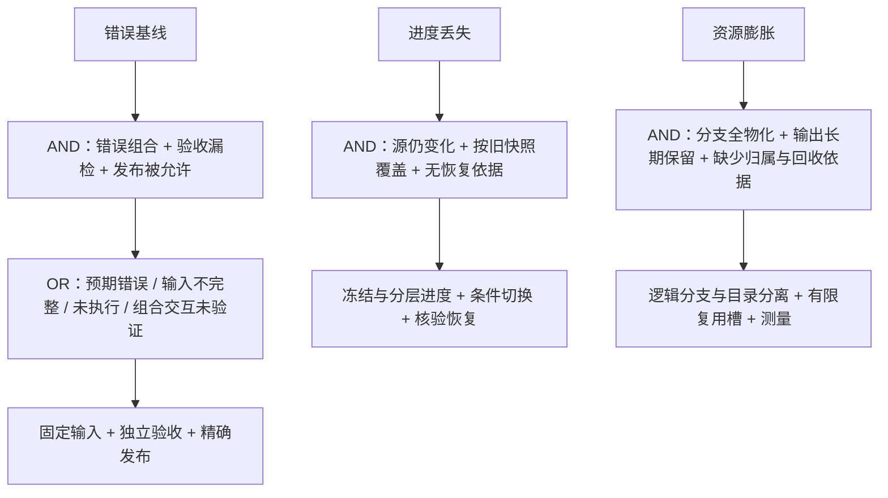

# 多 Agent 开发与持续集成：问题空间

状态：执行中的问题清单。既有设计为候选方案；本文件记录裁决、依赖、证据和下一步，不代表未实现能力已经可用。

<重表述提示词为问题>如何在 DSH + DeepSeek SuperAgent 基座上，以更少物理复制、重复执行和人工介入，获得更多经独立验收且持续有效的改进，并在分叉、集成、回流和升级失败时保留数据与权限边界？</重表述提示词为问题>

## 1. 目标与事实边界

- `S0`：已有 HMM 计划、执行适配、SQLite 事务、持久通知、上下文和设备权限；工程候选、组合发布及进度回流尚未形成闭环。
- `IFR`：必要计算只做一次；改进凭有效证据被接收，后续进度和经验自动保留，未知显式补证。
- `Sg`：先在现有单机控制面建立固定输入、有限执行槽、可信验收、条件发布和可恢复回流，再用成本实测决定扩容。
- `O`：消除重复、按需物化、共享不可变输入、独占可写输出、条件复用、版本比较更新、真实状态核验。
- `C`：不丢数据、不泄露凭据、不绕权限、不自动提交未完成修改、不降低验收或收窄需求；保留多端知识库和设备边界。
- 评价：单位总成本获得的、观察期内仍有效的已验收改进。失败、放弃、误拒、回退和恢复成本都计入。
- 新增已确认需求：多个普通功能工作树可以同时修改同一模块或相关模块；开发、优化和集成只是工作用途，
  不是三种固定且互不重叠的协作主体。必须协调跨工作树变更，不能以物理目录隔离代替语义兼容。

来源分级：

1. 用户最新原话定义需求与红线。
2. `F:/HMM-NEW/HumachineMetamethodology/references/使用ai的agentic嵌套状态机.opml` 定义目标方向；实现方式为工程推导。
3. `C:/Users/Paifa/WorkBuddy/2026-10-21-03-12-32/agents.md` 与 `agents-handoff.md` 是候选规约和历史交接，不替代源码事实。
4. [既有设计](agent-development-platform-design.md) 是可推翻方案，其中 Temporal 首选不再作为默认结论。
5. 源码、固定版本文档和命令输出形成证据；历史数量、空间、版本与性能不作为持续有效事实。

历史调查定位到 80 个登记 Android 工作树，不能推断活跃并发。优化器记录存在路径重复、测试覆盖范围和执行报告不足。
本轮不接管其他工作树、不清理对象库、不启动自动合并或定时优化。通过新检查入口重新识别状态，不沿用历史“可用”结论。

### 2026-11-07 对整体方案的完成度校准

以用户要求的完整交付链衡量，当前最小端到端闭环为 0 条跑通；
不能将前置协议、故障探针、界面改进或测试数量换算为候选集成完成率。

| 方案承诺 | 已实现的范围 | 尚缺的交付能力 |
| --- | --- | --- |
| 单一 superServe 控制面及按需 DSH | 已有 HMM 状态、执行适配、任务上下文和管理入口 | 工程任务尚未驱动候选到回流的完整流程 |
| 取消一 Agent 一目录 | 模块/任务/工作区分别登记，多任务能关联同模块 | 逻辑候选保存、按需物化及切换尚未实现 |
| 有限复用执行槽 | 持久占用、代次、启动许可、部分未创建目标回收 | 已运行作业恢复、权限边界、热状态安全切换 |
| 不可变候选和证据 | 提交检查及既有 HMM 引用基础 | 当前进度检查点、候选冻结、完整验收输入、证据复用 |
| 集成发布与回流 | 当前仍是方案 | 组合验证、精确发布及崩溃对账、后续进度分层回流 |
| 持续优化和资源复用 | 两种质量报告只读解释；模块/配方/工具配置版本登记与固定提交绑定预览 | 实际配置/工具核验、报告持久收录、预算让位、收益判定、工具链及缓存接入 |
| 升级、定时集成、成本评估 | 已拆出需求和验证条件 | 固定组合升级/回退、每小时调度、路线 A/B 完整对照 |

P01 是已验收的主问题；P03 分项已有实现和实验，P11 有通用 HMM 基础，其余主问题仍待实现或验证。
这不是“整体完成了 1/14”：问题权重和验收范围不相等，尚无可信百分比。
历史 80 个工作树、磁盘空间、包版本与上游 HEAD 未在本次重新盘点，不作为当前资源事实。

### 2026-11-07 手动质量流程向正式功能的拆解

<重表述提示词为问题>怎样复用已有 CRAP、覆盖率、变异及 sanitizer 工具，
使模块质量任务自动判断输入、缺证、预算和有效成果，而不要求用户重复粘贴路径与命令？</重表述提示词为问题>

`S0`：完整脚本和工具已存在，但需提示词解释路径/退出码/报告，尚无正式质量任务闭环。
`IFR`：必要检查只做一次，证据自动流向需要它的任务，用户只处理真实决策。
`Sg`：先导入解释证据，再受控补证，最后开放有预算的优化候选。
`O`：现有质量包、固定工具、HMM 状态、持久事务及按需 DSH；
`C`：不把元数据/报告存在当兼容或验收，不修改参考工作树，不启动优化服务或工程构建。

本轮三项：资源与脚本核验（完成）；资源归属及证据协议设计（完成）；
子问题与反例验收拆分（完成设计，代码未实现）。
详细方案与来源见 [既有设计](agent-development-platform-design.md) 第 8.4 节。

关键核验：

- 参考质量目录固定于提交 `ccb751d13403068dbf9de111f2277ca4bb25df07`、
  tree `6feec4a995ee1573e9e99c7881bb56a4a942ab54`；该目录状态检查无输出。
  CRAP 提交及三项 Python 依赖与用户清单一致；已核对 Windows 元数据和 WSL 编译器/插件版本，
  未运行质量试验。旧 optimizer 仍为 1 个快照、0 份报告、3 个计划项。
- JVM 试验 `review_required`/退出 3 不是产品失败；原生 gate 允许解析错误，strict 需另外判断。
  符号映射自检 `passed=true,supported=false` 是拒绝测试通过，不表示该语义已支持。
- 根路径依赖脚本位置、目标模块/函数固定，不能复制几个入口到 vendor 后就当通用功能。
  Mull 的 commit 标签及前后摘要不能证明副本来自合法固定输入；临时副本和全目录回存需计入成本。

裁决：工具、不可变输入与封存报告可以共享；源码/配置归属目标，可写状态归属运行与执行槽。
报告可集中保存并按摘要引用，不要求每工作树复制；活跃缓存和变异历史不能无条件共享。
优化是 HMM 工作项，不是永久工作树类型；只有需要修改或执行时申请物理资源。

| 子问题 | 下一步输出及验收条件 | 当前状态 |
| --- | --- | --- |
| P09.1 质量证据只读导入 | 识别固定报告格式、保留原始引用；区分执行事实/范围判断/待审查；外来收据不直接获得发布资格 | P09.1a 只读解释与 CLI 范围已验收；持久收录/原始报告语义核验待完成 |
| P09.2 目标与工具配置 | 显式仓库/模块/配方/工具包绑定，完整脚本及 vendor 来源；用两个模块验证迁移，未知能力不自动推断 | P09.2a、b1 固定来源内容范围已验收；实际工具/配置语义和依赖闭包仍待实现 |
| P09.3 受控补证 | 固定输入、独占输出、取消核验；同一源码分别产出覆盖率/变异/sanitizer 收据，封存后引用 | 依赖 P04 和执行边界；未提交进度还依赖 P02 |
| P09.4 有预算优化 | 按问题和输入版本累计全部尝试，开发让位，无收益停止；同模块跨树先只读诊断，再协调变更 | a 建议、报告核对及显式原件留存已实现；可信执行证据、优化与成本闭环待实现 |
| P09.5 候选比较与 UI | 突出目标/动作/阻塞/已验证收益；同一有效契约比较，配套候选进入原集成协议 | 依赖 P05/P06/P07 |

P09.1 必测：缺 summary、截断文件、未知 schema、报告路径越界、退出 3 的待审查、
gate=0/strict 不完整、零变异、映射不支持、不同范围和过期来源。
字段存在不等于可信；区分可解析、完整性、来源与发布资格，导入不触发新工作树或构建。

TC/PC：降低等待与复制要求共享，可写状态又必须独占；按时间/空间/条件分离复用。
代偿为输入身份、报告解释器、保存策略和恢复核验。此前调查轮仅修改设计与问题清单，
本轮增加只读解释；正式自动优化未实现/启用，整体集成发布回流闭环仍为 0 条。
自评：先验证能否准确解释真实报告的缺项与适用范围，比再起一个长期优化 Agent 更有价值。

此前设计轮验证：设计两文件 `git diff --check` 通过；`tests/docs.spec.ts` 4 项通过、2 项失败，
报告 `.artifacts/quality-workflow-design-docs.json`。通过项为编号连续、编号引用方向、本地链接和冲突标记检查；
失败为架构模块/测试清单未登记共享工作区新出现的任务计划文件（含 `src/client/task-plan.tsx`），
未修改其业务代码或削弱检查；不将该轮报告称为全通过。
参考质量目录状态复查仍无输出。没有执行 CRAP、覆盖率、变异、构建或设备试验，
因此本轮也没有新增质量通过或性能提升结论。

#### P09.1 本轮实现边界

<重表述提示词为问题>怎样先将已有质量报告转换为可行动的缺证与审查信息，
又不因字段完整、退出码成功或内容摘要匹配就赋予执行可信和发布资格？</重表述提示词为问题>

`S0`：格式已从生成脚本核对，正式解释入口缺失。`IFR`：重复解释自动完成，未知保持可见。
`Sg`：显式选择 JVM/原生配方，只读指定目录，返回原始文件摘要、声明身份、缺证和下一步。
`O`：已有 Node/Zod、CLI 与构建入口。`C`：不执行脚本、不跟随报告路径、不落库、
不替换原始文件、不产生候选、不过度声明 XML/覆盖率已验证。

本轮三项：固定文件读取边界（已实现）；配方解释与身份比较（已实现）；反例/CLI/构建验收（专项通过，环境限制见下文）。
新增 `quality-files.ts`、`quality.ts` 与 `scripts/development-quality.mjs`，
不引入 DSH 导入、HTTP 目录读取或新依赖，不占工程执行槽。

将 P09.1 进一步拆分，避免把可解释报告等同于可信证据：

| 子问题 | 完成条件 | 状态 |
| --- | --- | --- |
| P09.1a 有界读取与预览 | 指定目录、固定文件、读取预算、变化拒绝、脱敏结果、CLI 状态区分 | 已实现，30 项专项测试及打包 CLI 已验收 |
| P09.1b 原始报告语义核验 | 从 XML/SARIF/实际测试收据核对汇总，不只依靠摘要和声明 | 待实现；JSON 间一致性已有初步检查 |
| P09.1c 来源与持久收录 | 绑定目标、配置与生成来源，封存内容可复查，按权限接入 Store | 待实现，依赖 P09.2/P04 |
| P09.1d 面向用户的行动摘要 | 只呈现缺证、下一步和有效范围；未知与失败不能混写 | 当前有结构化 CLI 输出，尚未接入客户端 |

- 首版明确选择 `jvm-trial-v1` 或 `native-crap-v1`，不靠文件名自动猜测目标。
  缺失/损坏/空文件/未知格式/预算超限变为证据不足；取消、路径不安全和读时替换直接失败。
  单文件 4 MiB、总读取 24 MiB；限制是本地解析预算，超过时不能宣称产品失败或缩小验收。
- 固定报告文件名由适配器决定；汇总中的绝对路径、命令、日志正文不返回、不执行、不跟随。
  拒绝目录重解析别名、符号/硬链接；逐文件句柄身份及结束复核仅检测部分并发变化，
  不是 OS 沙箱或冻结快照。只适用于本机操作者明确授权的证据目录。
- 执行状态是 `reportedExecution`，仅表示报告声明；不足、过期、发现及待审查另行判断。
  JVM 待审查不会按产品失败处理；gate=0/strict 缺项、零变异、计数冲突、方法映射和目标范围不一致均补证。
  原生分项解析错误与汇总互相核对，工具失败保留缺证；记录顺序变化不冒充范围变化。
- 相同清单摘要仅为报告间一致线索；可用调用方预期提交/范围/输入摘要检出不匹配。
  匹配不代表来源可信或输入闭包完整。原始 XML/SARIF 只校验可读与摘要，尚未解析语义；
  不能据此认定测试/覆盖率/变异实际执行成功。所有结果保持发布资格为 false。
- 当前是只读解释，不是持久收录。后续需受信来源绑定、原始报告解析、完整验收输入和 Store 接线；
  不能将两种报告适配算作完整 P09、Mull/sanitizer 支持或正式自动优化。

#### P09.1a 验证与使用（2026-11-07）

当前源码构建后，可执行：

```text
node scripts/development-quality.mjs --directory <证据目录> --format jvm-trial-v1
node scripts/development-quality.mjs --directory <证据目录> --format native-crap-v1
```

可选 `--expected-commit`、`--expected-scope`、`--expected-input` 对比调用方预期声明身份。
退出码：0 仅帮助，1 参数/读取/取消失败，2 缺证或过期，3 已解释但仍需审查。
退出 3 不是产品失败，也不是可发布。结果中的文件名和摘要是核对线索，入口没有封存报告。

- 首轮报告 `.artifacts/development-quality-first.json`：23 项中 22 通过，
  1 项在创建链接夹具前误用文件删除 API 删除空目录；已改为目录删除，没有削弱链接拒绝断言。
- 关联回归报告 `.artifacts/development-quality-regression.json`：8 个文件、71 项，
  66 通过、5 失败、0 跳过；其中质量专项 30/30 通过，包含真实 Node 子进程运行打包 CLI。
  还覆盖总读取预算、清单/函数排序不变性、变异分项超过总计、未知原生版本与独立解析错误。
- 5 项失败均来自 `tests/deployment.spec.ts:33` 在准备目录符号链接时返回 `EPERM`，
  尚未进入产品断言；该夹具也依赖 Unix Shell 与 Unix PATH。记录环境阻塞，
  没有修改共享部署实现或通过跳过检查宣称全仓通过。其余关联 36 项通过，
  包括 Git 输入/进度观察、HMM 边界、打包与文档检查；此前文档清单失败在本轮已消失。
- TypeScript 类型检查和构建通过。首份构建摘要为
  `6707ad7ad4331bcce4cbe07b140b5793a5aa9dc5148f8e46a96964589ddd3b9c`；
  收尾发现共享客户端 `task-plan.tsx` 有并行修改，重新构建、类型检查并复测质量专项 30/30，
  报告 `.artifacts/development-quality-final.json`。最终观测源码与构建摘要一致：
  `3c9ad395c4930e7d13a3896f42e72decd01c88aaed9fd37c4f5b13338f228d92`。
  文档收尾检查 6/6，通过报告为 `.artifacts/development-quality-docs-final.json`；
  这些是固定时点观测，不承诺共享目录之后不再变化。
- 实际只读试用 `ai-browser-rewrite-model/superAppAndroid/univerge-ai-browser/quality-evidence/symbol-tests-f7e87aa8`：
  返回 `reportedExecution=unknown`、`insufficient_evidence` 和 `summary.json` 缺失，
  没有把符号拒绝测试通过提升为完整质量证明。
- 完整 JVM/原生报告测试采用根据固定生成器源码构造的合成夹具，
  原始 XML/SARIF 是占位数据；不构成真实覆盖率或变异运行证明。
  当前指定参考目录没有找到完整试验汇总，本轮未运行质量脚本、Android 构建或设备操作。

下一项优先 P09.2：登记明确的目标/配方/工具身份和运行输入，再推进 P09.1b/c，
使报告能回答“属于哪个目标、哪次运行、哪些验收”，而非仅“文件可以解析”。
P09.1d 客户端先复用现有任务的缺证与下一步展示，不新增长期 Agent 或独立工作树类型。
自评：减少了手工解读和错误放行的机会，但新增格式适配维护与有限读取成本；
来源真实性、原始证据语义、完整输入和实际成本收益仍没有证明。

#### P09.2 本轮：配置归属与上游更新边界（2026-11-07）

<重表述提示词为问题>如何一次登记目标、配方及工具声明，后续只读绑定固定输入，
同时及时识别模块或配置变化，不扩大 DSH 接触面，也不把声明升级成可信执行证据？</重表述提示词为问题>

`S0`：质量报告能够解释，但尚无稳定的目标及配置版本归属。
`IFR`：有效配置随任务复用，变化自动显现，不依赖模型重复抄写工具提示词。
`Sg`：现有 Store 保存配置历史，本机管理入口登记和读取；固定提交预览复用 P01，
新旧版本变化必须重新核对。`O`：模块版本、SQLite 事务、有界协议、既有只读 Git 检查。
`C`：不新增 DSH 内核接口、不安装工具、不运行质量脚本，不捕获未提交进度，不授予执行/发布权。

本轮三项：版本化声明（已实现）；固定提交绑定预览（已实现）；并发、重启与权限验证（本节范围已通过）。
模块负责人提供验收与目标，操作者登记配方和工具声明；控制面保存归属，宿主以后核验执行能力。
只有版本一致与来源核验都成立，声明才能用于受控执行；等待、保存及核验成本仍由运行环境承担。

已读上游固定提交 `8c32a9dc5d72c033816c6a8110b37f40cf94fba4` 的 README、`docs/000-philosophy.md`、
`package.json` 与 `src/index.ts`；`git ls-remote upstream HEAD` 在本轮返回该提交。
来源：`https://github.com/deepseek-ai/dsh-superagent-prototype`。
上游声明是研究原型，SuperAgent 已是 DSH bundle，并强调少概念、少设置、减少人的注意力消耗。
以下为工程推导，不声称知道作者未公开意图：

- 当前采用 superServe 内部质量领域模块：只依赖 Zod、既有 Store 端口、模块登记和 P01 检查。
  Runtime/HTTP 只做装配；不新增 DSH 导入、注入服务、插件包或数据库迁移。
- 另拆 DSH 插件可带来独立装卸，但目前没有独立权限或发行需求，反而增加版本兼容与状态交接成本。
  等到确有独立安装、权限或多个宿主复用需求时，再沿窄接口拆包。
- 继续依赖提示词虽省配置代码，却无法可靠处理请求重放、历史身份和并发覆盖，因此只让提示词表达行为建议，
  将身份与版本交给确定性记录。

TC：更多自动复用降低手工成本，但旧配置误用会增加风险。
PC：同一配置需要固定以重现，又需要随目标变更；按时间分离版本、按条件分离当前适用性。
AND 断点：旧模块/配置 + 异步输入检查 + 未在结束时复核 => 错误绑定。
对策是前后核对且结束核对在事务内完成；不靠会话状态或租约推断配置仍有效。

| 子问题 | 本轮状态与边界 |
| --- | --- |
| P09.2a 配置登记与固定输入预览 | 历史保留、CAS、请求幂等、两次版本核对；仅预览已提交输入，专项 20/20 通过 |
| P09.2b 配方/目标配置/工具身份核验 | b1、b2a 所选文件与安装声明观察范围已验收；b2b/c、b3 完整安装及运行依赖仍未验证 |
| P09.2c 宿主能力与完整输入闭包 | 待实现，关联 P04/P03；运行环境声明不能证明工具兼容或写入隔离 |
| P09.2d 报告与运行绑定、客户端复用 | 待实现，关联 P09.1b/c/d；报告字段匹配不自动证明来源 |

配置复用 `development/modules` 的明确版本，包含配方 Git 来源及目录 tree、目标配置文件摘要、
工具名称/版本/摘要及环境。工具路径和命令不进入配置：本轮不构造执行计划。
每次更新增加历史、当前指针和幂等回执；预览不写记录、不分配目录或执行槽。
历史读取保留原绑定，同时返回模块/配置是否仍是当前版本；幂等重放不把旧记录重新激活。
新增代偿为版本存储、格式维护与输入核验时间；历史保留策略及完整来源证明未解决。

#### P09.2a 接口、验证与下一步

复用 `/orchestrator/api/` 下的同源回环管理边界：

- `POST development/quality-profiles`：登记/更新配置；`revision=0` 表示新建，更新携带当前版本，
  `requestId` 保证重复请求不追加版本。配置引用已有模块的明确版本，不另设更宽松的验收。
- `GET development/quality-profiles/:id?revision=N`：读取历史；省略版本读取当前配置。
  同时返回 `profileCurrent`、`moduleCurrent`，不把历史可读等同于当前有效。
- `POST development/quality-bindings/preview`：提交 `profileId`、`profileRevision`、`repositoryPath`、完整 `commit`；
  只读 P01 检查后返回源码身份、配置身份及绑定摘要，不保存运行、不启动命令。

声明结构见 `src/development/quality-contracts.ts`，领域实现见 `src/development/quality-profiles.ts`。
目标配置、配方 tree、工具摘要仍未按实际文件验证。所有响应保留 `toolsVerified=false`、
`recipeVerified=false`、`configurationVerified=false`、`inputClosureVerified=false`、
`executionAuthorized=false`、`publishAllowed=false`。
预览只描述生成时的固定提交与声明关系，不是未来执行准入凭据；实际执行前仍须重新核验当前版本。
没有将这些管理接口作为模型工具开放，也尚未增加客户端配置界面。

验证记录：

- `.artifacts/quality-profiles-first.json`：24 项中 22 通过，2 项新测试夹具错误
  （Runtime 选项误作 seed、缺少 `vi` 导入）；同时类型检查发现模拟面板缺少三条路由。
  已修正夹具并按既有规则让模拟面板明确拒绝这些后端操作；未放宽真实路由要求。
- `.artifacts/quality-profiles-second.json`：34/34 通过；随后补了独立 SQLite 连接和指针缺失反例。
- `.artifacts/quality-profiles-regression.json`：11 个文件、194/194 通过、0 跳过。
  含配置专项 20、报告解释及打包 CLI 30、模块登记 14、Git 检查 10、HTTP 6、Runtime 93、
  模型表面 7、依赖边界 3、文档 6、类说明 1、打包 4。
- 两个模块能够复用相同工具声明，且保持独立配置身份；这是配置适配证明，
  不是两个真实模块已成功运行 CRAP/变异的证明。
- 真实临时 Git、SQLite、Runtime/HTTP 夹具验证固定输入不改写未提交内容，
  声明变化使预览失效，重放/重启保留历史，写失败整笔回滚；没有更改用户工程源码。
- TypeScript 类型检查与构建通过，构建时源码摘要核对一致：
  `35cac821ef2c4a04da1b44b12c03ddb3dc304c939ee1c7fc512a80b9af178008`。
  此为固定时点证据，不代表服务已加载新产物或整个仓库已经验收。
- `tests/hmm-boundary.spec.ts` 已将工程领域加入传递依赖核验，包含类型依赖；
  无 DSH/Cordis 或宿主层依赖。未升级 DSH/SuperAgent，也没有证明任意未来上游组合兼容。

下一步只先做 P09.2b 的“实际配置与完整配方来源核对”，然后补工具包/宿主能力和 P09.1b/c。
读配置时应绑定固定 Git 对象或合法检查点，不能读活跃工作区文件后冒充提交内配置；
配方入口、辅助代码及 vendor 必须作为完整来源核对，不能只哈希几个 PowerShell 入口。
在执行边界、工具兼容和完整输入闭包未证实时，继续保持不可执行。

自评：本轮完成可复用配置与输入归属的确定性基础，新增成本是少量版本记录与 Git 读取。
最大未知仍是配方可迁移性、实际工具包完整性及安全执行；暂不拆插件是当前约束下的取舍，
不是已证明的全局最优，也没有实现自动优化、发布或回流闭环。

#### P09.2b1 本轮：固定来源对象核验

<重表述提示词为问题>如何核实目标配置与配方目录的内容归属，而无需复制当前工作区，
也不把局部内容匹配扩大为完整依赖、工具兼容或执行授权？</重表述提示词为问题>

`S0`：质量配置和固定提交已绑定，但配置摘要与配方 tree 仍是声明。
`IFR`：利用现有不可变对象完成必要核验，没有新工作树和重复构建。
`Sg`：读取固定提交中的配置原始字节，按目录批量核验配方 tree/blob 对象及其身份，
将结果绑定当前配置版本。`O`：Git 对象库、批量 `cat-file`、摘要、既有事务边界。
`C`：不检出、不读未提交正文、不跟随符号链接、不联网补取、不执行脚本，
不把子模块或目录外依赖伪装为已核验。

本轮三项：有界 Git 共用读取（已实现）；配置与配方对象核验（已实现）；反例及接线验证（本节范围已通过）。
沿用 superServe 领域模块与既有 DSH bundle，未新增插件生命周期或 DSH API；
只把 P01 已有的进程读取约束提取为内部共用模块，原检查接口继续保留。
这符合减少重复机制的取舍，不声称知道原作者未公开意图。

- 配置只能是所选提交内的普通 blob，按原始字节核对 SHA-256，不使用工作区替身或换行/内容过滤。
  从提交根 tree 到配置父目录的对象链一并核验；文件摘要正确不能替代路径归属证明。
- 配方按声明提交及目录 tree 定位，目录下辅助代码/vendor 一并列入；以批量调用替代每文件一个 Git 进程。
  tree/blob 去重读取并校验 Git 对象身份；Gitlink 只记录引用，符号链接只核对链接 blob，不跟随目标。
  配方在提交中的父级目录也纳入核验，不能只证明子目录内容而遗漏其来源。
- 单配置 4 MiB、单提交 1 MiB、目录清单 4 MiB/10,000 条；
  配置父目录与配方（含父目录）两组去重对象各自含批量帧最多 16 MiB，整次读取 30 秒。
  这些是首版核验资源预算，不是项目合法大小上限；超出需补采集路径，不能缩小声明范围后冒充完整。
- 返回内容匹配证据；仍不证明配置语义、目录外依赖、LFS 外部内容、工具安装、宿主能力或可执行性。
  不落库，不执行质量任务；请求结束时重查配置/模块版本，变化则拒绝返回绑定。
- 新增代偿为有界对象读取、摘要计算及两个仓库的身份核对；节省检出空间但不是零 I/O。
  本机 Git 及对象库存储仍处于受信读取环境，未建立抵御恶意并发文件系统写者的 OS 隔离。

本机管理入口新增 `POST /orchestrator/api/development/quality-bindings/verify-sources`。
请求复用 `profileId`、`profileRevision`、`repositoryPath`、完整 `commit`，
配方来自不同仓库时必须显式提供 `recipeRepositoryPath`。
结果保留已有绑定摘要，并附 `verification`：内容匹配或存在未闭合引用。
`configurationContentVerified` 和 `recipeTrackedContentVerified` 只表示原始 Git 内容匹配；
上层 `configurationVerified`/`recipeVerified` 仍为 false，因为语义和执行依赖尚未证明。
原有 preview 行为不变；该新入口也只对同源回环管理开放，不作为任意路径模型工具。

实际参考来源试读（`.artifacts/quality-sources-reference-final.json`）：

- 固定提交 `ccb751d13403068dbf9de111f2277ca4bb25df07`，
  `univerge-ai-browser/tools/quality` tree 为 `6feec4a995ee1573e9e99c7881bb56a4a942ab54`。
- `targets.json` 为 1,134 字节，SHA-256：
  `46a104a21e7c0ae7e3a1146ffb6af78b53880549eef439e2b6f20999dcdac463`。
- 配方 119 个目录项；目录内 120 个唯一对象，连同父级目录共核验 123 个唯一对象、
  553,156 原始字节；配置父目录另核验 4 个 tree、12,787 字节。
  两组之间仍有少量重复对象读取，未将其算成零成本。
- 工作区索引核验前后相同；单次耗时约 1,115 ms，仅为该机器固定样本的观测，不是性能 SLO 或对照实验。
- 配置预期摘要取自同一本地固定 Git 对象，证明读取和身份一致，不能作为独立可信来源认证。
  未安装工具、运行 CRAP/变异/覆盖率、修改参考源码、检出新目录或执行外部脚本。

继续拆分：P09.2b1 固定配置和配方内容；P09.2b2 实际工具包及可编辑安装依赖；
P09.2b3 配方/配置语义、外部输入与完整执行依赖。后两项仍待实现。

验证记录：

- `.artifacts/quality-sources-first.json`：60 项中 43 通过、17 失败。
  根因是新读取器用 Windows 规范路径生成仓库 ID，而既有模块用 Git 输出路径。
  已提取共用 `repositoryIdentity`，保留原 ID 算法，物理目录身份单独核验；没有迁移或重写已有配置。
- `.artifacts/quality-sources-second.json`：31/32 通过，剩余损坏注入夹具被 Git 对象只读属性阻止；
  仅为临时夹具解除该属性，随后 `.artifacts/quality-sources-third.json` 来源专项 18/18 通过。
- 补充配置/配方父目录链核验后，`.artifacts/quality-sources-fourth.json` 为 70/72。
  一项损坏反例由 Git 先报错，测试已保留“损坏前成功、损坏后拒绝”，允许底层或本层报告对象错误。
  另一项既有目录观测测试先后单独复现 5 秒超时；将静态夹具中两次独立只读观测并行后，
  原断言与原时限不变，单项约 2.7 秒通过。没有扩大测试时限或减少观测。
- 共享客户端并行增加计划身份 API，使模拟面板缺少路由声明；按原夹具模式补明确拒绝响应，
  没有修改该功能业务逻辑。它不属于本轮质量能力成果。
- 最终 `.artifacts/quality-sources-regression.json`：13 个文件、227/227 通过、0 跳过，
  含来源专项 20、配置 20、报告/打包 CLI 30、P01 10、进度观测 12、模块关联 14、
  Runtime 93、HTTP 7、模型表面 7、依赖边界 3、文档 6、类说明 1、打包 4。
- TypeScript 类型检查、构建通过；观测时源码与构建摘要一致：
  `4a8653176c8f997f8c2e9877d054ae2f085f85b410752798859ad0dda8b9a8ab`。
  这不代表服务已加载新产物或未来 DSH 版本已兼容。

自评：以已有 Git 对象替代新增检出，实现了可复核的来源内容身份；
代偿是摘要计算、Git 进程及有界读取，尚无吞吐或总体成本最优性证据。
下一步优先 P09.2b2：证明工具包实际内容及可编辑安装依赖与声明一致，再谈可执行补证。
配方配置语义、执行环境、LFS/子模块及外部依赖闭包未完成，自动优化/发布/回流闭环仍未完成。

#### P09.2b2 本轮：工具文件与安装声明

<重表述提示词为问题>如何核对实际工具内容，同时暴露可编辑源码、解释器和运行时依赖缺项，
不把启动器文件与版本字符串的匹配误当成完整工具链可信？</重表述提示词为问题>

`S0`：工具仅登记名称、版本和单个摘要；实际 crap4cpp 使用可编辑安装，入口 EXE 不含全部业务代码。
`IFR`：共享工具已有内容被复用，核验只读取必要字节，不复制环境、不启动工具。
`Sg`：绑定配置中的完整工具集合，流式核对入口/制品摘要，解释显式安装目录中的 Python 元数据，
将尚未闭合的源码/依赖/启动扩展转成补证信息。`O`：现成文件、句柄身份、流式摘要、元数据、版本事务。
`C`：不安装、不执行 Python/Java/质量脚本，不跟随安装元数据中的外部路径，不保存宿主工具路径，
不把文件存在、元数据版本或 RECORD 自述当作真实性和兼容证明。

本轮三项：流式文件核对（已实现）；Python 安装声明与缺证解释（已实现）；反例及本机 API 验收（本节范围通过）。
沿用同一 superServe 领域模块与 DSH bundle；新能力无 DSH 导入、插件注册或数据库迁移。
待独立安装/权限/发布边界确实出现再拆插件，避免把技术栈升级与质量业务版本捆绑。
用户提供授权范围，模块负责人保有验收权，控制面保存配置版本；安装来源及运行能力核验仍由宿主补证。

实测输入事实：本机 detekt JAR 为 69,922,269 字节，超出报告读取器 4 MiB 预算，
因此新增工具专用流式读取，不放大原报告预算。crap4cpp 的 `direct_url.json` 声明 `editable=true`，
`.pth` 含源码路径，`METADATA` 声明 `tree-sitter-language-pack==0.13.0`，
虚拟环境 `pyvenv.cfg` 另指向外部 Python311；这都不是源码/依赖内容已验证的证明。
Python 3.11 官方 `site` 文档已通过只读 HTTPS 核对：
`https://docs.python.org/3.11/library/site.html`；`.pth` 的 import 行可在启动时执行，
本轮只读取分类，不执行、不递归解析其指向。

TC：共享安装减少复制，但可变加载路径削弱复现；PC：同一安装既想复用又必须固定。
按条件分离“所选文件内容匹配”和“运行时依赖完整”，按空间分离共享文件与未来独占运行输出。
AND 断点：入口摘要匹配 + 外部源码变化 + 把入口当完整工具 => 错误复用；
本轮不提升 `toolsVerified`，可编辑源码和依赖缺项保持显式。

进一步拆分：

- P09.2b2a 文件/安装声明观察：工具集合完整匹配、SHA-256、读时变化拒绝、Python 缺证解释；本轮专项 22/22 通过。
- P09.2b2b 发行包内容与可编辑源码：安装清单逐项验证、实际源码/依赖固定映射；待实现。
- P09.2b2c 解释器与加载环境：外部 Python/JVM/动态库、启动扩展及环境影响；待实现，不能用 `--version` 代替。

当前 `tools[].sha256` 核对调用方选定的入口文件或不可变制品；不是整个安装目录摘要。
单文件 256 MiB、总读取 512 MiB、256 个文件、30 秒；128 KiB 流式缓冲。
需要解析的文本单文件 1 MiB、累计 16 MiB；顶层安装目录最多扫描 2,048 项、64 个启动扩展。
预算不代表合法工具包大小上限，超限拒绝本轮结论而非缩小验收。
可复用同一文件的摘要，但文件前后及所有输入结束时复核；仍不是冻结快照或 OS 沙箱。
显式工具文件允许共享硬链接，依据设备/文件身份去重读取，每条指定路径仍作结束复核；
符号链接及目录重解析跳转拒绝。与报告导入的路径策略不同，此处操作者明确指定每个工具输入，
硬链接本身不改变所读内容，不应强迫复制共享工具；它也不提供不可变或权限隔离保证。
新接口只允许同源回环管理，不作为模型任意文件读取工具。工具位置只在请求中使用。
新增代偿是有界 I/O、目录扫描、元数据解释与维护，不声称零内存或完整供应链认证。

管理 API 新增 `POST /orchestrator/api/development/quality-bindings/verify-tools`：
携带 `profileId`、`profileRevision` 和全部工具的 `locations[{name,path,python?}]`；
Python 声明可附 `sitePackagesPath`、明确 `distribution` 目录名和 `packageName`。
正文、路径、`.pth` 行及来源 URL 不进入结果；只返回摘要、必要计数、状态和补证项。
结果含配置摘要与观测摘要绑定；返回前再次核对模块/配置版本，版本变化或关闭则拒绝。
状态 `selected_content_matched` 仅表示所选内容匹配，不是完整运行时通过；
`toolsVerified`、`dependencyClosureVerified`、`executionAuthorized`、`publishAllowed` 保持 false。

本机试用读取已指定的 crap4cpp EXE、虚拟环境 Python EXE、detekt JAR、PIT JAR，
及 5 个 Python 元数据/启动文件，共 9 个文件、70,945,726 字节。
识别到 crap4cpp 为可编辑安装，有 `tree-sitter-language-pack` 依赖声明、
1 行启动路径和 1 行可执行 import；没有执行 import 或读取其指定源码。
版本比较只针对元数据声明，JAR/EXE 没有通过执行来认证版本。
初次试用 96 ms，收尾复查 120 ms；均是本地缓存条件下单次观察，不包含预期摘要获取成本，
不作为性能 SLO、冷读结果或最优性证据。预期摘要来自本地先前读取，不是签名或独立供应链证明。

收尾存储事件：O 盘一度可用空间为 0，最终回归启动前及试用报告写入返回 `ENOSPC`。
没有把这次当作测试失败或成功；零字节 `O:/superServe/.artifacts/quality-tools-local-final.json` 无有效结果。
将本轮生成的 first/second/third/local 四份 JSON 报告按绝对路径核对后迁到
`C:/Users/Paifa/.codex/worktrees/device-connector-runtime/superServe/.artifacts/quality-tools-20261107/`。
测试继续读取 O 盘源码，临时夹具和报告使用 C 盘，采用 `--configLoader runner --no-cache`，
没有复制项目、安装依赖、修改测试断言或清理其他工作树。
之后观测 O 盘恢复约 1.2 GB 可用，不能归因于这几份约 38 KB 报告的迁移。
真实工具收尾报告保存在该 C 盘目录 `quality-tools-local-final.json`。

验证记录（报告根目录同上）：

- `quality-tools-first.json`：工具与 HTTP 26/26；`quality-tools-second.json`：配置/工具/边界等 58/58。
- 对共享硬链接的策略重新判断后，`quality-tools-third.json` 工具专项 22/22。
  覆盖文件身份共享、内容变化、输入集合遗漏/重复、元数据损坏/缺失、可编辑安装、
  `.pth` 代码不执行、URL/路径不回显、目录连接、字节预算、读取取消、期间变更、配置及模块失效。
- `regression.json`：14 个文件 249/249、0 跳过。含工具专项 22、来源 20、配置 20、
  报告及打包 CLI 30、Git 输入 10、进度观察 12、模块关系 14、Runtime 93、
  HTTP 7、模型表面 7、领域依赖边界 3、文档 6、类说明 1、打包 4。
- TypeScript 类型检查、构建通过；收尾核对源码与构建摘要一致：
  `e16550f1f4f50da1dd5530fcad0e0e3a7e281e6a81bec8a222e345f750af8d8a`。
  没有升级 DSH、安装工具或启动真实 CRAP/变异任务；不宣称部署服务已加载新构建。

自评：本轮减少工具路径与风险的人工复述，避免以文件匹配冒充运行时可信。
新增成本为有限文件读取、元数据解释和可追溯配置绑定；安装清单逐文件验证、可编辑源码、
条件依赖和解释器加载环境仍待补齐。下一步优先将 `RECORD` 与实际发行包文件对应核验，
同时保持可编辑外部源码独立绑定；不依靠执行 `.pth`、安装命令或版本命令补证。

## 2. 最小行动者与约束

| 对象 | 权力/资源 | 有用功能与风险 | 作用成立条件 |
| --- | --- | --- | --- |
| 用户/需求负责人 | 目标、验收、权限、成本预算 | 定义改进价值，承受错误和等待 | 需求与验收版本明确 |
| 开发与优化 Agent | 授权范围内生成修改 | 提供候选，也可能共享错误假设 | 固定输入、独占写入、受限工具 |
| 验证执行器 | 工具链、设备与执行证据 | 判断必要后置条件是否成立 | 输入闭包、可信检查入口、资源归属 |
| 发布入口 | 唯一基线推进权 | 接收已验证版本，防止错误发布 | 精确旧/新版本、有效放行决定、可对账 |
| 其他模块及工作区 | 后续进度、依赖与暂存状态 | 消费改进，也承受冲突与回归 | 配套契约、独立输出、可恢复检查点 |

约束分类：

- 基底：数据库与 Git/设备副作用不天然原子；不可观测依赖不能推断不影响结果；可写目录不能被无约束并发共享。
- 红线：数据和权限完整性、需求完整性、验收不能自我削弱。
- 可变假设：一 Agent 一目录、每轮全量重建、每小时必须合入、固定全局分数、必须分布式。
- 瓶颈待测：活跃工作区占用、槽位等待、构建热状态、物化与网络成本、恢复时长。
- 代偿：输入登记、短时冻结、证据存储、槽位切换、必要重验证和语义冲突人工处理。

## 3. 因果链与矛盾



| TC | PC | 分离与验证方向 |
| --- | --- | --- |
| 并行加速却扩大占用 | 同一输出要共享且独占 | 空间分离不可变输入/可写输出；时间分离槽位 |
| 复用降低成本却可能错误 | 同一证据要跨版本复用且只代表固定输入 | 输入闭包一致才复用；未知扩大验证 |
| 自动发布减少等待却扩大风险 | 同一修改要立即推进且等待充分证据 | 候选/组合分开；发布仅接受有效放行 |
| 基线回流提高一致性却损害新进度 | 同一工作区要表示新基线和未完成工作 | 先分层保存，再条件替换，失败不覆盖 |

## 4. 子问题与依赖

状态仅在有证据时更新；当前一次只推进一项主要实现。

| ID | 子问题及后置条件 | 依赖 | 状态 |
| --- | --- | --- | --- |
| P01 | 固定提交身份和工作区风险检查：同一输入稳定识别，脏目录不冒充候选，无目录复制或配置泄露 | 无 | 已实现并验收本节范围 |
| P02 | 当前进度一致检查点：分离 HEAD、暂存、未暂存、新文件和必要上下文；排除凭据、检测外部写入 | P01、写者归属 | 只读观测实验已验证；一致捕获待实现 |
| P03 | 模块内变更协作与执行槽归属：多任务可改同模块，语义关系与物理占用分别核验 | P01 | P03.1/P03.2a/P03.2b1/P03.4a、b2b-closed 及 consumed-rejected 已验收；已运行作业恢复及 P03.4b 待实现 |
| P04 | 可信验收输入：测试/构建/工具/依赖/环境/设备全部影响输入明确，未知不能复用 | P01、P03 | 待实现 |
| P05 | 候选登记：完成声明与固定输入分离，携带精确依赖/互斥关系与验收；发布候选后可继续编辑 | P02、P03.4、P04 | 待实现 |
| P06 | 组合验证：协作组与替代组分开，无检出预检、配套候选组、隐藏依赖、失败分诊和补证 | P03、P05 | 待实现 |
| P07 | 条件发布：精确被验证提交，基线旧值核验、发布后崩溃对账与回执补全 | P06、发布权限 | 待实现 |
| P08 | 基线回流：证明改进仍有效，保留候选后提交、暂存边界和未提交内容 | P02、P07 | 待实现 |
| P09 | 优化器接入：修复根路径/重复快照/证据缺项，有限预算、让位、无收益停止 | P03、P04；只读导入可先行 | 工具与脚本已核验；P09.1～P09.5 正式功能待实现 |
| P10 | 工具链与缓存复用：共享固定输入，隔离可写输出，缓存污染可检测和撤销 | P04 | 已明确归属与存放分离；复用机制待实现 |
| P11 | 上下文经验：按来源引用、证据适用域和失效条件交接，不复制完整聊天 | P04、现有 HMM | 已有基础，待工程接入 |
| P12 | 宿主/插件/协议/数据库独立升级：固定组合真实验证、迁移恢复、停止双重调度 | P03、P07 | 待实现 |
| P13 | 每小时集成：只处理已声明候选，无候选不唤醒模型，不补跑空周期 | P06、P07 | 待实现 |
| P14 | 固定负载对照：所有失败/放弃计成本，保留未调参场景，测误放/误拒和持续有效性 | P01 起贯穿 | 待实验 |

P01 输出只证明“选择了哪个 Git 提交”和“观测到哪些工作区风险”。
它不证明正在变化的目录已冻结、不证明凭据已排除、不证明工具链依赖闭包完整，也不签发可执行、可回收或可发布许可。

### P03 拆分：占用记录不是进程已停止的证明

| 子问题 | 后置条件 | 状态 |
| --- | --- | --- |
| P03.1 持久占用与执行代次 | 同一实际目录及登记父子目录不能同时授予不同操作；过期、取消、重启不隐式释放；旧宿主和旧执行不能确认新占用结束 | 本节范围已实现并验收 |
| P03.2 真实执行核验 | 宿主按操作身份登记启动、子进程/守护进程与可写输出；确认全部停止后才释放，未知保留占用 | P03.2a/P03.2b1、b2b-closed 及 consumed-rejected 已验收；已运行作业的完整范围与恢复待实现 |
| P03.3 权限与范围 | 工程执行只能写声明范围；共用 Git 元数据、构建输出和设备分别受控，不把目录登记当 OS 沙箱 | 待实现 |
| P03.4 模块内变更协作 | 多工作树关联相同或相关模块；按意图、契约、实际改动和证据协调，不将同模块直接判为互斥 | 声明/线索已实现；实际影响核对和裁决待实现 |

P03.1 复用现有 Store 的 KV 与事务，不增加数据库或后台续租服务。
占用记录先持久化，再允许宿主启动；开始执行之后只能由可信宿主核验释放。
本地管理 API 只开放预留、查看、续期、请求取消和放弃尚未启动的预留，
不能通过 HTTP 伪造“执行已停止”。P03.2a 将取消接到现有句柄的终止请求；
缺少句柄或信号调用失败明确记录，取消接口成功仍不代表进程已停止或回收成功。
P03.2 未验收前，不使用该登记层启动真实工程进程，不宣称能阻止不经过受控入口的外部写者。

#### P03.1 管理入口与代偿

复用现有仅本地管理 HTTP、同源检查与 Runtime 的单状态目录锁：

| 接口 | 用途 |
| --- | --- |
| `POST /orchestrator/api/development/workspaces` | `{path, owner, requestId, leaseMs}` 预留已存在的绝对目录；同请求重复调用返回原操作 |
| `GET /orchestrator/api/development/workspaces?offset=0&limit=20` | 有界页查看占用、过期和恢复状态，最多每页 50 项 |
| `GET /orchestrator/api/development/workspaces/<workspaceId>` | 查询一个当前占用 |
| `POST /orchestrator/api/development/workspace-command` | 提交 `{workspaceId, operationId, generation, action}`；action 只允许 renew/cancel/abandon，renew 另需 leaseMs |

`owner` 是审计归属，不是用户提交即可取得的权限凭据；调用方已处于本地管理员信任边界。
这些接口不注册成 Agent 工具。租期由调用方指定，1 ms～24 小时是输入资源上限，不是推断进程完成的阈值。
预留/查询不检查或改变 Git 状态、不创建目录、不授予执行权限、不启动模型或进程。

内部宿主在启动任何外部写者前先调用 `begin`，持久登记执行身份；它不自动启动进程。
`assertCurrent` 校验当前宿主、执行代次、租期和取消状态；`confirmStopped` 只在宿主已核验写者全部退出后调用。
返回的执行身份不通过管理查询暴露。HTTP 不接受 begin、confirmStopped 或用户自述 stopped 等扩权参数。
P03.2a 已接入 DSH 范围观测，P03.2b1 在下节增加未发许可操作的自动回收；
当前仍不提供绕过证据的强制释放接口。旧 begin 保持原语义，不具备“从未启动”的恢复证明。

同一实际目录以 canonical path 与目录设备/文件 ID 识别，登记父子目录互斥，兄弟目录可并行。
Windows 路径比较保守忽略大小写；目录身份不可读取或不稳定则拒绝，不退化为仅字符串判定。
启动前再核对路径与文件 ID，避免目录替换后复用旧预留。
该范围检查针对单控制库中受控入口，不能提供跨不同部署、外部目录移动、挂载变更、可写共享 Git 元数据或绕过宿主的 OS 排他。
工作区管理期间若发生这些变化，必须由 P03.2/P03.3 核验，不能声称本协议已覆盖。

状态为 reserved → running → released；取消将未结束占用变为 cancelling。
过期只是禁止新受控写入，不改变占用状态。取消提交后由 P03.2a 尝试终止当前句柄，
未开始执行的 reserved/cancelling 可显式 abandon；
登记过执行的操作即使从未成功创建进程，也必须核验后 confirmStopped。
Runtime 重建更换监督实例，旧实例不能继续变更；旧执行标记 recoveryRequired，不能靠续期或再次申请恢复。
开始执行和释放状态写入失败均回滚；成功确认重放不触发副作用，旧代次不能释放后来的操作。

代偿：每个目录保留当前状态，每个成功预留请求保留幂等回执；这些是实际持久存储，不是免费缓存。
查询响应分页，但当前目录冲突核对与 key 枚举为 O(登记目录数)；仅适用于初期有限工作区。
后续若记录量/延迟超过实际预算，再为活跃占用增加索引与回执保留策略，不能删除未确认执行以节省空间。
最保守的情况是目录会一直被占用，直到真实监督核验能力补齐；这避免把未知错误解释成“空闲”。

#### P03.2 执行监督子问题

本轮先完成 P03.2a 的真实执行观测，不把它命名为完整崩溃恢复：

| 子项 | 后置条件 | 当前状态 |
| --- | --- | --- |
| P03.2a 启动与观测 | 先登记后启动；取消触达真实执行；主命令退出与受管范围结束分开；重启/观测失败不重复启动 | 本节范围已实现并验收 |
| P03.2b 完整写者范围与恢复 | 将作业稳定身份绑定可重查的完整写者范围，处理启动窗口、监督器丢失及迟到回执；凭有效证据释放 | b1 未发许可及 b2b-closed 已验收；consumed 完整范围及 b3 待实现 |
| P03.2c 输出与外部服务归属 | 识别复用构建守护进程、外部输出和设备副作用；无法纳入进程范围的部分另行核验 | 待实现，关联 P03.3/P04 |

源码核对：项目安装的 `@deepseek-ai/dsh-subprocess` 为 `0.2.1-alpha.2`，
本机 DSH 的 `dsh-subprocess-local` 为 `0.2.1-rc.2`；没有升级二者。
公开接口中 `done` 只报告主命令结果，`waitForExit` 观测提供方定义的受管范围；
没有跨宿主进程的持久查找/重连接口。本机 rc.2 源码存在原生范围不可用时退化到较弱进程树管理的路径，
因此 `waitForExit=true` 不能单独证明全部工作区写者已停止。
这些是固定安装版本的本地源码事实，不是对未来版本或所有提供方的保证。
本轮公开网页检索未返回可用内容，未据此宣称任何版本为上游最新版。

`S0`：只有占用记录，取消尚未触达进程，丢失句柄后无法核验。
`IFR`：执行自带足够的结束事实，目录可复用而不需要猜测。
`Sg`：先让实际受控执行有归属和可持久读取的观测；完整范围未证明时继续保留占用。
`O`：复用 DSH 进程接口、现有 Store 和本地管理入口；不增加常驻辅助进程、目录复制或独立数据库。
`C`：不把 PID、退出码、租期、取消回执或受限范围的结束冒充所有写者已停止。

因果断点是 AND：旧写者可能继续存在 + 观测范围不完整 + 将有限观测提升为全局释放依据。
本轮先消除第三项。TC 是更积极回收降低等待却扩大误释放风险；PC 是同一目录要立即复用又必须保持旧作业独占。
按条件分离：有完整证据才释放；其余记录实际已知范围，保留未知。
代偿为少量执行状态存储和可能持续占用，不声称这一保守状态已经满足自动回收目标。

P03.2a 的宿主执行入口不开放成模型工具或任意命令 HTTP；现有管理取消请求接入执行器。
观测记录不保存命令参数、环境值或输出正文，退出失败也不复制潜在凭据诊断。
测试使用隔离临时目录；本轮不启动真实工程构建、设备操作或自动集成。

1. **启动窗口**：持久作业身份先于真实启动；崩溃发生在“已登记/已创建进程/收到回执”的任一边界，
   都能核对是否存在旧作业。只保存 PID 不够，必须考虑 PID 重用与子进程。
2. **写者集合**：优先复用 DSH 已公开的 job/子 Agent 生命周期，核实覆盖哪些工程进程；
   Windows 宿主补足进程树、共享守护进程和输出目录归属，未覆盖者不能被当作已停止。
3. **释放与恢复**：核验全部写者结束后才把 P03.1 标为 released；取消失败、核验超时、
   旧宿主迟到回执、共享构建进程或设备状态不明都继续占用。控制面重启后通过新宿主核验取得恢复依据，
   不能直接把旧 executionId 换成新宿主身份来跳过核验。

下一次优先验证的场景：宿主退出而写进程继续运行，新宿主不能重复启动；旧进程最终结束时，
新宿主通过可信作业身份核验解除占用。相同 PID 或租期结束不能构成该证据。
完成前暂不进入 P02 的当前进度捕获，不把 P03.1 的预留当作所有写者已暂停。

##### P03.2a 接线、有效范围与代偿

本节记录 P03.2a 的范围观测协议；下节 P03.2b1 在此基础上增加 prepared/not_started 和未启动恢复，
不将旧记录改释为新协议证明。

- `src/development/executions.ts` 在既有 Store 中保存每次操作的执行观测。
  工作区开始状态与执行意图共用事务，事务提交后才调用外部启动；登记失败回滚到未启动预留。
  异步目录核验返回后重新检查关闭、取消、租期和宿主代次。
- `src/executor/development-dsh.ts` 只使用 DSH 公开的 `spawn/done/terminate/waitForExit`。
  无命令行字符串拼接，工作目录取自占用；不改变 DSH 内核或导入本机 rc.2 的私有实现。
- `runDevelopmentCommand(ctx, workspace, command)` 是可信宿主插件入口，调用者负责命令授权，
  `workspace` 必须是既有占用的 workspaceId/operationId/generation。
  `command` 接受 argv 和可选 env；不得通过用户文本直接代替宿主授权。
  不开放成模型工具或任意命令 HTTP，也没有新增调度器、自动构建或发布动作。
- `GET /orchestrator/api/development/workspaces/<id>/execution` 返回当前操作的观测或 null。
  不返回内部执行身份、命令参数、环境值和输出正文。
  状态为 launching/observing/range_quiet/unknown；outcome 只描述主命令，不能替代范围状态。
  `scope=provider_managed_range`、`workspaceReleaseAllowed=false` 明示本轮证据边界。
- 现有 `workspace-command/cancel` 只在事务成功提交后请求终止；
  事务回滚不会杀进程。请求已发送、发送结果未确认、缺少旧句柄分别记录，
  不能把取消成功响应误读为回收完成。
- 关闭或失去 Runtime 生命周期时，尝试终止仍持有的句柄，结束本地观测后再关闭数据库。
  提供方不响应观测取消也不会无限阻塞控制面；这只结束等待，不证明外部进程已结束。
  晚到结果不再写库，旧宿主的观测不能覆盖新宿主权威。
- 范围观测失败仍保留原句柄，后续取消和宿主关闭可以继续请求终止；
  只有范围确已 quiet 或执行器关闭后才移除内存句柄。观测未知明确标为 recoveryRequired，
  即使仍持有句柄也不冒充已经核验。
- 重启保留上次观测，`recoveryRequired` 表示需要重新核验；缺少旧句柄不能自动重启命令、
  不能伪造终止成功。DSH 完整进程崩溃后的查找、重新绑定与安全回收属于 P03.2b。

代偿：每个操作新增一条当前观测，运行期每个实际执行保留一个句柄及两条等待链；
stdout/stderr 各保留最多 16 KiB 尾部，无输出正文入库、无完整 spill 文件。
命令输入上限 128 KiB，最多 256 个参数，单字段最多 32,768 字符；
这些是入口资源预算，不是“永久不支持”判断。
历史操作记录尚无回收策略，持久存储随尝试次数增长。
受管范围 quiet 后仍保留工作区占用是当前明确代偿，尚未实现低等待的自动回收闭环。
没有证明原生隔离能力、全部输出归属或外部服务结束前，不将此入口用于无人值守的真实工程流水线。

##### P03.2a 验证记录

- 2026-11-06：执行与占用、Runtime/HTTP、HMM 边界、文档/类说明共 8 个文件、137 项通过，
  报告 `.artifacts/development-executions-final.json`，其中真实 DSH 用例 2 项实际执行，未跳过。
- 新增执行协议测试 15 项覆盖主命令/后代分离、启动前原子登记、落库失败、取消回滚、
  终止失败、不同目录互不取消、旧宿主及关闭后回执、Runtime 重启和只读 API 权限。
  既有占用测试继续通过，没有删除断言或放宽时限。
- 真实用例显式使用 `C:/Users/Paifa/dsh` 中已安装的提供方，只在测试 Context/临时目录执行：
  父命令退出后其 detached 后代继续写入，范围仍被观测为未结束；写者停止后才报告 range_quiet。
  另一个用例通过管理取消入口终止真实写入进程。测试自身负责停止和清理，不修改线上 DSH 配置。
- 首次真实用例因测试夹具误用 Cordis 生命周期 API 而未执行；
  核实固定安装版本后改用 `context.fiber.dispose()`，保留全部行为断言后通过。
  类型检查通过。协作登记、面板、构建身份和打包契约另有 4 个文件、107 项通过，
  报告 `.artifacts/development-executions-contracts.json`；与上述 8 个测试文件没有重复。
  复查补上“范围观测失败后仍保留取消能力”的反例，未将失败等待当成进程已结束。
  最终类型检查、构建通过；源码与构建指纹一致：
  `c7db0f060b446a5f39130326804719605b015c321e3404f765cd9a7b648095e5`。
  107 项接口回归先于上述句柄保留修正执行；修正后重新通过 137 项执行关联检查。
  这些是分批、分范围证据，不宣称进行了全仓或线上流水线验收。
- 可复验：设置 `SUPERSERVE_TEST_DSH_INSTALL` 为已有 DSH 安装目录后运行
  `pnpm test:development:live`。未提供目录时明确跳过，跳过不构成真实进程验收。
  普通 `pnpm test:development` 不依赖某台机器的 DSH 安装路径。

本轮待办状态：能力核对已完成；最小执行观测已完成；故障测试及文档已完成。
下一项先验证 P03.2b：控制进程在启动边界被强制结束时，是否能用可持久查询的范围身份区分
“尚未启动、仍在写入、确已停止”，以及如何阻止旧启动动作在核验后迟到。
优先验证/扩展已有提供方的最小能力；在证据出现前，不增加常驻监督服务或按 Agent 复制工作区。

##### P03.2b 拆分：先消除无需进程核验的恢复成本

<重表述提示词为问题>如何证明某次操作从未获准调用执行提供方，原子回收这次占用，
并让暂停的旧控制进程在恢复运行后也无法迟到启动？</重表述提示词为问题>

| 子项 | 后置条件 | 状态 |
| --- | --- | --- |
| P03.2b1 未发出许可的启动恢复 | 准备与启动许可分离；未发许可可恢复；许可一旦发出便不靠超时回收；旧宿主不能迟到启动 | 本节范围已实现并验收 |
| P03.2b2 已发许可的范围身份 | 崩溃后的原生范围可以持久查询，区分未创建、仍存活、已结束和不可观测 | b2a 实验及 b2b 目标创建权关闭已验收；已消费范围恢复待实现 |
| P03.2b3 已启动作业回收 | 完整范围结束、外部输出与委托服务得到必要证据后，原子保存恢复依据并释放 | 待实现，依赖 P03.2c/P03.3 |

`S0`：启动意图已持久化，但旧 launching 记录混合了“准备中”和“可能调用过提供方”。
`IFR`：未发生外部动作时，利用已有记录和启动顺序证明无须等待外部写者。
`Sg`：新协议显式区分 prepared 与 issued；只回收可证明尚未 issued 的操作，
其余维持既有未知状态，不伪造完整恢复。
`O`：现有 Store 事务、宿主代次、精确执行身份、不可逆启动许可、恢复记录。
`C`：不从旧版 launching、PID 不存在、文件未变化或无输出推断从未启动；
不重放原命令、不覆盖文件、不增加常驻进程或新工作树。

必要因果关系是 AND：旧执行仍有效 + 启动许可已提交 + 实际调用提供方，才允许新受控进程启动。
未发许可的恢复将该操作标为不可再发许可，并释放占用；与发许可在同一状态库串行竞争，
两条路径不能同时成功。已发许可到实际启动之间仍存在外部副作用窗口，此时只能保留占用。
SQLite 与进程创建不原子这一基底约束没有被消除。

TC：更强恢复保障增加状态写入；PC：同一占用既要等待可能存在的写者，又要立即释放从未启动的操作。
按条件分离两类操作。代偿为每次真实启动增加一次小事务、少量状态字段和一次启动时扫描；
不是为每次尝试复制目录或启动一个永久监督器。

一手机制依据为 SQLite `isolation.html` 与 `lang_savepoint.html`：
不同连接只能读取已提交的普通事务，WAL 下旧读快照不能直接升级覆盖新写入；
内层保存点的 RELEASE 不能代替外层提交。对应实验必须跨真实进程，并覆盖提交前退出和提交后退出。
本轮通过只读 HTTPS 请求取得这两份官方文档，均返回 200；网页工具未提供可用的引用编号，
先前无效的引用标记已纠正，不将该标记算作证据。

##### P03.2b1 实现与恢复边界

执行顺序为：

```text
预留目录
  -> prepare：工作区身份与 prepared 意图共用事务
  -> issueLaunch：启动许可 issued 与 launching 意图共用事务
  -> 最外层事务提交
  -> 再核对宿主/代次/取消/租期
  -> 调用 DSH 提供方并观测

恢复支路：
  prepared 许可 + 精确匹配的新版 prepared 记录
  -> 同一事务写入 retired、released、not_started
  -> 允许新的独立操作；旧启动链不得继续

issued、旧版缺字段、记录不一致或观测未知
  -> 不进入未启动回收，保留占用
```

- `src/development/workspaces.ts` 持有启动许可权威，状态为 prepared/issued/retired。
  旧 `begin` 直接记为 issued；已有缺少许可字段的历史执行仍按不确定处理。
  许可不能重复发出，恢复不能把 issued 退回 prepared。
- `src/development/executions.ts` 新写执行记录版本 2，旧版本 1 继续读取，但不会被自动转换为 prepared。
  实际调用提供方放在既有 Store 的 afterCommit 中，避免在内层保存点释放后提前启动。
  许可与 launching 保存失败时整笔事务回滚，没有外部动作。
  prepared/not_started 的记录模型不允许出现进程结束结果或“已发送终止”事实；
  矛盾的持久记录必须报告并保留占用，不能把可解析的 JSON 当作有效恢复依据。
- `Runtime` 在获得状态目录锁、建立新宿主代次后，自动运行一次 `recoverUnstarted()`。
  只扫描当前工作区记录；每个恢复用独立事务再次核对精确操作和记录。
  释放与 not_started 回执共用事务，保存失败保留占用并报告，一项失败不回滚其他已成功恢复。
- 恢复不接管旧 executionId 的宿主所有权，不修改文件、不重放命令。
  即便旧控制进程只是暂停而非死亡，恢复后的操作状态与宿主代次也阻止其再次取得启动许可。
- 既有只读执行 API 增加 prepared/not_started。仅已原子回收的 not_started 返回
  `scope=launch_not_issued`、`workspaceReleaseAllowed=true`、`recoveryRequired=false`。
  这说明本操作未获准调用提供方，不证明整个目录不存在外部编辑器或其他部署写者。
  已启动的范围观测仍返回 `provider_managed_range`，不会签发释放许可。
  本协议只约束通过受控入口发起的执行，不能使直接调用 DSH 或 OS 的外部写者自动纳入管理。
- 许可已提交但进程尚未创建、提供方启动后回执丢失、旧写者仍运行、旧版记录等情况保持占用。
  即使测试能看到某时刻没有进程，也不将这个外部观察写成自动回收规则。

代偿：每次新启动多一次持久提交，内部包含必要保存点；每个执行增加少量许可/版本状态。
每次 Runtime 重启扫描当前登记目录，复杂度 O(目录数)，不是扫描全部历史尝试，也不是后台轮询。
没有新增依赖、数据库、驻留辅助进程、Agent 会话或工作树。原有历史回执增长成本仍存在，
已发许可的未知操作也仍可能长期占用；本轮没有消除这两项成本。

##### P03.2b1 验证记录

- 2026-11-06：最终 10 个测试文件、153 项全部通过，无跳过，
  报告 `.artifacts/development-launch-recovery-final.json`。
  包含新协议与恢复测试 11 项、真实跨进程故障测试 5 项、原有真实 DSH 提供方测试 2 项，
  以及执行、工作区、Runtime/HTTP、HMM 边界、文档和类说明回归。
  之前的 152 项结果保留在 `.artifacts/development-launch-recovery-regression.json`，不改写旧报告数量。
- 独立 SQLite 连接在实际提供方入口核验许可与 launching 均已可读；
  另测启动事务和恢复回执事务回滚，不能用内存对象或本连接的未提交读取冒充提交成功。
- `tests/fixtures/development-launch-crash.ts` 在准备完成、许可事务未提交、许可提交后、
  实际写者运行四个边界使用 SIGKILL 强制结束自身，跳过正常关闭与退出钩子。
  准备和未提交许可可恢复，已提交许可不能回收；不是只重建对象或模拟返回值。
- 写者存活反例使用真实 Node 单进程提供方，明确允许写者跨控制进程退出；
  新宿主发现文件仍变化但不重复启动，停止文件令测试写者退出后也没有冒用此私有夹具信息自动释放。
  该用例不声称 DSH 原生范围具有相同的退出行为；DSH 的两个既有真实用例另行执行。
- 旧控制进程准备后等待 IPC；新控制面回收并重新分配目录后才恢复旧进程。
  旧进程收到 supervisor_stale，提供方没有被调用，新的占用仍有效。
  该夹具直接使用 Store 构造双控制面竞争，不移除或绕过真实 Runtime 的状态目录锁。
- 用例只使用自身创建的临时目录和数据库。正常回归 36 项先通过；
  新增跨进程夹具后类型检查发现标准库的可空管道类型，依据显式 pipe 配置修正夹具访问，
  未放宽行为断言、增加已有测试时限或修改生产设备配置。最终类型检查通过。
- 协作登记、面板、构建身份及打包契约另外 4 个文件、116 项通过，
  报告 `.artifacts/development-launch-recovery-contracts.json`。
  该批先于最后的矛盾记录模型收紧执行；收紧后重新通过上述 153 项及类型检查。
  最终构建通过，源码/构建指纹一致：
  `85d59c2d4879f29768251225f0ecbc4c5d0a5f106e9406e55db5ff3877c88216`。
  指纹对应核对时的共享工作区，不把其中既有或并行的界面改动归为本轮开发成果。
  本节不宣称全仓、完整工程流水线或机器断电恢复已验收。

本轮待办状态：新协议与旧记录边界已完成；Runtime 自动恢复已完成；故障与对抗性验证已完成。
下一步最值得验证 P03.2b2：已发许可后是否存在跨宿主可重查、不会被重用的执行范围身份，
以及它是否覆盖全部可能写者。没有该证据，继续保持占用，不能凭新版 prepared 恢复能力提前进入
无人值守集成或当前进度快照。

##### P03.2b2 范围身份验证计划

<重表述提示词为问题>已获许可的作业失去宿主后，哪些现成系统事实能够证明范围仍在运行或已经结束，
而不会因为观察行为改变作业寿命、因为同名重建混淆身份，或因为迟到创建产生误回收？</重表述提示词为问题>

待办按顺序推进：

1. 核对安装版本的公开接口和原生资源语义，确定哪些身份实际可重查。
2. 实现按需、可重复运行的原生范围实验，观察真实后代写入及控制进程强制退出。
3. 根据反例裁决是否能进入生产适配，记录被排除路径、补偿成本与后续契约。

现状事实：本机 DSH `0.2.1-rc.2` 的 Windows runner 独占匿名 Job handle，
Win32 库使用 `CreateJobObjectW(null, null)`；公开 subprocess 句柄没有持久重连标识。
源码来自已安装库，尚不代表任意未来版本。生产工程继续使用现有公开接口，不导入其私有 runner 协议。

`IFR`：用已有内核对象识别原作业，减少新增监督服务和状态复制。
`Sg`：先验证命名作业对象是否足够，再决定是否需要最小的提供方扩展。
`O`：已有 DSH Win32 库公开导出的绑定扩展与原子创建/加入/恢复进程能力，以及 Windows 内核范围计数。
`C`：实验仅创建自己的临时目录、命名对象和进程；不安装依赖、不修改线上配置、不释放真实工作区。

本轮拆分：

| 子项 | 验收依据 | 状态 |
| --- | --- | --- |
| b2a 原生范围实验 | 宿主退出后重查；主进程退出仍有后代；空范围之后再次加入；名称消失/重用；观察句柄改变寿命 | 已实现并验收实验边界 |
| b2b 一次性范围创建与关闭协议 | 精确身份、创建者 fencing、禁止迟到重建、权限和跨重启边界，不能仅凭名字推断 | 目标命令的一次性消费/关闭已接线；范围终态仍待实现 |
| b2c 生产 DSH 适配 | 不 fork 内核，明确能力发现、缺失能力时降级为未知，恢复与本地管理接线 | 已接入可信启动器；原生完整范围恢复未实现 |

TC：持久保留一个观察句柄可提高可观测性，却可能延迟 kill-on-close。
PC：同一个内核句柄既要存在以保持范围可查，又要全部关闭以触发结束。
先检查条件和时间分离，不能把“只读查询”默认当成无副作用或免费操作。
新增实验 CLI 是后续版本/环境的实际验证消费者；不把它伪装成生产恢复实现。

##### b2a 实现、反例及设计裁决

实现为 `scripts/development-range-probe.mjs` 和专用 worker，消费者为开发命令
`pnpm development:probe-range --dsh-install <已有且可信的安装目录>`。
无需构建即可运行，不安装依赖；只从显式位置加载公开 `dsh-win32-process` 原语，
不修改 DSH 包、不使用私有 runner 消息协议、不启动在线模型。
脚本仅用于源码仓库中的开发验证，未加入生产插件的自动启动链。
两份脚本均加入构建指纹，原生加载仍限于实验子进程。

实际实验包含三个场景：

1. **空范围不是已关闭范围**：作业先为空，随后可加入进程。主进程退出后，
   它创建的 detached 后代继续写入，查询仍报告非空；写者退出后才为空。
2. **观察会改变寿命**：观察方仅申请 `JOB_OBJECT_QUERY` 权限，持有该句柄时，
   原拥有者被 SIGKILL 终止后，写者仍持续写入，另一进程还能重新打开并查询范围。
   最后一个观察句柄关闭后，作业才被终止并消失。
3. **同名不等于同一对象**：没有持久观察句柄时，原拥有者退出后命名对象消失；
   相同名字可重新创建一个新的空作业，且再次查询成功。名字不是不可重用的终态凭据。

这些是当前 Windows x64 和已安装 `dsh-win32-process 0.2.1-rc.2` 上的真实实验，
没有使用模拟进程状态。正常主进程退出、拥有者强制退出、后代文件长度增长、
范围非空/空及对象消失分别观测，不能用其中一个事实替代其余事实。

据此排除三条实现：

- 持久保存 Job 名称，查不到就释放：未创建、已销毁和迟到创建窗口无法区分。
- 查询 active process count 为零就释放：创建者还可能向空范围加入进程。
- 永久保留只读句柄实现“无代价重连”：句柄会改变 kill-on-close 条件，并产生驻留和恢复成本。

保留的最小正确性条件是 AND：

```text
本次精确操作与提供方范围绑定
  AND 范围创建权已不可逆关闭（含暂停/迟到 runner）
  AND 旧范围全部成员已结束
  AND 外部委托写者与输出范围已核验
  -> 才允许已启动作业的目录回收
```

条件必须在实际创建 Job 的提供方/runner 边界成立。控制面自己把状态改为 sealed，
不能阻止已经越过该控制面的迟到进程继续创建范围。
因此下一步优先验证“提供方的一次性启动消费与关闭回执”能否复用已有 DSH runner；
若公开接口无法支持，再评估一个窄的可选提供方扩展与上游接口提案，
不能先依赖包内私有字段、建立通用分布式执行框架或增设每任务常驻监督器。
即使获得命名原生范围，也仍不包含通过外部守护进程、服务或设备发起的写入，
这些由 P03.2c/P03.3 继续核验。

资料核对：Microsoft 的 `job-objects` 与 `CreateJobObjectW` 官方页面经只读 HTTPS 请求成功取得。
前者说明命名对象才可重新打开、最后一个句柄的生命周期作用与 breakaway 限制；
后者定义已有同名对象时的 `ERROR_ALREADY_EXISTS` 行为。
这是实验设计依据，实验结果是本机观测；没有将网页版本、安装版本或历史耗时冒充最新版/通用性能。

##### b2a 成本、复验和验收

- 首次完整 CLI 报告 `.artifacts/development-range-probe.json` 三场景通过并确认清理。
  首次观察方 RSS 为 67,575,808 字节，仅代表报告时的观察进程，不包括拥有者/写者总内存，
  也不是峰值。该次计时约 971 ms，不含原生加载，不能作为启动延迟结论。
  随后计时口径调整为原生加载至清理完成，最终结果单独保留，不能混为同一口径。
- JSON 返回每个实际场景的观测和耗时，以及 planned/passed/failed/notRun 计数。
  失败或未完成场景不计入通过；等待超时只代表失败，不能当作范围结束。
- 进程与命名范围均使用随机实验身份；拥有者及观察句柄关闭、命名对象确认消失后才删除临时目录。
  异常清理不能确认时报告 `cleanup=unconfirmed` 并保留临时目录，不假装成功。
  实验只终止自己创建的进程，未接触既有工程目录或生产执行占用。
- `tests/development-range-probe.spec.ts` 检验帮助/参数以及真实实验事实，
  通过 `SUPERSERVE_TEST_DSH_INSTALL` 显式选择已有安装；没有安装或非 Windows 时，
  原生测试明确跳过，跳过不构成通过证据。
  `pnpm test:development:live` 同时执行既有 DSH 接口用例与原生身份实验。
- 首轮实验、真实 DSH、构建指纹和文档检查合计 4 个文件、26 项通过，无跳过；
  报告 `.artifacts/development-range-probe-tests.json`。类型检查通过。
  计数/测量口径完善后同范围再次通过 26 项，无跳过，
  报告 `.artifacts/development-range-probe-final-tests.json`，不能将两轮相加作为不同用例数。
- 最终独立 CLI 报告 `.artifacts/development-range-probe-final.json`：
  planned=3、passed=3、failed=0、notRun=0、cleanup=verified。
  原生加载至清理完成约 1,250 ms，报告时观察进程 RSS 为 67,817,472 字节；
  不含 Node 启动、不含全部子进程内存，不是稳定性能基线。该轮与测试并行运行，存在资源竞争。
- 最终类型检查、脚本语法检查、构建通过，源码与构建指纹一致：
  `252f574067e0ded97464d99d61b1fa0cdadbd5ff0e227e10935d26738acff8e6`。
  只验收本轮实验工具与受影响的构建/文档接口，未重跑全仓或线上系统。

自评：本轮交付可重复执行的原生范围验证工具，排除了会误释放或改变进程寿命的三条捷径。
这减少错误生产实现的成本，但没有新增已发许可作业的自动恢复能力；
P03.2b2/b3 仍未完成。新增代偿是按需实验进程、原生库加载和维护测试工具，
没有新增生产常驻服务。下一步最有价值的验证是创建者已经暂停在“获准/真正创建”之间时，
提供方能否原子关闭其创建权并留下可重查的终态回执。

##### b2b 实施：在实际命令启动器中一次性消费许可

<重表述提示词为问题>控制面已向 DSH 发出启动请求、但目标命令尚未开始时，
如何让重启/取消能够永久关闭目标的启动权，并阻止迟到的启动器重新创建目标进程？</重表述提示词为问题>

本轮待办：核对公开进程与 SQLite 入口；实现一次性消费及关闭并接入 Runtime；
用真实启动器/DSH 和跨进程竞争验证。每次只推进一个主要断点。

根因：DSH 的实际进程创建晚于控制面的许可检查；本轮把最终消费动作放进一个部署方控制的短命启动器。
DSH 仍负责运行和观测该启动器及其受管范围；不修改或复制 DSH 私有 runner，不创建新工作树。

`S0`：issued 之后无法阻止已经延迟的目标启动请求。
`IFR`：目标命令没有有效且未消费的许可便无法开始，关闭后的命令永久不重放。
`Sg`：复用既有 SQLite KV，offered -> consumed 与 offered -> closed 原子竞争；
只有消费事务提交的启动器才能调用真正的目标命令。
`O`：既有状态库、小型可信启动器、DSH stdin 与进程范围、绑定操作和命令的不可猜测令牌。
`C`：不将 consumed 当作已启动或已停止；不将 closed 当作启动器本身已退出；
不在日志/数据库保存命令与环境正文，不让目标环境配置先于许可消费注入启动器。

TC：创建权更可控，却增加一个进程和一次持久提交。
按整体与部分分离：启动器只访问状态库，真正命令在消费后才进入工作区；
启动器没有新的常驻服务职责。其内存、启动时间和额外写入是明确代偿。
本轮只关闭目标命令创建权；已消费作业的完整范围回收和外部写者仍属于 b2c/P03.2b3/P03.2c。
关闭后的凭据先通过已有只读执行 API 可见，尚不凭此自动释放已经登记 issued 的工作区。

##### b2b 目标创建权实现与边界

新链路为 `Runtime -> DSH subprocess -> 可信启动器 -> 目标命令`。
`developmentDshPort` 保留直接提供方模式供既有能力和测试使用；Runtime 必须配置启动器模式，
不因许可失败回退到直接目标启动。启动器构建产物随插件 lib 发布，无独立安装依赖。

- 状态权威仍在既有 SQLite KV：每个精确 executionId 一条许可，
  `offered -> consumed` 或 `offered -> closed` 不可逆，不能以重试重建原许可。
  两条转移使用同一数据库的事务串行竞争；启动器只有消费提交后才能执行目标 spawn。
- 控制面在登记许可时固定 workspaceId/operationId/generation/executionId、目标目录与完整有效命令环境。
  随机令牌经 stdin 传递，库中只保存令牌摘要和带密钥的载荷摘要；
  命令、环境值和原始令牌不写入状态库、进程参数或管理 API。
  这减少明文凭据留存，不是同 OS 用户之间的权限隔离。
- 可信启动器读取有界 stdin，以独立连接打开既有状态库，不创建业务表或运行迁移；
  核对状态库文件身份、精确许可、载荷，以及同库当前工作区状态、issued 许可、宿主代次和租期。
  取消/换宿主即使还未保存 closed 回执，也不能让旧 offered 被消费。
  数据库忙等待最多 1 秒，失败不执行目标，不把忙等待当作消费成功。
- 启动器在可信状态目录启动，其环境清除继承值，仅保留明确的系统/临时目录变量。
  目标环境通过数据载荷保存，使用 DSH 的环境脱敏函数构建，并在消费后才传给目标；
  `NODE_OPTIONS` 等不能在消费前注入启动器。Windows 大小写键按目标系统语义覆盖。
- 现有取消入口先尝试关闭尚未消费的许可，再请求 DSH 终止；正常关闭和宿主重启也关闭当前活跃操作的 offered。
  只扫描现有活跃工作区绑定，不扫描全部历史许可。旧宿主不能修改新控制面的许可权威。
- 既有执行查询新增 `admission={state, reason?, targetStartPrevented}`。
  只有 closed 表示目标创建权已终结；consumed 表示可能已运行，即使此时没有目标进程，也不得重放。
  关闭的未消费许可可阻止迟到启动器，但不证明该启动器本身或 DSH 原生范围已退出。
  所以本轮 issued 工作区继续保持占用，不复用 `not_started` 的自动释放路径。
- 经启动器的结果标为 `outcomeScope=trusted_launcher`，旧记录默认 `provider_command`。
  正常情况下启动器返回目标退出码，但启动器自身错误/信号也会形成退出事实，不能将单个退出码当目标执行凭据。
  受管范围 quiet 的含义保持原边界；不能将控制进程、启动器、目标命令与全部后代混成一个结果。

必要子问题进一步分开：

1. **目标尚未消费**：关闭目标创建权已可用；范围退出与可回收证据需要下一步对齐。
2. **目标已经消费**：即使消费后立即崩溃也必须保留未知；仍需要稳定范围身份、终态回执和外部写者核验。
3. **目标之外的写入**：启动器需要访问状态库，DSH/Node 可能使用系统临时目录；它们不是目标源码写者，
   也不能被本协议冒充为无写入。OS 隔离和工具输出归属仍由 P03.3/P03.2c 实现。

代偿成本：每个实际运行中的目标多一个 Node 启动器进程，存活到主目标结束；
多一条不含正文的持久许可、登记与消费事务，以及有效环境一次 stdin 传输。
没有每个 Agent 常驻进程或新目录复制；但不能将启动器内存、传输和 SQLite 争用称为免费。
命令含有效环境的输入继续受 128 KiB 限制，完整启动器输入上限 256 KiB；
过大明确失败而不截断输入。目标标准输入保持原有 ignore 行为。
许可暂不清理，保留关闭/消费事实防止旧消息重放，后续回收必须同时处理消息保留期与旧启动器存活。

安全及兼容边界：

- 只保证遵循入口的可信启动器，不能防御同账号恶意修改代码、状态库或复制旧数据库。
  状态库移动/替换在已有文件身份不匹配时拒绝；备份恢复、权限限制和在线升级仍需 P03.3/P12。
- 只有在可访问同一状态库、同一可信启动器和本地执行世界时适用；远程 subprocess 不能直接借用本地路径。
  本轮仅本机 DSH 验证，不宣称远程/多机适用。
- DSH 原生管控不足或进程逃逸、共享编译守护进程等不会被此层自动修复。
  这一步封闭目标创建权，不宣称已完成原生范围重连与完整故障恢复。

##### b2b 验证记录

- 首轮许可、执行、未启动恢复共 3 个文件、34 项通过，报告
  `.artifacts/development-launch-permits-first.json`。
- 真实 Node 启动器覆盖双进程消费只执行一次、已有启动器延迟收到命令而被关闭回执拒绝、
  消费已提交但目标创建前 SIGKILL、不一致命令/环境/目录/身份/令牌、状态库替换、
  关闭事务回滚、过期和非 issued 许可，以及关闭/消费竞争。
- Runtime 取消和重启的回执通过既有 API 检验，缺少旧句柄也不会重复执行或自动释放 issued。
  本轮没有新增模型命令执行工具或任意命令 HTTP。
- 首次真实 DSH 环境隔离测试因为测试的 Windows `NODE_OPTIONS --require` 反斜杠路径解析失败，
  修正夹具为 Node 接受的斜杠路径后原断言通过。失败报告保留在
  `.artifacts/development-launch-permits-live.json`，没有调整生产逻辑掩盖目标失败。
- 真实 DSH 独立验证先有 5 项通过，无跳过，报告
  `.artifacts/development-launch-permits-live-final.json`。
  包含已有后代范围、取消、新启动器消费、目标 NODE_OPTIONS 只加载一次、
  已消费长命令取消，以及实际构建产物 `lib/development-runner.js` 的执行。
  测试只使用新建临时目录/数据库和独立 DSH Context，不操作在线模型或真实工程任务。
- 最终 11 个文件、167 项关联回归通过，无跳过，报告 `.artifacts/development-launch-permits-final.json`。
  另外协作登记、面板、构建身份与打包契约 4 个文件、136 项通过，
  报告 `.artifacts/development-launch-permits-contracts.json`。
  共享工作区存在并行界面更新，不把其新增用例或功能归为本轮实现。
- 之后新增实际 DSH 的迟到窗口用例，保持原断言重新验证整个真实 DSH 文件，6 项全部通过，
  报告 `.artifacts/development-launch-permits-live-verified.json`。
  该用例在 offered 已提交但实际 subprocess 调用前取消，继续放行启动器本体，
  验证它退出 125、目标文件和 NODE_OPTIONS 钩子文件都不存在、admission 明确 closed；
  issued 工作区仍保持 cancelling，未偷换为已回收。
- 最终类型检查、构建和指纹核对通过：
  `1880256cd2779da5a5bbff1f803292647b7c8019d16fc42059d7e79e6c97ba72`。
  构建后的启动器也在最后 6 项真实 DSH 验证中执行。
  本节不将各次重跑数量相加为不同场景数，不宣称全仓、远程提供方或线上验收。

本轮三项待办已完成：公开入口核对、一次性消费与关闭接线、真实启动器/DSH 对抗验证。
新增能力是关闭目标创建权，仍不等于关闭并核验全部原生范围。
下一步拆分：

| 子项 | 后置条件 | 状态 |
| --- | --- | --- |
| b2b-closed 未消费关闭后的回收 | closed 证明目标不可能启动；受管启动器已退出；回收依据与占用释放原子提交，旧回执不能释放新代次 | 本节范围已实现并验收 |
| b2b-consumed 已消费范围恢复 | 消费后崩溃时有跨宿主可核验的范围身份与终态，不以无进程/无输出猜测 | 明确创建被拒路径已验收；已运行作业范围仍待补证 |
| b2b-cost 启动器成本与替代 | 测整个进程集合的内存/时延和数据库争用，决定保留短命启动器还是推动 DSH 原生前置钩子 | 待测量 |

自评：已把关闭规则推进到实际目标创建入口，真实迟到启动被阻止；
新增一个随目标主进程存活的 Node 进程和许可事务，是尚需测量的代偿。
证据仍不足以支持 consumed 作业回收。下一步优先验证 closed 且受管范围已 quiet 的完整释放事务，
并保留宿主崩溃丢失范围证据时的未知状态。

##### b2b-closed 本轮实施边界

<重表述提示词为问题>能否复用已有许可和执行记录，让从未启动目标且受管启动器已结束的操作
安全归还目录，而不把旧观测、取消请求或已消费作业当作足够证据？</重表述提示词为问题>

`S0`：closed 和 range_quiet 已能分别观察，但 issued 目录始终占用。
`IFR`：结束事实自动使对应占用可复用，不增加轮询、进程或人工确认。
`Sg`：新版执行记录明确保存正向范围结束观测；精确绑定的 closed 许可与该证据同时成立，
在同一事务记录回收结果并释放对应代次。提交失败保留占用，重启可复核持久证据重试。
`O`：既有 Store 事务、执行代次、启动器协议和 Runtime 启动恢复。
`C`：只回收从未消费的目标；旧版记录、未知、缺失观测和 consumed 不适用；
不删除文件、不操作 Git、不扫描或终止外部进程，不宣称工作区获得 OS 隔离。

必要条件为 AND：新版可信启动器记录 + 精确操作/执行身份 + 不可逆 closed +
正向 waitForExit=true 已持久化 + 当前控制面仍有该占用的回收权。
范围证据先保存，随后“回收回执与 released”原子提交；第二笔失败不能抹去第一笔证据，
也不能只释放目录却丢掉回收依据。旧进程的迟到回执不得修改新代次。

TC 是缩短闲置等待可能增加误释放；按条件分离 closed 与 consumed，保留两者不同的验收要求。
代偿为每次符合条件的回收多一次小事务与少量时间戳；重启复用当前目录扫描，无新增后台服务。
三个待办为证据模型、回收接线、故障与真实 DSH 验证，均已完成本节范围。

##### b2b-closed 实现与验证

- 执行记录新增版本 3：range_quiet 必须带正向观测时间；
  released_closed 必须带可信启动器范围和回收依据。版本 1/2 仍可读取，
  不把旧 range_quiet 原地升级为新版可回收证明。
- 运行中在明确 waitForExit=true 后先保存证据；取消和关闭关闭未消费许可，
  再凭已有证据回收。Runtime 启动依次处理 prepared、关闭旧 offered、复核 closed，
  不接管旧执行身份或重新运行命令。
- 回收回执与工作区释放使用同一 Store 事务，回收时间同时更新 updatedAt。
  不增加数据库、轮询、安装或物理工作树；只增加记录字段和符合条件时的一次小事务。
- 首轮 3 文件、39 项通过，报告 `.artifacts/development-closed-reclaim-first.json`。
  随后两个真实控制进程强制退出边界与回收协议共 2 文件、19 项通过，
  报告 `.artifacts/development-closed-reclaim-crash.json`。
  边界为范围证据提交后及释放事务提交前；范围句柄由夹具提供，
  只证明持久恢复与事务回滚，不替代真实 DSH 范围观测验收。
- 时序检查曾有 1 项失败：延迟回收后 updatedAt 仍为旧观测时间。
  失败报告保留在 `.artifacts/development-closed-reclaim-ordering.json`，
  已修正回收事务记录，保留原断言，不放宽时间或验收要求。
- 16 文件关联回归为 221 项通过、4 项未启用、0 失败，报告
  `.artifacts/development-closed-reclaim-regression.json`。
  覆盖输入检查、目录占用、协作登记、执行/许可/恢复、Runtime/HTTP、HMM 工具边界及文档构建契约；
  未启用的 4 项是已有 Windows 命名范围实验，本轮没有重跑，不作为新增回收证据。
- 最终定向验证 4 文件、29 项全部通过，无跳过，报告
  `.artifacts/development-closed-reclaim-final.json`。
  回收协议本身为 15 项，另含 7 项真实控制进程崩溃及文档/类说明检查；
  覆盖普通命令不得冒充可信启动器、旧结果不得污染新代次、关闭重试不得降级回收终态。
- 真实 DSH 6 项全部通过，无跳过，报告 `.artifacts/development-closed-reclaim-live.json`。
  offered 提交后实际启动前取消，迟到启动器退出 125、目标及环境钩子未执行，
  目录 released 后可取得新代次；已消费长任务即使范围结束仍不回收。
  本轮构建后的 `lib/development-runner.js` 也由真实 DSH 执行。
- 类型检查、构建通过，源码/构建指纹核对一致：
  `7faede37e443ae01d7270fc14231cd9814e19e618b1305bc8cac37593ff2f6db`。
  早先静态检查遇到共享客户端文案键未就绪；再次读取时已补齐，
  本轮未修改客户端或把其并行改动计入实现成果。
- 测试只使用用例临时目录、SQLite 和独立 DSH Context；
  没有运行实际工程构建、设备操作、线上任务、定时优化或自动集成。
  各次测试报告不累加为不同场景数，也不代表全仓或全部提供方验收。

##### b2b-consumed 创建结果与恢复边界

本轮完成 `b2b-consumed-rejected`：补齐许可已消费、目标创建被 OS 明确拒绝的证据链。
完整已运行作业恢复继续待补证，不用该子项替代。

<重表述提示词为问题>如何把目标创建失败与目标运行失败分开，复用现有启动器和数据库消除
确实没有目标写者的无谓占用，同时不提升旧记录、重复启动器或未知结果的可信度？</重表述提示词为问题>

`S0`：consumed 目前不能区分消费后崩溃、创建失败及目标已运行。
`IFR`：创建结果自己携带足够证据，不增加人工排查、复制或常驻服务。
`Sg`：只有消费获胜者拥有一次性创建结果写入权；明确拒绝创建 AND 受管范围已结束
AND 当前精确占用仍匹配时，回收依据和释放同事务提交。
`O`：Node 进程事件、已存在的短命启动器、独立 SQLite 连接及已有释放事务。
`C`：退出码 125、缺 PID、路径不存在及进程消失均不是创建失败证明；
旧 consumed 没有新增证据仍保留占用，旧观察者不能改新代次；不引入任意命令工具或 OS 隔离宣称。

本机固定安装复核：`dsh-subprocess` rc.2 的公开 `SubprocessRuntime` 与 `SubprocessHandle`
只暴露 spawn/terminate/waitForExit 等当前实例接口，未提供跨宿主重连；
`dsh-jobs` 记录归属与状态，实际执行资源仍由生产者持有。
`dsh-subprocess-local` rc.2 的 `selectContainmentMode` 可选 fallback，
其警告明确指出逃离直接父子树的后代可能不被 waitForExit 覆盖。
因此完整 consumed 回收缺的仍是范围身份与完整性，不能用后台 Job ID 取代。
以上来自现有安装的公开类型与本地实现，不宣称是上游最新版。

三项待办：创建结果及独占写权、回收接线、真实启动器/DSH 与故障验证，均已完成本节范围。
代偿是一个消费写权摘要、一个有界结果和额外事务；不把原错误路径、命令或环境存入回执。

已用真实 Node 验证缺可执行文件、缺工作目录与目标自行退出 125 的区别：
前两类明确拒绝创建，后一类已创建；都不能由退出码单独判定。
消费后崩溃、创建成功但回执落库失败仍保持 unobserved；
结果来自消费获胜者闭包中的独立写权，不把原 envelope 令牌当作结果写权。
版本 3 的正向范围证据可以和新补的有效回执组合，不为版本数字强制重跑；
版本 1/2 的无时间范围记录及旧 consumed 则不能凭读取升级为新证据。
新执行及回收回执为版本 4，新消费记录为版本 2；旧版读取兼容，降级宿主不支持新记录，
不能在同一状态库直接回退运行，完整升级/回滚仍归 P12。

Node 官方 `child_process` 文档通过只读 HTTPS 核对（`https://nodejs.org/api/child_process.json`）：
成功创建发出 spawn 且先于其他正常事件，创建失败发出 error；
error 也可能来自 kill/send/AbortSignal，故启动器不使用这些入口，
并在 spawn 后移除“未创建”监听，不能把运行后的错误改成 rejected。
网页检索工具没有返回正文，此处依据官方接口实际响应和真实进程测试，不编造搜索引文。

**本轮验证与限制**

- `src/development/launch-permits.ts` 在成功消费时生成独立结果写权，只保存摘要；
  返回给可信启动器的闭包可以从 unobserved 追加 spawned 或 rejected，
  重复相同结果不改时间，相反结果拒绝。原命令输入、原 envelope 令牌和重复消费失败
  都不能取得这份写权。它是可信程序内部契约，不是抵御同权限任意进程的 OS 安全边界。
- `src/executor/development-runner.ts` 只在明确创建事件上写结果；
  同步异常、消费后崩溃、创建成功但结果写入失败仍为 unobserved。
  创建回执不能单独释放目录，执行器仍须保存可信启动器的正向范围观测；
  新释放状态 released_start_rejected 与依据 target_start_rejected_range_quiet 原子提交。
- 已有扫描入口改为 `reclaimUncreated`，复用取消、关闭和 Runtime 启动恢复；
  不增加轮询、数据库、临时工作树、进程或模型权限。
  创建后即使立刻退出 125、重复启动器随后退出 125，仍保留占用并等待完整写者证明。
- 首轮新协议检查曾出现 1 项错误分类失败：新代次没有 execution 字段，
  旧结果被通用解析异常拒绝，而未返回明确 operation_inactive。
  修正持久工作区类型及信任边界判断，原拒绝断言保留；
  报告 `.artifacts/development-start-result-focused.json` 为 61 项通过、1 项失败。
  随后 5 文件、75 项通过，报告 `.artifacts/development-start-result-recovery.json`。
- 在真实 Node 启动器被 OS 拒绝创建后，控制进程分别于范围观测保存前、
  范围证据提交后、回收事务提交前 SIGKILL；
  第一种保留占用，后两种重启凭完整持久证据回收，均不重放目标。
  该夹具的等待只提供启动器单进程范围，完整 DSH 行为另行验证。
- 最终关联回归 13 文件、212 项全部通过，无跳过，报告
  `.artifacts/development-start-result-regression.json`。
  包含创建事实、许可、占用、回收、真实崩溃、Runtime/HTTP、HMM 边界和文档/构建契约。
  公共宿主测试夹具改用 DSH 正式 SubprocessSpawnSpec 类型，
  纠正先前只声明 argv、遗漏真实 stdin 的类型，不改变宿主模拟行为。
- 真实 DSH 8 项全部通过，无跳过，报告 `.artifacts/development-start-result-live.json`；
  缺可执行文件和成功创建后退出 125 使用本轮打包启动器对照，
  只有前者释放并允许新代次，后者保持占用。
  本轮没有重新运行独立命名 Job 实验，不据此声称已有完整跨宿主范围恢复。
- 类型检查、构建通过。验证 Node 为本机 `v24.22.1`，源码/构建指纹一致：
  `63f544e6813b96155fcd33d41c8e740e6bc1efc63984094b82aaba2a70e7d7e5`。
  测试报告分别保留，不将多次重跑相加为不同场景总数。
  没有操作实际工程任务、设备、其他工作树或启用定时优化和自动集成。

自评：明确“创建被拒”和“运行后失败”，补齐了一条无目标写者的低成本恢复路径；
每次实际创建尝试增加一次结果事务和消费方摘要存储，尚未测量吞吐与内存收益。
证据仍不足以释放已运行作业；下一步应验证目标创建前的范围绑定及创建权封闭，
而非继续以退出码、进程树扫描或后台 Job ID 推断完整终态。

##### b2b-consumed 剩余子问题

1. **范围身份与创建权**：验证已消费后目标及后代能否绑定不可混淆、不可在终态后再次加入写者的范围；
   名称相同、PID 存在/缺失及命名 Job 为空都不满足该后置条件。
   优先核对已有 DSH 公开扩展点，不先新增常驻监督服务。
2. **范围完整性**：区分提供方原生范围、退化进程树、外部构建守护进程和设备动作；
   没有纳入的写者保持未知，不能将 closed 路径的简化证明推广到 consumed。
3. **恢复与成本**：在消费提交、目标创建、控制宿主崩溃、终态保存、回收提交边界做真实故障注入；
   同时测整个进程集合内存、启动耗时和数据库争用，再决定是否保留启动器或推动宿主扩展。

自评：本轮闭合“目标未启动”的回收证明，降低这类结束作业继续占目录的成本，
代偿为版本化记录和小事务；仍没有已消费作业的完整范围证明或 OS 隔离。
下一步最值得验证的是 DSH 公开接口能否在目标创建前绑定可跨宿主核验的原生范围；
若无法做到，应重新比较宿主扩展与独立监督的总成本，不能凭旧 PID 自动回收。

##### b2c 创建与范围绑定原子性

<重表述提示词为问题>能否在同一次进程创建中绑定原生范围，消除拥有者在创建与接管之间崩溃留下的目标，而不增加常驻监督服务？</重表述提示词为问题>

`S0`：本机 `dsh-win32-process 0.2.1-rc.2` 先挂起创建，再 AssignProcessToJobObject，最后恢复运行。
`IFR`：目标一经存在即归属可终止范围。`Sg`：先用既有公开绑定扩展验证创建属性携带 Job 的路径，
再确定生产适配；不把实验完成等同于恢复协议完成。
`O`：公开 `extendWin32ProcessBindings`、Windows 创建属性、现有 Job、真实强制退出、外层清理范围。
`C`：不改上游安装、不启动工程任务、不放宽 consumed 回收、不靠 PID 或名称认定身份；
实验限当前 Windows x64 与固定安装，外部委托写者和设备仍不在范围内。

AND 断点：创建成功 + 尚未加入内层 Job + 创建方被强制终止 => 内层范围空但目标仍存在。
TC：补观察者改善恢复却增加句柄寿命与进程成本；PC：创建者既可故障退出，又必须完成后续绑定。
时间分离优先：把后续绑定前移到创建动作内；内核仍承担范围管理，不新增常驻业务服务。
用户承担遗留进程与错误复用风险，提供方拥有创建权；外层实验 Job 只负责兜底清理，
不作为内层终止结论的替代证据。

本轮三项：公开接口与崩溃窗口核对（已复现）；有界故障探针（已实现并验收本节范围）；
固定场景与真实范围反例、文档构建契约（已验证）。

- 新入口 `scripts/development-creation-probe.mjs`，调用已有可信安装，不安装依赖。
  对照旧路径的绑定前/绑定后、新路径的创建后边界、主进程退出但后代仍写入及无效 Job。
  不持有内层观察 Job 句柄；移交精确进程句柄只供实验观察，不把其编码写入业务状态。
- 第一轮 5 个场景均符合预期：旧路径绑定前拥有者崩溃，挂起目标仍存活；
  创建时绑定的路径在同边界不留下目标；后代在主进程退出后仍属于范围；无效范围阻止创建。
  所有实验进程经外层范围核验结束后才删除本次临时目录。
- 代偿：平台限定、Win32 属性布局与错误处理的维护成本。用例记录局部 RSS 和总历时，
  不是启动性能基准，也未测整个进程集合峰值，不能据此宣布内存优化。
- 这不解决名称重用、创建权封闭、外部守护进程、同账户权限边界或跨宿主终态对账；
  生产 Runtime 与 DSH 适配器未改变，已运行作业仍保持原回收限制。

2026-11-06 核对和验证：

- 网页搜索未返回可核对正文；改用只读 HTTPS，微软官方
  `https://learn.microsoft.com/en-us/windows/win32/api/processthreadsapi/nf-processthreadsapi-updateprocthreadattribute`
  和 `https://devblogs.microsoft.com/oldnewthing/20230209-00/?p=107812` 均返回 200。
  前者说明 JOB_LIST 随创建提供 Job 列表，适用于 Windows 10 / Server 2016 及以后；
  后者讨论创建与分配之间的崩溃窗口。不能据这些文档宣称本项目已接通生产路径。
- 真实探针报告 `.artifacts/development-creation-probe-native.json`：
  Windows x64、Node v24.22.1、公开 Win32 库 0.2.1-rc.2，5 个计划场景全部通过，无失败或未运行。
  主进程退出后的后代反例由外层范围查询证明仍有成员；内层拥有者强制终止后，
  在尚未终止外层时确认全部成员结束。实验最后通过外层范围清理并确认，临时目录已移除。
  观察者约 67.6 MB、拥有者约 65.8–66.8 MB RSS 是报告时/检查点的局部样本，不是总内存峰值。
  单次总历时约 1.05 秒包括加载和清理，不是性能收益或跨机器时延承诺。
- 首轮 5 文件、34 项通过；关联回归 17 文件、251 项通过，
  报告 `.artifacts/development-creation-probe-regression.json`，无失败或跳过。
  新实验纳入 `test:development` / `test:development:live`，没有显式安装位置时真实用例标记跳过，
  不把跳过作为已验收。原命名范围实验仍保留为空/重名/观察句柄的反证。
- 真实 DSH 使用构建后的既有启动器，8 项通过，
  报告 `.artifacts/development-creation-probe-dsh.json`。
  该运行验证旧生产协议没有回归，不代表新创建属性已经经过 DSH 适配。
- 共享客户端在构建后有并行修改，保留修改并补跑 3 文件、253 项通过，
  报告 `.artifacts/development-creation-probe-shared.json`；不将其计为本轮新增实现或独立场景总数。
  重新类型检查、构建及指纹核对通过：
  `bfbdd565f6f322d31c895b0f4194ad14db20defcf1ef4d8227a0f6784f879f69`。
  构建仍有既有 CJS 建议，未修改模块格式、上游安装或锁文件。

自评：已把一个模糊恢复风险缩小为可复现的创建时序缺口，并验证复用内核能力的候选修复。
新增代价是仅开发时运行的探针及原生布局维护；生产仍没有新增进程或范围回收权限。
最可能推翻后续接入选择的证据是目标环境不支持创建属性、原生范围未覆盖外部写者，
或提供方无法禁止退化/提供足够恢复身份；这些情况应保持未知，不退回 PID 推断。

后续拆分：b2c.1 创建时绑定（本轮实验已验收）；b2c.2 提供方适配及禁止退化的能力契约（要求校验已接线，强保证实现待完成）；
b2c.3 消费写权、持久身份和终态恢复组合证明（待实现）；P03.3 外部写者及权限隔离（待实现）。
优先形成可提交上游的最小机制修复，不复制整套 DSH 执行器。

##### b2c.2 调用要求与提供方保证

<重表述提示词为问题>调用方要求可恢复的强执行范围时，怎样在能力不足或能力变化时拒绝启动，而不是先产生副作用再发现只能弱观测？</重表述提示词为问题>

`S0`：窄接口只收命令，无法表达强范围要求；当前 DSH 公开 spawn/handle 没有禁止退化或持久重连参数。
`IFR`：不满足要求的执行自然不发生。`Sg`：可信调用方能附带明确要求；
当前适配器不声明未提供的保证，拒绝发生在准备事务前，并在异步核验、发许可和实际启动边界重查。
`O`：现有执行端口、Zod、SQLite 事务和本地只读管理 API。
`C`：不升级 DSH，不把探针/版本/平台或当前成功当作逐次能力，不增模型命令工具；
能力声明不等于历史执行事实，不改变目录释放规则。

AND：强要求不可表达 + 提供方可能退化 + 上层把成功启动当作强保证 => 错误复用风险。
按条件分离：只有适配器明确兑现本次要求才可启动；旧兼容调用不获新增保证。
代偿：增加一个小的类型和校验模块，以及有界只读响应；不新增数据库记录、定时器或进程。
本轮不支持的强请求会拒绝，不能把“能拒绝”说成“已经能可恢复执行”。

本轮三项：调用要求及适配器二次校验（已实现）；本地查询和异步变化反例（已验证）；
执行/恢复及真实 DSH 关联验证（定向通过，完整回归存在 Git 超时，见下）。

- `runDevelopmentCommand` 增加可选要求列表：atomic_range_creation、no_containment_fallback、
  durable_range_identity。当前 DSH 适配器的保证列表为空；缺省调用保留既有弱契约兼容行为，
  因此现有命令仍不能用于宣称 P02 写者冻结或 P07 发布隔离。
- 初次缺项不改变已有预留、不创建执行记录/许可、不调用 spawn。异步目录核验后再次检查；
  已发许可后才发生能力变化时，不尝试弱入口，仍保留占用，交由既有核验流程处理。
- 调用要求复制并冻结后向适配器传递；DSH 适配器在 offer 和 subprocess.spawn 前再次校验，
  防止绕过控制器直接调用适配器时意外启动。后续适配器必须将要求转成提供方真实的逐次限制；
  仅添加 guarantees 字符串不能作为生产支持的验收证据。
- `GET development/execution-contract` 只描述当前可信适配器契约；
  无 POST 修改入口，返回明确标记不覆盖外部写者、不授权工作区释放。
  不把该响应写回历史执行，不将旧记录升级成新证据。

下一步仍为强提供方路径接入与恢复身份协议；本小项只建立拒绝边界，不消除这些依赖。

2026-11-07 验证记录：

- 首轮 4 文件、39 项通过，报告 `.artifacts/development-execution-contract-first.json`。
  随后新增准备提交后的能力撤回和无效适配器声明反例，合同用例共 16 项。
- 能力约束及真实 DSH 2 文件、25 项通过，无失败或跳过，
  报告 `.artifacts/development-execution-contract-live.json`；其中真实 DSH 为 9 项，
  包含明确要求强保证时不调用提供方、不产生目标文件，和既有启动/取消/回收路径。
  测试中提供保证的模拟适配器仅验证要求传递和控制流程，不冒充生产原生能力。
- 18 文件关联回归为 264 项通过、3 项失败，报告
  `.artifacts/development-execution-contract-regression.json`。失败在既有 Git 输入及模块登记用例。
  单独串行重查 2 文件仍为 21 项通过、3 项失败，
  报告 `.artifacts/development-execution-contract-git-recheck.json`：均触发原有 5000ms 时限，
  两项随后清理出现 EBUSY。保留失败记录，不扩大时限、不删断言，不宣称完整回归通过。
- 类型检查首次定位到新增 HTTP 宿主类型、界面夹具路由及真实测试变量三处遗漏，修复后通过；
  这些是本轮接线问题，不归因于上游。缺省调用没有改变回收依据和持久格式。
- 待补证 G01：拆分 Git 夹具准备与检查各子命令耗时，确认超时是否源于进程启动、文件系统或检查串行成本；
  另核验超时取消后清理是否等待在途 Git。只有取得分段证据后才选择修复路径，
  不能把增加测试时限作为性能改进，也不能先断言是环境波动。

自评：新增了强保证不足时的确定拒绝及只读诊断，防止将启动成功当成可恢复执行；
代价是校验代码和一次小响应，未新增常驻资源。整体最小交付闭环仍未打通，
执行能力实现、完整恢复和 Git 回归耗时证据仍是明确缺项。

#### P02 前置：有限进度观测与 G01 诊断（2026-11-07）

<重表述提示词为问题>在尚不能冻结全部写者时，怎样识别当前进度的已观测变化，
又不把采样相同、名称清单或差异摘要冒充可恢复检查点？</重表述提示词为问题>

`S0`：固定提交检查已实现，但当前进度尚无一致捕获；强执行范围生产路径未接入。
`IFR`：只记录必要证据，未知不被误作放行条件。`Sg`：有限只读观测分离 HEAD、
语义索引、暂存/未暂存差异和未跟踪名称，不保存正文，不授权候选、发布或目录复用。
`O`：已有 Git 只读入口、摘要、输出预算和取消信号。`C`：不提交未完成工作、不读新文件正文、
不靠路径启发式宣称秘密已排除、不把租约当作写者冻结。

AND：外部写者仍可修改 + 两次采样恰好相同 + 下游把相同当成一致快照 => 错误候选风险。
条件分离：仅报告采样是否相同；捕获、写者冻结、秘密审查及发布资格始终为 false。
名称不变而正文变化、变化后恢复原值、被忽略内容和子模块工作区均不受此观测保证。
代偿：两轮串行 Git 及差异计算，仍可能耗时；摘要不能用于恢复，不能计作 P02 完成。

本轮三项：
1. 核实强范围接入条件（已核实）：本机 `dsh-subprocess-local 0.2.1-rc.2` 的
   `windows-job.d.ts` 有声明，但包运行时公开导出不包含对应独立入口，不能按类型文件存在认定可调用。
   未导入私有实现、未升级 DSH、未虚报强保证；b2c.2 生产接入仍待完成。
2. 有限进度观测（已实现、定向验证）：`observeDevelopmentProgress` 不接 Runtime、HTTP 或 Agent 工具。
   索引由 Git 解析成语义清单，失败即报错；不以读索引失败后的空摘要替代证据。
   取消等待本次子进程 close 后才返回，不声称该事件证明外部写者全部停止。
3. 对抗验证、关联回归及构建（已通过）：真实 Git 文件变化、未跟踪正文盲区、索引损坏、
   已配置钩子禁用、链接工作树、二进制差异、只读及取消顺序。

G01 诊断不等于修复：`.artifacts/git-inspect-focused.json` 和
`.artifacts/git-changes-focused.json` 在命令行临时放宽到 30 秒后分别通过 2 项、1 项，
另有按名称筛选排除的 8 项、13 项；只能说明该次运行在较长预算下通过断言。
未改默认测试时限，Git 分段耗时和先前 EBUSY 根因仍待补证。
旧 `.artifacts/development-progress-checkpoint-regression.json` 的 15 项是在默认时限下通过，
不是 30 秒覆盖；但它验证的是已撤回的“检查点”实验，不能代替当前观测接口验收。

当前观测接口验证：

- 首轮 2 文件、20 项通过，报告 `.artifacts/development-progress-observation-first.json`；
  子目录对照耗时约 4992ms，接近默认 5000ms。没有据此提高时限或降低断言。
- 用临时小仓库分段记录命令结束时间：每次观测原为 25 次 Git 调用，约 1.70s / 2.07s；
  合并目录身份和末尾引用查询后为 21 次，约 1.52s / 1.59s。报告分别为
  `.artifacts/development-progress-timing-before.json`、`.artifacts/development-progress-timing-after.json`；
  复测脚本 `.artifacts/measure-progress-observation.mjs` 使用现有 Node 的类型转换选项运行。
  首次未加该选项时因 TypeScript 参数属性而失败，未生成测量结果，不计入成功测量。
  两次顺序测量没有交叉控制预热、负载和缓存，因此不能算固定负载性能验收；
  只确认查询次数减少，未解决 G01 的历史超时/EBUSY 根因。
- 新增链接工作树和二进制反例后，14 个测试文件、238 项通过，失败/跳过均为 0；
  报告 `.artifacts/development-progress-observation-regression.json`，使用默认测试时限、单 worker。
  覆盖观测/P01、模块登记、工作区、执行及许可/回收、Runtime/HTTP、HMM 边界与文档。
  其中观测 12 项，取消提前回调的顺序由模拟句柄注入，其余文件变化由真实 Git 和临时文件验证；
  不能把模拟 close 顺序当作真实崩溃恢复实验。类型检查通过。
- 构建通过，产物导出 `observeDevelopmentProgress`，源码/产物指纹一致：
  `889fb742e11de2a81a0cf1258380b8a0f664a838258c4b4e0a457f72ff6c2b42`。
  这只代表本次构建状态，不覆盖之后的共享工作区修改；未运行真实工程构建或新增定时任务。
- 结果中的 repository 为 Git 目录路径摘要，不是目录物理身份或访问授权。
  只禁用采样时已配置的内容过滤器；若外部主体同时修改配置/属性，仍无 OS 隔离保证。
  摘要不是秘密审查或匿名化保证。未跟踪正文、忽略项、子模块工作区和外部写者仍缺少捕获协议。

后续子问题按依赖推进：
1. **P02.1 写者与捕获边界**：明确哪些写者可暂停、哪些文件必须保存；无法协调的工作区拒绝生成检查点。
2. **P02.2 一致捕获与恢复**：在受控边界保存 HEAD/索引/工作区分层内容、新文件和必要上下文，
   对秘密、路径逃逸、二进制、冲突及中途崩溃验证；摘要观测不能替代此步骤。
3. **P04/P05 验收输入与不可变候选**：只消费完整检查点或已提交固定输入，不接受当前观测摘要作为候选内容。
   并行推进 b2c.2/b2c.3 提供方逐次强保证及已消费作业恢复，不通过私有接口或能力字符串绕过。

自评：补齐了范围明确的观测及反例，减少 4 次进程调用；新增代价是差异计算、测试和解释观测盲区。
最小集成发布回流闭环仍为 0 条；本小项不计作 P02 一致检查点已完成。

#### P03.4 多工作树修改同一功能或相关模块

<重表述提示词为问题>如何让多个工作树并行改进同一模块，既提前发现相互影响，
又不因模块级互斥或过多同步浪费并行收益，并只接收满足共同验收目标的兼容组合？</重表述提示词为问题>

**必要分离**

- 工作树是文件与执行状态的承载位置，不拥有一个模块的永久排他修改权。
- 模块登记路径、公开契约、依赖和公共验收；一个模块可关联多个任务，一个任务也可跨多个模块。
- 变更任务记录目的、目标后置条件、固定起点、预期修改范围、依赖的契约版本、负责 Agent 和工作区。
  同一功能的协作任务共享目标/验收版本，分别交付不同贡献；不同目标作用于同模块时需检查目标兼容。
- P03.1 的物理目录互斥继续成立，但无法发现两个不同目录中的相同 API、JNI、表结构或行为约束冲突。
  独立 Git 工作树也不能被当作 Git 公共元数据、设备或发布权限的独立安全域。
- 发布以冻结候选和实际组合为单位，不能默认将每个工作树的完整分支全部合入。

**按变更关系协调，不按“普通/优化/合并”类型裁决**

| 关系 | 提前协调方式 | 进入集成的条件 |
| --- | --- | --- |
| 同模块、不同职责且契约兼容 | 同时开发，公开双方依赖和验收；不占模块级大锁 | 当前组合满足共同约束；声明独立不是免验依据 |
| 提供方与调用方配套变化 | 约定接口/数据契约版本，调用方使用固定候选/制品；变化通知实际依赖方 | 兼容迁移可分批；不可分割变更按明确配套组共同验收发布 |
| 同一职责或不变量发生重叠修改 | 先比较意图；可拆分贡献则拆分，不能拆分时仅串行相关边界或指定一个任务整合 | 新整合候选保留各方已授权后置条件，重新核验受影响范围 |
| 同一目标的竞争实现 | 登记为替代方案，预算内并行探索，按相同需求与独立证据选择 | 选中方案进入组合，其他方案保存理由和重新考虑条件，不盲目全合入 |
| 重复做同一工作 | 核对固定输入和目标；复用已有候选/证据，停止尚未产生价值的重复尝试 | 不删除另一方新进度；只有可证明等价的贡献才能去重 |
| 关系未知或隐藏依赖 | 只读调查、契约检查、影响分析与补证；独立部分可继续 | 相关组合在证据不足时等待，不把未知当独立或永久不支持 |

同文件、不同文件、函数名及目录范围只是发现影响的线索，不能单独证明可合入或必须串行。
依赖还包括行为预期、生命周期、ABI/JNI、存储与迁移、资源、工具配置和副作用。
读依赖同样重要：A 没有改 B 的文件，也可能破坏 B 实现所依据的约束。

**最小协作闭环**

1. 开工时复用既有任务登记变更意图：共享目标/验收版本、模块范围、预期读写/契约影响、固定起点和已知关系。
   声明只是待验证主张，不是永久锁或权限扩张。已有工作树可关联进来，不为登记关系新建物理目录。
2. 总管按模块/契约索引找潜在相互影响任务，决定协作、依赖、替代或补证。
   优先自动复用已授权规则；只有目标/契约互不相容且缺少授权裁决时才向用户提出一个具体问题。
3. 接口版本、目标、验收或修改范围发生实质变化时，向受影响任务发送有界变更引用。
   不逐 token 同步、不广播完整历史、不把未提交文件直接搬进另一工作树；超出声明范围时重新评估关系。
4. 完成边界冻结为候选后，核对实际差异、影响范围及必要依赖，记录精确候选版本。
   下游在新候选到来后显式重新绑定；依赖被替换、撤回或回退时，相关证据失效，独立成果及本地进度仍保留。
5. 集成选择依赖闭合且无互斥关系的组合，执行该组合的验收。依赖环先判断是否为具有共同目标的配套组，
   否则重构依赖/契约，不能无限等待，也不能把无关未完成工作塞进组内。
6. 每小时集成仍只处理已声明候选；提前协调发生在开发中，不必等到整点才发现冲突。
   一组失败不冻结所有工作树，无关候选可继续；任何修复形成新候选，不机械选择某一方或删除断言。

不另建“协调 Agent 集群”。使用现有总管、任务记录、按需工具和证据引用；
负责整合的 Agent 可以来自现有任务，不具有单独修改验收或发布基线的权限。
优化任务也走同一关系模型，默认在资源/修改范围争用时让位；是否优先仍由目标风险和用户策略决定。

**示例**

工作树 A 修改消息持久化模型，B 为同一消息功能增加编辑入口，C 改进消息查询性能：

- A/B 先共享消息契约版本；A 可保持兼容时分别提交，否则组成配套候选组。
- C 若依赖旧表结构，即使完全不改 A 的源码文件，也必须重新绑定 A 的新模型并重测性能/正确性。
- C 若与 A 提出互斥的数据结构方案，应作为替代方案比较，而非把两份重构一起合并。
- 集成只验证选定的兼容组合；相应工作树中其他未完成修改不进入基线。

**后续实现拆分与验收**

| 子问题 | 验收反例 | 状态 |
| --- | --- | --- |
| P03.4a 变更意图及模块多对多绑定 | 同模块的兼容任务不能被模块锁误拒；不同目录的声明契约影响必须可见 | 本节范围已实现并验收 |
| P03.4b 候选关系及版本失效传播 | 配套变更不因单方不可独立编译被误拒；依赖更新后不能复用旧验收；互斥候选不能进同组 | 待实现 |
| P03.4c 有界协调与冲突裁决 | 范围扩大触发重评而不丢进度；一个失败组不阻塞无关任务；反复变更不会产生无限通知/重试 | 待实现 |

TC：协作越频繁，冲突发现越早，但同步成本与干扰越大。
PC：相同契约需要稳定才能并行实现，又需要变化才能完成功能。
以契约版本固定输入、以事件通知实质变化，以局部配套组处理不可分割改动；
物理占用锁限制同一输出的同时写入，语义关系限制不兼容的发布组合，两者分别验证。

代偿是少量变更登记、依赖维护和受影响组合重测；不承诺系统能从 diff 自动理解全部语义。
记录重做量、依赖等待、误阻塞、冲突逃逸与通知成本；如协调成本超过收益，收缩登记粒度或只串行争议边界，
不能用减少必要验收来获得更高吞吐。不默认添加工作树或永久协调会话。

一手机制对照：Git 的 worktree 文档说明多个工作树附着同一仓库、部分元数据共享；
GitLab merge trains 文档说明分别通过的候选合起来仍可能失败，需验证实际组合。
对应 `https://git-scm.com/docs/git-worktree` 与 `https://docs.gitlab.com/ci/pipelines/merge_trains/`。
这是机制依据，不要求采用 GitLab 服务或它的固定队列实现。
本节是设计修正及验收计划；P03.1 处理物理占用，P03.4a 处理声明与潜在关系，
不宣称已经实现兼容性裁决、候选依赖约束或自动组合验收。

##### P03.4a 本轮边界

- 模块声明包含仓库身份、相对路径、公开契约版本与验收条件；本地管理入口可版本化登记。
- 一个既有本地 HMM 任务可登记一份当前变更意图，绑定多个模块的精确声明版本，
  记录负责 Agent、工作树、固定基准提交、读写范围、契约读写与补充验收条件。
  一个模块可被任意多个任务关联；登记不占执行槽、不派发、不修改授权或原目标。
- Git 提交及仓库身份通过 P01 检查器核实；当前未提交进度仍未捕获。
- 总管只读查询当前任务意图和有界关联列表。关联依据包括同模块、写写重叠、读写重叠和共享契约，
  都是待评估线索；没有线索也不证明独立，不在本轮实现兼容/互斥裁决。
- 修改登记需要旧版本，网络重试有独立请求身份；历史版本不可原地覆盖。
  模块变更后旧意图显示声明过期，不能把旧声明自动换成最新版。
- 潜在关系仅在同一已识别本地仓库内计算；独立克隆不自动推断为同一逻辑仓库。
  跨仓库目标映射、实际 diff 对照、自动失效通知和候选关系属于后续 P03.4b/c。

##### P03.4a 接线及操作

模块与任务变更意图存在既有 Store KV 中，当前定义和不可变历史版本分开；
首次 revision=0，修改时携带现版本，新请求使用新 requestId。
请求指纹绑定全部有效声明；同请求改内容返回 request_conflict，成功重放返回原历史版本，
不会覆盖后来的新声明、延长占用或重开任务。

| 本地管理接口 | 功能 |
| --- | --- |
| `POST /orchestrator/api/development/modules` | 登记/更新模块路径、契约版本、公共验收；返回模块 id 和 revision |
| `GET /orchestrator/api/development/modules/<id>?revision=1` | 读取精确历史模块，省略 revision 读当前声明 |
| `PUT /orchestrator/api/development/changes/<ticketId>` | 为已有本地 HMM 任务登记/更新变更意图 |
| `GET /orchestrator/api/development/changes/<ticketId>?revision=1` | 读取当前或历史意图，以及模块是否已出现新版本 |
| `GET /orchestrator/api/development/changes/<ticketId>/related?limit=8` | 有界关联线索；后续页携带返回的 snapshot 与 nextOffset |

请求示意，尖括号值必须替换成实际路径、返回身份及 P01 核实的完整提交：

```json
{
  "requestId": "register-message-module-1",
  "revision": 0,
  "repositoryPath": "<已有仓库绝对路径>",
  "name": "messages",
  "paths": ["src/messages"],
  "contracts": [{"name": "message-format", "version": "v1"}],
  "acceptance": ["保存再读取后，消息身份和内容保持一致。"]
}
```

```json
{
  "requestId": "declare-message-change-1",
  "revision": 0,
  "worktreePath": "<已有功能工作树绝对路径>",
  "baseCommit": "<已核实的完整 commit OID>",
  "owner": "message-editor",
  "purpose": "在不改变消息身份的前提下增加编辑能力",
  "modules": [{"id": "<模块返回 id>", "revision": 1}],
  "reads": ["src/messages/storage"],
  "writes": ["src/messages/editor"],
  "contracts": [{"name": "message-format", "version": "v1", "access": "read"}],
  "acceptance": ["编辑保留原消息标识，原有读取行为仍成立。"]
}
```

owner 是任务责任标签，不是新身份认证或 DSH Session 授权。任务原目标和权限保持在 HMM 工单，
模块公共验收与任务附加验收分别保留，不能将附加列表当作替代公共要求的依据。
paths/reads/writes 使用相对路径段，不支持 glob；`.` 表示仓库根，路径包含上级目录或 `.git` 时拒绝。
超出登记模块的读写或未声明的契约版本要先更新模块/绑定，再继续登记，不能悄悄扩范围。
读取某范围的声明不授予读取私有资料的能力。

总管新增只读 `hmm_development_read(ticket_id, view)`：

- intent：读取固定起点、模块绑定及附加验收，不返回工作区绝对路径；
  当前模块版本与绑定版本不同则显示 moduleDeclarationsChanged。
- module：带 moduleId 读取该任务意图绑定版本的模块正文；可带意图 revision 回看旧绑定，
  不能借此枚举未绑定模块。
- related：每页最多 8 条，返回 same_module/write_overlap/read_write_overlap/shared_contract/
  contract_version_difference 线索。snapshot 绑定目录版本与可见关联任务，翻页期间终态或范围变化时重新从首页读取。
  结束任务保留为显式 ended 的关联资料，不能将其当作仍在运行的协作者。

所有关系都返回 compatibility=unassessed、dependencyAnalysisComplete=false；
没有关联也不代表独立。模型没有模块/意图写工具，不接触任意 Git 命令或路径；
节点不会继承这个跨任务只读工具。未登记开发意图的普通 HMM 任务不因此失败。

代偿及局限：

- 每份模块/意图序列化上限 32 KiB；字段数量、路径、契约和验收分别有界。超过预算明确拒绝，
  不截断必需验收。模块原文按绑定版本单独读取，避免每次复制多份完整验收正文。
- 每次写声明需要 Git 只读核实，会有 I/O/进程成本；不将调用方声称的提交或相同字符串当作核验。
  不复制源码、新建工作树、启动模型、占执行槽或写入 Git refs。
- 查询响应分页，当前潜在关系计算仍扫描登记意图，复杂度 O(登记数)；没有新索引服务。
  历史版本和幂等回执会增加真实存储，尚未实现保留清理，不能把这部分叫作零成本。
- 模块或声明更新使旧绑定显示过期；不会自动变更下游验收、发送广播或废弃已验收成果。
  真正的候选证据失效传播要等 P03.4b 的精确候选身份。
- 仅凭 local Git common-dir 路径区分仓库；仓库搬迁/替换、独立克隆映射及跨仓库共享契约还需登记层补证。
  两次检查不是当前进度一致快照，本功能仍不签发可执行或可发布许可。

##### P03.4b 下一步拆分

1. **关系声明和证据分离**：将 requires/co-deliver/alternative 等关系绑定精确候选及双方验收版本；
   用户/规则认可的关系和模型提出的假设不能混为已确认事实。
2. **实际影响核对**：将意图与冻结候选 diff、构建依赖和契约测试比较，范围漂移及隐藏依赖进入补证；
   不能把文件重叠或没有重叠作为最终裁决。
3. **失效传播与局部继续**：依赖候选替换/撤回后仅作废受影响组合证据，保留其他候选与新进度；
   配套组共同验收，替代方案不能同时盲合，一个组失败不阻塞无关任务。

以上依赖 P05 的冻结候选和 P04 的可信验收输入；本轮不先造没有候选消费者的关系调度器。
P03.2 的真实执行监督仍是安全物化与运行验证的前置条件。

##### P03.4a 验证记录

- `src/development/change-contracts.ts` 定义有界契约；`src/development/changes.ts` 复用 Store 保存声明，
  Runtime 装配本地管理 API 和总管只读工具。不增加数据库、执行槽、定时器或模型写入权限。
- 使用真实临时 Git 仓库及两个关联工作树、SQLite 和 Runtime 验证接线；
  状态机反例重用已核验 Git 报告，真实 HTTP 另行通过 P01 检查器验证。
  fixture 的 Git 构建/检查在 beforeAll 以独立 30 秒建立预算执行，单项行为测试继续使用默认时限。
- 最终开发声明 14 项通过，报告 `.artifacts/development-changes-final-focused.json`。
  覆盖同模块多任务、跨模块多绑定、契约/读写线索、相似路径前缀、模块历史与过期、分页失效、
  并发修改、写入回滚、重启幂等、已结束/非本地任务、跨仓库误绑定、异步期间模块变化、
  超量 Unicode/额外字段拒绝、总管可读/节点不可读，以及不占目录或自动执行。
- 后端与工作区关联回归 51 个文件、867 项通过（当时包含 12 项开发声明测试）；
  报告 `.artifacts/development-changes-backend.json`。
  新增两项反例的最终结果保留在独立报告，不改写先前数量。
- 面板、控件、文档及构建指纹契约 4 个文件、95 项通过，
  报告 `.artifacts/development-changes-panel-contracts.json`。
- 类型检查、构建通过，源码/构建指纹核对一致：
  `17dbde10070329b674b58956f5bc00a7b65ba0c797b64ea79551eb37ca75e7c6`。
  构建仅对应核对时的共享工作区状态；未将各次测试数量相加冒充无重复的总验收数量。
- 真实项目、Android 工作树、在线 DSH 和设备未被登记、迁移或执行；所有新声明仅在测试状态库中创建。
  未启动自动集成、持续优化或后台协调，不把测试通过解释为已经具备语义兼容性判断。

### P01 入口与范围

构建项目后运行：

```powershell
node scripts/development-inspect.mjs --repo O:/superServe
node scripts/development-inspect.mjs --repo <仓库目录> --revision <固定提交>
node scripts/development-inspect.mjs --help
```

也可运行 `pnpm development:inspect --repo <目录>`。Git 不在 PATH 时使用 `--git <可执行文件路径>`。
脚本只向标准输出返回 JSON；生成报告时可重定向到自行选择的本地报告路径。
实现位于 `src/development/inspect.ts`，实际消费者为 `scripts/development-inspect.mjs`，
无需启动 DSH、数据库或网页服务。

结果分三层：

- `source`：解析并固定完整 commit/tree OID 与对象格式，生成稳定身份；包含文件、符号链接、gitlink 计数和源码 blob 逻辑字节。
- `workspace`：观测暂存、未暂存、冲突、新文件、忽略项、索引标志和已知进行中 Git 操作；两轮变化明确标记。
- `assurance`：始终声明当前进度未捕获、依赖闭包未确认、未完成凭据审查、未接收候选及未允许发布。

不返回文件路径清单、正文、Git 远端或配置值；不跟随子模块工作目录、不下载缺失对象，
不创建提交、ref、目录或新对象。裸仓库也可只读识别固定提交。
`blobBytes` 是每个树条目的逻辑文件大小之和，不能当实际磁盘占用；gitlink 的内容不包含在该值。
忽略项统计的是 Git 报告条目，可能是整个目录，不能当作其中的实际文件数。

读取阶段禁用 fsmonitor 和已声明的 clean/process 内容过滤器；因此工作区判断偏保守，
依赖过滤器的源码可能被报告为修改。保留 Git 权限及仓库信任检查，不自动添加 safe.directory。
Git 判断已跟踪文件是否变化时仍可能读取其内容；这些内容不进入报告或被复制保存。
命令总期限 30 秒、单次输出最多 16 MiB；超限、权限不足、缺失提交或对象明确失败，
不输出被截断的“成功报告”。这些是检查资源预算，不代表仓库永久不支持。
使用 `--no-lazy-fetch` 等功能要求 Git 提供相应能力；本轮在 Git 2.53.0.windows.3 验证。

双次状态检查不是并发快照证明：内容可能在同样状态标记下变化，旧进程也可能继续写入。
本工具没有 OS 沙箱或写者冻结能力，不能替代 P02/P03。报告不固定 Git 对象保留期，
不写保护引用；正式候选登记必须另行建立保留和验收协议。

## 5. 推荐实施次序

### U04 任务内的质量来源核验（2026-11-07，本节范围完成）

<重表述提示词为问题>如何让用户直接从工程任务核对已登记的质量配置与配方，免于重复填写提交、目录及版本，同时不把字节匹配误认为测试通过或发布许可？</重表述提示词为问题>

`S0`：P09 已有配置、来源与工具只读核验，但客户端没有消费者；任务与配置分别存在。
`IFR`：任务已有的可信信息自行完成传递，用户只处理缺项。
`Sg`：任务详情按需读取关联配置，继承登记的固定提交与目标目录，一次操作核验来源。
`O`：既有模块引用、配置历史、Git 对象读取、同源管理 API、面板折叠行。
`C`：不执行质量工具、不自动登记/升级配置、不将工作区进度或开发起点冒充候选；
不保存补充的本机配方路径，不改变 DSH 或设备权限。

最小 EAFC：用户拥有目标与验收权、承担手填与误判成本；控制面拥有登记和版本事实；
来源读取器只核对字节；DSH 拥有执行会话。本轮只连接控制面与用户，不增加执行权。
AND 断点：任务已有固定输入 + 核验接口仍要求重复输入 => 转录与错绑风险。
TC：减少操作会隐藏版本与结论边界；PC：版本必须由系统自动携带，又必须让用户能辨认核验对象。
时间分离为展开时查询；空间分离为显示摘要与保留精确提交；
条件分离为任务/模块/配置绑定有效才核验；整体与部分分离为来源匹配不等于完整验收。

三项依次推进：U04a 任务关联投影与版本绑定（已实现并验证）；
U04b 任务内核验、缺项输入和失败重读（已实现并验证）；
U04c 换任务、配置变化、迟到响应、跨仓配方及桌面/窄屏验证（本节范围通过）。
不新增独立插件包：现有领域服务和 HTTP/客户端接口已承载本功能，没有新增安装或权限边界。
代偿：按需查询需扫描现有配置键，返回有界分页；目录不是持久快照，变更后重新读取。
展开与核验有 I/O 成本；离页忽略响应不等于取消已发起的只读 Git 操作。
当前核验对象明确为“登记起点”，仍未形成候选发布闭环。

公开结构核对：2026-11-07 通过 HTTPS 读取 SuperAgent 官方仓库
`docs/007-architecture.md`，其中领域类持有规则、Runtime 装配依赖、接线层转换 HTTP 与宿主事件。
本轮沿用该依赖方向，没有升级 DSH 包；不据结构相似声称上游新版本兼容，也不推测作者未公开意图。
网页搜索接口未返回可引用正文，聊天中曾出现的无效引用标记不计作证据。
来源：`https://raw.githubusercontent.com/deepseek-ai/dsh-superagent-prototype/main/docs/007-architecture.md`。

2026-11-07 实现与验证：

- 任务详情新增按需展开的“工程质量来源”。同仓核验继承任务登记的目录、提交与配置版本；
  跨仓配方只补充仓库目录。入口不新增轮询，分页仅保留当前页，上一页/下一页及重读后接续焦点。
- 后端在读取前后校验任务、模块及配置版本；客户端不允许替换目标提交或工作区路径。
  同任务其他模块改版不误拒当前模块的独立来源核验；这不代表完整组合验收成立。
  回执与任务、配置和固定来源绑定，离页、折叠或重读后迟到回执不影响新访问。
- 任务质量专项：真实 Git/SQLite/HTTP 的 10 项及客户端 11 项，共 21 项通过，
  无失败或跳过。报告为
  `C:/Users/Paifa/.codex/worktrees/device-connector-runtime/superServe/.artifacts/task-quality-20261107/task-final.json`。
  此处的 Runtime 使用模拟 DSH 宿主，不是实际模型执行验收。
- 关联回归首次 618 项中 616 通过、1 个来源插件启动时序用例失败、1 个构建后 CLI 用例未启用；
  后续完整 Runtime 93 项通过。新增多模块用例曾因重复检查同一固定 Git 输入超时，
  改为登记步骤复用已核实输入，最终核验保留真实 Git/HTTP；未延长测试时限或减少断言。
  首次失败报告保留在同目录的 `regression.json`、`final-recheck.json`，不以重跑掩盖失败。
- 构建后启用 CLI 的质量报告检查 30 项全部通过，报告 `built-cli.json`。
  期间其他线程修改计划编辑、HTTP 与 HMM 文件，保留其修改，并完成受影响检查 143 项，
  无失败或跳过，报告 `shared-recheck.json`。不同报告覆盖有重叠，不累加为独立场景数。
- 类型检查及构建通过；共享源码又有修改后再次构建，2026-11-07 05:09:18（香港时间）
  紧接构建核对源码与产物指纹一致：
  `2c13baf1aa5f69d1d69d27d491aafa739ed8bcdcf3195a909ad32be630beac8f`。
  回执为同报告目录的 `build-final.json`。指纹只代表该次观测，不把前面测试记录扩大为
  对全部后续并行修改的完整回归。原有 CJS 格式建议仍存在；最终文档检查 7 项通过。
- 浏览器使用实际任务组件和受控示例数据；中文 1280×900、375×812，
  英文长名称及补证状态 320×812 检查无横向溢出。9 配置按 8/1 翻页并返回，
  版本冲突要求重读，不自动重放。截图保存在 `output/playwright/task-quality-*.png`。
  预览 `http://127.0.0.1:57921/?state=waiting` 不连接真实任务写入；
  控制台仅观察到首次 favicon 404，无应用异常。

边界与代偿：配置创建仍走既有管理接口，当前没有配置登记表单；
通用任务保留一个折叠入口，未登记时显示空态。目录响应有界，但扫描随配置总量增长。
结果是核验时固定输入的观察，展开期间不自动获取后来改版；
重读及再次核验才核对当前绑定，页面结论不能作为执行或发布许可。
工具核验界面、质量工具执行、证据持久收录及优化调度仍未完成。
P09.4a 已补入版本化优化建议与失效关系，避免默认增加优化工作树；后续仍需固定报告来源及可信执行证据。

自评：减少了已有登记信息的转录和错绑，未新增状态权威、插件包或写入权限；
代价是目录扫描、显式重读及单次核验 I/O。尚未测量真实用户认知负荷或整套系统的成本收益。

### P09.4 优化职责共享模块工作树（建议管理已实现，接管未启用）

编号校正：本节此前误用 P09.3，与上方“受控补证”冲突；现归入 P09.4 有预算优化。

用户提出优化 Agent 可与普通功能 Agent 共用模块工作树，取消“每种 Agent 一棵树”的默认假设。
当前推荐为“并行观察、修改汇合、验证按需隔离”：优化 Agent 读取固定输入和已有报告，
输出问题证据、适用版本、建议及验收要求；优先由当前模块写入者落地。
空闲阶段可考虑短期接管；长时间探索或会写源码/字节码/输出的测试，再按需借用执行槽。
这些是候选运行规则，当前没有实现共享写入权交接或自动优化调度。

三项待办：P09.4a 定义建议与任务/输入版本的失效和去重关系（已实现）；
P09.4b 在 P03 真实范围停止证明与 P02 进度保护满足后实现短期交接；
P09.4c 固定负载比较建议落地、间隙接管与独立槽的全部成本。
模块不是排他锁：多个现有工作树可以关联同模块；同一实际工作区的可写输出须有明确归属。
共享源码与工具不等于共享活跃构建输出，也不能按文件互不重叠推断语义独立。
写入许可不证明编辑器、旧子进程或外部写者已停止；不能以租约过期替代真实状态核验。

优先消除重复分析、相同逻辑的重复修改和无必要物化。建议过期时重新判断，
不自动将补丁套入新进度；源码、暂存边界和候选后进度仍须保留。
只有独立方案节省的开发等待与切换，超过物化、冷构建、存储、集成和恢复代价，
才增加执行槽；不预设免费缓存或固定并发阈值。指标用于选题，不能代替行为验收。
最可能推翻该默认规则的证据是：模块写入者处理建议及上下文切换的成本持续高于独立优化后的集成成本。

#### P09.4a 版本化优化建议（2026-11-07，已实现并专项验证）

<重表述提示词为问题>如何保存可追溯、可暂缓的优化建议，并在必要输入改变时提示重新评估，避免重复建议、旧建议自动重绑和未经验证的执行？</重表述提示词为问题>

`S0`：已有任务、模块、固定来源及质量配置，优化意见仍可能散落在聊天中；
`IFR`：已有事实自动标明建议的适用范围，用户只处理值得关注的事项；
`Sg`：不可变建议绑定固定输入，处理事件独立追加，按需显示缺证与过期原因；
`O`：现有 Store 事务、内容摘要、历史模块/配置引用、任务内折叠区域；
`C`：建议不属于验收证据或写入许可；不读取活工作区，不派发模型，不删除历史。

最小 EAFC：建议提交者提供问题与验证方向，但无权自行宣布收益；
模块负责人决定关注或暂缓；控制面核对登记身份，独立验收仍负责证明行为和收益。
AND 因果：建议脱离输入版本 + 旧意见可被直接重用 => 错误修改风险。
TC：持续保留建议减少遗漏，却增加重复和过期信息；PC：建议须保留以追溯，又须退出当前可行动集合。
时间分离保留正文与处理历史；条件分离以必要输入判断重评；整体与部分分离将关注状态与有效性分开。

本轮三项：持久登记/去重（已验证）；输入变化与处理重放（已验证）；客户端查看/暂缓/恢复关注（已验证）。
同任务、同必要输入、同三段正文去重；负责人变化不使建议过期。
源码身份、任务范围/验收、所选模块版本、质量配置身份改变时提示重评；
其他模块的独立变化不自动使当前建议失效。新建议不能使用已过期依据，
重复提交旧建议可返回原记录及当前过期状态，但不得重新绑定或恢复已暂缓项。
这里的“一致”仅指登记输入，不能证明未提交工作区、配置语义或执行环境仍适用。

代偿：每任务至多 64 条建议、总记录 256 KiB，每建议至多 64 次处理事件；
达到预算拒绝新增，保留原记录，不通过丢历史换取成功。分页每页默认 8 条，上限 20；
处理成功后重读首页，新增一次查询，尚未优化深页处理位置。
登记走同源管理接口；本轮不增加建议编辑表单、自动质量选题或模型写入工具。

实现与验证：

- `src/development/optimization-suggestions.ts` 复用 Store 与模块/质量配置历史；
  Runtime 装配同源 `tasks/:id/quality/suggestions` 读取、登记及 `:suggestionId/decision` 关注动作。
  API 保存三段声明文本，不保存质量报告本体，不把声明当成已核验的来源。
- `src/client/optimization-suggestions.tsx` 接入既有任务质量配置区域；默认折叠且零建议读取。
  展开只读，暂缓/恢复一键完成并携带处理版本；重读不自动重放。重评原因与原始依据可查。
  空回执、缺失版本和错误归属均不确认成功；A→B→A 访问隔离迟到读取和处理响应。
- 新增领域 16 项、客户端 12 项，另外补入同源接口拒绝测试。包含实际 Git/SQLite/HTTP、
  重启、第二连接、等价顺序、无关模块变更、历史重放、事务回滚、计数/字节/处理历史预算。
  全部关注动作均不取得目录、派发模型或执行优化工具。
- 关联回归 17 个文件、379 项通过、0 跳过，包含构建后真实质量 CLI；
  报告 `.artifacts/optimization-suggestions-20261107/final-regression.json`。
  类型检查与构建通过；构建指纹记录 `.artifacts/optimization-suggestions-20261107/build.json`。
- 真实浏览器检查 1280×900、375×812 中文和 320×812 英文长文本。
  320 像素视口中页面滚动宽度为 320，建议区域无越界元素。
  使用实际客户端与隔离的模拟 API，不据此宣称真实 CRAP/变异运行通过。
  英文截图 `output/playwright/optimization-en-320.png`；中文截图保存在
  `C:/Users/Paifa/.codex/worktrees/device-connector-runtime/superServe/output/playwright/optimization-desktop.png`
  与同目录 `optimization-mobile-receipt.png`。
- 验证中两次遇到磁盘耗尽。首次 O 盘写入留下空测试文件，恢复空间后已完整补写；
  210 个 Node 临时编译缓存文件经 SHA-256 核对后转存 C 盘，未操作源码或业务数据。
  后续 C 盘耗尽导致一轮回归与 JSON 写入失败，零字节报告不能作证据；
  本轮专用临时目录改到恢复空间的 O 盘，原验收条件不变，重新运行通过。
  磁盘可用量大幅波动，尚未确定外部占用来源，不把当时余量当成持续容量保证。

上游边界：沿用现有 SuperAgent 插件、Runtime、Store 和面板；没有新独立插件或 DSH 内核改动。
该选择来自本地 `docs/000-philosophy.md` 的少概念、少设置、低注意力成本原则；
这是工程解释，不声称知道作者个人判断。在线上游核验本轮未返回可用正文，未升级依赖或宣称最新版本兼容。

后续拆分：

1. P09.4a-evidence：外来报告核对记录已接入，保留文件摘要、声明范围与声明输入摘要；
   完整输入及真实来源尚未核验，原始报告也未归档。不能据此声称已解决指标投机或错误验收。
2. P09.4b：在真实写者停止与进度保护已证明后再接入同目录短期交接；本轮未实现接管。
3. P09.4c：固定负载统计建议落地、间隙接管与独立槽的成功、失败和放弃成本，
   保留未参与策略调整的场景；本轮不宣称已降低端到端优化成本。

自评：已减少建议散落、重复登记和手工追版本；新增代价是有界记录、重读及处理历史。
自动发现、真实优化、效果保持和可恢复发布仍未闭合，完整自动集成闭环仍不能计作完成。

#### P09.4a-evidence 报告核对记录（2026-11-07，观察链已实现，可信执行链待完成）

<重表述提示词为问题>如何让建议携带固定报告依据与缺证说明，用户只补报告位置即可核对，同时不复制构建目录、不把外来报告提升为可信验收？</重表述提示词为问题>

`S0`：建议已绑定固定输入，但三段正文没有报告引用；已有只读 JVM/native 报告解释器。
`IFR`：一次核对形成可追溯依据，后续不靠人工寻找报告和对齐版本。
`Sg`：复用解释器，保存不可变的文件摘要与解释结果，绑定原建议；按需查看或重新采集。
`O`：既有 Store 原子事务、质量配置历史、固定报告适配器、内容摘要与任务详情。
`C`：默认不归档原件（显式留存见下一节）、不执行报告内命令、不读取报告引用的外部路径；摘要不能证明来源或输入闭包。

EAFC：模块写入者提供报告目录并保管原件，控制面保存所读内容身份及缺证结果；
用户查看依据而不再重填提交/格式；可信执行器及独立验收仍负责证明事实与收益。
AND 断点：建议无报告身份 + 报告可原地变化，导致后续无法确认当时依据。
TC：保留依据增加存储；PC：依据要长期稳定，又不宜长期复制整份报告及输出。
先用时间分离保存当时解释，再用整体/部分分离保留有界清单和摘要；原件归档仍是未完成项。

本轮三项：不可变核对记录及预算（已实现并专项验证）；异步读取、重放与归属验证（已验证）；
建议详情的一次位置输入、按需读取及迟到隔离（已实现并验证）。
记录明确是外来报告观察，不是执行证明；缺失、失败、提交不匹配仍保留，不按低分授予许可。
原建议版本不可变，采集期间任务变化只改变当前适用性，不将旧报告重绑新建议。
与临时复制整个质量目录相比，减少实际磁盘与敏感内容保留，代价是未来重解析依赖原件仍可获得。
完整报告目录归档、已核验输入闭包、自动选题和行为收益验证不在本轮完成范围；后续已读原件显式留存见下一节。

实现边界与代偿：

- `src/development/optimization-reports.ts` 保存绑定原建议编号的只读解释记录；
  格式与预期提交来自原建议引用的历史配置，调用方不能换提交、格式或声明许可。
  文件读取结束后重新核对任务归属；期间依据变化时保留原建议绑定并展示需重评，不改绑新版本。
- `GET/POST tasks/:id/quality/suggestions/:suggestionId/reports` 复用回环同源管理边界。
  前端只在建议详情展开时读取持久记录，只在显式提交目录后采集；目录不写入 Store 或浏览器存储。
  没有新增模型工具、后台任务、独立插件或工作树，也没有更改 DSH 内核或依赖版本。
- 原始报告正文、命令、外部路径不进入记录；保留固定文件名、已读字节摘要、声明身份、报告状态及缺证项。
  报告缺失、格式不支持、提交不匹配及失败声明不会被伪装成成功；无法安全完成读取则不保存部分结果。
  `receiptPersisted` 只代表核对记录已保存；`sourceAuthenticated/inputClosureVerified/executionAuthorized/publishAllowed`
  均为 false。原件留存现按每条报告的 `retained` 返回，不再用目录级布尔值概括混合记录。
  记录不可变不等于原件已封存，更不等于可信执行快照或 OS 隔离。
- 单次记录至多 64 KiB，每建议至多 16 份，每任务至多 64 份及 2 MiB，超预算不删除历史或截断结论。
  每个控制实例同时只采集一份，沿用原解释器单文件 4 MiB/总读取 24 MiB 预算，30 秒协作式取消。
  取消信号不代表文件操作已结束，读取许可到实际返回才释放；这里没有承诺跨进程全局配额。
- 记录按时间倒序分页，默认每页 8 条；相同解释版本、原建议和内容重复采集复用原记录。
  解释器改变语义时必须升 `interpreterVersion` 并保留旧记录，不能覆盖已有解释。
  该方案仍消耗元数据存储与读取 I/O，尚未测得端到端节省率。

验证：

- 新增领域 11 项、客户端 13 项及同源边界检查。实际临时文件、Git、SQLite、HTTP 覆盖重启、
  第二连接、写后回滚、跨目录同内容去重、原文件后续变化、历史配置、采集中依据变化、取消、容量及记录损坏。
  客户端覆盖一次位置输入、重复点击、A→B→A 迟到响应、缺失/串任务回执、读取错误与分页。
- 关联回归 19 个文件、404 项通过，0 跳过，含构建后质量 CLI；
  报告 `C:/Users/Paifa/.codex/worktrees/device-connector-runtime/superServe/.artifacts/optimization-reports-20261107/regression.json`。
  专项报告 `.artifacts/optimization-reports-20261107/domain.json`、`client-contracts.json`。
  类型检查及构建通过，最终构建指纹另存同目录 `final-build.json`。
- Playwright 检查桌面 1280×900、中文 375×812、英文 320×812：
  建议未展开详情时报告请求为零；查看已有记录无采集请求；显式采集后重读记录并清空目录。
  320 像素页面滚动宽度为 320，报告区域没有越界元素。长摘要移入按需展开的身份与文件清单。
  截图 `output/playwright/optimization-report-desktop.png`、`optimization-report-mobile.png`、`optimization-report-en-320.png`。
  浏览器使用隔离模拟 API；真实 HTTP/SQLite 由集成测试覆盖，不把界面夹具当作实际 CRAP/变异执行证明。
- 本轮磁盘余量持续波动，回归临时目录和总报告选择当时余量较多的 C 盘；
  未清理源码、工作树、依赖、业务数据或启动实际 Android 构建。
  在线上游读取未返回可用正文，沿用本地已读源码与哲学文档，不宣称已核实最新公开版本。

下一轮优先拆分：

1. P09.4a-evidence.2：显式保留已读原件与取回已实现；按引用回收、重解析与受控保留期限仍待实现，当前不自动删除。
2. P09.3/P09.4a-evidence.3：绑定受控执行身份、源码/测试/配置/工具/环境输入闭包；自报摘要不能替代实际输入核验。
3. P09.4c：将建议进入实施后的收益、无收益、失败和放弃归入同一观察账本，并使用独立验收与保留场景评估。

自评：已把建议正文连接到固定报告观察，减少重复填格式和手工追文件；没有完成报告来源认证或自动优化。
新增成本是有限记录、一次采集和必要的原件保管；最值得验证的是实际生成器能否提供可核对的完整执行输入。

#### P09.4a-evidence.2 显式保留已读原件（2026-11-07，已实现并验证）

<重表述提示词为问题>当原报告目录可能变化或消失时，怎样保留当时已经读取的确切字节，同时让用户控制敏感内容与磁盘成本，不制造虚假的来源认证？</重表述提示词为问题>

`S0`：报告观察已持久，但原件仍随原目录变化；执行记录只覆盖启动/进程范围，没有绑定完整输入与报告输出。
`IFR`：必要依据仅保存一次，后续可核对与取回，不再依赖活目录。
`Sg`：默认只存摘要；用户明确勾选后保留本次实际读到的字节，按内容共享、原子提交、逐文件取回。
`O`：现有文件读取器、Store 事务、内容摘要、任务授权、浏览器下载；
`C`：不自动归档、不读取额外文件、不承诺原件无秘密；不因存档授予执行或发布资格。

EAFC：模块负责人决定是否保留并承担内容保管责任；读取器提供实际字节；
控制面承担容量与完整性核对；验收者仍独立判断真实性和行为收益。
AND 断点：原件只存活目录 + 目录后来变化/删除 => 无法重核当时字节。
TC：保留原件降低补证成本却增加磁盘/内存和敏感信息保管；
PC：原件必须存在以便核验，又不能无选择永久复制全部输出。
条件分离为显式选择，整体/部分分离为仅保留适配器已读文件，空间分离为只读内容共享与独立记录引用。

三项待办：同次读取的原件保留和全局预算（已实现并验证）；去重、取消、故障与取回归属验证（已验证）；
前端显式保留与按需下载（已实现并验证）。未开启实际工程执行、自动优化或工作树接管。
不直接添加“执行编号”：现有执行记录不足以证明该报告由该命令产生，加编号不能填补输入/输出缺口。

实现与代偿：

- `qualityFiles` / `inspectQualityEvidence` 在调用方显式要求时收集同次已读字节。
  保留操作不重新打开源目录，JSON 格式无效但已经读到的字节也可留存，解释结论仍为缺证。
  缺失、过大、未能读取的文件不保留，原件清单只声称覆盖已读字节，不声称整个目录完整。
- `OptimizationReportFiles` 使用既有 SQLite Store 保存以 SHA-256 命名的内容及任务/报告链接；
  链接与核对记录在同一事务中提交，失败整体回滚。原路径不保存，用户所选文件正文可能包含敏感内容，
  界面明确提示其保管代价，默认不勾选留存，不将用户一次选择设为后续默认。
- 同内容跨记录共享字节，原有摘要记录可在再次读取相同内容后补留原件，原记录身份与结论不改写。
  之后未勾选的重复请求不会撤销已留存内容；补留后分页快照更新，避免拼接旧留存状态。
  相同原件损坏或缺失时不静默从路径修复，需单独调查；观察清单不等于持续的存储完整性保证。
- 全状态库原件正文至多 4096 个内容对象、64 MiB 序列化 JSON（包括 base64），
  单文件仍为 4 MiB、单次源读取仍为 24 MiB。到限拒绝新增原件且不保存半条记录，
  用户可以明确改为仅记摘要；不自动丢历史或清理数据。
  64 MiB 不是物理磁盘总上限：SQLite 页、WAL、链接、报告记录和备份另有成本；
  base64 约增加三分之一正文体积，采集、编码、容量检查与下载还会占用有界工作内存。
  当前配额为保守初始资源预算，不声称是经性能实验得到的最优阈值。
- 同源 `GET .../reports/:reportId/file?name=...` 先核对任务、建议、报告和文件清单，再核对存储字节摘要。
  没有按全局摘要任意取文件的接口。客户端只在用户点击后请求单文件，验证归属、大小和 SHA-256，
  使用二进制下载，不渲染或执行原件；离页后的迟到回执不生成下载。
- 沿用现有插件、Runtime、Store 和控件，不新增 DSH 内核改动、依赖、后台 Agent 或物理目录。
  仅新增内容/链接记录族，旧摘要记录无迁移即可读取；API 留存信息按报告投影，来源认证各标志仍为 false。

验证记录：

- 报告集成专项现为 17 项，新增 6 项覆盖实际 SQLite/HTTP 的补留、重启、原目录变化、字节共享与归属隔离、
  无字节/格式错误、事务回滚、取消、同次读取和损坏原件；容量专项 1 项使用有界内存存储验证真实编码体积上限。
- 客户端报告专项现为 23 项，新增 10 项覆盖显式勾选、成功后复位、字节完整性、
  错任务/错报告/错摘要/错大小/损坏 base64/内容篡改及迟到下载。
  原件读取路径补入同源保护测试，没有降低原验收断言或放宽测试时限。
- 关联回归 20 个文件、432 项通过、0 跳过，报告 `.artifacts/optimization-retention-20261107/regression.json`；
  专项报告同目录 `focused.json`。共享任务计划测试增加至 113 项，属于其他并行工作，不计作本轮新增功能。
  其中一个既有任务计划测试输出 React `act` 警告但断言通过，未为消除此警告修改无关实现。
  类型检查、构建及源码指纹核对通过，最终指纹见同目录 `final-build.json`。
- 浏览器使用实际客户端和隔离模拟 API，在桌面 1280×900、中文约 375 像素和英文 320×812 检查。
  默认留存未勾选；选择本身不发送请求；显式留存后选择复位；实际下载的 `retained-summary.json`
  为 2 字节，SHA-256 为 `44136fa355b3678a1146ad16f7e8649e94fb4fc21fe77e8310c060f61caaff8a`。
  英文页面视口及滚动宽度均为 320，报告区域无越界元素。
  截图 `output/playwright/optimization-retention-choice.png`、`optimization-retention-desktop.png`、
  `optimization-retention-mobile.png`、`optimization-retention-en-320.png`。
  这证明 UI 留存选择与下载链，不替代真实工程工具运行或来源认证。

后续三项：

1. P09.4a-evidence.2b：基于已留存原件的重解析，结果按解释器版本新增，保留旧观察；不以新规则抹去原失败。
2. P09.3/P09.4a-evidence.3：固定执行输入与输出目录归属，绑定完整源码/测试/工具/配置/环境后再认证报告来源。
3. P09.4a-evidence.2c：可恢复的按引用回收与明确保留期限，测量编码、容量检查、数据库/WAL 和下载的实际成本。

自评：已补齐选择性原件留存和取回，减少对活目录的依赖；并未完成受控执行关联。
主要代偿为状态库存储、编码内存及敏感内容保管；下一步最值得验证的是一份真实生成器输出能否闭合输入与输出身份。

### U01 任务目录的低认知负荷状态

<重表述提示词为问题>能否利用已有 HMM 状态，让用户在目录内区分执行、暂停、等待验收和待处理，
减少逐个打开任务的操作，同时不添加推测性状态、额外权限或逐行详情请求？</重表述提示词为问题>

`S0`：详情已有运行状态，目录除待回答及终态外只显示未结束。
`IFR`：必要状态随现有目录读取自然呈现，用户只在需要处理时进入详情。
`Sg`：每行增加有界 activity，不发送完整计划、问题、工作帧或授权；
状态由现有领域事实投影，列表与详情共用优先级。
`O`：HMM 依赖有效性和验收判断、既有 SQLite 快照、目录 API 与客户端行组件。
`C`：读取不得唤醒或派发 Agent；全局暂停不抹去在途执行；旧宿主缺字段仍只显示未结束；
缺计划/未知版本显示待核实，真实数据库错误不能被吞成普通状态。

最小行动者链：用户承担逐项查阅成本；控制面持有状态权威；插件只展示事实，不取得发布或执行权。
因果断点为 AND：目录缺少有效状态 + 用户需要选择处理对象，导致反复进入详情。
TC 是信息增加降低查阅成本却增加阅读与传输；
按整体/部分分离，每行只加一个状态词，原因、正文及操作仍按需进入详情。
复用现有 SuperAgent 插件与面板入口，不为这项显示另建插件或独立状态库。

三项实施项：共用状态判定与有界读取（本节范围已完成）；列表接线（本节范围已完成）；
动态及窄屏验收（本节范围已完成）。终态优先，待回答单独优先展示；
全局暂停不覆盖仍在执行的事实，也不把允许派发等同于已经执行。
代偿：每页未结束任务需要读取当前领域状态并核验依赖，不新增缓存或持久投影；
客户端仍为一次目录请求，新增状态字段不包含正文。是否能显著减少人类查阅耗时仍待实测。
上游 GitHub 查询本轮未能核实；npm 公共 dist-tag 返回的版本与本机固定安装不一致，
不能据此推断升级方向，也不声称本轮已跟进最新版。实现使用当前已安装公开接口。

2026-11-06 验证记录：

- 代码事实：`HmmWorkflows.activity` 提供只读状态事实，`LocalTasks` 共用活动判定；
  目录只对当前页未结束任务读取状态，不读取用于判断下一页是否存在的额外行，也不调用完整详情。
  客户端沿用现有行和打开任务操作，旧宿主缺字段显示未结束，不新增执行权限。
- 自动验证：最终关联回归 15 个文件、392 项通过，失败和跳过均为 0；
  报告 `.artifacts/hmm-list-activity-regression-final.json`。覆盖列表与详情一致性、
  本页读取边界、未知版本、数据库错误、终态、待回答优先、动态刷新及无执行副作用。
  收尾时发现共享客户端在先前构建后更新，保留变更并重新验证；类型检查与构建通过，
  最后核对的源码和构建指纹一致：
  `f529b20e1753626feadb7e5d4eea53a7c1187bc4fabe3f4587d40e41c8436c94`。
  文档检查另有 2 个文件、7 项通过，报告 `.artifacts/hmm-list-activity-docs-final.json`。
- 浏览器验证：复用实际页面组件的独立示例，在中文 1280×900、中文及英文 375×812 下检查，
  状态行及筛选区无横向溢出，待回答筛选和进入详情可用。
  截图为 `output/playwright/hmm-list-activity-desktop.png`、
  `output/playwright/hmm-list-activity-mobile.png`、`output/playwright/hmm-list-activity-mobile-en.png`。
  示例使用受控数据，不代表真实 Agent 运行或在线验收；首次资源加载仅观察到 favicon 404。
- 结论边界：已验证状态展示和既有行为兼容，尚未证明人类操作耗时下降或大规模查询性能达标；
  不等于完整 OPML、已运行作业范围恢复或上游升级完成。

后续子问题，按需逐项推进：

1. U02（本节范围已完成，见下节）：后续页的状态如何保持新鲜，同时不把轮询成本放大到全部历史任务？
   原来首屏重读、后续页保留快照，现改为只展示和刷新当前页。保留草稿、游标边界及迟到响应隔离；
   其他页返回时重读，跨页对照及新任务发现的操作代价交由 U03 测量。
2. U03（部分调查，整体收益待验证）：增加的领域读取是否换来了足够的人类等待和操作收益？
   固定任务规模、状态分布及设备，比较定位待处理任务的耗时、误判和点击次数，
   同时记录请求数、响应字节、查询延迟与内存；保留未参与策略调整的场景，不以截图代替收益证据。
3. P03.2b 后续（保持待解）：目标已实际启动后的完整写者范围与恢复证明。
   列表的活动状态不能作为进程停止、工作区释放或成果仍有效的证据，继续遵守原执行协议。

### U02 当前浏览页刷新

<重表述提示词为问题>如何让较早任务的活动状态与筛选成员持续更新，同时让每轮目录读取不随已浏览页数增加？</重表述提示词为问题>

`S0`：首屏轮询，后续页只追加快照；较早任务即使完成或回答后，仍可能留在旧筛选结果。
`IFR`：用户正在阅读的信息自然保持有效，离开的信息不继续消耗读取资源。
`Sg`：一次展示并轮询一页，保留返回用的游标，不保留多页任务副本；草稿独立保留。
`O`：现有有界目录接口、游标、轮询清理、组件局部生命周期；无需新增后端协议或持久缓存。
`C`：旧响应不能写入新页，读取失败不能伪装成当前状态，筛选切换不能清空目标草稿，
任务读取不得产生执行或授权副作用。

行动者仍是用户、控制面与客户端：用户需要可信状态，服务端承担查询成本，
客户端只掌握阅读位置。AND 断点为“保留多页旧结果”与“只刷新首屏”同时存在。
TC：全部已加载页持续新鲜会增加网络、领域读取和内存；PC：历史页既要留在当前阅读结果，
又必须不占持续刷新预算。按时间分离，只保留当前页结果，返回历史页时重读；
按整体/部分分离，任务目录可重建而创建草稿不重建。

取舍：保留原追加模式并轮询所有已加载页会随浏览深度放大成本；
仅增加手动刷新把状态核实工作交给用户。本轮选择单页浏览和上一页/下一页导航。
被替代的“加载更多并同时查看所有旧页”变为按游标前后浏览；
新增代偿是跨页比较需要往返读取、游标栈随访问深度增长，且没有跨页一致快照保证。
页面离开后忽略迟到响应不等于已撤销网络传输，已发出的只读请求仍有成本。

三项工作：当前页生命周期替换（已完成）；迟到响应与草稿隔离（已验证）；
状态、筛选成员变化及失败恢复（本节范围已验证）。固定多页数据已验证
每次刷新只读取当前游标、只保留当前页行；真实 Runtime/SQLite 已验证停止及回答导致的成员退出。
浏览器发现底部页码焦点不利于继续阅读，已改为翻页后定位新页起点，
轮询不夺取输入焦点。中英文窄屏已检查，不把请求数不增长当作实际 CPU/延迟收益。

2026-11-06 验证与边界：

- 关联回归 14 个文件、406 项通过，无失败或跳过，报告
  `.artifacts/hmm-task-pagination-regression-final.json`；首次及重复运行不累加为独立场景数。
  新增覆盖浏览深度 1/3 页时每次刷新只读一个目录游标、往返回读、草稿与焦点、
  待回答/未结束成员退出、A/B/A/B 迟到成功及失败、首次读取失败、旧数据标记和重试去重。
  HTTP/SQLite 用例使用实际任务停止与回答操作验证同游标重读，不仅依赖客户端模拟数据。
- 类型检查、构建及源码/构建指纹核对通过：
  `14c73c514436bf6a57e3e562d425bbdc083bdbdb445a38dea2f76d9251ffefff`。
  生产修改限于现有任务页面及文案；未新增依赖、接口、数据库、调度或 DSH 内核扩展。
- 浏览器使用实际组件和 105 条受控示例，走过三页及返回，观察每页 50/50/5 行；
  中文 1280×900、中文和英文 375×812 截图检查通过，窄屏目录状态、筛选和导航横向溢出为 0。
  截图位于 `output/playwright/hmm-task-pagination-desktop.png`、
  `output/playwright/hmm-task-pagination-mobile.png`、`output/playwright/hmm-task-pagination-mobile-en.png`。
  预览 `http://127.0.0.1:57541/?pages=1` 为示例数据，不能写入真实任务；
  控制台只有 favicon 404，没有观察到应用错误。
- 轮询预算指目录当前订阅，不包括面板既有全局状态请求、用户翻页及离页前已发出的请求。
  页码表示本次游标访问深度，不证明全部任务的稳定排名；成员变化可能使页面内容移动或为空。
  读历史页时不额外查询首屏，新任务可能要返回后才发现；这是减少后台读取的显式代价。
- 权限、任务恢复、已启动作业完整范围仍由原协议决定，列表与页码均不构成执行证据。

自评：消除了后续页永久停留在旧快照的问题，复用既有接口与轮询，无新增状态权威；
代价是返回重读、游标栈和跨页操作。下一项 U03 应比较固定混合工作负载下的定位耗时、
错误操作、请求/字节及延迟，尤其保留“深页阅读期间出现新的待回答任务”作为未用于调参的场景。
若增加的返回操作抵消收益，再评估可见范围更新或新任务摘要，不能直接回到全量轮询。

### U02.1 从详情返回原阅读页

<重表述提示词为问题>打开较早任务后返回，能否直接读取原页最新状态，不让用户重复翻页或在后台继续维护整份目录？</重表述提示词为问题>

`S0`：当前页轮询已修复，但 `TasksPage` 以任务 ID 为 key，进入详情会丢失目录游标；
返回较早任务所在页要再次翻页。`IFR`：阅读位置自然随一次任务处理保留，内容仍由控制面重新核实。
`Sg`：仅在当前面板宿主身份内保留一个筛选的游标状态，详情期间卸载目录读取，返回时直读原游标。
`O`：现有 React 父状态、宿主身份 key、详情 key、目录游标与返回导航。
`C`：不得沿用旧任务数据作为新状态；切换宿主、状态目录或筛选必须隔离；详情表单按任务隔离；
不把游标当授权，不新增数据库或执行动作。

AND 因果：较早页打开任务 + 目录位置随详情切换销毁 => 重复定位与请求。
TC 是恢复方便与保留状态开销；PC 是离开的目录既须保留位置，又须释放数据和轮询。
按整体/部分分离保留游标、释放目录组件；按时间分离返回时读当前状态。
用户承担重复翻页，客户端承担少量游标内存，控制面仍拥有状态与权限判定权。
代偿：这只是当前面板内的阅读记忆，整页刷新或切换其他功能页后从首屏开始；
同游标的筛选成员可能变化或为空，仍不保证跨页快照。

本轮三项：阅读位置上移（本节范围已完成）；目录/详情异步生命周期隔离（已验证）；
固定 1/3 页往返、筛选/宿主变化及读取失败反例（已验证）。
先复用现有 SuperAgent 面板，不另建插件，不改变 DSH；这是基于公开结构的工程判断，
不声称知道原作者未公开的意图。

2026-11-06 一手资料核对：搜索工具未返回可引用正文，改以只读 HTTPS 获取官方页面和原始文档，
三处均返回 200。DSH 官方站及 SuperAgent 架构仍描述插件化宿主与客户端；
React 官方状态文档说明按父组件保留必要状态、按 key 重置不同对象的表单。
来源为 `https://www.deepseek.com/harness/en/`、
`https://github.com/deepseek-ai/dsh-superagent-prototype/blob/main/docs/007-architecture.md`、
`https://react.dev/learn/preserving-and-resetting-state`。本轮使用当前锁定接口，不据此宣称升级兼容已验证。

2026-11-06 验证与边界：

- 最终关联回归 14 个文件、451 项通过，无失败或跳过，报告
  `.artifacts/hmm-directory-return-regression-final.json`。此前 220/427 项运行不累加；
  共享工作区期间新增的停止操作等测试也在最终集合中，不全归属本轮。
  本轮反例覆盖原游标一次重读、详情期间无目录轮询、成员退出筛选、
  旧请求迟到成功/失败、筛选及宿主身份变化、整页重挂载。
- 类型检查、构建及源码/构建指纹核对通过：
  `0e17065b9c0ec5214bce56519e38fce8688c710ee9b8be735ea5ff393f4064a3`。
  原有 CJS 格式建议仍在，不视为新增构建失败；本轮未调整模块格式或上游依赖。
- 浏览器加载实际 `App` 和现有任务组件，使用 105 条受控示例，完成第三页到详情再返回，
  返回仍为第三页、5 行，焦点落在目录区域。中文 1280×900、中文及英文 375×812 检查通过，
  两种语言窄屏实测文档宽度均为 375，无横向溢出。
  截图为 `output/playwright/hmm-directory-return-desktop.png`、
  `output/playwright/hmm-directory-return-mobile.png`、
  `output/playwright/hmm-directory-return-mobile-en.png`。
  预览 `http://127.0.0.1:57541/?pages=1&shell=1` 使用模拟读取、拒绝真实写入，
  不等于线上或真实模型端到端验收；中文首次加载仅观察到 favicon 404，无应用异常。
- 固定深度 3 的往返从需重新经过首屏及第二页，缩为一次原游标读取；未增加详情期间的目录订阅。
  保留的是当前筛选的游标栈，内存随已访问页数增加，不是零成本或固定空间；
  返回内容仍可能变化或为空，整页刷新、宿主切换及离开任务功能后从首屏开始。
  本轮也不扩大创建草稿的保存范围：仅目录翻页保持草稿，详情往返不新增草稿持久化。

自评：本节消除了深页详情往返的重复翻页，复用既有前端状态和后端游标接口，
没有增加插件、数据副本或执行权限。局部请求和操作路径已有证据，
整体认知负荷、真实用户耗时及长期收益仍未知。

U03 继续拆分，逐项执行，不据当前结果调低验收要求：

1. U03a（下一项）：先固定混合负载及计量口径，覆盖首屏处理、深页往返、筛选切换和失败重试；
   固定任务规模、状态事件与网络条件，统计全部成功、失败和放弃尝试的点击、请求/字节及等待。
2. U03b（待 U03a）：测量真实定位耗时与误操作；自动点击时长仅是系统路径数据，
   不冒充人类认知收益，同时记录游标内存与后端查询成本。
3. U03c（保留验证）：以深页阅读期间新增待回答任务作为未参与本轮策略调整的场景；
   退出筛选和宿主切换已用于回归，不算独立保留样本。先冻结负载，再检验新任务发现代价。
   若遗漏或回退代价抵消收益，再比较通知摘要或其他读取策略，
   不直接增加全目录轮询或常驻 Agent。

1. P01：无需新工作树的只读输入检查入口；真实 Git 夹具验证，真实仓库只读冒烟。
2. P03.2/P03.3：先建立写者与作业归属，再进入 P02 捕获当前进度；取消/崩溃后核验真实状态。
   P03.4a 作为候选登记前的协作前置项，允许多任务绑定同模块，不能预设模块排他。
3. P04/P05：一个模块的固定候选与可信验收。旧优化器的 JSON 只作为历史资料。
4. P03.4b/P06/P07：加入同模块兼容协作、替代方案与跨模块配套候选，再使用一个已确认可用的集成槽形成精确发布闭环。
5. P08/P09/P10：保留后续进度的回流，以及按收益让位的优化任务和缓存复用。
6. P11/P12/P13：接通经验、升级和定时调度；增加执行槽或远程服务须由 P14 证明收益。

每一阶段都记录：功能、取消的旧机制、新增成本、有效输入、验收、失败恢复及退出条件。
不把文档状态、Agent 自述或单次绿测试计为交付。

## 6. 反例与扩展条件

- 正确候选遇到环境失败：补证，不能永久误拒或降低要求。
- 同时修改实现与测试预期：独立验收仍需能识别错误。
- A/B 各自成功、组合失败：只能发布通过当前组合验收的精确版本。
- 已发布后回执丢失：核对真实 ref，不能重复外部动作。
- 租约过期但旧进程未退出：槽位仍不可重用。
- 候选后又有暂存/未暂存进度：回流不得覆盖，不能根据祖先关系声称改进仍有效。
- 共享缓存忽略环境或依赖变化：证据作废；不能将未知当命中。
- 分支数量增大但无写入：不应线性增加完整目录和构建状态。
- 同模块多个工作树：兼容贡献应能并行，互斥设计不得盲合，配套接口应联合验证。
- 不同文件但共享契约：必须发现或明确未知依赖；不能用“无文本冲突”证明无行为交互。

扩容须用固定负载同时测：开发反馈/集成等待、物化与重算、实际磁盘分配峰值、内存、网络、恢复和人工成本。
当新增槽减少的等待与重算超过争用/存储/运维增量，且正确性及既定 SLO 不退化，才扩容。
Temporal、多机服务、容器和写时复制均按同一条件评价，不预设免费或必选。

## 7. 验证记录

P01 实现与验证：

- 实现：`src/development/inspect.ts`；可直接执行的消费者：`scripts/development-inspect.mjs`。
- 真实 Git 夹具 10 项通过，报告 `.artifacts/development-inspect-focused-final.json`。
  覆盖暂存/未暂存、新文件/忽略项、并发索引变化、跨克隆身份、裸仓库、空提交、索引隐藏标志、
  fsmonitor/过滤器禁用、冲突和锁文件、符号链接/gitlink、错误输入及取消。
- 文档、类说明、构建指纹及打包预设契约 4 个文件、21 项通过，报告 `.artifacts/development-inspect-contracts.json`。
- 类型检查和构建通过。CLI 及其构建入口已经计入源码指纹，不仅检查被打包的 TypeScript。
- 真实 `O:/superServe` 只读冒烟报告：`.artifacts/development-inspect-real.json`。
  此次观察到 60 个未暂存跟踪条目、256 个未跟踪条目、4 个忽略条目；HEAD 和索引摘要在检查前后相同。
  固定提交为 `3834d5696bbd4bd3acce97471cf96d14d27eb42d`，当前进度仍返回 `unfrozen`，发布许可为 false。
  以上数量仅代表该次观测，不能当作后续工作区状态或真实磁盘占用。

测试执行曾暴露用例包含过多 Git 进程导致超时，以及 ESM 不允许直接替换模块导出的夹具问题。
分别拆分独立契约、合并生产检查中的重复 Git 查询、修正测试的时序控制；最终保持原有默认时限和数据完整性断言。
该 P01 轮未运行全仓回归、真实 DSH 或设备，也没有启用定时优化、自动合并、工作树覆盖或全局清理。

P03.1 实现与验证：

- 实现：`src/development/workspaces.ts`，由 Runtime 装配并接入现有本地管理 API；
  无新增数据库、依赖、定时器或 Agent 工具。`pnpm test:development` 同时运行输入检查与占用协议测试。
- 真实 SQLite/Runtime 的工作区测试 12 项通过，包含临时子进程持续写文件时的过期/取消互斥反例。
  同时覆盖并发预留、父子目录与别名、独立兄弟目录、目录替换、幂等重放、
  旧执行/旧控制实例、持久重启、预留/启动/释放事务失败、取消前后及 HTTP 不能伪造宿主确认。
- 后端及关联回归 51 个文件、866 项通过，报告 `.artifacts/development-workspaces-backend.json`。
  类型检查、构建通过；未为新功能修改原有测试时限或放宽断言。
- 面板与契约检查 5 个文件、94 项通过，报告 `.artifacts/development-workspaces-panel-contracts.json`。
  工作期间共享工作区的任务页面及状态实现发生并行更新，保留其改动，
  对受影响任务链路补跑 3 个文件、79 项通过，报告 `.artifacts/development-workspaces-shared-state-check.json`。
  按当前源码重新通过类型检查与构建，指纹核对一致：
  `9f1b0591661e33d5bc338e36a98274d6a8a8b8df57c33ac3070420742a85b372`。
  866 项报告仍表示该次后端回归结果，不据此宣称后续所有并行改动均已完成同一轮全量验收。
- 测试只在用例创建的临时目录与数据库执行；没有把既有 Android 工作树登记为可用，
  没有启动真实工程构建或定时集成。临时子进程测试不证明 DSH 宿主崩溃后能找回全部写者。

自评：需求已拆分为可检验的后置条件；最大未知是输入闭包、写者协调与真实资源成本。
P01/P03.1/P03.4a 分别提供只读输入身份、受控入口占用和多任务意图登记，
P03.2a 新增真实 DSH 受管范围观测与取消接线，P03.2b1 新增未发许可操作的原子回收；
尚未构成一致快照、OS 隔离、完整作业恢复或兼容性裁决。
已验证租约过期且旧进程仍写入时不能通过本协议重复分配目录；
也已验证同模块多个任务可并行登记、跨路径共享契约有可见线索而不被冒充为已确认冲突。
P03.2a 已验证真实主命令退出但后代仍写入、取消失败、事务回滚和重启后的未知保持；
P03.2b1 已验证真实控制进程崩溃、许可事务回滚、旧进程迟到，以及写者存活时拒绝误回收。
P03.2b2a 进一步用真实命名 Job 实验验证观察句柄延长寿命、空范围可加入进程、同名对象可重建，
已排除“按名称为空/不存在就自动回收”的方案，实验工具可在后续提供方版本中复验。
代偿是每次启动增加一次提交，已发许可但缺少完整范围证据的操作仍占用目录。
b2b 已接入 DSH 管理的可信启动器，原子消费或关闭目标许可；真实重复/迟到启动与环境隔离测试通过。
b2b-closed 已验证未消费关闭且范围 quiet 后的原子回收与真实强制退出恢复；
下一步优先 consumed 范围身份及创建边界补证，再推进范围恢复和 P02/P04/P05；
P03.4b 的候选关系与证据传播要消费这些实际输入，不能只围绕声明自循环。

## HMM 调查模型分工（2026-11-07，H01 已实现，真实收益待验证）

<重表述提示词为问题>如何把有明确输入范围的调查交给单独配置的模型，同时保持主线推理、普通开发、权限与验收边界，减少用户逐节点选模型的操作？</重表述提示词为问题>

`S0`：HMM 独立节点已有并行调度与证据引用，但全部使用通用执行器模型。
`IFR`：必要调查只执行一次，主模型只处理影响决策的新事实、冲突和未知。
`Sg`：本轮先实现显式调查用途与统一可选路由；不声称已完成去重或证明成本下降。
`O`：复用计划定义、模型选择器、设置版本核对与 DSH 节点适配器。
`C`：旧计划行为保持；不按标题猜用途，不硬编码模型型号，不静默回退失效的显式模型，
不新增执行权限、不绕过共享并发预算、不改变正在执行的模型选择。

用户掌握模型配置与验收权，总管声明节点用途，宿主核验路由并调度；
子节点提供有出处的结果，不能因低成本模型多数同意而取得验收权。
因果断点：不能单独选择调查模型 ← [AND] 调查与开发共享唯一路由 + 节点没有表达用途。
错误结论风险 ← [OR] 输入有误 / 调查遗漏 / 推断冒充事实 / 验收同源偏误；
模型分工不能独自消除这些风险，保留原证据和验收要求。
`TC`：精细分工可能增加用户配置；`PC`：模型选择既要独立，又不应每个节点重复配置。
按条件分离为节点用途，整体上只配置一个可选调查模型，未设置时沿用原路由。

依次推进的子问题：

1. H01（已实现，契约及界面验证通过）：显式用途、调查模型设置、服务端核验、节点路由与计划编辑闭环。
2. H02（待解）：相同输入的在途调查复用、权限范围隔离与取消订阅；独立验收不得去重。
3. H03（待解）：固定负载比较单主模型、串行辅助与并行辅助，统计全部失败、放弃和重试；
   保留未用于策略调整的资料与依赖组合，实测主模型阅读量、总耗时及费用。

本轮代偿：增加一个可选设置和计划用途字段；模型选择仍需本机提供方实际可用。
沿用现有插件与领域状态，不新增工作树、常驻 Agent 或 DSH 内核修改。

已落实：

- `purpose="survey"` 只用于任务节点；省略或显式推理用途沿用旧路由并保持原计划身份。
- `executor.surveyModel` 可选；按“调查专用 → 执行器 → DSH 默认”解析未设置的配置，
  显式模型不可用则挂起，不把故障隐式转为其他模型调用。
- 配置变更只影响后续启动；普通开发和总管模型保持不变，调查仍计入既有共享容量。
- 用途变更进入计划指纹、任务输入引用及依赖失效传播；独立成果保留，旧执行凭据拒绝。
- 前端按需展开可选设置；计划直接显示调查标签，复制、撤销及影响预览保留用途和核验要求。
- 不匹配真实模型名称、品牌或节点标题；没有新增模型供应商、权限、自动启用或自动付费调用。

验证记录：

- 新契约测试先在缺少路由时失败，再通过实现；23 个相关测试文件共 813 项通过、无跳过，
  报告 `.artifacts/hmm-survey-preview/regression.json`。结果是模拟 DSH 与真实领域/API 的契约证据。
- 最后界面调整另查设置、计划、语言和构建/文档契约；原有 TaskPlan 测试仍有一次 `act` 提示，
  不将测试通过解释为真实模型抽取质量或独立验收有效性。
- 浏览器使用实际组件与本地预览夹具：单次保存保持普通模型、320 像素英文长名称、
  中文计划用途编辑与影响预览；不连接实际用户设置、真实任务或外部模型。
- 长模型名称曾挤出折叠行，改为折叠时显示配置状态；展开保留完整输入值，
  模型继承提示支持连续长文本换行。无新增大配置页或逐节点模型下拉框。
- 类型检查和构建通过。最后文档检查发现漏登记新测试文件，补入架构清单后
  `docs-final.json` 的 6 项通过；保留 `final-checks.json` 中这次失败记录，不改写历史。
  按文件和测试全名合并本轮结果，831 项不同检查的最后结果均通过。
- 2026-11-07 08:27:33（香港时间）构建前后及产物源码指纹一致：
  `e3b906d52bda11040a34e33e63dd70c18be3f1133ad4820a72b580859f5674e2`。
  总管提示文件另行校验前后 SHA-256 一致：
  `33d3e8970b6ad4f3f46d7325647678521bab3ff69ea3517938034994824d22eb`。
  报告 `.artifacts/hmm-survey-preview/final-build.json`；该观测不保证共享工作区之后没有变化。
- 浏览器截图：`output/playwright/hmm-survey-settings-desktop.png`、
  `hmm-survey-settings-mobile.png`、`hmm-survey-settings-en-320.png`、
  `hmm-survey-plan-desktop.png`、`hmm-survey-plan-mobile.png`。
  实际组件与模拟接口的检查不能替代真实模型端到端验收。

自评：本轮完成了可使用的模型分工入口，新增代价为一个可选设置与用途元数据；
用途识别质量、主模型阅读量及全流程时间/费用尚未验证。下一步优先固定 H03 的对照负载，
再决定是否值得实现 H02；不以并行节点数、调用数或本轮测试数作为优化收益。

### H01-observation 总管模型生效观察（2026-11-07，已实现并验证）

<重表述提示词为问题>怎样让用户核对模型分工时不把保存配置、最近请求及后续选择混为一谈，又不为观察而启动模型或复制一套会话状态？</重表述提示词为问题>

`S0`：调查路由已经可配置；总管创建后保留会话选择，保存默认配置不证明当前会话已采用。
本机 DSH `selectModel` 同时异步保存宿主默认，直接复用为后台“配置同步”会带来额外影响。
`IFR`：系统利用原有真实记录说明已知与未知，用户无需逐次查日志猜测。
`Sg`：复用 DSH `projections` 的模型选择投影，按需读取，区分 `lastUsed`、`next` 和新会话配置。
`O`：只读投影、明确来源与观察水位、折叠展示、手动刷新及原有总管会话入口。
`C`：不激活 Agent、不切换模型、不改变宿主默认，不把旧缓存或配置推断成实际请求；
请求记录不证明调用已成功、测试通过或费用下降。缺能力、迁移要求、读取失败均保持未知。

用户负责模型选择，总管维护计划，DSH 提供会话记录，superServe 仅投影可用字段。
误判生效 ← [AND] 保存配置与会话选择可能不同 + 界面未区分 + 用户据配置推断已使用。
`TC`：信息完整增加界面和读取负担；`PC`：状态既要可核对，又不应永久占据注意力。
按时间与条件分离为折叠后零读取、展开及手动刷新时读取；不复制完整聊天历史或持久化第二份状态。

三个子问题按顺序推进：

1. OBS1（已实现，专项通过）：只读 DSH 投影适配、未知分类、固定总管身份与有界等待。
2. OBS2（已实现，交互专项通过）：设置页按需核对、过期响应隔离及现有会话入口。
3. OBS3（已完成本轮验证）：协议/界面/窄屏验证，记录实际请求次数与新增成本；真实模型质量和费用仍归 H03。

核验的本机接口事实：

- 已安装 `@deepseek-ai/dsh-api-session-controller` 的 `projections` 提供不激活会话的读取接口。
  `kind="sequenced"` 的模型投影区分 `lastUsed` 与 `next`，并带事件水位 `asOfSeq`。
- `kind="migration-required"` 的值属于旧提示，本轮不将其提升为已核实观察；
  不请求迁移，不退回到 `resolveAgent` 或完整聊天记录读取。
- `selectModel` 会在设置会话选择后调用宿主默认模型保存；本轮没有调用该写入口。
- 已保存配置的版本与会话投影水位来自不同权威，不构成跨系统原子快照；
  界面分别呈现，不通过字符串比较宣称“已生效”或“配置错误”。

新增代偿是一次显式核对的宿主读取及最多 5 秒等待预算，没有新增数据库记录或轮询。
5 秒只约束调用方等待，同时向宿主传递取消；不保证不响应取消的底层 I/O 已停止。
“最近请求”仅表示 DSH 已记录请求配置，不证明提供方接受、实际计费、响应成功或验收通过。

与原文和原项目的关系：

- 原 OPML 的“执行监督”提醒规划与执行不能割裂。本轮让保存意图与请求记录分别可见，
  属于用户已要求的运行与界面扩展，不声称完整实现原文的嵌套状态机或执行监督。
- 按仓库 `docs/000-philosophy.md` 的少概念、少设置原则，扩展现有插件与宿主只读接口；
  没有独立安装、权限或发布边界的需求，不另拆插件。这是依据文档作出的设计选择，不推测作者心理。
- DSH 冷会话分支会通过 `sessionQuery.observeSession` 获取投影；小响应不证明底层读取成本恒定。
  展开和手动刷新才调用，不将本轮接口响应字节当作全部磁盘、CPU 或内存成本。
- 观察层按上游记录 schema 保留模型标识原值，不使用配置写入的自动裁剪规则。
  新增无关字段被过滤而非使有效记录失效；缺少必要身份字段仍保持未知。

验证记录：

- 专项覆盖配置/最近请求/后续选择分离、零水位、空选择、别名及空白原值、额外字段过滤、
  缺读取能力、迁移提示、无效记录、读取失败、有界等待、取消和迟到响应。
- 管理接口只读固定总管，忽略用于探查其他会话的查询参数，额外路径拒绝；
  同源失败不执行读取。观察不调用创建、恢复或切换模型，也不改写设置版本。
- 前端覆盖折叠零读取、展开及手动刷新各一次、显式会话打开、跨会话及迟到响应隔离；
  刷新失败会移除旧观察，不能以旧结果冒充当前状态。
- 相关 13 文件共 190 项回归最终通过，随后解析原值调整的 27 项专项通过、均无跳过。
  按文件和测试全名合并后的 191 项不同检查最后结果通过，汇总为
  `.artifacts/controller-model-status-summary.json`。
- 保留首轮 `.artifacts/controller-model-status-regression.json` 中一项原有预设守卫测试失败；
  未更改该守卫或断言。单项、完整 `runtime.spec.ts` 的 93 项及上述同组重跑均通过，
  间歇性失败原因仍未确定，不能把复测通过解释为该问题已经修复。
- 实际组件与模拟接口浏览器检查：折叠 0 次、展开 1 次、刷新后累计 2 次模型观察请求，
  无写请求、无自动打开会话；中文桌面、中文窄屏、320 像素英文连续长名称均无横向越界。
  迁移未知只显示配置与未知原因，不显示伪造的最近请求或后续选择。
- 截图位于 `output/playwright/controller-model-desktop.png`、
  `controller-model-mobile.png`、`controller-model-en-320.png`、`controller-model-unknown-mobile.png`。
  浏览器预览不连接真实提供方或实际用户会话。
- 类型检查与构建通过；2026-11-07 09:11:14（UTC+8）构建前后及产物源码指纹一致：
  `2b99728514410a4bce4d70824603549579501ecc3fb89090fea7395ec02ba918`。
  报告 `.artifacts/controller-model-status-build-final.json`，不保证之后的共享工作区未再变化。
- 09:14 共享工作区另有并行修改，涉及 dispatcher、locales、tasks、local-tasks 与 runtime，
  均保留。09:16:34（UTC+8）再次构建，构建前后及产物源码指纹一致：
  `a5826150c10a68931929bfe5c6a12c67695361b799a7142af592cc529d297c2e`，
  报告 `.artifacts/controller-model-status-build-shared-final.json`。
  09:17 类型检查及本功能 27 项专项再次通过，报告
  `.artifacts/controller-model-status-shared-final.json`。此前 190 项回归属于较早源码状态，
  不能据此宣称其他并行修改已经完成全部回归。

自评：完成了不增加配置项的前后端核对入口，避免把意图当成已执行事实；
新增代偿为可选读取与少量界面状态，没有证明真实认知负荷、模型质量或费用下降。
下一步仍是 H03：固定输入、独立预期与失败/放弃统计，分别量化实际模型请求、
冷/热会话读取和人工核对成本；如需本页模型切换，须先解决宿主默认副作用，不能隐式接入。

### U01.1 待回答目录就近辨认问题（2026-11-07，已实现）

<重表述提示词为问题>用户能否直接辨认哪个任务需要自己作出何种判断，减少为查看问题而反复进入和退出详情，又不扩大总管上下文或依据过期节选提交回答？</重表述提示词为问题>

`S0`：目录已区分待回答，但只有任务名称与状态；多个任务等待判断时，要进入详情才知道所问内容。
`IFR`：需要人判断的事项就在当前阅读位置可辨认，执行中的正常事项不额外占注意力。
`Sg`：仅在用户选择“待回答”时展示有界问题节选，选择目标任务后读取当前详情并按既有身份回答。
`O`：已有问题原文、SQLite 单页投影、待回答筛选、React 行组件、现有回答冲突检查。
`C`：普通目录及总管工具不扩大正文范围；不扫描所有工作流，不增加逐行请求或摘要模型，
不改变问题原文、回答授权、暂停状态和执行状态。

问题链是 AND：任务名称不足以表达当前问题 + 多任务待回答 + 目录只显示状态，
导致用户必须通过详情往返辨认。功能由“工单问题 → 有界只读投影 → 当前待回答页”实现，
不将判断工作交回用户的记忆。TC 是辨认信息与阅读量相冲突；PC 是问题既须可见又应少占界面。
按条件分离：普通目录维持精简，待回答范围才增加节选；按时间分离：浏览用节选，提交前读当前问题。

本轮比较的路径及取舍：

- 全局“需要处理”排序需要跨工作流计算依赖事实或维护新索引。当前没有收益数据支持此代价，未实施。
- 目录直接回答会增加草稿、问题身份及冲突管理入口，容易在过期节选上作答；保留现有详情入口。
- 模型摘要会引入费用、延迟和遗漏关键限制的风险；采用原文的有界节选，不推断重要性。
- 复用原插件的目录和宿主服务，没有独立权限、安装或生命周期需求，不另建插件。
  依据为 `docs/000-philosophy.md` 的少概念、少设置及只突出需人处理事项的原则，不宣称知道作者想法。
- 原 OPML “执行监督”讨论规划与执行的割裂及上下文作为参考资料。本轮只改善判断入口，
  不将展示改进宣称为完整的嵌套状态机，也不据此改变规划、执行或验收职责。

数据依据为本地 2026-11-07 的代码、真实 SQL/接口测试和实际组件浏览器检查。
本机 DSH 会话控制器版本为 `0.2.1-alpha.2`；公共检索未获得可用结果，
不作“全球最新版本”、模型质量或价格结论。本功能无需新增宿主能力或依赖升级。

实现与验证：

1. 后端 `preview=question` 为可选的只读投影，返回最多 160 个 Unicode 码点并说明是否截断；
   收起空白但不改原文。普通目录不返回正文，总管工具严格剔除该参数。
2. 前端在待回答筛选随原请求取得节选，标题仍是唯一打开入口；回答和终态优先于残留节选。
   原列表轮询继续存在，没有新增订阅、详情请求、会话打开或写入。
3. 专项覆盖原文及选项隔离、159/160/161 码点边界、问题替换、回答与结束后的清除、
   跨页及外部工单隔离、文字转义、可访问描述、零写入及进入详情再核对。
   未按任务标题、模型名称、问题内容或测试用例身份分支。
4. 相关 5 文件的 416 项回归通过，报告 `.artifacts/question-preview-regression-final.json`。
   首轮两项失败来自旧请求地址断言未包含新增参数；更新为核对路径及完整参数对象，
   保留重试防重复、草稿和原筛选断言。原失败报告 `.artifacts/question-preview-regression.json` 保留。
5. 浏览器检查中文桌面、中文 320 像素及英文连续长字符串。窄屏页面宽度与滚动宽度均为 320，
   仅观察到原有 `GET state` 与 `GET tasks`；截图在 `output/playwright/question-preview-*.png`。
   首次独立预览未等待面板状态，修正夹具挂载条件后复核；未据夹具错误改动产品加载流程。
6. 共享工作区修改保留后再次验证，416 项相关检查全部通过且无跳过，
   报告 `.artifacts/question-preview-verified-regression.json`。类型检查和构建通过；
   2026-11-07 09:56:59（UTC+8）验证前、测试后、构建后及产物源码指纹一致：
   `1efa0f9f843ff3e2498c25351d66c16b888b5e15427b6016112c8318dd6319c2`。
   完整记录 `.artifacts/question-preview-verification.json`；这是该时间点的观测，
   不保证共享工作区以后没有改动，也不是在线部署或真实用户收益验收。

补偿成本为待回答页增加响应字节和纵向文字；过长问题仍须打开详情，节选不能保证覆盖全部判断条件。
没有测量真实用户的定位耗时、误判率或总操作次数，不以测试通过或截图无溢出代替认知收益。
H03 真实固定负载比较仍待验证：应包含多个同名任务、关键条件位于问题末尾、回答期间问题替换及
深页阅读时新增待回答任务，保留失败、放弃和回退次数；未用这些真实收益数据调参或宣称最优。

### U01.2 问题变化时的输入连续性（2026-11-07，已实现并验证）

<重表述提示词为问题>怎样让重复提出同一个待答问题不制造修订变化，同时让真实问题更新后可取回已填写内容，又不把旧答案自动提交到新问题？</重表述提示词为问题>

`S0`：相同待答问题仍经过 hold 与 report，带来工作流修订、历史及工单报告写入；
真实问题更换身份后，前端正确重建答题区，却会同时丢失用户正在填写的内容。
`IFR`：不变的判断不打断用户；真正变化时，用户可以利用既有工作，又清楚当前要回答什么。
`Sg`：重复问题在执行已停止时返回现状；新问题留空，只保存本次任务页访问中的填写备份，显式复用。
`O`：既有问题身份、修订检查、运行节点事实、任务页生命周期、答案请求身份及焦点机制。
`C`：不把相似问题当成同一问题，不跨任务复用，不自动映射选项，不跳过版本或执行边界；
不把在途请求的内容宣称为未保存，不把本地备份变成第二个服务端事实来源。

主要有害链条为：重复工具意图仍执行状态转换 → 无效修订与报告写入；
另一链条为：问题身份变更 → 表单正确隔离 → 未提交输入随组件销毁 → 用户重输或凭记忆重建。
TC 是保留输入便利与旧答案错投风险；PC 是先前内容既需要保留，又不能成为新问题的默认答案。
按条件分离：重复请求保持现状，真实变化建立新身份；
按时间和整体/部分分离：当前回答清空，历史填写只作可展开参考，明确填入后才属于当前回答。

与原文及原作者原则的关系：

- 所引用 OPML 的“执行监督”保留过去上下文但将其视为参考资料。本轮将先前填写内容作为参考，
  不自动当作新问题的答案；这是产品实现类比，不宣称原 OPML 直接规定了此交互。
- 仓库 `docs/000-philosophy.md` 要求少占注意力、每次提出一个具体问题、少概念和少设置。
  因此使用既有问题、局部状态和折叠控件，不新增草稿中心、后台 Agent、设置或独立插件。
- 当前依据是 2026-11-07 的本地源码、领域/HTTP/前端测试与实际组件浏览器结果。
  公共检索未返回可用材料，不据此声称掌握最新模型能力、价格或作者个人意图。

两条实现分支均已完成：

1. 重复提问仅在任务和运行环境可用、修订匹配、当前问题文字及有序选项相同、
   active 工作流已关闭自动派发且没有运行节点时短路。
   若仍有执行则走原 hold；文字、选项顺序、自由回答方式或问题生命周期改变仍按原契约处理。
2. 前端每次任务页访问仅保留当前填写和一份可恢复的先前内容，不积累问题历史。
   备份默认折叠，填入或丢弃后将焦点移回当前输入；当前已有文字或选项时禁止覆盖。
  当前回答确认保存后清除备份。离页/切任务时释放，不新增存储、API 请求或自动提交。

验证与证据：

- 自由回答及选择题各连续重复五次，问题身份、修订、工单和通知数量保持不变，
  `hold`、`report` 均未再次调用；陈旧修订仍拒绝，重启后仍可返回原问题。
  回答后再问相同文字建立新身份；原有改选项、重排、撤回、迟到回答及事务回滚检查继续通过。
  五次是验证样本数，不是实现阈值；实现没有按问题样例、任务名或测试身份分支。
- 前端验证同问题刷新保留输入、真实更新后答案留空、显式复用只绑定当前问题、
  原有选择题转为其他回答、无自动写入、不覆盖新输入、仅保留最近填写内容、丢弃/保存/离页清除，
  以及原有八组迟到成功/失败与离页隔离。
- 首次专项的 13 项中一项失败是新增断言使用了不存在的容器选择器；改为核对实际段落原文，
  保留原失败报告 `.artifacts/question-continuity-focused.json`，未放宽内容、身份或零写入断言。
- 第一轮完整验证 5 文件、421 项相关回归通过且无跳过，类型检查与构建通过。报告
  `.artifacts/question-continuity-initial-verified-regression.json` 和 `.artifacts/question-continuity-initial-verification.json`。
  2026-11-07 10:38:53（UTC+8）验证前、测试后、构建后及产物源码指纹一致：
  `cf829a105dfb3fa31ae8464c74f8a274aa01358c54bcd637766b279bcc198b8e`。
- 10:42 共享任务页发生其他并行修改，保留并再次验证。10:52:31（UTC+8）同组 421 项全部通过，
  类型检查和构建成功，验证前后及产物源码指纹一致：
  `bd5b6689c7612e49121212eb79e9e85b6aa566e561bd171439915a386c5aadb7`。
  最终报告为 `.artifacts/question-continuity-verified-regression.json` 与
  `.artifacts/question-continuity-verification.json`，不保证之后的共享工作区没有再变化。
- 实际组件加模拟接口检查中文桌面、中英文 320 像素页面。填入后焦点在回答框，
  页面宽度与滚动宽度均为 320，填写、展开和填入阶段没有写请求；
  显式提交只产生一次绑定新问题 ID 的模拟写入。截图
  `output/playwright/question-continuity-desktop.png`、`question-continuity-mobile.png`、
  `question-continuity-en-320.png`；请求证据在 `.artifacts/question-continuity/browser-*-submit.txt`。
  未连接真实提供方或用户会话，未部署；预览仅出现 favicon 404，没有应用错误。

代偿为少量页面内存和一个仅在有旧填写内容时出现的恢复入口；恢复需要展开和明确填入，
不能保证语义适用，也不能防止浏览器刷新导致的内容丢失。没有引入永久保存来交换隐私和同步成本。
H03 的真实耗时、误判、失败和放弃成本仍未测量。后续收益验证需包含：
问题措辞相同但上下文变化、旧答案在途时新问题出现、连续多次换题、无关旧内容及用户主动离页；
不能仅依据重复调用减少或测试数推断整体认知收益。

### U01.3 连续性改动的反例修正（2026-11-07）

<重表述提示词为问题>上一轮的快捷返回与输入恢复，是否在边界状态下省略了原有检查，或把清空当前输入误当成丢弃其他内容？</重表述提示词为问题>

本轮先写反例再修复，确认 U01.2 有两处遗漏，而非新增交互需求：

- 当前 assignment 缺失或结束时，相同提问通过快捷返回，普通提问却被原报告路径拒绝。
  修复为复用领域的 `runningAssignment` / `latestAssignment` 选择规则；仅存在未结束归属时
  才允许快捷返回。其他情况仍由原路径拒绝并回滚，不复制错误分类或改变原契约。
- 在新问题中输入后清空，或从选项切回空白的“其他回答”，会把任务页保存指针清空，
  但当前界面仍显示先前备份；再次换题后备份丢失。修复为空白输入继续引用仍展示的备份。
  非空当前回答仍优先，显式丢弃、成功保存和离页的释放规则保持不变。

`S0` 为快捷路径绕过前提、显示与后续恢复不一致；`IFR` 为用户无需猜测状态和重新录入。
`Sg` 是快捷与普通路径遵守同一归属前提，清空当前回答与丢弃先前内容分别生效。
`O` 为已有领域选择函数、事务与现有备份；`C` 为不放松身份/修订检查、不扩大存储和读取范围。
TC 是少写入与完整校验的冲突；通过共享原有判断条件解决。恢复便利与误用旧答案的冲突，
仍通过“参考内容可恢复、当前回答需明确填入”分离，不自动选答或提交。
依据仓库少概念、少设置原则，本轮没有新控件、配置、API 或插件；这是兼容性修正。

验证记录：

- 修复前 3 个反例全部失败，原报告 `.artifacts/question-boundaries-before.json` 保留。
  后续对重复/不同提问分别组合归属缺失/结束，对文本清空/选项切回空白分别验证。
  检查拒绝后的工单与工作流不变，正常重复、迟到回执、显式恢复和清除继续覆盖；
  实现不依赖问题文本、任务名或测试用例标记。
- 5 文件、427 项相关回归全部通过且无跳过，类型检查与构建通过。报告
  `.artifacts/question-boundaries-initial-verified-regression.json` 和 `.artifacts/question-boundaries-initial-verification.json`。
  2026-11-07 11:05:46（UTC+8）验证前后及构建产物源码指纹一致：
  `f2e378f7046d4c4dffc42df04c04e550753fc3e4ab6635791d8292b9a3eb7963`。
- 共享源码随后变化，11:17 同组 427 项仍全部通过，但类型检查发现成果分页旧夹具缺少新增
  `offset` 字段；保留 `.artifacts/question-boundaries-shared-type-failure.json` 和
  `.artifacts/question-boundaries-shared-regression.json`。重新读取时并行工作已补齐该字段，未重复修改。
  11:22:38（UTC+8）提问/回答/成果/来源 92 项专项通过（另 335 项未选中，不计通过），
  类型检查与构建成功，验证前后及产物源码指纹一致：
  `cb7829ea07afbc31f951d115f1587c8848279b9e4a446e22992ee3c11bb9e0bd`。
  报告 `.artifacts/question-boundaries-final-focused.json` 与 `.artifacts/question-boundaries-final-verification.json`。
- 实际组件加模拟接口复核选择后切回空白、再次换题、展开备份；旧内容仍可见，
  当前无选择、零写请求，320 像素无横向溢出。证据
  `.artifacts/question-boundaries/browser.txt`、`output/playwright/question-boundaries-mobile.png`。

依据为当日实际代码和反例；公共检索未提供可用补充，不推断全球最新版本或作者个人想法。
这是对已发生的机制错误的修复，未测量其真实发生率或用户耗时收益；H03 仍待真实固定负载验证。
新增代偿为对已加载 assignment 的选择检查，不增加全任务扫描、模型调用、持久副本或轮询。

### U03 跨页发现待答任务（2026-11-07，已实现并验证）

<重表述提示词为问题>用户阅读较早任务页时，怎样知道当前搜索范围内已有问题等待回答，而不靠反复切换筛选、不自动跳走，也不每轮加载全部工作流？</重表述提示词为问题>

`S0`：当前页正确刷新，其他页的新待答任务却不会出现在本页；用户需要自己反复检查筛选。
`IFR`：出现需要人判断的事项时，在已有入口可辨认，正常阅读不被打断。
`Sg`：同次目录响应给出当前名称范围的待答存在性，既有筛选按钮条件显示状态点。
`O`：工单 attention、Store 生成列和部分索引、既有目录轮询/筛选/名称搜索。
`C`：不自动跳页、不丢草稿、不增加详情请求、通知流、模型调用或独立后台轮询；
不把“无待回答”解释为所有任务健康，也不计算所有工作流的依赖或成果有效性。

因果链为 AND：按页浏览 + 页外可能产生待答问题 + 已有筛选无动态信号 → 用户反复主动核对。
TC 是全局发现与后台读取/写入成本冲突，PC 是信号既要可见又不应持续占据注意力。
按条件分离为仅有待答时标记已有按钮；按整体/部分分离为只读待答工作集存在性，
不复制工单或读取所有工作流。选择性索引的代偿被保留和测量，没有宣称读取优化没有写入成本。

方案比较：

- 自动重排或跳到新问题会破坏阅读位置；本轮保留原创建游标顺序，由用户点击已有筛选。
- 精确总数需要更多遍历，用户此时只需知道是否有事；返回布尔值，不新增数字仪表盘。
- 全局“需要处理”分类需要计算更多状态；本轮只处理原有明确的待回答事实。
- 新提醒插件会引入安装、权限和生命周期成本；复用现有插件、Store 索引机制和面板控件。
  依据为本地 `docs/000-philosophy.md` 的少概念、少设置和人类注意力原则，不代作者作心理推断。
- 原 OPML 对执行监督和上下文参考的讨论没有直接规定此 UI；
  本轮属于用户授权的运行与界面扩展，不宣称完整实现嵌套状态机。

实现与检查：

1. `attention=questions` 按需返回同快照 `hasQuestions`，与页游标/当前状态筛选分离，
   仍保留本地任务权限和名称字面搜索范围。总管工具剔除此参数，默认目录不增加查询。
2. `local_question` 由原工单 JSON 派生，复用生成列/部分索引协调机制；
   待答筛选也使用该索引。验证旧库缺列重开、问题回答/撤回/结束、外部工单排除和事务回滚。
3. 提示更新不跳页、不抢输入、不读取页外工作流；读取失败撤下提示，晚到旧范围响应不覆盖新范围。
   点击筛选回到所选范围第一页并接续焦点，保留创建草稿。
4. 包含领域、HTTP、前端、存储和迁移的 7 文件、468 项相关回归全部通过，无跳过；
   类型检查与构建通过。报告 `.artifacts/question-discovery-verified-regression.json` 和
   `.artifacts/question-discovery-verification.json`。2026-11-07 11:46:03（UTC+8）
   验证前后及产物源码指纹一致：
   `1e843ada6971074a36b15c741bf06fe7a532c86aac00af640eb64127afe23e7e`。
5. 实际组件与模拟接口检查中文桌面、中英文 320 像素布局；
   第二页收到信号仍停留第二页，点击后切到待答第一页，焦点在筛选按钮。
   仅原有 `GET state` 与 `GET tasks`，无详情读取或写请求。证据
   `.artifacts/question-discovery/browser.txt`、`output/playwright/question-discovery-*.png`。
   未连接真实提供方或用户会话，未部署。

成本测量（仅合成内存 SQLite，2026-11-07 11:52，单位毫秒）：

| 任务数 / 待答数 | 存在性查询中位数：扫描 open / 待答索引 | 名称未命中：扫描 open / 待答索引 | 100 行更新中位数：索引前 / 后 |
| --- | --- | --- | --- |
| 10,000 / 0 | 10.460 / 0.002 | 10.770 / 0.004 | 0.252 / 0.392 |
| 10,000 / 1 | 10.294 / 0.003 | 10.436 / 0.006 | 0.245 / 0.397 |
| 10,000 / 10,000 | 0.002 / 0.001 | 14.171 / 8.921 | 0.248 / 0.486 |

读取各 31 次交替顺序，写入各 15 次批次；另测 1,000 行三种分布。
万行首次建列/索引约 11–19 ms，页分配增量在 4 KiB 至 84 KiB；
这些是单次合成环境观察，不是性能承诺。完整脚本和原始结果位于
`.artifacts/question-discovery/measure.mjs` 与 `measurement.json`。
无真实磁盘、并发写者、真实正文或人的任务表现；更新测量为前后顺序，未排除全部预热/顺序影响。
密集待答且名称不命中仍需检查整个待答集合，不能把小返回体解释成恒定读取成本。

本轮公共检索没有得到可核验返回，进度中一次无效上游引用已更正；事实依据为本地源码和当日测量。
较早文档保留的“深页阅读时新增待答任务”现已用于机制实现及回归，不再算独立留出验证场景。
H03 的真实用户定位时间、误判、失败/放弃和总操作次数仍未验证；
后续应预先固定独立任务与评价者，保留上下文变化、搜索范围外的新问题、密集待答和无关提醒成本。
本轮证明的是发现路径与读取边界成立，不以测试数、热缓存速度或新增标记宣称全局认知最优。

### U03.1 可选提示不能阻断基本目录（2026-11-07，已实现并验证）

<重表述提示词为问题>如何让新界面获得待答提示，同时让旧宿主继续提供基本搜索、翻页和任务访问，不增加能力握手、重试或用户设置？</重表述提示词为问题>

本轮待办依次为：核对版本混用的选择契约；验证搜索及翻页范围；验证错误与升级回退。
先处理第一项，再以其余两项检查同一修正，不另开产品功能。
三项现均完成本地机制验证；真实部署与人工收益不计入此完成状态。

`S0`：U03 的新面板每次发送 `attention`，待答页还发送 `preview`；旧严格 schema 将其作为
未知查询参数拒绝。仅测试旧响应缺字段，不能证明旧宿主能够接收请求。
`IFR`：可选信息自行增强界面，信息不可用时基本工作仍成立。
`Sg`：选择条件始终严格；可选展示偏好可被旧宿主忽略，每次只读一次。
`O`：现有 HTTP 请求头、类型化调用、严格查询解析与局部轮询订阅。
`C`：不能丢失名称/状态/游标范围，不能吞掉权限和服务错误，不能将缺字段当成全局无问题。

最小 EAFC：用户提供注意力并决定回答；面板拥有只读请求表达权；HTTP/领域层持有查询与权限校验；
宿主版本可不同步。AND 因果链为“可选偏好进入严格选择参数 + 旧宿主不识别 + 整请求拒绝”
导致正常列表不可用。TC 是增强提示与升级兼容冲突；PC 是同一请求信息既必须严格识别，
又必须允许忽略。整体/部分分离选择契约与可选展示，保留真正严格的选择条件。

比较三条路径：

- 按错误删参数重试：旧错误缺少稳定的未知字段代码，容易吞掉其他错误且重复付出请求成本，舍弃。
- 增加能力握手或缓存：增加请求/状态与宿主切换竞态，当前两项可选展示不值得承担，舍弃。
- 可忽略的展示请求头：复用原请求，不缓存能力，旧宿主返回基本目录，采用。

实现保持在现有 SuperAgent 的 HTTP 与面板边界，未改 DSH 宿主或新建插件。
本地 `docs/000-philosophy.md` 是少概念、少设置与注意力原则的依据；不是对作者个人想法的断言。
OPML 的执行监督仅作为方向来源，不宣称这个兼容修正实现了整个嵌套状态机。
本次公共检索无可核验返回，进度消息中的无效网页引用已纠正，不据此宣称上游最新兼容性。

修复前两种严格旧 schema 的任务列表均无法显示；HTTP 新展示协议尚不生效。
专项报告 `.artifacts/question-protocol-before.json`：7 项失败、1 项通过，350 项未选中。
修复后首轮专项 11 项通过，347 项未选中；类型检查通过，后续继续核对实际 HTTP/领域链路。
历史契约夹具独立冻结，不能从当前 schema 删除字段后冒充旧实现；仍属于本地模拟，
不是对旧版完整 DSH 安装的部署验收。

最终验证：

- 实际 HTTP 到任务领域链路核对默认无正文、名称范围、页限与待答节选。
  新旧契约、四种筛选、含转义字符的搜索和游标均保持选择语义。
  400/403/404/503 不能触发删参数或重试；未知展示偏好被忽略，非法查询仍被拒绝，
  同源拒绝发生在领域读取前。旧查询形式继续通过。
- 9 文件、510 项相关回归全部通过，无跳过；类型检查和构建成功。
  记录 `.artifacts/question-protocol-regression.json` 与
  `.artifacts/question-protocol-verification.json`。
  2026-11-07 12:18:00（UTC+8）源码、测试前后与构建产物指纹核对一致；
  源码指纹为 `c1551131d0c03fb748c1ccef64482086f7610f12ee7d28c503399bfc6f34555c`。
  不保证之后的共享工作区没有变化，不把累计测试数当成功能完成比例。
- 实际前端组件配严格旧查询模拟接口，验证升级/回退、深页搜索、草稿、筛选焦点、错误及恢复。
  中文桌面和中英文 320 像素截图无横向溢出；只有模拟 GET，无写请求或真实模型调用。
  证据在 `.artifacts/question-protocol/browser.txt`、`browser-en.txt` 与
  `output/playwright/question-protocol-*.png`。预览只见 favicon 404，没有应用错误。
  这些场景已参与实现验证，不能再视为独立留出集；完整旧宿主部署仍未验证。

代偿：一项请求头及其映射维护；旧宿主暂时没有额外提示，即使中间版本原本支持查询节选。
收益仅确认可用性、请求次数与范围不变；真实人工耗时与错误率仍属 H03，尚未测量。
下一步优先预先固定未参与实现调整的任务与评价者，比较定位/回答总耗时及失败、放弃和误判，
再决定是否继续增加提示；本轮不扩展 H02 去重或自动调度。

### U01.4 保存与状态更新减少一次往返（2026-11-07，已实现并验证）

<重表述提示词为问题>回答或补充已保存时，怎样利用保存回执直接更新界面，不重复等待状态读取，同时保留并发变化、错误与旧宿主的真实边界？</重表述提示词为问题>

本轮依次处理：保存与状态同一快照；并发刷新及换题隔离；旧宿主和读取失败退路。
三项已完成本地机制核对；真实人类收益仍未计为完成。
`S0`：保存短回执后必须 GET 详情，读取失败时用户停在旧问题或旧状态。
`IFR`：用户的一次提交自然产生可核对的保存结果，无需额外确认已完成的事情。
`Sg`：保存回执按需附带当前投影；客户端只在没有更新数据时接纳，其他情况原样重读。
`O`：现有 SQLite 事务、输入幂等身份、`tasks.status` 与 `usePoll.accept`。
`C`：不改权限/验收、不重复保存、不自动恢复、不覆盖新问题、不因展示失败撤销保存。

用户拥有回答决策，HTTP 入口负责提交与投影，前端负责显示和在途请求归属；
宿主与网络承担新增响应字节和读取成本。AND 链为“保存只给身份 + 页面依赖最新状态 +
必须再次请求”导致重复往返；OR 风险为旧响应覆盖、投影失败、保存未确认，分别处理。
TC：少一次等待与更大保存响应/事务时长冲突；PC：状态既要立即接纳又不能覆盖更新事实。
条件分离为仅原数据仍为当前数据时接纳；整体/部分分离保存事实与可失败的展示投影。

路径选择：

- 本地乐观删除问题会把请求未确认说成成功，舍弃。
- 新增推送、通知或状态服务引入额外连接、状态和恢复成本，舍弃。
- 复用既有控制动作的可选投影及接纳机制，采用；保持原读取作为兼容和竞争处理路径。

不修改 DSH 内核，不新增插件、设置或模型；面板仍说明已保存等待总管核对。
依据本地哲学文件少概念和注意力原则，以及 OPML 执行监督对事实和参考上下文的区分，
不声称作者必然选择此方案或完整状态机已经完成。
本轮 web 检索没有可用返回；GitHub 上游提交接口返回 403 限流，未核得最新提交。
2026-11-07 本机只读访问 npm 官方 registry，session-controller 标签为
latest=0.1.2-alpha.2、next=0.2.2-rc.1、alpha=0.2.2-alpha.3；
标签不同不等于当前依赖应升级，本轮未改依赖或声称新版兼容。

专项先行报告 `.artifacts/input-projection-before.json` 为 21 项失败、362 项未选中。
其中前端夹具过早断言请求头，产生连带失败；后续改为记录后断言，不能把这些失败都算产品故障。
测试中一处不存在的 effects.list 读取亦改为真实 effect 表快照。
修复后 21 项专项与类型检查通过；后续追加同问题投影与同源/保存拒绝反例，等待完整相关验证。

最终证据：

- 9 文件、472 项相关回归通过，无跳过；类型检查、构建成功。
  `.artifacts/input-projection-regression.json`、`input-projection-verification.json` 保留检查结果。
  2026-11-07 12:34:53（UTC+8）验证前后源码及构建产物指纹一致：
  `e403fdfecfe7b9616b14694f0f502bcabbbba67538212b370b4b8510b37ffbcf`；
  本组测试前后内容指纹也一致，不代表共享工作区未来不会改变。
- HTTP 与真实领域验证输入/通知事务、保存失败回滚、投影失败但保存成功、幂等重试、
  暂停和后来输入保持、权限拒绝及默认无投影。未新增执行或扩大原授权。
- 客户端覆盖回答与补充、旧读取成功/失败迟到、后来输入/新问题、缺少或为空的投影、
  局部投影、错误任务以及仍包含原问题的错误回执；不按任务名称、模型型号或固定问题文字分支。
  当前数据已变化则重读；换题离页后的旧回执不进入新问题。
- 浏览器使用真实组件与模拟接口：正常回答、补充各记录一次 POST、无附加详情 GET；
  模拟旧宿主返回短回执时记录一次 POST 加一次详情 GET。
  保存状态仍为暂停/待核对，没有自动派发；中文桌面和中英文 320 像素无横向溢出。
  证据在 `.artifacts/input-projection/browser-answer-verified.txt`、
  `browser-context-verified.txt`、`browser-old-en.txt` 及 `output/playwright/input-projection-*.png`。
  两次浏览器脚本分别使用错误文案和不唯一文本定位，失败记录保留于
  `browser-answer.txt`、`browser-context.txt`；改为界面真实、唯一的按钮名称后通过，
  未据此修改产品行为。控制台仅有 favicon 404，无应用错误，未调用真实模型或部署。

边界与代偿：默认 API 不读投影；请求投影的保存增加同事务读取与响应字节，前端接受时省一次 GET。
已有更晚状态或旧宿主仍重读，不保证每次操作都省请求；未测真实人工耗时及总体资源收益。
H03 留出任务不由本轮测试代替，本轮新反例只作为机制回归。
自评：减少正常保存路径一次网络往返已获证据，响应体与事务成本未做真实负载比较；
后续最值得验证的是固定任务下的总等待、重读率与失败/放弃成本，而非继续按通过测试数扩功能。

### U01.5 保存后的操作位置（2026-11-07，机制验证完成）

<重表述提示词为问题>回答或补充保存后，怎样不让用户丢失键盘位置，同时不抢走用户已转移的操作，不自动进入下一项执行？</重表述提示词为问题>

本轮依次检查：控件移除后的焦点断点；成功/失败/换题的交接条件；短视口及重复按键。
`S0`：回答保存后表单移除，焦点落到 body；补充保存后焦点可能留在禁用提交按钮。
`IFR`：一次提交结束后，用户仍在当前事项可理解的位置，下一动作完全由用户决定。
`Sg`：依真实保存回执，在原回答/补充区域衔接焦点；用户转移操作时让位。
`O`：已有状态回执、区域 DOM、浏览器焦点与滚动；不新增后端协议。
`C`：不自动执行、不抢焦点、不增加普通 Tab 步骤、不把未知保存当成功。

最小 EAFC：用户掌握下一动作；后端提供保存事实；面板拥有 DOM 生命周期；浏览器执行焦点。
AND 链：控件移除/禁用 + 用户仍在该控件 + 未交接 → 位置丢失。
TC 为自动接续与用户控制冲突，PC 为焦点既应移动又应保持。
按条件分离当前操作归属，按时间分离明确提交与普通刷新；保存回执不授予执行权限。

三条路径比较：自动选中继续按钮可能把重复回车变成执行，舍弃；
新增确认面板增加概念与点击，舍弃；复用就近阅读区域，采用。
初版统一转到任务标题，专项虽通过，但真实 320×430 视口显示标题 y=-232，焦点落在屏外。
因此改为保留就近阅读区域并在 DOM 更新后衔接，必要时只滚至最近可见位置；
没有按 320 或 430 做实现特判。空回答区域隐藏，避免额外布局间隔。

采用现有 SuperAgent UI 和状态语义，没有独立生命周期/权限需求，故不新建插件，也不改 DSH 内核。
本轮 web 检索无可核验返回，进度中的无效引用已纠正。后续以只读 HTTP 成功核到：

- `https://raw.githubusercontent.com/deepseek-ai/dsh-superagent-prototype/main/docs/000-philosophy.md`
  在 2026-11-07 读取成功，确认当前分支文档仍强调注意力、少概念、少设置；
  未据此推断作者个人意图或精确上游提交。
- `https://www.w3.org/WAI/ARIA/apg/practices/keyboard-interface/`
  当日读取的 Persistence of focus 段说明移除活动元素而不交接会使浏览器焦点回到 body。
  这是一手交互原则，不是本产品总体效率实验。

修复前 4 个成功交接检查失败，17 个让位边界检查通过，
报告 `.artifacts/input-focus-before.json`；初版 21 项通过仍遗漏视口可见性，
`.artifacts/input-focus-offscreen-before.txt` 保留真实浏览器反例。
就近方案专项 21 项及类型检查通过。

最终验证：

- 8 文件、490 项相关回归通过，无跳过；类型检查和构建成功。
  `.artifacts/input-focus-regression.json`、`input-focus-verification.json` 保存完整结果。
  2026-11-07 13:04:58（UTC+8）验证前后源码与构建指纹一致：
  `2b32f0cb7dde074c8dd70b2d3caab8e272dd6da7f2a3f868f3088018bd6d2194`。
  本组测试文件指纹也一致；这是限定文件和版本的验证，不代表整个系统验收完成。
- 专项覆盖回答/补充、新/旧宿主、用户转移后失焦、点击其他区域、隐藏页面、
  保存拒绝、回执不完整、无原焦点、离页及换题；重复回车与普通刷新不触发后续执行。
  不按任务名称、问题文字或视口尺寸选择产品逻辑。
- 真实组件加模拟接口的浏览器验证：英文旧宿主保存一次 POST 加一次 GET，
  焦点落在可见的原回答区域，重复回车后仍只有一次写入；
  `.artifacts/input-focus-old-en-verified.txt` 保存请求及可见性证据。
- 人为延迟保存后主动转到“步骤与依赖”，回执后焦点仍为同一个 DOM 元素；
  `.artifacts/input-focus-user-choice-identity-verified.txt` 记录身份比较。
  较早 `input-focus-user-choice-verified.txt` 错把具备 button 角色的 DIV 断言为 BUTTON，
  故该字段为 false；修正为元素身份核对，未据此修改产品。
- 最终源码下中文 320×430 视口：补充保存区域 top=134.26、bottom=396.20，
  完整可见、无横向溢出，仅一次 POST；
  `.artifacts/input-focus-final-context-verified.txt` 与
  `output/playwright/input-focus-final-context-320x430.png` 保留证据。
  预览未连接真实模型或宿主，只验证组件、请求和焦点行为；
  缺少完整宿主主题变量，不能据截图确认全部主题和通知颜色。

代偿为请求期间两个事件监听、少量局部状态和必要滚动；成功时移向不可执行阅读区域，
并不保证所有使用习惯下都比保持输入框更好。H03 真实用户对照仍待完成，
这些反例已进入开发验证，不能再视为留出集。
自评：保存后的操作位置断点已修正并通过反例验证；真实认知负荷、辅助技术体验、
总等待和额外渲染成本仍未测量。下一项优先用未参与实现的固定任务验证输入到继续工作的
总耗时、误操作与放弃率，避免继续用测试数量代替产品收益。

### U05 交互收益对照：离线计量入口（2026-11-07，工具验证完成；真实实验待采集）

<重表述提示词为问题>如何比较前后端改动前后的完整任务成本，保留失败、重试、放弃和未知数据，而不是把自动测试速度或成功子集当作用户收益？</重表述提示词为问题>

本轮依次处理：固定比较口径；实现离线汇总；检验缺失、重复、失败和口径漂移。
`S0`：U01 系列有机制证据，既有 hmm-baseline 只测模拟宿主和设备资源，没有真实交互收益计量入口。
`IFR`：一次可信观测即可帮助保留有益改动、淘汰无收益改动，不增加正常用户的决策负担。
`Sg`：导入固定计划和完整尝试，报告描述性差异与缺口；真实采集完成前不推断收益。
`O`：现有脚本层、Zod、文件摘要、单元测试和外部实验记录。
`C`：不埋点、不上传正文/凭据、不启动模型或自动任务、不混淆模拟与人类观测、不削弱验收。

最小 EAFC：需求负责人定义独立验收；参与者付出时间并拥有数据边界；
采集者记录全部尝试；汇总器仅校验口径；评价者承担错误选型风险。
AND 链：只保留成功记录 + 未知记零 + 据此比较 → 低估成本。
OR 链：输入变化 / 顺序混淆 / 缺测 / 留出污染 / 证据来源不实，各自可能使收益结论无效。
TC 为观测完整性与采集维护/隐私成本冲突；PC 为交互轨迹需要被记录，又不能持续收集正常用户行为。
时间分离到显式实验，空间分离到本地文件；整体/部分分离机制通过与收益结论。

路径比较：

1. 给正式界面加持续埋点：增加隐私、传输、保留和升级成本，本轮不用。
2. 将现有浏览器点击时长改称用户收益：无需新工具，但证据不成立，舍弃。
3. 离线固定计划和逐次尝试汇总：采用，代偿是实验准备、记录和证据保留成本。

实现位于 `scripts/hmm-interaction-report.ts` 和 `scripts/hmm-interaction.mjs`。
不修改 DSH 内核、SuperAgent 正式前后端或依赖，不新增插件/设置/服务。
开发与留出声明分开；摘要绑定测量规则、版本、任务、验收、环境和顺序。
所有失败和放弃计成本，重试间隙不丢失；缺测保持未知，重复或计划外记录不能静默过滤。
同一任务更名为留出、同一参与者同时操作、计量溢出均不得形成看似完整的对照。
原基线比较要求机制测试全部通过，继续保持；新报告允许失败任务参与对照，二者不混用。

资料边界：本轮复核本地哲学文件、HMM skill 与评价说明、原 OPML 评价节点和既有报告脚本。
网页搜索无可核验返回，已撤回进度中的错误引用；没有核实新的上游版本，也没有声称作者会采用本实现。
OPML 自评分仅用于排除明显问题，不能替代这里的事实级核验。

验证结果与限制：

- 首轮 3 文件、74 项相关检查通过；类型检查发现两处测试可空访问，已修正而未放宽类型规则。
- 完整相关检查发现架构索引缺少六个已存在测试文件；读取职责后补齐登记，未修改这些测试。
  最终 4 文件、83 项相关检查和类型检查通过；报告为
  `.artifacts/hmm-interaction-verified.json`，初轮失败保留在 `hmm-interaction-final.json`。
- 命令行使用纯合成算术记录实跑：环境失败 10 秒、等待 10 秒、重试 10 秒共计 30 秒及四次请求；
  另一个方案 5 秒后放弃，仍保留其成本与放弃结果，不因耗时更短宣称更优。
  完整记录退出 0，缺一组记录退出 2；输入与输出保留于 `.artifacts/hmm-interaction-demo-*.json`。
  这是报告机制验证，不是产品性能、真实模型或人类试验。
- 真实收益实验尚未进行：缺少两份可运行的固定完整版本和真实参与者记录。
- `human`、`held_out`、`accepted` 均来自导入声明；本工具不校验证据正文或历史泄露，
  不声称密码学摘要能证明事实真实、预登记或独立验收。
- 成本口径仅含墙钟、交互、误操作及 HTTP；不代表完整模型/存储/运维代价。
  这只是 U05 计量准备，不将 H03 多模型对照或 P14 工程路线实验标为完成。

后续依赖按顺序为：固定两个可运行的完整版本及采集规则；由评价者提供未参与实现的任务和验收；
交叉安排真实参与者运行并记录全部结果。没有这些输入时，不制造胜率或节省比例。
自评：可执行计量入口已完成，增加三份脚本/测试文件和本地报告维护成本；
没有生产运行开销，但真实采集及完整成本仍是缺项，不能将工具完成度视为产品收益完成度。

### P05/P06 已提交路径：候选登记与对象级组合（2026-11-08，局部实现验证完成；完整闭环未贯通）

<重表述提示词为问题>在当前进度冻结和工程执行边界尚未贯通时，怎样先让明确完成的固定提交进入可恢复的候选组合，又不偷换成完整发布或回流已经完成？</重表述提示词为问题>

本轮三项依次为：核对五段依赖和真实断点；实现已提交候选到对象级组合；验证故障与来源保持。
使用 HMM 的执行监督边界：声明、对象事实、组合结果和验收分别保留来源。
`S0`：工作区占用/单次许可已有实现，强范围和写者冻结未接通；候选到回流最小闭环仍为 0。
`IFR`：明确完成的成果自动组合并按事实继续验证，不复制源码或干扰后续开发。
`Sg`：固定已提交输入，登记候选，按精确基线与顺序构造确定组合对象，失败后可核对回执。
`O`：现有模块/任务声明、Store 事务、Git 对象库、专用 ref、原生 merge-tree。
`C`：不提交未完成进度、不检出覆盖作者、不把声明当独立验收、不更新发布分支、不启动定时集成。

EAFC：操作者声明完成和依赖；开发者保有后续进度；控制面记录固定身份；
Git 提供对象计算；后续独立验证者承担语义及隐藏依赖判断。主要代价由对象存储与计算槽承担。
AND：混入活动目录 + 结果被认为固定 + 沿用旧证据 → 误放行；
OR：基线改变 / 顺序改变 / 声明变化 / 回执丢失 / 隐藏依赖，必须分开处理。
TC：少物化降低磁盘却增加对象/引用管理；PC：作者目录需要继续变化，验收输入又必须保持不变。
按空间分离固定提交对象与作者目录，按时间分离候选登记、组合和验收；
无法冻结的脏进度继续停留在未捕获状态，不靠两次采样提升保证。

路径选择：直接接管脏集成树会覆盖归属，舍弃；每候选新建源码树增加物化成本，暂不采用；
对象级组合采用少量临时 Git 元数据并共享对象，保留后续借用验证槽的入口。
不复制 DSH 执行器或新增独立插件，避免把上游强范围缺口包装成能力字符串。
本机 Git 2.51.0.windows.1 的 `merge-tree -h` 与真实仓库试验是本轮工具依据；
网页工具无可引用返回，已撤回错误引用，不声称核实最新上游或作者个人选择。

五项诉求的实际边界：

| 链路 | 本轮推进 | 仍缺 |
| --- | --- | --- |
| 带未提交进度安全分叉 | 识别冻结仍是前置断点；不修改既有进度观测的保证 | 写者停止/编辑器刷新、分层捕获、新文件及秘密边界、恢复 |
| HMM 自动工程修改 | 候选直接绑定既有 HMM 工程声明 | 真实工程执行权限、工作区交接、执行及验收接线 |
| 持续优化 | 候选可承接完成的优化提交；不按分数批准 | 预算/让位、写入交接及有效收益核验 |
| 候选集成 | 新增显式候选、依赖齐备检查、对象组合、固定 commit/tree、专用引用及失败回执核对 | 可信组合验证、每小时调度、受保护 ref 精确发布及发布后崩溃对账 |
| 发布后回流 | 证明候选组合不修改作者后续进度 | 发布事实与效果有效性、后续提交/索引/工作区分层回流 |

新增代偿：Git 调用和对象、候选/组合记录及保留 ref、少量临时元数据；单槽会拒绝并发异请求。
不声称零存储；冲突产生的未引用对象及崩溃残留尚无自动清理策略，不做推测性删除。
本阶段只覆盖已提交输入；不把 `declaredComplete` 当作模型判断、秘密审查或发布批准。
下一段应消费固定组合 commit 运行可信验收，而不是重新读取作者 HEAD 或只展示新的状态字段。

验证及反证记录：

- 候选专项 15 项通过，覆盖真实 SHA-1/SHA-256 仓库、配套依赖、顺序/基线变化、
  冲突隔离、声明范围、在途去重、管理接口和作者进度保持。源 HEAD、原始索引字节、
  未暂存内容及新文件均与执行前一致；这是“不触碰源进度”，不是发布后的自动回流。
- 强制退出子进程发生于组合 Git ref 已成功、SQLite prepared 回执事务未提交时。
  重开数据库仍为 preparing，重试核验并得到同一 commit；没有依赖进程正常清理。
  该试验只验证组合准备的恢复，不代表权威基线发布、断电持久性或外部副作用恢复已经完成。
- 专用引用异值与符号引用均拒绝；符号引用即使当前指向正确 OID，也不能充当固定保留根。
  无授权自定义合并驱动继续拒绝，不能偷偷换用其他语义或执行源仓库命令。
- 最终关联回归为 7 文件、213 项通过、0 跳过，报告
  `.artifacts/development-candidates-verified-regression.json`；类型检查及构建通过。
  Git 及 HTTP 仅作用于合成测试仓库和临时运行环境，没有发布真实候选或调用模型。
- 初次 Git 测试因 Windows 配置空文件路径不兼容失败，改为 Git 支持的 `NUL`；
  初轮文档索引缺项和新增测试类型参数错误均修复，未关闭检查或修改验收预期。
  失败报告保留，不能只统计最后一次成功。
- 核验窗口内共享目录的 `src/client/tasks.tsx` 出现其他任务修改，整仓源码指纹变化；
  候选实现及测试文件前后指纹一致，构建后指纹与产物一致。记录见
  `.artifacts/development-candidates-verification.json`。不宣称整个当前目录完成固定快照验收，
  不回滚其他任务，也不无限重跑以追逐共享目录变化。
- 本轮使用的故障与格式案例现在属于回归材料，不再声称是未参与策略调整的留出集。
  尚无真实大型工程、磁盘断电、受保护发布身份、跨平台或单位成本收益证据。

下一轮拆分，仍一次处理一项：

1. 固定组合的可信验收：绑定独立验收版本、工具链和输入闭包，结果区分产品失败、
   环境失败、证据不足与过期；不得把任意上传的成功字符串当作执行证据。
2. 执行槽与写者交接：补真实进程归属、取消确认及固定输入物化；
   再接安全分叉、工程写入和优化让位，不跳过尚未兑现的 DSH 执行保证。
3. 权威发布与回流：先固定受保护 ref 的比较更新及真实对账，再验证后续提交、
   暂存/未暂存/新文件分层迁移；每小时触发只消费合格候选，不能提交未完成工作。

自评：本轮把“候选到精确组合”从设计变为真实 Git/API 路径；五项完整链路仍未全部贯通。
代偿是对象/引用保留、临时元数据、单槽等待与失败重算。最值得验证的下一件事是：
固定组合的真实验收结果能否绑定独立输入，并在基线或规则变化后可靠失效。

### P05/U06 工程候选从管理接口进入任务操作（2026-11-08，局部功能验证完成；负载与收益待验证）

<重表述提示词为问题>如何在现有 DSH + SuperAgent 工程任务里准备固定候选组合，
让用户不必抄写提交编号和依赖列表，同时不把组合生成、外部报告或历史声明误当成可信验收？</重表述提示词为问题>

本轮按三项依次推进：核对可信执行断点；连接已有候选能力与工程界面；用反例和窄屏检查验证。
`S0`：对象级组合已有真实 Git 路径，用户仍需手工调用管理 API；独立验收及强执行范围未接通。
`IFR`：已声明的成果和依赖自行形成准确下一步，用户只处理必要选择。
`Sg`：在既有工程区域读取固定计划，选择成果后一次准备组合，明确显示仍待验收。
`O`：已有任务/模块声明、候选对象、事务读取、组合 API、折叠区域和原交互组件。
`C`：不推断未声明依赖、不自动合入同模块修改、不提交未完成代码、不降低验收或执行权限。

最小 EAFC：作者提供完成边界和显式依赖；操作者承担选择及误合风险；
控制面提供确定输入；执行提供方承担尚未兑现的范围保证；独立验收者仍掌握验收依据。
当前因果断点：候选组合生成 AND 缺少可信执行来源 AND 被当作验收 → 错误放行；
OR 风险为基线漂移、依赖后续失效、迟到回执、目录换页混杂、生成状态命名失真。
TC：自动补全减少手工操作，却可能扩大组合；PC：依赖应自动带齐，同时不能自动决定合并范围。
条件分离到明确 requires；整体/部分分离到只准备指定组合，验收与发布继续有独立边界。

路线取舍：

1. 直接接普通 DSH 执行器充当强隔离验收：本地 guarantees 仍为空，不能靠能力命名补足。
2. 接受外部成功报告即放行：没有独立输入和执行来源，舍弃。
3. 把可靠的候选准备接入现有工程区域：本轮采用；后续可信验收继续沿固定组合推进。

界面只保留一个工程展开入口，候选按历史工作目标显示，提交/组合输入可核对。
计划自动去重、依赖优先排序，基线取历史声明；不使用“最新”或“已经集成”的含混说法。
缺失依赖/依据变化/超预算没有执行按钮，执行阶段仍重新核对。
目录快照保护翻页成员，其他任务依赖变化不被快照掩盖；旧前端调用不强制迁移。
折叠零候选读取，已登记任务展开增加一次有界读取，不增加轮询、常驻角色或工作树。

新增代偿：目录遍历与依赖展开、少量传输、工程区域增加候选列表；
多候选仍需人作选择，根声明基线不是实时权威基线，不承诺自动集成完整闭环。
界面请求失败可能已完成对象准备，只显示未确认；重试依赖既有内容身份对账，不偷偷补发。
本轮未修改 DSH 核心或增加独立插件，沿用本地 docs/000-philosophy.md 的少概念、少设置原则。
这是依据本地架构作出的工程选择，不声称原作者一定会采用；公开搜索没有可核验返回，
最新上游版本与扩展保证仍未核实，没有执行依赖升级。

验证与失败记录：

- 专项第一轮 40 项中 38 项通过；两项界面测试误用原生 button 查询既有 role=button 的展开行，
  已按真实交互入口修正；夹具导出类型补全，未改变产品验收条件。
- 界面、语言与文档专项 35 项通过。完整关联回归 470 项中 463 项通过，
  7 项在真实 Git/仓库检查中超时或中止，报告为 `.artifacts/task-candidates-verified.json`。
  修正测试收尾为先取消后等待，避免超时后尚未结束的子进程影响后例；产品时限不变。
- 第一次串行复测 32 项中 14 项通过，之后遇到 SQLite 的磁盘已满/数据库无法打开，
  初始化失败还引起后续收尾错误。保留 `.artifacts/task-candidates-serial-recheck.json`，
  不将这些失败隐藏或当作候选代码错误。
- 事后读取临时目录约余 3.26 GiB、项目卷约余 6.87 GiB，不能反推错误发生时也有足够空间。
  未清理用户数据，仅为下一次测试进程设置专用 TEMP/TMP；
  `.artifacts/task-candidates-volume-recheck.json` 的 32 项全部通过，包含 18 项真实候选检查。
  这证明所测功能在该次环境通过，不证明并行负载下的稳定性；前述资源失败仍待独立测量。
- 类型检查和构建通过。产品源码在回归前、复测后及构建产物指纹一致；
  记录见 `.artifacts/task-candidates-verification.json`。测试收尾文件的单独变化另记，未冒充同一测试快照。
- Playwright 使用实际组件与模拟接口，中文桌面/320 像素及英文 320 像素无横向溢出。
  英文展开完整输入后仍可读；一次点击仅发出一次固定组合 POST，焦点落在结果区域。
  截图在 `output/playwright/task-candidates-*.png`；浏览器只见 favicon 404，无应用异常。
  错配、迟到、冲突、依赖失效和失败重试由组件/API及真实 Git 测试覆盖，不声称浏览器连接了生产候选。
- 临时浏览器和预览服务已停止，没有重启在线服务、安装依赖、发布真实候选或启动调度。
  这些样本已参与开发，只是回归材料，不能重新命名为独立留出集。

下一轮继续拆分：

1. 固定组合的独立验收依据与可信执行来源，优先解决“是谁真的执行了哪些输入”。
2. 临时存储、执行槽和取消的资源失败分类，保留全尝试成本，比较并行与串行的等待。
3. 在未参与实现的任务上测量选择、检查输入、准备组合的完整交互时间与误操作。

自评：前后端候选准备已接通，用户不再手工拼组合请求；当前没有真实认知负荷收益数据。
新增成本是有界候选查询、依赖展开和列表显示，不增加独立插件或模型调用。
仍未完成可信验收、精确发布、自动回流及整体五段闭环；最值得验证的是可信验收入口，
不能把更多状态显示或更多测试数量作为它的替代品。

### 线上故障修复：创建后详情白屏（2026-11-08）

用户反馈点击创建任务后白屏。只读核对确认创建已提交，真实任务已有两个完成步骤，
评价步骤因 RATE_LIMIT 挂起；不能以白屏推断创建失败并重复提交。
运行后端指纹 `ae9807…` 与当时静态前端不同，旧详情响应没有
`workflow.dependencyBlockers`；将真实响应在内存中传入当前详情组件，复现读取 `.total` 的异常。

最小修复在任务详情边界提供仅供渲染的空依赖摘要；缺失摘要仍视为未知，
保留总管核对入口，不认定依赖健康、不新增执行权限、不绕过原恢复条件。
回归覆盖旧响应的未结束/已结束任务，以及创建成功后跳转详情仅提交一次。
既有相关回归 4 文件、407 项通过；随后新增创建跳转检查所在文件 8 项通过，
两组重叠，不累加为独立测试数。最终类型检查和构建通过，
源码前后与构建指纹一致为 `598921637dcbf29b14c46aa069554a87e25fb2004c5f8e5a6fc61fa53682c5ba`。

用户在侧聊明确授权修复与重新加载。确认无运行/排队节点后，备份状态库并核验 quick_check=ok，
保留旧 lib 压缩包；触发旧进程已有 SIGTERM 清理流程，用原配置启动同一 superserve profile，
保留状态目录与总管身份，不恢复限流步骤。在线 sourceHash 已与新构建相同。
真实本机 Chrome 打开原任务，页面无脚本异常、无管理 API 写入、无横向溢出，
显示已完成 2 / 已挂起 1；证据为 `.artifacts/task-detail-live-browser.json` 和
`output/playwright/task-detail-fixed-live-20261108.png`。
通用浏览器控制工具不可用，Playwright 自带内核缺失；改用本机 Chrome，没有安装软件。

本节仅修复版本混用导致的详情崩溃。模型限流仍需用户明确恢复，
不将一次页面恢复视为模型、工程集成或整体产品验收。
最终检查发现共享源码目录另有并行开发继续变化；本节修复及测试文件指纹仍与受验版本相同，
在线产物保持 `598921…`，不追随未验证的后续修改重建或重启。
`.artifacts/task-detail-recovery-final.json` 分别记录在线/构建一致与当前工作目录已前进，
不能用当前目录摘要反推已运行版本发生漂移。

### P06 组合固定来源核验（2026-11-08，局部功能验证完成；可信执行待接通）

<重表述提示词为问题>如何证明核验读取的是待验收组合固定内容，而非旧基线、活动目录或调用者上传结论？</重表述提示词为问题>

本轮三项依次为：核对来源绑定；保存真实核验结果和失败；接入原任务操作并检验误用反例。
`S0`：候选可准备，质量按钮仍读登记起点，真实测试执行入口和独立验收来源仍缺失。
`IFR`：同一明确输入的真实证据自动跟随成果，用户不再手工对齐或猜测适用版本。
`Sg`：复用只读对象核验器，固定组合 source 与配置版本，持久保存回执及失效条件。
`O`：候选/模块声明、既有 quality.verifySources、Store 事务、原质量操作、请求身份。
`C`：不执行候选脚本、不捕获未提交进度、不接受上传成功、不自动放宽验收、不授予发布资格。

EAFC：作者给出候选；操作者登记配置；控制面解析实际输入；核验器提供内容证据；
独立验收者仍需决定规则是否充分。新增存储和读取成本由宿主承担。
AND：旧起点通过 + 用户误认为组合通过 + 结果被沿用 → 错误放行；
OR：组合变化 / 配置升级 / 请求串用 / 迟到响应 / 回执丢失，各自需要边界。
TC：自动复用证据减少等待，却可能沿用错误版本；PC：成功应保留，又必须在不适用时停止授权。
时间分离历史观测与当前适用性，条件分离相同内容请求重放与新输入重验，
整体/部分分离来源字节核对与完整业务验收。

选择复用现有核验器；不新建任意命令执行器，也不把普通 DSH 进程范围包装为强隔离。
服务端控制目标目录和提交，前后核验作用条件；成功/失败保留，同请求重放不重复读取。
准备组合后沿用原按钮，标签切换到精确组合；旧起点优化建议暂不用于组合。
仅核对当前所选配置，不把单模块结果冒充整个依赖组验收。

代偿：新增少量领域记录与内容读取，失败或失联可能需再读取；
记录保留暂未自动回收，配置的独立来源、工具执行及全部需求充分性仍未知。
验证与失败记录：

- 首轮 3 文件 32 项通过；首次关联回归 9 文件 167 项通过。
  随后加强“另一任务即使合法登记同模块，也不能核验不包含自身的组合”的 API 反例，
  单项复测 1 项通过、6 项有意未选中，不把未选中记作通过。
- 质量配置刷新原先会无声清除组合选择，已把选择归属移到任务工程区域，
  配置重读仅清除旧回执；候选重读、关闭区域或切换任务才清除选择。
  对应界面、语言及文档检查 4 文件 40 项通过。
- 最终关联回归 9 文件 168 项通过、0 失败、0 跳过，耗时约 99 秒；
  报告为 `.artifacts/combination-checks-final-regression.json`。
  各轮存在重叠，不累加成独立测试数。类型检查和构建通过，
  前后源码及产物指纹均为 `34ce47fc21fb5da000dc28b9e291cb06ecee4147c4c8479e21651c927a6f0fd6`。
- 真实 Git、Runtime 与 API 检查作用于合成临时仓库，验证组合配置与旧起点不同、
  源 HEAD/索引原字节/未提交修改/新文件不变、配置动态失效、回执重放、请求去重及任务范围。
  来源核验的 interrupted 恢复采用持久状态故障注入，不是真实强杀、断电或发布崩溃试验。
- Playwright 使用实际组件与模拟接口，完成中文桌面、中文及英文 320 像素窄屏检查，
  无横向溢出，核验请求没有目标目录、commit 或成功字段，没有发布请求。
  英文首个脚本错误地要求包含提交编号的段落与标签文字完全匹配，等待超时；
  读取实际页面后继续操作并保存成功回执，未为脚本修改产品行为。
  截图为 `output/playwright/combination-sources-*.png`；未见应用脚本错误，
  中文阶段另有 favicon 404，不计为产品接口失败。
- 仅测试进程使用本轮专用 TEMP/TMP，沿用前轮空间故障记录，不清理用户数据。
  本轮浏览器和临时预览服务已停止；未调用模型、修改 DSH 内核、升级依赖、
  重启在线服务、发布真实候选或开启定时集成。构建成功不表示在线版本已替换。
  完整证据索引见 `.artifacts/combination-checks-verification.json`。
- 本轮样本已经参与实现和回归，不作为未参与策略调整的留出集；
  尚未测量真实大工程的内容读取成本、持久记录增长或用户操作时间收益。

待办继续按断点拆分，一次推进一项：

1. P06.1 独立验收与真实执行：先定义规则来源、工具链和全部有效输入，
   再让受控执行生成可核对的结果；按产品失败、环境失败、证据不足和过期分别处理。
   现有来源回执不能替代它，普通 DSH 适配器尚无强范围执行保证。
2. P06.2 写入与资源交接：打通执行槽归属、旧操作终止核验、固定内容物化；
   再承接含暂存/未提交/新文件/上下文的安全分叉、HMM 工程写入，以及优化预算、让位和收益判定。
3. P06.3 发布与回流：先完成受保护权威 ref 的比较更新和崩溃对账，
   再做每小时合格候选处理及候选之后提交、暂存和未提交进度的分层回流。

自评：组合生成到来源回执的前后端路径已完成局部验证，没有新增独立插件、
常驻 Agent 或物理工作树。新增代偿是单核验槽等待、固定内容读取及尚无自动回收的持久记录。
用户要求的安全分叉、自动代码修改、持续优化调度、精确发布和自动回流仍未整体贯通；
最值得验证的是下一份真实执行证据能否同时证明“实际执行者、完整输入和独立验收依据”，
不能用更多状态字段或测试总数替代这个断点。

### P06.1 固定代码输入先于物化和执行（2026-11-08，局部核验完成；大型工程与真实执行待验证）

<重表述提示词为问题>如何在不复制整套工作树、不增加手工输入的前提下，
证明后续验证所依赖的整个已提交代码树可读取且内容一致，并明确还缺哪些执行条件？</重表述提示词为问题>

三项依次推进：核对现有资源与上游接口；实现完整代码输入核验；验证资源和错误放行/误拒边界。
`S0`：组合回执已持久化，但只证明所选配置和配方；其他源码对象可能缺失或损坏。
`IFR`：成果自行带着准确且足够的验证输入，未需要执行时不复制目录。
`Sg`：沿用原按钮和 Git 对象读取器，核对固定代码树中全部可达普通对象，
仅保存输入摘要和计量；依赖未闭合、资源不足与尚未执行保持可见。
`O`：固定组合、Git 对象 ID、已有批量读取及摘要核验、请求回执与原任务质量界面。
`C`：不运行候选脚本、不读脏目录补缺、不跟随源码链接、不联网补取、不把代码树完整等同于依赖闭包。

EAFC：作者提供固定候选；控制面拥有核验范围和回执；Git 对象库提供不可变输入，
执行宿主将承担后续物化、进程和输出归属；用户承担等待、存储与误判成本。
AND：配置匹配 + 配置外输入缺失或损坏 + 被当成代码输入齐备 → 后续执行使用错误来源。
OR：对象缺失 / 原始对象损坏 / 未闭合链接和子模块 / 资源预算不足 / 旧范围证据被提升，各自处理。
TC：完整核验提高可靠性却增加内容读取；PC：输入既要完整确定，又应在未执行时不占新的完整目录。
时间分离到先逻辑固定、需要执行才物化；空间分离到共享对象与独占输出；
条件分离到已验证代码对象与外部依赖；整体/部分分离到历史配置回执与新代码输入范围。

路线比较：

1. 立即为每个候选检出目录：新增文件、构建状态及失败清理成本，且现有执行保证仍不充分，暂不采用。
2. 继续只看配置和配方：开销最低，但不能发现配置外源码对象缺失，无法承担后续输入核验。
3. 用现有只读 Git 能力核对完整固定树：本轮采用；不新增插件、模型调用、物理工作树或操作入口。

上游事实复核：

- 本机 `@deepseek-ai/dsh-subprocess` 为 `0.2.1-alpha.2`，Node 为 `v24.22.1`。
  2026-11-08 直接读取 npm 元数据，`next=0.2.2-rc.1`，发布时间为
  `2026-11-04T09:00:58.660Z`；`latest=0.0.1-rc.1`，不能按 latest 混合升级。
- 在内存读取该 next 发布包的公开类型声明；`SubprocessSpawnSpec` 仍没有逐次要求
  原生范围且禁止退化、持久范围身份或跨宿主重连的字段。进程范围也不等于文件权限隔离。
  因此不修改现有空 guarantees，不把发布版本存在或一次实验成功当成执行保证。
- `git ls-remote` 得到 SuperAgent 上游 HEAD 为 `8c32a9dc5d72c033816c6a8110b37f40cf94fba4`。
  未安装、升级或修改上游依赖，不宣称与该 next 组合兼容。
- 本机 `agentctl --help` 可读取，输出自报 `0.1.0` 并列出构建锁与集成入口；
  帮助文字不证明其真实隔离、恢复或当前工程兼容性。
- 网页检索未取得可引用结果；工作中一次网页引用无效，已明确撤回，
  不把它列为依据。上游判断来自上述直接读取的发布包与命令观测。

当前代偿：对完整代码树增加 Git 清单、元数据和原始字节读取，
并保留少量回执字段。沿用 30 秒、10,000 条清单、16 MiB 去重对象及批量帧的保守预算；
这是当前实现的资源预算，不能成为合法项目的永久限制，也不能因超限而删文件缩小验收。
跨请求复用、分批流式读取和实际大型项目耗时尚未证实。

后续断点仍是独立验收依据、工具链和外部输入闭包、可靠执行范围、物化与输出归属；
本轮不声称已完成真实构建测试、安全分叉、精确发布或自动回流。

验证、失败与观测：

- 首轮 4 文件 58 项中 57 项通过、1 项失败。删除源码对象后，带大小的目录清单先产生异常格式，
  与已有对象缺失分类不一致。已删除第二套大小来源，大小统一取已核验的对象元数据，
  保留原“缺失对象”断言；没有放宽检查或降低验收。
- 最终关联回归 11 文件 217 项通过、0 失败、0 跳过，约 206 秒；
  报告为 `.artifacts/combination-inputs-regression.json`，与首轮有重叠，不能累加为独立样本。
  类型检查与构建通过，源码在回归前、构建后及产物指纹一致：
  `e95e67a5ac0a39867c3ce63971d2ecf04d91ee6a7e6cfdde846b52ba4faf9af2`。
- 真实 Git 用例覆盖 SHA-1/SHA-256、二进制与重复内容、配置外对象缺失或损坏、
  未提交/新文件/空提交不改变固定树输入、链接和子模块未闭合、资源超限及旧范围回执重启读取。
  本轮用例已参与实现调整，不能再作为留出集；未新增真实强杀、断电或发布恢复试验。
- Playwright 使用实际组件与模拟接口完成中文 1280/320 像素及英文 320 像素检查，
  无横向溢出；每个流程仍只发准备组合和来源核验两次明确 POST，没有发布请求。
  未见应用脚本错误，中文预览有 favicon 404。截图为 `output/playwright/combination-inputs-*.png`。
- 另对当前项目固定 `HEAD=3834d5696bbd4bd3acce97471cf96d14d27eb42d` 做真实只读诊断：
  226 个普通文件，逻辑大小 2,625,401 字节，248 个去重 tree/blob 对象，共 2,635,390 字节，
  单次约 1,092 毫秒。只包括该提交，不包含当前未提交的平台实现；
  不是 Android 工程、候选验收、冷/热对照或反馈延迟分位数。
  诊断首次使用 Node 的仅擦除类型模式，因参数属性语法未加载成功；
  改为本机已有的类型转换模式后完成，不为诊断改产品源码或安装软件。
- 未新增工作树、源码检出目录、构建输出槽或模型调用；未重启在线服务、发布候选、
  启用调度或升级依赖。本轮临时浏览器和预览服务均已停止，证据索引为
  `.artifacts/combination-inputs-verification.json`。

下一轮三项，仍先做第一项：

1. 在真实大型固定输入上测量清单与内容读取、内存及重复读取成本；
   超过现有预算时先比较分批流式读取与已核验对象复用，不以更多执行槽代替输入问题。
2. 绑定独立验收依据、工具链、生成输入与外部依赖，再完成受控执行和物化；
   不把本轮 `sourceInputs` 摘要变成执行许可或完整缓存键。
3. 用未参与实现的任务与故障组合评估误放、误拒和用户完整操作时间，
   再决定是否需要增加专门入口、独立插件或更多物理资源。

自评：固定代码输入的前后端路径已验证，保持原操作次数并推迟不必要物化。
代偿是整树读取、批量内存和回执保留；当前预算尚不能证明适配大型工程，
也没有认知负荷或单位成本收益的对照证据。最值得补的一件事是实际大工程固定输入的
资源计量，它将决定继续复用当前读取器还是改为分批流式实现。

### P06.1a 大工程固定输入的有界流读取（2026-11-08，局部验证完成；整机资源与真实验收未完成）

<重表述提示词为问题>如何把完整代码输入核验扩展到真实 Android 工程，
而不将源码总量变成同时驻留的正文内存，不物化工作树，也不扩大上游维护和用户操作成本？</重表述提示词为问题>

本轮三项顺序：真实固定输入测量；替换底层读取结构；故障、资源与摘要等价验证。
`S0`：上一轮完整输入正确性在小仓库验证，整批正文仍受 16 MiB 与 10,000 条预算阻塞。
`IFR`：内容被读取一次即可确认身份，正文随即释放，调用者无需选择不同模式。
`Sg`：沿原 API 流式核对固定对象，保留输入摘要、错误分类、总量和时间预算。
`O`：现有 Git 管道、对象长度和身份、Node 增量哈希、原取消与回执接口。
`C`：不跟随链接/联网补取、不删文件缩范围、不把更大预算当收益、不新增候选执行权或缓存信任。

资源观测：参考 Android 工作树当前固定提交
`66d2bf915074d5a1311c3aa83472a57ed8ce0da9` 有 16,020 条清单、14,006 个去重非 Gitlink 对象
（此计数不含根 tree），大小 447,678,401 字节，最大对象 39,832,258 字节。
旧实现实际约 1,067 毫秒后以 output_limit 拒绝完整核验，没有返回部分成功。
读取时 F 盘剩余约 9.5 MiB；本轮不向该对象库写入、检出、构建、清理或安装。

EAFC：作者固定源码身份；Git 提供对象；核验器承担逐字节校验；控制面保留证据边界；
用户和宿主承担 I/O、CPU 与等待。AND：总输入增长 + 整批正文驻留 + 固定内存预算 → 合法大输入被拒绝。
OR 风险：错误帧长度 / 截断 / 错序 / 对象篡改 / 取消后继续回调 / 无限总量，分别验证。
TC：扩大读取范围提高适用性，却增加内存与等待；PC：同一正文既要全部经过核验，
又不能全部同时驻留。时间分离逐块核验与释放；空间分离正文流与小型摘要索引；
条件分离总字节预算与驻留内存；整体/部分分离单对象完整身份与完整清单。

路线取舍：简单扩大整批 Buffer 预算会扩大峰值内存；跨请求缓存新增失效与对象库信任问题；
选择固定 Git 对象流，去除正文累积，继续全量验证。完整树预算调整为 50,000 条、512 MiB
总对象流，仍保留 30 秒和清单预算；这些数值是保守资源上限，不是测得的最优阈值。
局部配置/配方预算不变，不通过整体提高所有限制来迁就样本。

本轮只变更 superServe 领域读取器和一个窄解析模块，不修改 DSH 核心、依赖、插件装配或用户设置。
本地 docs/000-philosophy.md 的少概念原则支持该取舍；这是工程推断，不替原作者宣称意图。
Git 帧协议查阅本机 Git 2.51.0 随附一手文档
`C:/Program Files/Git/mingw64/share/doc/git-doc/git-cat-file.adoc` 的 BATCH OUTPUT；
网页读取未返回可用内容，不编造网页引用，也不声称上游最新版本已重新实测。
代偿是流解析与终止收尾复杂度、全量 I/O/哈希 CPU、条目元数据及 Git 子进程内存；
暂不增加跨请求缓存、并行 Git、工作树或新的前端动作。

验证与失败记录：

- 解析器首轮 8 项通过；第一次类型检查发现 Error 类型不能直接访问 code，
  在外部错误边界收窄后通过，没有改业务判据。
- 首轮关联专项 46 项中 45 项通过、1 项失败：高位头字节通过 ASCII 解码可能被掩盖，
  已改为与原始头字节严格比较。该轮执行期间还在补充测试与实现，不算固定源码验收，
  失败和尝试保留为 `.artifacts/source-stream-first.json`；解析器复测 10 项通过。
- 固定源码后最终关联回归 14 文件 260 项通过、0 失败、0 跳过，约 277 秒，
  包含真实 Git、目录检查、候选准备、组合回执、HTTP、运行时和界面消费。
  报告为 `.artifacts/source-stream-final-regression.json`。类型检查、构建通过。
  源码在最终回归前后、构建产物一致：
  `9dbc9c145b2ddedd3e0f1cd6f2f4ace11d4b07e40624a5da885648b588e5a18c`。
- 同一 Android 固定提交新实现完整核验约 2,743 毫秒，
  13,000 个普通文件逻辑大小 465,330,982 字节，含根 tree 的 14,007 个去重对象共 447,682,851 字节。
  核验前后源 HEAD 和索引摘要一致；未读取活动文件来补缺，也未物化源码。
  Node 进程峰值 RSS 203,542,528 字节；这不含 Git 子进程及 OS 缓存，
  不证明整机峰值、冷启动收益或稳定延迟分位数。
- 原小项目固定提交的 manifest 与上一轮完全一致，单次约 1,105 毫秒，
  前次约 1,092 毫秒；无同时冷/热对照，不能据差值宣称加速或退化。
  原大项目是超限拒绝，新实现是完成核验，两者完成的工作不同，不计算加速比。
- 本轮前端及 API 形状不变，只运行原界面组件回归，没有重新启动浏览器；
  不沿用上一轮截图冒充本轮视觉验证。没有新增定时任务、模型调用或工作树，
  没有升级依赖、重启在线服务、发布真实候选或运行候选测试。
- 新样本用于实现和回归，不声称为独立留出集。证据索引为
  `.artifacts/source-stream-verification.json`；真实只读测量脚本为
  `.artifacts/source-stream-measure.mjs`，不属于产品公开入口。

下一轮仍拆分三项，优先第一项：

1. 将独立验收要求与可执行配方绑定到固定组合，明确谁批准规则和输入，
   然后接真实受控执行；不要继续用来源检查的扩展代替这个主断点。
2. 有新容量瓶颈时再测更多固定工程的冷/热交叉负载及整机内存，
   决定分片、按需复用或预算调整；当前一次约 2.7 秒不足以支持引入缓存服务。
3. 延续执行槽归属、取消核验、按需物化与精确发布回流，保持五段闭环未完成状态。

自评：本轮把一个真实大工程从超限缺证推进到完整代码对象核验，保持原操作与上游接口。
新增代偿是流协议和进程收尾，I/O/CPU 并未消失；元数据、摘要及 Git 内存仍有成本。
最值得验证的下一件事是固定组合的独立验收配方能否形成真实执行证据，
而不是继续扩大指标或按测试数量宣布平台完成。

### P06.1b 验收依据的版本绑定与操作者确认（2026-11-08，局部功能验证完成；可执行验收未接通）

<重表述提示词为问题>如何让固定组合引用可追溯的验收依据，减少重复输入与确认，
又不把操作者声明、来源匹配或规则确认冒充独立验收和执行授权？</重表述提示词为问题>

三项顺序：核对规则和权限权威；实现前后端的依据确认与撤回；验证复用、失效和恢复边界。
`S0`：模块、任务和质量配置已有验收要求及固定配方，但没有明确确认与来源说明。
`IFR`：后续执行自动使用已授权且仍适用的规则，人只处理规则真正变化或缺证的决定。
`Sg`：先把既有要求与所选配置绑定成依据，记录操作者来源说明与覆盖/缺口说明，
可复用到同一任务声明与配置下的不同组合；依赖执行授权与真实证据的部分继续保持未完成。
`O`：现有来源回执、模块/任务版本、质量配置、Store 事务、工程折叠区和原控件。
`C`：不提供改写验收条款的快捷入口、不接受上传成功、不增加命令执行、不伪造独立审查者身份。

EAFC：需求负责人定义目标，操作者声明来源与配方覆盖理由，控制面固定版本和决定历史，
执行宿主以后产生运行证据；模型不能靠本次确认取得工作区或发布权限。
AND：同一实现假设 + 自行改验收 + 直接放行 → 错误验收；本次不改变放行边界。
OR：过期规则 / 跨任务串用 / 迟到重放覆盖撤回 / 半份事务 / 局部当整体，逐项验证。
TC：少确认降低注意力成本，却可能沿用旧规则；PC：确认既应长期复用又需在依据变化时失效。
时间分离规则确认与候选执行；条件分离相同依据复用与版本改变重评；
整体/部分分离任务和所选模块依据与整个组合验收；空间分离历史记录与当前适用性。

选择在既有领域层新增一个记录模块，不写独立审批插件，不复制 DSH 权限或流程引擎。
本地 docs/000-philosophy.md 的少概念、少设置原则支持该取舍，这是工程推断；
网页读取未返回可引用内容，工作中一次无效网页引用已撤回，不作为本轮事实依据。

用户操作：来源回执下展开“验收依据”，自动带出任务要求、模块要求与固定配方；
只填写来源和覆盖/缺口说明，再确认。规则相同的后续组合可沿用确认，但每个组合仍需独立来源回执。
确认不等于测试通过，也不证明来源独立或配方充分；默认未展开不查询、不轮询。
要求、任务声明或配置变化后新预览拒绝；旧历史可查询，并可在过期后撤回。
重复原请求只返回当前状态，不恢复已撤回确认；新增决定使用版本比较和事务保存。

代偿：一次必要核对、两项说明、有界事件历史和请求回执；单依据至多 64 条事件和 128 KiB，
确认预留最后一个事件及 1 KiB 供撤回，不能因为存储预算令已有决定不可撤销。
尚无全局历史清理；当前使用本机管理接口，没有认证的多人独立审查边界。
依据按任务声明版本绑定，负责人等不影响规则的声明变化目前也会要求重核，这是保守代偿，
不能将规则复用能力扩大宣传为跨任务或任意提交自动放行。

真实执行仍缺：可执行验收映射、配方及规则独立性、工具/外部输入闭包、可靠执行范围与物化归属。
此步骤只完成依据确认协议，不声称已兑现“规则已授权并真实执行”的完整目标。

验证与失败记录：

- 首轮 6 文件 50 项中 49 项通过、1 项失败。故障注入测试把记录键按原字符串而非 JSON
  编码计算摘要，未修改到实际记录；修正注入目标并先断言原记录存在，未放宽损坏拒绝要求。
- 第一轮关联回归 11 文件 204 项通过；随后收尾审查发现容量上限会阻止撤回，
  增加确认预留空间和满额反例。最终固定源码关联回归 11 文件 205 项通过、0 失败、0 跳过，
  约 162 秒，报告 `.artifacts/acceptance-basis-capacity-regression.json`；各轮重叠不累加。
- 类型检查和构建通过；最终回归前后源码、任务文件与产物指纹一致：
  `089b609456b21e812bea098dad5545e1ac4692523a620a18cd0d245e2b60e02b`。
- 真实 Git/Runtime/SQLite/API 覆盖两个不同组合复用确认、任务要求/配置变化失效、
  过期后撤回、重启重放不恢复撤回、同编号换正文拒绝、存储回执失败的原子回滚、
  跨任务拒绝、记录损坏、满额历史仍可撤回；源 HEAD、索引、未提交与新文件保持。
  没有真实强杀/断电、多人认证、候选命令执行或全部组合独立验收证据。
- Playwright 实际组件与模拟接口：中文 1280/320、英文 320 像素无横向溢出，
  确认与撤回历史可读，未展开时零依据读取，展开一次 GET、确认一次 POST，
  没有命令、验收条款替换或发布请求。界面未改变后端容量修正后的契约，
  截图为 `output/playwright/acceptance-basis-*.png`。未见应用脚本错误，中文有 favicon 404。
- 本轮重新直读 npm 元数据和远端 HEAD：subprocess 的 next 仍为 `0.2.2-rc.1`，
  latest 为 `0.0.1-rc.1`，SuperAgent HEAD 为 `8c32a9dc5d72c033816c6a8110b37f40cf94fba4`；
  这是发布元数据观测，不是混合依赖兼容验证。未升级依赖、修改 DSH 内核或新增插件。
- 临时预览与浏览器已关闭，未重启在线服务、启动自动集成、调用模型或发布候选。
  证据索引为 `.artifacts/acceptance-basis-verification.json`。测试样本已参与开发，
  不作为独立留出集；实际注意力、交互时间与单位成本收益仍缺对照。

下一轮三项，先处理第一项：

1. 需求条目到可执行检查的明确映射与结果契约，保留已知缺口；确认说明不能替代可执行配方。
2. 受控执行器、工具输入闭包和独立授权边界，才允许自动派发实际命令；不以管理请求头冒充身份认证。
3. 整个组合的配套验收、精确发布与进度回流；本轮所选模块依据不是组合全体的放行票据。

自评：本轮把“哪一版要求与配方、操作者依据、是否撤回”接成可恢复的前后端记录，
同依据可复用到不同候选组合，避免重复抄写版本。代偿是必要确认、说明录入和持久历史，
尚未减少到零人工，也未产生真实执行证据。下一步必须实现可执行检查映射，
不能再把依据说明或测试总数当成验收闭环。

### P06.1c 要求到检查的显式映射（2026-11-08，局部功能验证完成；报告解析与真实执行未接通）

<重表述提示词为问题>如何将验收要求绑定到固定检查及明确结果约定，
不让人重复拼命令、不自动猜测覆盖，又不把检查声明当成真实运行或充分验收？</重表述提示词为问题>

本轮三项依次推进：核对配方能力；扩展版本化配置和原界面；验证缺口、依赖及变更失效。
`S0`：验收依据有版本、来源说明与撤回；还没有要求到具体检查的机器可读关系。
`IFR`：要求自行定位到正确检查，操作者只处理缺口和实质变化。
`Sg`：沿用质量配置版本保存检查，自动映射既有要求、声明依赖/工具/工作目录/参数与结果，
在原要求旁显示对应关系，尚未执行或来源独立性不足的部分继续明确标记。
`O`：已有模块/任务要求、配置摘要、固定配方、Store、验收回执及原界面。
`C`：不删除未映射要求、不默认零测试成功、不运行任意命令、不绕过执行权限、不新增隐式覆盖推断。

EAFC：负责人定义要求；配方作者声明检查；操作者核对来源与缺口；
控制面判断精确引用/版本/依赖关系；后续执行器承担实际工具、输出及回执归属。
AND：要求未覆盖 + 测试名被误认为覆盖 + 缺口隐藏 → 错误放行。
OR：条款变化 / 跨作用域同文 / 缺少前置 / 循环依赖 / 工具缺失 / 工作目录不明，分别建模。
TC：自动映射减少对照成本却可能猜错语义；PC：检查要自动关联要求，同时不能自动推断充分性。
条件分离到明确作用域、序号和原文；整体/部分分离到声明关系与真实覆盖；
时间分离到登记一次固定配方与每次固定组合验证；空间分离源码、配方和输出根。

现成资源复核：参考 Android 的 Invoke-QualityTrial.ps1 已分 baseline、target-tests 等阶段，
但从脚本相对位置推导模块和项目根，还需要 ToolHome、JavaHome、AndroidHome、插件证据等。
原生脚本也有多项安装位置默认值。故不能把“文件存在”提升为通用可运行配方；
本轮只只读脚本，没有执行或修改 Android 工作树。
重新直读 npm 和远端 HEAD：subprocess next 为 0.2.2-rc.1、latest 为 0.0.1-rc.1，
SuperAgent HEAD 为 8c32a9dc5d72c033816c6a8110b37f40cf94fba4；不构成兼容验证，没有升级。
网页工具没有可引用返回，工作中一条无效网页引用已撤回；采用本地上游哲学文档，
不替原作者宣称具体实现意图。

路线：新增测试编排插件会复制版本、权限与状态，暂不选；单纯自然语言覆盖说明不能确定执行关系；
采用原质量配置的可选 checks 字段和派生映射，省略字段不改变旧记录摘要。
每次核验不增加填写命令、版本或要求的表单；新增成本集中在配置作者一次登记和维护。
界面不重复要求列表，检查详情折叠，不增加轮询或确认次数。
仍然只是声明：结果仅支持 JUnit/CTest XML 约定，未执行报告解析；参数安全、
配方存在性、外部输入闭包、可信执行与组合验收并未因此完成。

验证与观测：

- 首轮 5 文件 61 项通过；随后补充显式工作目录、前置构建检查、要求新增的关系测试，
  并去除界面重复要求清单。最终关联回归 14 文件 284 项通过、0 失败、0 跳过，
  约 248 秒，报告 `.artifacts/acceptance-mapping-regression.json`；
  与首轮重叠，不累加为独立样本。本轮测试未出现失败。
- 类型检查、构建通过。最终回归前后源码、任务文件和构建产物一致：
  `4720b3baf5e31c7a3f78f4b682adead4459ffae7a9fb9d5479611c44e558e224`。
- 关系测试覆盖同文不同作用域、一检查多要求、多检查同要求、要求新增/改文/改序号、
  先决检查、循环/缺依赖、零参数和特殊合法路径、结果要求为零拒绝。
  配置/SQLite 验证旧配置摘要不变、新检查重启保留、工具和模块条款不匹配拒绝；
  真实 Git/Runtime 验证检查变更后来源回执与验收确认失效，不产生执行占用。
- Playwright 使用实际组件及模拟接口，中文缺项场景 1280/320 像素、英文完整声明场景
  320 像素均无横向溢出。缺口附在原要求旁，未重复清单；展开参数明细可读。
  两个流程仅原组合准备和来源核验发 POST，读取映射没有新的写入、模型调用或发布请求。
  原宿主 state 轮询仍存在，本功能没有新增轮询。没有应用脚本错误，中文预览有 favicon 404。
  截图为 `output/playwright/acceptance-mapping-*.png`。
- 只读查看本机 Android 脚本没有执行脚本或改动对应工作树；没有把示例检查登记到生产配置。
  本轮未新增插件、模型调用、执行槽或工作树，未重启线上服务、升级依赖、开启自动集成。
  临时浏览器和预览服务已停止；完整证据索引为 `.artifacts/acceptance-mapping-verification.json`。
- 本轮样本已参与实现，不作为独立留出集；尚未有真实操作时间、认知负荷、误操作或单位成本对照。
  两项 XML 格式只是当前实现支持的结果声明，不代表其他报告格式永久不支持。

下一轮三项，优先第一项：

1. 按固定结果约定解析原始 JUnit/CTest 报告，区分未执行、缺报告、零测试、跳过、
   产品失败及环境失败；不得以退出码或上传 passed 字段充当原始证据。
2. 将报告绑定可信执行者、固定组合和完整工具/环境输入，再解决物化与输出归属，
   不能把本轮 command 声明直接交给无保证的执行入口。
3. 在独立任务和故障组合上评估整个组合验收与重复确认成本，再推进精确发布和自动回流。

自评：要求、版本化检查与依赖已贯通到原界面，不增加每次核验的请求或填写步骤。
代偿是配方作者维护精确条款映射、显式工作目录和结果约定；条款重排会要求重核，
以保守条件换取不猜测覆盖。还没有任何实际候选执行结果，
下一步必须补报告语义与执行来源，不能把声明齐全叫作验收完成。

### P06.1d 固定检查的报告内容核对（2026-11-08，局部功能验证完成；受控执行归属未接通）

<重表述提示词为问题>如何解释实际 JUnit/CTest 报告，识别零测试、跳过和矛盾汇总，
而不把外来报告内容与当前组合或可信执行身份混为一谈？</重表述提示词为问题>

三项顺序：盘点现有读取/解析资源；实现固定结果约定的只读核对；验证真实工具样本与对抗结构。
`S0`：检查结果约定已固定，但没有 XML 条目解析，也没有受控执行产生的报告归属。
`IFR`：真实执行的原件自行给出可核对结果，用户无需人工比较计数或报告路径。
`Sg`：先复用现有有界文件读取器、已有 XML 库和固定检查，提供内容解释；
完整执行身份仍等待可信宿主接入，不能用本轮接口取代。
`O`：qualityFiles、已安装并锁定 saxes、固定配置、验收依据版本、原检查明细。
`C`：不执行 XML 或外部实体、不接受上传成功、不据退出码或汇总计数放行、
不保存目录/日志/测试名称、不靠报告时间戳冒充新鲜度。

EAFC：配方作者规定结果约定；工具产生 XML；操作者选择已有目录；控制面解析但不能认证工具来源；
执行宿主未来提供固定输入与输出归属。AND：虚假/过期报告 + 按汇总放行 + 混淆执行来源 → 错误验收。
OR：零测试 / 跳过 / 缺项 / 矛盾计数 / 重复 / XML 攻击 / 路径越界 / 读取中变更分别处置。
TC：人工补证提高可见性，却可能增加交互并扩大文件读取面；
PC：报告应被解释，但未经认证的来源不能被信任。条件分离内容结论和来源证明；
空间分离显式报告目录与源码/输出执行权限；时间分离只读诊断与后续自动执行。

方案取舍：手写 XML 语法解析易遗漏，不选；新增通用报告平台增加安装和适配成本，不选；
复用已锁定 saxes 6.0.0 并显式声明运行依赖，领域层解析测试语义。
首次 `pnpm install --offline --frozen-lockfile --ignore-scripts` 因供应链元数据缺失失败；
没有关闭策略，正常联网读取元数据后同锁文件安装成功，忽略安装脚本。
锁文件仅新增根依赖引用，saxes 及传递包版本本已在锁文件中，不升级 DSH/其他包。
新增成本是一个显式维护依赖、有界 DOM/文本内存以及人工选目录的临时补证动作；
完整自动流程不得要求每次用户填目录，应由未来执行器提供归属。

本轮已读本机 Gradle 真实报告，另在 O 盘合成目录用 CTest 3.31.6 生成通过、失败和禁用样本；
没有运行候选或 Android 构建。样本用于检查真实格式，不充当当前候选验收或独立留出集。
网页查询无可用返回，解析库行为依据已安装包 README/类型和真实工具输出，不编造网页引用。
本轮不新增插件或修改 DSH 核心；原作者的具体选择不能代言，
本地少概念原则支持把专业解析保留在工程领域模块，并明确公布新增成本。

验证与失败记录：

- 首轮 5 文件 73 项通过、1 项条件跳过；界面及解析专项 5 文件 59 项通过。
  类型检查先后发现文案键与既有报告组件重名、公共 API 返回的 Counts 类型未导出，
  分别使用独立 task.checkReport 文案命名空间、导出明确计数类型修正；未修改验收断言。
- 最终关联回归 16 文件 299 项通过、1 项条件跳过，约 153 秒；
  报告 `.artifacts/test-report-regression.json`。跳过项为依赖构建产物的既有 CLI 检查，
  构建后显式设置 SUPERSERVE_TEST_BUILT_QUALITY=1，所在文件 30 项全部通过、0 跳过，
  报告 `.artifacts/test-report-built-cli.json`。多轮重叠，不累加为独立测试数。
- 类型检查及构建通过，最终回归前后源码、任务文件和产物指纹一致：
  `14f4e18f6a8e86b2f155875797836a778d4a2d179d9214a7f3ac3b90dc97b741`。
  产物以显式依赖引用 saxes，依赖锁文件仅增加根依赖 6.0.0 引用；
  已锁包版本未升级，供应链检查通过，没有运行安装脚本。
- 真实 CTest 3.31.6 只在 `.artifacts/ctest-report-sample` 运行 cmake -E true/false
  和禁用测试，预期非零退出。其 Test.xml 为 3 项、通过 1/失败 1/跳过 1，
  解析为 incomplete，同时保留 failures_reported，不吞失败。
  读取已有 Gradle 报告得到 12 项通过、content_consistent；
  两份报告均 executionAuthenticated=false、publishAllowed=false，不属于当前候选执行证明。
- 原始 XML 测试覆盖嵌套套件、条目重排、同名身份、汇总/叶条目矛盾、跳过/禁用、
  缺项、错误状态、DTD、命名空间、编码、节点深度和体积、隐藏结果及 CTest 完成状态矛盾。
  文件边界、Runtime/API、旧优化报告回归覆盖目录链接、硬链接原有防护、合法空格/大小写、
  缺文件、读取中依据变更、单槽忙、取消关闭、禁止客户端替换格式/数量/路径或上传通过。
  读取报告没有向状态库写入，不改变既有验收确认或工作区占用。
- Playwright 实际组件与模拟 API：中文缺证 1280/320、英文内容一致 320 像素无横向溢出；
  目录未明确提交前零报告核对请求，点击一次只有一次核对，不提交验收决定或发布。
  修改目录清除旧结果、回执归属和迟到响应由组件测试验证。
  没有应用脚本异常，中文预览有 favicon 404；截图为 `output/playwright/test-report-*.png`。
- 本轮重新直读 npm 与远端 HEAD，subprocess next 仍为 0.2.2-rc.1，
  SuperAgent HEAD 仍为 8c32a9dc5d72c033816c6a8110b37f40cf94fba4；
  这是元数据检查，不是升级兼容试验。没有修改 DSH 核心、新增插件或自动调度，
  没有运行候选代码、Android 构建、重启在线服务或发布候选。
  本轮临时浏览器和预览服务均已关闭；证据索引 `.artifacts/test-report-verification.json`。
- 真实工具样本和反例已参与本轮开发，不作为独立留出集。
  其他合法 JUnit/CTest 方言、极限内存/延迟、恶意并发写者和真实用户交互收益仍未完成验证。
  不把本机读取器当成文件系统沙箱；不把报告所列通过当成业务覆盖充分。

下一轮三项，优先第一项：

1. 接可信执行者的固定输入、进程身份和独占输出归属，使自动报告无需手选目录，
   复用本轮解析器，而不是继续添加外来报告确认按钮。
2. 明确退出状态、超时/取消和报告之间的组合判定，区分执行未发生、环境失败、
   报告缺证与产品失败；任何来源未知保持未授权。
3. 再推进完整组合验收、精确发布、崩溃对账和后续进度回流，
   不用来源检查、报告解析或测试总数冒充五段闭环完成。

自评：本轮接通了固定结果约定的原件解释，零测试、跳过和矛盾结果不会被当成完整通过，
且保留报告内容与执行来源的分离。代偿是一个显式 XML 依赖、有限解析内存和可选手工目录动作；
还未实现自动验收，也没有减少整个流程人工成本的对照证据。
下一步必须进入真实执行归属，不再以完善诊断替代主链路。

### P06.1e 真实目标退出与启动器结果分离（2026-11-08，局部功能验证完成；固定检查自动执行未接通）

<重表述提示词为问题>如何确定实际目标命令是否已经退出并保留其结果，
不把 DSH 启动器退出码误当测试结果，也不把主进程退出误当目录可回收？</重表述提示词为问题>

本轮三项：核对实际启动链；补目标退出写回与原执行页观测；用真实进程及失效场景验证。
`S0`：既有启动器可消费单次许可并真实 spawn，但持久事实只到创建；
控制面 outcome 属于 provider/launcher，缺目标自身结束事实。
`IFR`：原执行链自行留下最小可信事实，用户无需猜测进程层级或输入新的执行编号。
`Sg`：在同许可消费方闭包记录目标 exit，现有 GET 分别显示目标和启动器结果；
不执行未经授权的固定检查，也不放宽尚未具备的原生范围保证。
`O`：启动许可、consumerSecret、SQLite 事务、目标 spawn/exit、原 DSH 接口与执行页。
`C`：不复制 DSH 进程管理、不重放目标、不传消费方写权给目标环境、
不推断报告身份、范围静止、设备结束、业务验收或发布许可。

EAFC：控制面发单次许可；启动器消费后创建并观测目标；目标可能另起后代；
提供方只承担自己声明的范围；操作者要区分命令结果、观察失败与目录归属。
AND：启动器零退出 + 目标状态未知 + 当成检查通过 → 错误验收。
OR：创建失败 / 创建写回失败 / 目标退出 / 退出写回失败 / 启动器被终止 / 后代仍活，各自保留事实。
TC：更多持久观测提高恢复能力却增加协议与写入复杂度；
PC：目标结果应保留，但不能扩展成全部写者停止。整体/部分分离目标/启动器/范围，
时间分离 spawn、exit 和 close，条件分离目标结束与独立回收依据。

选择扩展既有许可版本而不新建日志服务或执行插件；不新增命令/API 写入口，
UI 仅按需读取现有列表与执行。三项严格范围 guarantees 仍为空，不凭版本/平台补齐。
本轮最新 npm 标签和远端 HEAD 与前次一致，没有升级 DSH 或声称新版本兼容。
网页无可引用内容；本地上游哲学和公开类型用于分析，不替原作者宣称具体选择。
用户额外成本是可选展开，默认不查询/轮询；代偿是 v3 记录、一次目标退出写回与可见字段。
旧 v1/v2 不被升级成更强证据，旧实现不能读 v3 时须保持状态库，不做静默降级。

信任界限：密钥不进入目标，但同账户可改状态库的恶意代码仍不在本协议防护范围。
目标退出不认证源码、配方或报告，也不保证后代、外部写者或设备已经停止。
所以本轮不是完整自动验收：输入物化、可信范围、独占输出及报告绑定仍待接通。

验证与失败记录：

- 首轮 4 文件 80 项中 76 项通过、4 项失败：新增夹具未接自定义 argv，仍执行原成功命令；
  另两处将完整回执而非精确绑定传给严格接口。类型检查同时发现夹具参数不匹配。
  修正夹具输入，保留目标退出码、身份和不可回收断言，不放宽产品输入。
- 第二轮 8 文件 101 项中 94 项通过、7 项失败：界面测试只查询原生 button，
  未识别现有 DisclosureRow 的 role=button；真实集成夹具把 cwd 混入严格命令，启动被拒绝。
  改正确控件定位、拆分 cwd 与命令，并断言子进程确实创建和等待真实退出；
  两文件专项复测 35 项通过。失败均留在原报告，不删用例或改结果期望。
- 最终冻结源码关联回归 13 文件 623 项通过、0 失败、0 跳过，约 129 秒，
  `.artifacts/target-exit-regression.json`；多轮有重叠，不累计为独立测试数。
  类型检查和构建通过，源码前后、任务文件和产物一致：
  `ba19fdf866391a92c2fbfa602c608770dd1068e544f352381634610ef91a1aef`。
- 真实子进程测试覆盖退出 0/7/125、创建失败、创建/退出写回失败、启动器被终止、
  多启动器竞争和消费后崩溃、原消费方写权、旧 v1/v2 读取、重启保留与新代次拒绝。
  后代继承输出用显式 release-descendant 文件协调：直属目标已 exit，
  启动器 close 未到，目录仍 running；不是靠延长睡眠猜测全部写者停止。
  signal 字段的互斥及冲突用例为协议验证，不外推成跨平台真实信号行为已覆盖。
- 本轮构建产物额外实测：在 `.artifacts/target-exit-built-uZRkO5` 的独立目录/状态库，
  Node 直接启动本地产物，目标只执行 process.exit(17)；
  创建与目标退出 17 都已落库，工作区仍 running。没有执行候选、读写源工作树或联网。
  该观测是构建产物检查，不是 DSH 宿主端到端运行或安全范围证明。
- Playwright 真实组件/模拟接口：中文 1280/320、英文 320 像素无横向溢出，
  目标退出 7 和启动器退出 0 分开显示；警告仍保留后代/外部写者/报告/验收缺证。
  默认零工程读取，展开目录列表一次 GET，再展开一个目录一次 GET；没有 POST、
  新自动轮询、取消、强杀、释放或发布请求。没有应用脚本错误，中文 favicon 404。
  截图为 `output/playwright/target-exit-*.png`，临时浏览器和预览服务均已关闭。
- 本轮最新发布元数据仍为 subprocess next=0.2.2-rc.1、latest=0.0.1-rc.1，
  SuperAgent HEAD=8c32a9dc5d72c033816c6a8110b37f40cf94fba4；只核对元数据，
  没有重新执行 next 兼容试验。没有改 DSH 内核、依赖、安装配置或升级已有在线宿主。
  旧宿主无法解释 v3 的回滚限制已明确记录，不能默默删除退出字段降级。
- 测试样本已参与实现，不是独立留出集；没有真实用户注意力/操作时间或单位成本收益对照，
  没有同账户恶意目标隔离、跨平台范围恢复或断电试验。
  证据索引 `.artifacts/target-exit-verification.json`，构建产物观测脚本
  `.artifacts/target-exit-built-observation.mjs` 只为本轮诊断，不是公开运行入口。

下一轮三项，先处理第一项：

1. 使可信执行范围和输入/输出物化归属在现有端口下实际成立；
   如果公开接口仍不能提供必需保证，明确选择外部受控执行适配边界，而不是伪造 guarantees。
2. 将固定检查的工作目录、工具输入、目标退出和独占输出报告绑定，
   用真实执行回执取代手选目录，复用已完成的报告解析器。
3. 整个组合验收及精确发布回流，保持超时、取消、未知结果和后代存活不误回收。

自评：本轮补的是实际运行链而非另一种外来报告：目标 exit 现在能持久核对，
启动器/目标/范围三层事实分开，用户无需猜某个退出码指向谁。
代偿是许可版本演进、一次写回和按需观测入口；自动验收仍未实现。
下一步应兑现范围与输出归属，不能用状态观测完善代替执行闭环。

### P06.1f 固定代码输入的独立落盘（2026-11-08，局部功能验证完成；隔离执行和输出归属未接通）

<重表述提示词为问题>如何把已核验的固定 Git 输入转成工具可读取的独立目录，
不把活动进度、过滤器或宿主环境混入，也不将准备输入误当已获执行许可？</重表述提示词为问题>

三项顺序：复核上游/宿主边界；实现固定源码落盘并接可信宿主；真实 Git、故障和构建验证。
`S0`：对象核验、检查声明、报告解析和目标退出已有，但工具仍无固定源码目录；
公开 subprocess 不具备既定严格范围保证。`IFR`：执行内部自动准备正确输入并关联输出，
用户只决定实质目标/授权，不负责手选目录和复制文件。
`Sg`：从当前完整来源回执准备独立源码，流式校验并读回，零新增用户步骤。
`O`：固定 commit/tree、已有双哈希流解析、完整 manifest、现有组合/配置版本和本地父目录。
`C`：不读取活动文件/检出源分支、不触发过滤器或钩子、不跟随链接、不静默缩输入，
不伪造进程保证或因准备成功授予执行/发布权。

EAFC：控制面固定回执；Git 提供原始对象；准备器负责新目录/落盘核对；
未来执行提供方负责权限和输出归属。AND：活动工作树＋隐式转换＋沿用旧回执→输入混淆。
OR：路径碰撞/引用缺失/磁盘不足/部分写/取消/落盘篡改/依据过期，分别检验。
TC：复制提高独立性却占空间和 I/O；PC：输入需为工具落盘，又不能同时积累全部正文或改源。
空间分离源库/临时目录/可用回执，时间分离读对象/写分块/读回复核，
条件分离完整成功与保留不可用残留，整体/部分分离源码快照与整个执行闭包。

新资料观测：Docker 28.3.3 客户端可用，但 desktop-linux 引擎管道不存在，未启动服务。
直读 npm 发布包中 dsh-sandbox next=0.2.2-rc.1 的公开类型：
confine 约束同宿主文件写入，明确网络和进程可见性不属于该词汇，
容器/虚拟机/远程执行应替换外层能力边界。不能用它补造持久范围身份保证。
仅内存读取发布 tarball 的类型资料，未安装依赖、运行脚本或修改已安装 DSH。
网页检索无可用引用；这是包类型一手观测，不是新版兼容或隔离实验。
本地 docs/000-philosophy.md 的少概念和公共接缝原则支持复用已有对象核验，
是否另写执行 provider 待其明确保证和可实测环境决定，不能代原作者猜测。

选择复用原树读取与摘要算法，给对象分帧新增可等待的写入消费；
只读调用仍用原 push，准备器可按分块写文件。相同 blob 的多个路径均独立落盘，
逻辑大小而非去重大小约束磁盘预算。先读回后返回，成功不覆盖旧结果，失败不做递归删除。
可信 CombinationChecks.prepareSource 继承服务端当前回执和配置，发回执前再次验证适用性；
没有新管理 API、模型工具、前端表单、插件、缓存服务或新进程管理实现。

代偿明确：文件复制与读回 I/O、目录空间、保守路径适用域、失败残留及后续清理责任。
本机空间紧张（F 盘仅数 MiB，O 盘约 1.7 GiB），不在参考 Android 对象库写入，
不启动 Docker/WSL、不下载镜像、不做全量大工程物化来挤占空间。
当前输入可变，不抵御同账户恶意写者；独立配方/工具/输出未准备，执行权限仍 false。
本轮前端不改，避免把内部准备拆成新按钮；最终仍需一个动作内部完成准备和受控执行。

验证与失败记录：

- 首轮 24 项中 20 项通过、4 项失败：Windows Git 索引先于准备器拒绝了三个非法路径，
  改为用真实树对象表达跨平台输入；文件系统 mock 恢复成自身影响后续测试，改回原生函数。
  初次类型检查还发现故障注入字节索引可能 undefined，修正测试的明确索引。
- 第二轮 55 项中 54 项通过、1 项失败，发现实际产品取消分类丢失：
  Git 流取消被外层通用包装成 preparation_failed，已保留 cancelled 与部分残留状态，
  没有放宽“不发布部分目录”断言。后续两文件专项 26 项通过。
- 较广首轮 14 文件 273 项中 272 项通过、1 项失败：临时 Git 对象为 Windows 只读文件，
  损坏注入未生效。仅在测试专用临时仓库 chmod 后注入，保留损坏拒绝检查。
  最终 14 文件 273 项全部通过、0 失败、0 跳过，约 252 秒，
  报告 `.artifacts/source-materialization-final.json`；各轮重叠，不累加为独立样本。
- 最终类型检查、构建通过；产品源码和产物指纹一致：
  `283b994856c299f7d13685427ee5eb35919ebaff5f2c63a45a6363bf757fbd39`。
  第一次较广回归之后只调整测试里的临时对象权限，产品文件未变；前后哈希明细保留在证据索引。
- 真实 Git 覆盖 SHA-1/SHA-256、二进制/空文件/重复 blob、多路径独立拷贝、脏内容/新文件/
  源索引不变、smudge 不执行、符号链接/Gitlink/碰撞/Windows 名称拒绝、合法中文空格与前导横线、
  大于旧 16 MiB 缓冲的 17 MiB 对象、部分写入、ENOSPC 模拟、取消、篡改、对象损坏。
  另测异步背压最大同时消费数 1，最终回调结束后才返回；异步消费拒绝后无后续回调。
  真实 Runtime 接线验证仅当前完整组合回执可准备，配置改变不返回可用目录，
  未新增管理路由或执行占用；现有来源回执算法/调用面回归保持。
- 构建产物实测既有固定提交 3834d5696bbd4bd3acce97471cf96d14d27eb42d：
  226 文件、逻辑内容 2,625,401 字节，约 1,282 毫秒，原 HEAD 与索引摘要未变。
  在本轮独立诊断裸库内取固定对象，不硬链接源对象库，不检出或修改源工作树。
  manifest 为 e5a67e25676f3177514cd747251f0c13c9e0eb698b17c579f26bbebcb61e5ab6，
  与前轮该提交的完整核验一致。额外逐对象 `git cat-file`＋字节比较独立对照 226/226 一致，
  无额外文件；不复用准备器的 manifest 或读回函数。
- Node 单进程峰值 RSS 110,297,088 字节（约 110 MB），含前置核验与对象库准备；
  不含 Git、OS 缓存，不是内存增量或整机峰值。无冷/热交叉和重复统计，不能宣称速度优越。
  实测是输入准备，未运行候选源码、测试、插件或 Android 构建。
- 前端未修改，运行已有组件回归但没有重开浏览器，不沿用旧截图充当本轮视觉验证。
  没有新增插件、依赖、模型工具、管理端点、工作树或定时任务，未启动 Docker/WSL/在线服务。
  只保留本轮诊断裸库与成功输入，失败测试残留由各自已验证范围的夹具清理，不清理用户数据。
  证据索引 `.artifacts/source-materialization-verification.json`；
  实测及独立对照脚本仅为诊断，不是公开运行入口。
- 本轮样本均已用于实现/回归，独立字节对照不是独立留出集。
  未验证完整 Android 物化、恶意同账户写者、POSIX 实机模式、断电目录耐久性、
  跨宿主权限、整个配方闭包及真实用户耗时/误操作收益。

下一轮三项，按依赖推进：

1. 为已有固定源码和配方建立完整输入/输出布局及持久归属，把准备产物接到实际执行计划，
   同时保留“可变快照”和“被隔离挂载的执行输入”的区别。
2. 选择有明确可验证保证的执行提供方，接既有 DSH 公开能力边界；
   Docker 引擎不可用和 sandbox 文件策略不足均不能被忽略，也不复制一套隐式进程管理。
3. 在同一组合、检查与独占输出上联合核对目标退出及原始报告，再做取消/重启恢复和精确发布。

自评：主链从“证明源码存在”推进到了“工具可读取的固定源码快照”，且未增用户步骤或复制
核验规则。代偿是复制/读回、保守路径拒绝、残留治理和平台执行位差异。
完整自动验收仍未完成；下一轮应接布局和提供方，不把本轮准备成功当作受控执行授权。

### P09.3a 固定输入旁的输出布局（2026-11-09，局部功能验证完成；持久归属未接通）

<重表述提示词为问题>如何让固定源码准备同时提供不污染输入的独占输出根，
减少用户手选报告目录的操作，又不把目录存在误当可信执行或发布依据？</重表述提示词为问题>

`S0`：固定提交已能落盘并读回核验，但报告核对仍要求用户手选目录；输入与输出
没有共同的容器事实。`IFR`：系统在一次受控准备中自动给出输入和结果位置，用户不
重复填写路径，任何未知仍保留为未知。`Sg`：固定输入旁有独立输出根，后续执行、
目标退出和报告可以引用同一容器身份；尚未具备的 OS 隔离、可信执行和发布许可不
被伪造。`O`：现有对象流、源码读回、父目录预算、容器目录和既有执行回执。
`C`：输出不能进入源码清单，不能覆盖源目录，不能被目录名认证，不能成为任意命令
入口；失败、取消和同账户写入仍须保守处理。

最小 ANT-EAFC：控制面固定任务和输入来源；准备器创建源码与空输出根；未来可信
执行器拥有结果写入权；报告解析器只解释固定输出。关键 AND 链为“容器存在 +
执行身份已绑定 + 输出仍未被替换 + 报告内容匹配”才可能形成受控结果；当前只实现
第一项。若输入/输出混用、目录可被替换或报告脱离执行代次，则只能得到内容观察，
不能得到验收结论。

TC/PC：减少用户填写和重复复制，要求系统预先创建更多目录与回执；输出要可写，
又不能写回固定源码。采用空间分离（源码/输出）、时间分离（准备/执行/解析）及
整体/部分分离（容器身份与报告内容）。新增代偿是一个空目录、父目录空间和后续
清理责任；减少的代价是用户手选目录和输入输出混淆。没有新增 Agent、插件、模型
工具、HTTP 写入口或工作树。

实现与证据：`materializeCommittedSource` 返回 `outputDirectory`，其创建不改变
源码 manifest；组合准备接线只把它作为内部回执的一部分。真实 Git 物化与 Runtime
组合专项 `.artifacts/output-layout-focused.json` 为 36/36 通过；`pnpm typecheck`
和 `pnpm build` 通过。该测试集参与了实现，不能作为独立留出集；没有证明权限
隔离、跨进程恢复、报告持久绑定、自动清理、真实 Android 构建或用户成本下降。

下一步：优先建立持久的“输入 manifest + 输出根身份 + 执行代次”回执，并让固定
JUnit/CTest 报告只从该回执读取；若公开 DSH 适配器仍无法提供必要范围保证，就
保持 `executionAuthorized=false`，选择可验证的外部执行边界，不凭路径继续推进。

自评：本轮把一个真实的空间矛盾切开，减少了一次人工目录选择的潜在入口，但没有
跨过可信执行的边际跃迁。主要缺项是输出写者归属、容器耐久恢复和报告绑定；不能
用“36 项通过”或“目录已创建”替代完整验收。

### P09.3b 输出容器回执驱动的报告读取（2026-11-09，局部功能验证完成；执行写者未认证）

<重表述提示词为问题>如何让报告核对自动使用当前组合准备的输出根，消除用户填写
目录的动作，同时防止旧容器、任意目录和外来报告获得执行可信度？</重表述提示词为问题>

`S0`：输出根已经创建，但没有持久记录，报告入口仍要求目录。`IFR`：系统从当前
组合回执自动定位报告，用户只触发核对，不手抄路径；旧证据和未知仍可见但不放行。
`Sg`：输入 manifest、输出根身份和任务/组合/配置版本共同形成可重新核验的回执，
报告解析只读取该回执的相对路径。`O`：既有 Store、组合来源回执、源码物化、报告
解析器和前端现有一次点击。`C`：不把路径当权限，不接受上传结论，不把输出存在或
直属退出当执行成功，不回收未知写者占用。

EAFC：组合核验提供固定来源；物化器创建容器并写持久回执；报告读取器消费回执；
未来可信执行器才拥有输出写入权。必要条件是“回执当前 + 容器身份仍可读 + 报告路径
在固定输出根内 + 内容解析通过”；当前只完成前两项和读取绑定，未完成写者认证。

TC/PC：减少认知负荷需要自动准备和选择路径，但自动准备会增加磁盘、耗时和残留；
输出根必须可写，又不能成为源码输入。采用条件分离（当前回执/历史回执）、空间分离
（源码/输出）、时间分离（准备/执行/解析）。旧手工目录保留为兼容补证，明确不属于
受控来源，避免为了简化界面而放宽证据边界。

实现：`CombinationChecks` 持久保存容器、源码和输出目录的文件系统身份，并在每次
读取前重核组合、版本和目录身份；目录替换后回执失效。
`AcceptanceReports` 在无目录时自动准备并读取回执输出根；前端核对按钮不再要求目录。
专项结果：报告测试 11/11，组合/物化/前端聚合 35/35，类型检查和构建通过；
`.artifacts/materialization-receipt-focused-5.json` 为聚合证据。样本参与实现，不能
作为独立留出集；没有证明跨进程耐久恢复、OS 写权限隔离、工具真实执行、Android
构建、报告写者认证或单位成本收益。

下一步：把执行代次、目标退出和输出写者能力纳入同一持久回执；报告仍必须保持
`publishAllowed=false`，直到可信执行提供方给出可核验的范围保证。若 DSH 公开接口
无法满足该保证，保留当前只读/待审查状态，不通过增加 Agent 或改 UI 绕过缺证。

自评：本轮真正减少了用户路径输入，并把自动化限制在当前组合回执内；代价是一个
持久回执和容器治理责任。仍未完成自动执行、失败分诊、精确发布或回流，不能把这条
局部链路称为完整验收闭环。

### P09.3c 执行代次绑定物化输入（2026-11-09，局部功能验证完成；OS 隔离未提供）

<重表述提示词为问题>如何保证受控命令使用的是当前组合准备出的源码和输出根，
避免目录替换或旧准备结果混入，同时不把 DSH 普通进程接口误称为沙箱？</重表述提示词为问题>

`S0`：输入/输出容器回执已持久化，但执行启动协议仍可不携带它；执行代次与物化
结果只是并列事实。`IFR`：命令启动前自动引用当前物化输入，替换即拒绝，用户不再
抄路径；未知范围仍保持未知。`Sg`：执行记录、一次性许可、启动器和目标环境共享
同一物化编号及目录身份，旧调用兼容但不获得更强保证。`O`：已有执行代次、启动许可、
物化回执、文件系统身份和 DSH subprocess 接缝。`C`：不执行任意上传路径，不绕过
许可，不把环境变量当权限，不因目标退出或报告存在自动释放/发布。

EAFC：组合准备器产生回执；执行登记绑定回执；启动许可签名回执投影；启动器消费
前复核身份；目标获得受控引用；报告读取器仍单独解析。AND 条件是“当前代次 + 回执
未失效 + 源码/输出身份未替换 + 许可签名匹配”才能启动绑定执行。任一缺失都拒绝，
不会退化成使用旧目录。

TC/PC：少一次人工路径操作要求自动注入路径，但自动注入不能扩大目标权限；源码和
输出必须可读写，又必须按回执区分。采用时间分离（准备/启动）、条件分离（带回执/旧
调用）、整体与部分分离（执行身份/文件系统身份）。新增代偿是许可载荷、环境变量和
两次目录核验；收益是阻断旧容器和替换目录混入。

实现：`DevelopmentExecutions` 保存并传递 `PreparedExecutionInput`；
`DevelopmentLaunchPermits` 将其纳入载荷摘要，启动器消费前复核；DSH 适配器为目标
提供 `SUPERSERVE_SOURCE_DIRECTORY`、`SUPERSERVE_OUTPUT_DIRECTORY` 和
`SUPERSERVE_MATERIALIZATION_ID`。这些是引用，不是沙箱或写者认证。

验证：执行与许可专项新增用例，目录替换被拒绝；类型检查通过。完整执行相关回归
中 48 项通过、1 项既有后代输出时序用例失败；该用例单独运行通过，属于长回归下的
进程关闭时序抖动，不删除、缩短或放宽它。测试使用 O 盘专用临时目录，避免 C 盘空间
耗尽造成 SQLite/jsdom 假失败。没有证明跨平台 OS 隔离、写者身份、断电恢复、工具
真实执行或发布资格。

下一步：让真正的质量检查命令使用该物化执行记录，并把目标退出、报告绑定和取消/重启
恢复组合起来；若无法取得可信范围保证，继续保持 `executionAuthorized=false`，不通过
新增 Agent、插件或提示词绕过。

自评：本轮跨过了“回执只是记录”的边界，形成了启动前的身份核对；仍未跨过“进程和
写者受控”的边界。最可能推翻本轮设计的证据是同一执行代次在实际宿主重启后无法可靠
重建或输出目录被外部写者替换而无法发现。

### P09.3d 固定检查执行计划（2026-11-09，计划生成完成；工具执行未接通）

<重表述提示词为问题>如何让用户只触发一次固定检查，而不再手工拼接源码目录、输出目录和参数，
同时拒绝未准备的配方路径，并保持退出码、报告和发布许可彼此独立？</重表述提示词为问题>

`S0`：检查声明已有 cwd、参数位置和结果相对路径，但尚未绑定当前物化回执；用户或
未来执行器仍可能自行拼接路径。`IFR`：系统从当前回执自动生成路径完整、前置关系完整的
执行计划，任何不完整输入提前拒绝，计划生成不产生副作用。`Sg`：一次点击可得到可审查
的固定计划，后续可信执行器直接消费，不要求用户复制命令；仍不把计划当启动或通过。

`O`：检查声明、物化回执、路径边界、组合版本和现有执行代次。`C`：配方未物化时拒绝；
路径不能越过 source/output 根；工具路径尚未验证；计划不启动命令、不读取报告、不释放
工作区、不授予发布权。

TC/PC：减少手工交互需要自动解析绝对路径，但自动解析不能扩大输入范围；命令必须可执行，
又不能在工具身份未核验时启动。采用空间分离（source/output）、条件分离（已物化/未物化）、
时间分离（计划/启动/报告）。新增代偿是一个有界计划对象和对配方的暂时限制，减少的代价
是路径拼接错误和错误目录读取。

实现：`acceptance-execution.ts` 生成 `AcceptanceExecutionPlan`；`CombinationChecks`
在当前来源和物化回执有效时提供内部计划接线。计划保留 `requires`，固定报告路径并明确
三项 false 授权字段。尚未新增 HTTP 或模型工具，避免把未验证执行能力暴露给用户。

验证：类型检查及构建通过；路径解析、配方未准备拒绝和前置关系将随组合执行专项补测。
当前没有声称工具执行成功，也没有把测试退出码、报告摘要或模型判断作为发布依据。

下一步：持久化工具位置与内容核验回执，按 `tool` 绑定可执行入口，再由可信执行器消费
计划；工具、运行时、依赖闭包或范围保证任一缺失，保持待补证而不是自动启动。

自评：本轮先消除了最容易引入错误的路径和参数拼接，代价很小；但它只是计划层，尚未
跨越工具可信度和进程范围的执行门槛。
